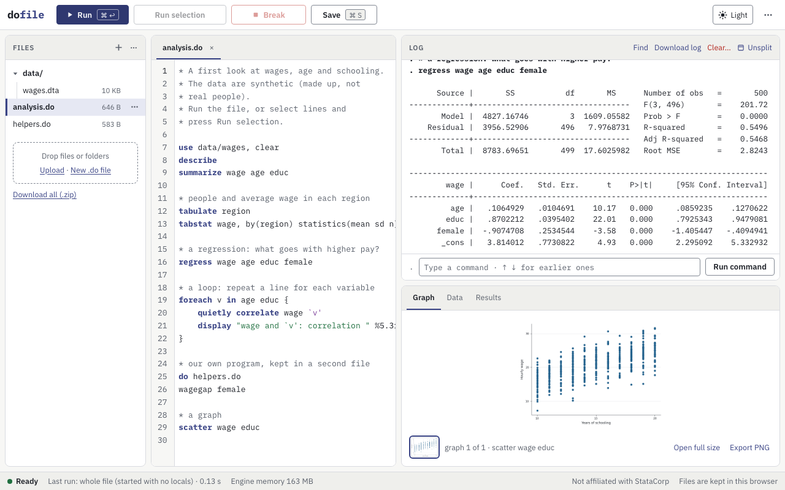
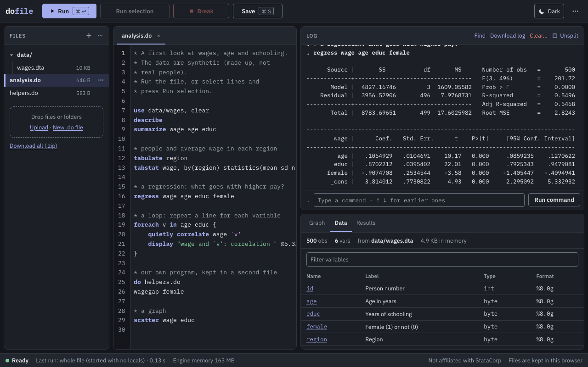
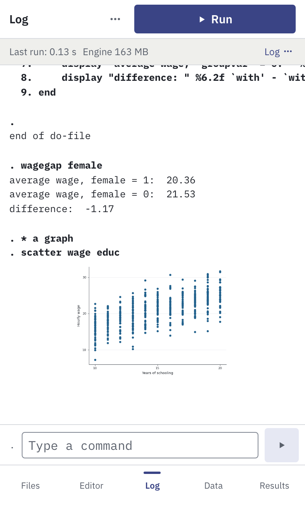

<p align="center">
  <picture>
    <source media="(prefers-color-scheme: dark)" srcset="https://raw.githubusercontent.com/jeffzyliu/dofile/main/docs/images/logo-dark.svg">
    
  </picture>
</p>

<p align="center">
  Run Stata-syntax <code>.do</code> files without a Stata license: in your browser, on the command line, or from an AI
  agent over MCP. The browser editor needs no install and no account: the engine runs inside the page, on your own
  computer.
</p>

<p align="center">
  <b>Try it in your browser: <a href="https://app.dofile.dev/">app.dofile.dev</a></b> · About:
  <a href="https://dofile.dev/">dofile.dev</a>
</p>

<p align="center">
  <a href="https://github.com/jeffzyliu/dofile/actions/workflows/ci.yml"></a>
  <a href="https://pypi.org/project/dofile/"></a>
  <a href="https://github.com/jeffzyliu/dofile/blob/main/LICENSE"></a>
</p>



- **In the browser:** open the editor at [app.dofile.dev](https://app.dofile.dev/). No account and no server: the engine
  runs inside the page, on your own computer, and the files you open stay in that browser. The first visit downloads the
  engine once (Python compiled to WebAssembly); it opens with a sample project, or bring your own do-files and data.
  The landing page and the list of supported commands are at [dofile.dev](https://dofile.dev/).
- **On the command line:** `dofile run analysis.do` prints the log as `stata -b` would, sandboxed.
- **For AI agents:** `dofile-mcp` is an MCP server, so an agent such as Claude Code runs do-files and reads `e()` and `r()`
  as JSON instead of guessing numbers.

**Under the hood:**

- The Python engine runs in the browser on Pyodide (CPython compiled to WebAssembly), in a Web Worker. The page starts
  from a Pyodide memory snapshot with the engine already imported, keeps the files in IndexedDB, and stops a running
  do-file between commands (Break) through Pyodide's interrupt buffer, which needs the cross-origin-isolated page it is
  served as.
- An MCP server (stdio and HTTP) so an AI agent runs do-files and reads `e()` and `r()` as JSON: one worker process per
  session, forked (on Linux and macOS) from a server that has the engine preloaded, with timeouts and cancels as
  Stata's Break.
- A sandbox for code it did not write: dangerous commands are disabled, and a PEP 578 audit hook blocks subprocesses
  and the network, confines writes to the working folder and reads to the folders it is given.
- Tested against reference results: a corpus of do-files checked against statsmodels and linearmodels to 1e-6, and the
  engine's own cases compared with Stata 14 logs: on Python in every CI run, and in the browser engine whenever the
  engine changes.

| Dark theme, Data view | On a phone |
| --- | --- |
|  |  |

The interpreter is [OpenDTA](https://github.com/yaskepalhares/opendta) (MIT), by its own authors. It reads and writes
`.dta` files, fits the common estimators and draws graphs; not every Stata command exists yet (the list is on
[dofile.dev/commands](https://dofile.dev/commands/), or the `dofile://commands` MCP resource). dofile adds the sandbox,
the web editor, the command line and the MCP server.

Status: alpha (0.1.x). Emulates Stata 14. The screenshots use the editor's sample project, whose data are synthetic.

## Project structure

- [`src/dofile/`](https://github.com/jeffzyliu/dofile/tree/main/src/dofile): the `dofile` Python package, with the CLI
  (`cli.py`) and the MCP server (`mcp_server.py`), at the repository root (`pyproject.toml`).
- [`src/dofile/_vendor/opendta/`](https://github.com/jeffzyliu/dofile/tree/main/src/dofile/_vendor/opendta): the
  vendored OpenDTA engine.
- [`web/`](https://github.com/jeffzyliu/dofile/tree/main/web): the web editor and the dofile.dev pages. Development and
  architecture: [web/README.md](https://github.com/jeffzyliu/dofile/blob/main/web/README.md).
- [`plugins/`](https://github.com/jeffzyliu/dofile/tree/main/plugins): the Claude Code plugin (`dofile-log`).
- [`docs/`](https://github.com/jeffzyliu/dofile/tree/main/docs): plans, design and notes.

## Install

Only pre-releases so far, so pip needs `--pre`. Python 3.12 or newer.

```bash
pip install --pre dofile            # the dofile command
pip install --pre "dofile[mcp]"     # adds the dofile-mcp server
```

From a source checkout: `uv sync --extra mcp`, then `uv run dofile ...` or `uv run dofile-mcp ...`.

## Command line

```bash
dofile run analysis.do --json results.json
```

Prints the log like `stata -b` and exits 1 if the do-file stops on an error. `--json` also writes
`{rc, error, error_command, results, versions}`; `results` holds `e()` and `r()` in the MCP server's form
([MCP-SCHEMA.md](https://github.com/jeffzyliu/dofile/blob/main/MCP-SCHEMA.md)). The sandbox (below) is on: code writes
only to the working folder (the current one, or `--workdir`) and reads from it, from the do-file's own folder (so nested
`do` files work) and from any `--read-dir` folders. `--unsafe` turns the sandbox off for trusted code that needs `shell`,
`cd` or `erase`.

## MCP server

Add it to Claude Code (stdio; the session works in the folder you launch it from):

```bash
claude mcp add dofile -- dofile-mcp --workdir "$PWD"
```

From a source checkout: `claude mcp add dofile -- uv run --directory /path/to/dofile --extra mcp dofile-mcp --workdir "$PWD"`.

**Tools:** `run_do` (run Stata code; returns the log, rc, error, `e()`/`r()` as JSON and new files), `describe_data`,
`get_file` (exported graphs as images, logs and CSVs as text in pages), `get_matrix` (one matrix, or part of it, at full
precision), `upload_file`, `start_session`, `request_upload` and `request_download` (HTTP), `reset`. **Resources:**
`dofile://commands` (the supported commands) and `dofile://about` (the versions). Data stays in memory between `run_do`
calls. Every input, output and return code: [MCP-SCHEMA.md](https://github.com/jeffzyliu/dofile/blob/main/MCP-SCHEMA.md).

**HTTP:** `dofile-mcp --http --port 8000` (localhost only by default). Call `start_session` first and pass its token as
`session`; each session gets its own temporary folder, deleted when the session ends.

**Large files** never need to pass through the model's context:

- stdio: start with `--read-dir /path/to/data`. The folders are listed in the server's instructions, and code reads files
  in place by absolute path (`use "/path/to/data/file.dta"`). They are read-only; output goes to the working folder.
- HTTP: the agent calls `request_upload(name, session)`, gets a one-time URL (valid 10 minutes) and sends the file
  itself, e.g. `curl --fail -T file.dta <url>`. Behind a proxy or in a container, set `--public-url` to the address
  clients reach the server at. (`--read-dir` here means folders on the server.)

`--file-limit` sets the largest upload in MB (default 1024). Small files the agent writes itself (CSV, .do) go inline with
`upload_file(name, text=...)`. An upload never overwrites an existing file unless the agent passes `replace=true`, as with
Stata's `save, replace`: over stdio the working folder is your own.

**Sandbox (on by default; `--unsafe` turns it off):** `shell`/`!`, `erase`/`rm`, `rmdir`, `mkdir`, `cd`, `copy` and
`webuse` are disabled. Files can only be written in the working folder, and read from it, from `--read-dir` folders and
from the Python installation. No subprocesses or network. Each call has a timeout (`--timeout`, default 60 s); a call that
runs too long or is cancelled is interrupted like Stata's Break key (rc 1, data kept), and only code that does not stop,
or a crash, resets that session (rc 9998). The sandbox is a policy layer, not a security boundary: run public HTTP
deployments in a container.

### Claude Code plugin: readable logs

Claude Code shows an MCP result as JSON, so a log is one string full of `\n`. The optional `dofile-log` plugin prints each
`run_do` log in the terminal under the call, colored and between two rules, and keeps it out of the model's context. It
needs `jq` and works with stdio and HTTP. Long runs show the cut `log` from the result; the bar names the `log_file` that
holds the full text.

```
/plugin marketplace add jeffzyliu/dofile
/plugin install dofile-log@dofile
```

Source: [plugins/dofile-log](https://github.com/jeffzyliu/dofile/tree/main/plugins/dofile-log).

## Development

Python (3.14 for development per `.python-version`; CI tests 3.12 to 3.14 on Ubuntu and macOS):

```bash
uv sync --extra mcp
uv run poe               # list the tasks
uv run poe test          # in parallel, ~35 s; skips the slow Stata 14 log comparison
uv run poe test tests    # dofile's own tests only, without OpenDTA's suite in tests_opendta/
uv run poe slow          # the Stata 14 log comparison (~75 s)
uv run poe ci            # every test, as CI runs them
uv run poe lint          # ruff format --check, then ruff check, as CI runs them
uv run poe format        # ruff format (never the vendored engine)
```

- `tests/`: dofile's own tests. `tests/conformance/` is a corpus of `.do` files checked against reference values from
  statsmodels/linearmodels, plus breadth probes; known engine gaps are strict xfails, so a fix in OpenDTA shows up as a
  failure to remove. `tests_opendta/`: OpenDTA's own suite and its Stata 14 reference logs, regenerated by the vendor
  script. The map of the whole suite: [docs/test-map.md](https://github.com/jeffzyliu/dofile/blob/main/docs/test-map.md).
- In a new clone, run `git config blame.ignoreRevsFile .git-blame-ignore-revs` once, so `git blame` skips the reformat
  commits.
- CI: `.github/workflows/ci.yml` (the Python tests and ruff), `web.yml` (the web editor) and `lint.yml` (actionlint over
  the workflows).
- Check the local MCP server with the [MCP Inspector](https://github.com/modelcontextprotocol/inspector) (needs Node):

  ```bash
  npx @modelcontextprotocol/inspector uv run --extra mcp dofile-mcp        # web UI: list tools, call run_do
  npx @modelcontextprotocol/inspector --cli uv run --extra mcp dofile-mcp --method tools/call \
    --tool-name run_do --tool-arg 'code=display 2+2'                       # scripted check
  ```

  For HTTP, start `uv run --extra mcp dofile-mcp --http` and connect the Inspector to `http://127.0.0.1:8000/mcp`
  (call `start_session` first).
- Releasing to PyPI: [docs/releasing.md](https://github.com/jeffzyliu/dofile/blob/main/docs/releasing.md).

**The engine** is a vendored copy of OpenDTA, pinned in `src/dofile/_vendor/opendta/VENDORED`, and is never edited by
hand. dofile's changes to it are patch files in
[`scripts/patches/`](https://github.com/jeffzyliu/dofile/tree/main/scripts/patches) (`r(table)` after estimation, and
fixes for the engine bugs in
[docs/opendta-issues.md](https://github.com/jeffzyliu/dofile/blob/main/docs/opendta-issues.md)). `uv run poe vendor
[COMMIT]` (`scripts/vendor_opendta.py`) copies an upstream commit and re-applies the patches; run the full suite after
it.

**The web editor** (Pyodide, the page, its tests and the two Cloudflare Workers) has its own setup and scripts:
[web/README.md](https://github.com/jeffzyliu/dofile/blob/main/web/README.md).

## License

MIT ([LICENSE](https://github.com/jeffzyliu/dofile/blob/main/LICENSE)). Contributions follow the clean-room and license
rules in [LICENSE-POLICY.md](https://github.com/jeffzyliu/dofile/blob/main/LICENSE-POLICY.md): no StataCorp files or
text, no GPL code. Not affiliated with StataCorp; Stata is a registered trademark of StataCorp LLC.
