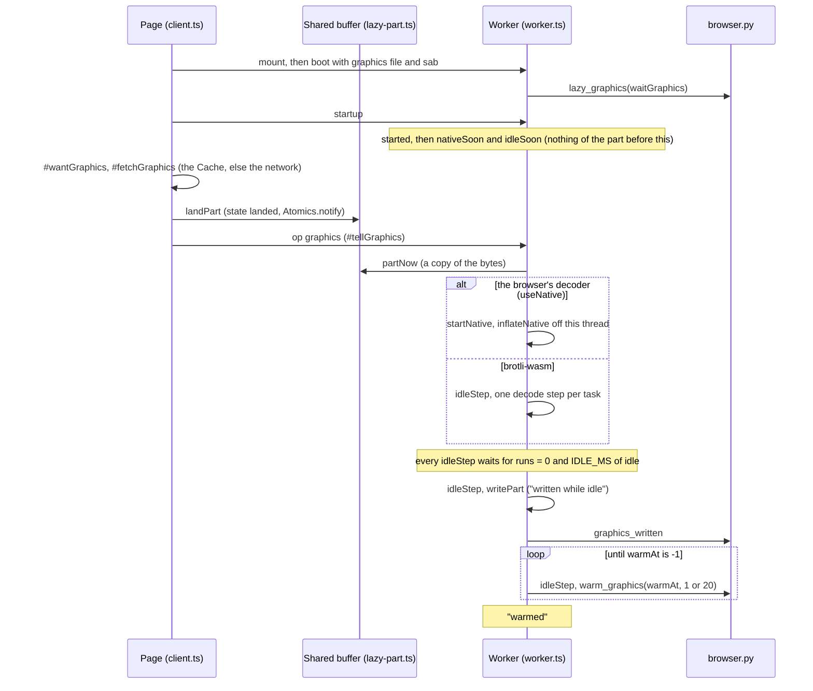
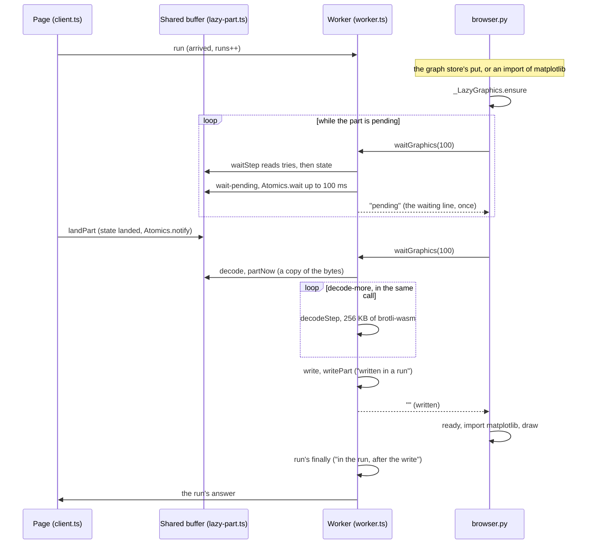
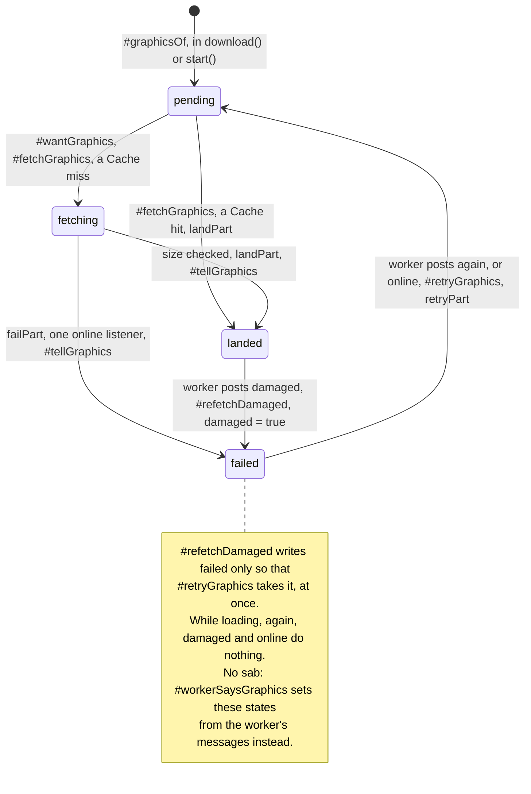
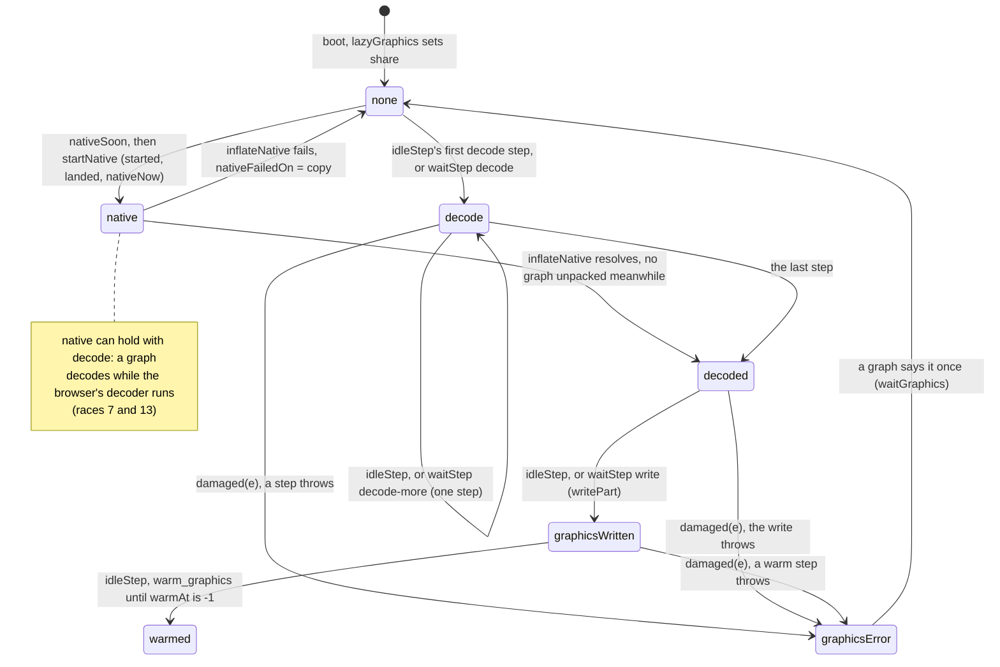
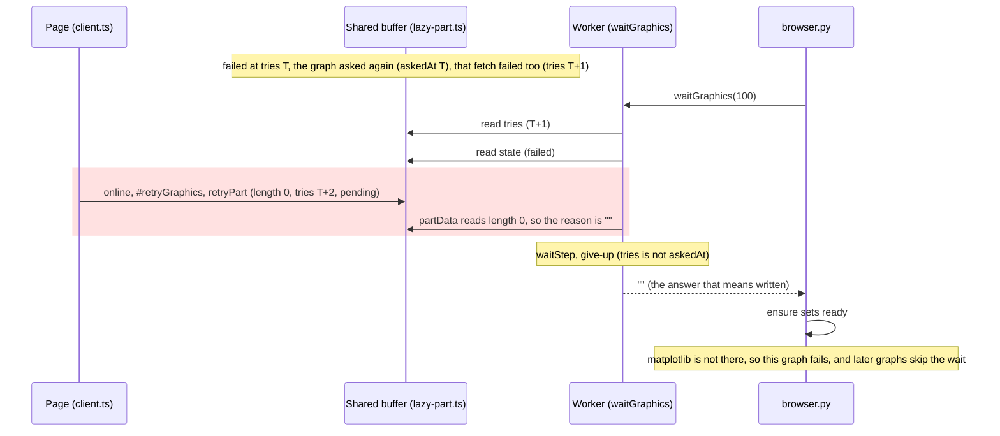

# Lazy graphics on both threads

The R1 note of the web audit (`docs/web-audit-plan.md`, section 6). It states how the lazy snapshot's graphics part
(matplotlib in a file fetched after the start, `docs/lazy-matplotlib.md`) moves between the page and the worker today,
and proposes how R1 makes it one machine. It changes no code. **Status: proposed 2026-11-23, for the maintainer's
approval;** section 6's seqlock and its path without cross-origin isolation (no lazy part) were decided the same day.
Read from the code at e496b4c. Paths are under `web/src/engine/` unless they start with `web/`, `src/` or `docs/`.
"Guess" marks what was not checked.

## Primer: the pieces, in plain words

For a reader new to Web Workers, Pyodide, `SharedArrayBuffer` and `Atomics`. The sections after it assume it.

**Why Python runs in a worker.** The engine is Python, run in the browser by **Pyodide** (CPython compiled to
WebAssembly, the browser's portable machine code). A page has one main thread that also draws the page and answers
clicks; Python running there would freeze the page for the length of a run. So it runs in a **Web Worker**: a second
thread with its own memory, which talks to the page only by **messages** (`postMessage`; each message arrives as a
**task**, one unit of work a thread's event loop runs, never in the middle of another task). A run is one long task in
the worker: while Python runs, the worker reads no messages.

**Why matplotlib is a separate part.** The page starts from a **snapshot** (Python's memory saved at build time, so a
start skips the imports). matplotlib and the packages only it needs are left out of it and put in one more file, the
**graphics part**: about 7.7 MB compressed with brotli (a compression format), 32.9 MB and 1,822 files unpacked
(`docs/lazy-matplotlib.md`, 2026-11-15). The visitor downloads about 33.9 MB before the engine is ready instead of
41.6 MB, and only a program that draws a graph needs the rest.

**The flow.** Once the start files are in, the page fetches the part (from the browser's **Cache**, its offline store
for files, or else the network) and hands it to the worker. When the engine has been **idle** (no run sent or running)
for 0.25 s, the worker unpacks it, writes its files into Python's file system and imports the first modules, one short
step at a time, so that a run sent meanwhile waits for one step at most. Where the browser has its own brotli decoder,
the unpack starts as soon as the part is handed over and runs off the worker's thread; only the write and the imports
wait for idle. A graph that comes before that is done waits for the part inside its run, and unpacks and writes it
there. Section 1 has both threads' tables, and the pictures below show both paths.

**The shared buffer.** A message cannot reach a graph that waits inside a run: the worker is busy in Python and reads
none. So the page hands the part over in a **`SharedArrayBuffer`**, memory that both threads see at the same time. The
page posts it to the worker once, in `boot`'s arguments; posting a `SharedArrayBuffer` shares the memory, it does not
copy it. Its size is 16 + the part's size: a 16-byte header of four 32-bit numbers (the part's state: pending, landed or
failed; the length of what follows; `tries`, how many times the page has fetched it again, 0 after the first fetch; one
unused today, which section 6 makes a sequence counter), then the part's bytes (or, when the fetch failed, the reason as
text). The page writes it; the worker reads it (with section 6's counter it also does one `Atomics.add` of 0, which
writes back the value it read). A buffer is only available when the site is **cross-origin isolated**: served over https
(or from localhost) with two HTTP headers, COOP and COEP, that keep other sites' windows out and let the page load only
what other sites allow. Production and the dev server send them, so plain http to a LAN address has no buffer.

**`Atomics`, the operations on shared memory.** Plain reads and writes of shared memory can be seen by the other thread
late or out of order, and data longer than one number can be seen half written. `Atomics` calls on one 32-bit number
cannot be:
- `Atomics.load` reads the number whole, and the thread then also sees every write the other thread made before its
  `Atomics.store` of the value read ("write the data, then publish the state" relies on this);
- `Atomics.store` writes it whole, and publishes the writes made before it;
- `Atomics.add` reads the number, adds to it and writes it back in one step (a **read-modify-write**), so two adds never
  lose one;
- `Atomics.wait` checks that the number still has a given value and, if so, sleeps until another thread calls
  `Atomics.notify` on it or a time limit passes (it does not watch the number: a change without a notify does not wake
  it);
- `Atomics.notify` wakes the threads waiting on it.

What they do not give: two loads are two moments, not one snapshot (between them the other thread may change anything);
several stores are not one step (a reader can see the first without the next); a plain read placed before an
`Atomics.load` may still take its value after it (section 6); and the page's main thread may not call `Atomics.wait` at
all (a browser refuses to block it). The page hears the worker only by messages; the worker never changes the part's
buffer, so there is nothing there for the page to watch.

**Without a buffer** (plain http on a LAN address, say), the worker today fetches the part itself once the engine is
ready, and a graph that comes first downloads it with a request that blocks the worker until it ends. Its messages tell
the page how the download goes, for the progress ring. There is no **Break** then either (Break stops a run at its next
safe point; it uses a second, 4-byte shared buffer), so a stuck run resets the worker. **Decided** (the maintainer,
2026-11-23, section 6): without a buffer the part is not lazy at all. The worker loads it with the start files, before
"ready", and writes it at `boot`, so no graph ever waits for it; "lazy" then always means "with a shared buffer". R1b
removes today's path without a buffer.

**Where it goes wrong: a race**, when the result depends on which thread gets somewhere first. Race 3 is the worked
example. A graph has asked the page for one more fetch, and that fetch failed, so the buffer says "failed" with its
reason. The graph reads the state (failed), and is about to read the reason's length. Just then the browser comes back
online, and the page starts another fetch: it sets the length to 0 first, then counts a try, then sets the state to
pending. The graph reads length 0: the reason is "" (empty). But "" is also the worker's answer for "the files are
written", so Python stops waiting, the graph fails on the missing matplotlib, and later graphs no longer wait. Each of
the page's steps was atomic, and the graph's length read is a plain one; the trouble is that the graph's three reads
were not one snapshot and the page's three writes were not one step. Section 6 gives the fix the maintainer chose: a
**seqlock**, a counter the page moves around every write so that the graph can tell a write overlapped its reads.
Section 7 lists every race found.

## In pictures: the normal path, with a shared buffer

The page fetches the part and hands it over; the engine is idle, so the worker unpacks, writes and imports it:

A graph that comes before the part is written waits for it, and unpacks and writes it in the run:

## 1. The two halves

**Page** (`client.ts`, the section "a lazy snapshot's graphics part"): one `GraphicsPart` per build for the page's life
(`#graphicsOf`), so a restarted worker gets the same one. Its state is spread over `progress.state` (also what the
status bar shows, through `onGraphics`), `loading` (a fetch on its way) and `damaged`. Writers of the shared buffer:
`landPart`, `failPart`, `retryPart` (`lazy-part.ts`).

| Event | Guard | Effect |
|---|---|---|
| `download()` (its Cache open); `start()` | | `#graphicsOf`: the part, pending; `sab` = `SharedArrayBuffer(PART_HEADER + size)` or null |
| `download()`'s start files are in; `start()`'s `started` | `sab`, not `loading`, not landed or failed | `#wantGraphics`: `#fetchGraphics` |
| `#fetchGraphics` | | the Cache (deleted first when fresh), else `#downloadGraphics` (`no-cache`; fresh: `reload`), kept in the Cache only beside the heap; size checked; `landPart` or `failPart` + one `online` listener; then `#tellGraphics` |
| worker posts `again` | sab; current part; failed; not `loading` | `#retryGraphics`: `retryPart` (tries + 1, pending), `#tellGraphics`, `#fetchGraphics(part, damaged)` |
| worker posts `damaged` | sab; current part; landed; not `loading` | `#refetchDamaged`: writes `progress.state = "failed"` so that `#retryGraphics` takes it, `damaged = true` |
| `online` | as `again` | `#retryGraphics` |
| no sab: worker posts `fetching`, `progress`, `landed`, `failed`, `damaged` | | `#workerSaysGraphics`: progress only (`damaged` becomes pending); `start()` resets it to pending for a new worker |

`#tellGraphics` sends the op `graphics` (no args, answered outside the queue) to the live worker, if any: it tells
the worker to look at the header, nothing more. It is sent only when there is a buffer.

The page's part, as `progress.state` (the flags `loading` and `damaged` beside it):

**Worker** (`worker.ts`, the section "a lazy snapshot's graphics part", lines 56 to 425). Pure decisions are already in
`lazy-part.ts`: `waitStep` (a waiting graph) and `useNative`; the rest decides inline.

| Event | Guard (spelled where) | Effect |
|---|---|---|
| `boot`: `startEngine` calls the hook `lazyGraphics` (`worker-boot.ts`) | build has a part | `share` set; the engine's `lazy_graphics(waitGraphics)` (`src/dofile/browser.py`) |
| `startup` answered | | `started`, `idleSince`; no sab: `prefetch` in a task; `nativeSoon`; `idleSoon` |
| op `graphics` | | `nativeSoon`; `idleSoon` |
| run arrives (dispatch hook `arrived`) | | `runs++` (stops the idle steps at once, before the queue reaches the run) |
| run starts | | `askedAt = null` |
| run ends (`finally`) | | the "in the run, after the write" line; `runs--`, `idleSince`; `nativeSoon`; `idleSoon` |
| `nativeSoon` | started; part; none of native, decode, decoded, written, error (line 352); `nativeNow()` | `startNative` in a task |
| `startNative` | the same flags again (358); landed; brotli-sized | `native`; `inflateNative`: keeps the result unless a graph unpacked meanwhile; failure: `nativeFailedOn = copy`; then `idleSoon(0)` |
| `idleSoon` | started; part; no timer; not native; no error; not (written and warmed) (387) | timer to `idleSince + IDLE_MS` |
| `idleStep` | `runs === 0`; idle `IDLE_MS` | one of: write (`decoded`; then `browser.graphics_written`), one decode step, start native (`nativeNow()` again, 408), first decode step, one `warm_graphics` step; a throw: `damaged`; else `idleSoon(0)` |
| a graph: `browser.py`'s `_LazyGraphics.ensure` calls `waitGraphics(100)` in a loop | written: ""; `graphicsError`: said once | `waitStep` decides: break, write, decode(-more), say-fetching, fetch (`fetchPartNow`), ask-again (`again`, wait), give-up, wait-failed, wait-pending (`Atomics.wait` on the header); a throw: `damaged` |
| no sab: `prefetch` lands or fails | not aborted, not here, not written | `share.bytes`, `copies++`; posts `landed` (or `failed`); `nativeSoon`, `idleSoon` |
| `damaged(e)` | | `graphicsError`; decode dropped; no sab: bytes dropped, `fresh`; posts `damaged` |

The rows and effects marked "no sab" (and `prefetch`, `fetchPartNow`) go with section 6's decision on the path
without cross-origin isolation.

The unpack is one state written as four flags: none, `native`, `decode` (brotli-wasm under way), `decoded` (not
written), `graphicsWritten`, then warmed (`warmAt < 0`); `graphicsError` stops all idle work. Two can hold at once:
`native` with `decode` (a graph decodes while the browser's decoder runs; its result is then dropped, unless the
graph found the copy damaged: race 13).

The worker's unpack, as that one state (the table's events on its edges):

**Mirrors? No: the page's machine is much smaller.** Today the page's part has 4 states (pending, fetching, landed,
failed), two flags beside them (`loading`, `damaged`), 7 event rows and 7 transitions; the worker's has 7 unpack states
(none, native, decode, decoded, graphicsWritten, warmed, graphicsError), 13 event rows and 13 transitions, plus the idle
clock and a waiting graph's 10 steps (`waitStep`). Proposed (R1; the counts are a guess until it is built): the page
keeps its 4 states, with `damaged` as the argument of a retry rather than a flag, and about 6 events (want, landed,
failed, again, damaged, online); the worker keeps its 7 states as one field of its record, and about 9 events (startup,
the op `graphics`, run arrives, run ends, idle step, native done, native failed, a graph's wait, damage; today's own
fetch landed and failed go with the path without a buffer). They own different things: the page owns the download, the
Cache, the copy number (`tries`) and the progress the status bar shows; the worker owns everything after the bytes
arrive (unpack, write into Python's files, warm-up, the idle clock, the waiting graph). What they share is the buffer's
fields (its three states `PART_PENDING`, `PART_LANDED`, `PART_FAILED`, the length, `tries` and the bytes or reason),
nothing else. The page's names pending, landed and failed match the buffer's; its fetching is not in the buffer; the
worker's names match neither. Today, without a buffer, the page's machine shrinks to a display of the worker's messages
(`#workerSaysGraphics`); after section 6's decision there is no lazy part then, so no machine on either side.

## 2. The 22 variables as one record

All at `worker.ts:70-97`, one `let` each. S8 moved none of them. It moved what surrounds them: the boot work into
`worker-boot.ts` (`startEngine`, which calls back through the hook `lazyGraphics` that `table`'s `boot` entry defines;
`since` went there too), and the dispatch into `worker-dispatch.ts`, whose hook `arrived` now counts `runs`. Eight are
written by `table`'s handlers, so R1b's record is called from each of them: `snapshotBase` and `brotliWasm` (mount),
`share` (boot, in the hook `lazyGraphics`), `started` and `idleSince` (startup), `runs` (run's `arrived`, then its
`finally`), `askedAt` (run's start), `idleSince` and `writtenInRun` again (run's `finally`).

| Group | Today | Proposed field (names R1's to choose) |
|---|---|---|
| given at start | `share`, `snapshotBase`, `brotliWasm`, `started` | `part` (`{file, hdr, sab, bytes}`), `base`, `wasm`, `started` |
| idle clock | `runs`, `idleSince`, `idleTimer` | `runs`, `idleSince`, `timer` |
| unpack | `decode`, `native`, `decoded`, `graphicsWritten`, `warmAt`, `tWarm`, `warmLongest` | one `unpack` state (none, native, decoding, decoded, written, warming, warmed) with its data |
| copies and damage | `copies`, `nativeFailedOn`, `fresh`, `graphicsError` | `nativeFailedOn`, `error` (`copies` and `fresh` serve only the path without a buffer, which goes: section 6) |
| this run | `askedAt`, `fetchSaid`, `writtenInRun` | `run: {askedAt, writtenAt}` (`fetchSaid` goes with that path) |
| own fetch (no sab) | `prefetching` | none (goes with that path) |

Read but owned elsewhere (they stay): `interrupt` (boot), `brotliMode` (mount), `py`, `browser`. Dead today:
`share.error` is never set to a reason (only cleared, `fetchPartNow`), so `partNow`'s failed branch without a buffer
cannot be reached; it goes with that path. Names the naming survey gives R1: `askedAt` (the tries when this run asked
again), `at` in `fetchPartNow` (a URL), `damaged(e)` (a verb's job: it drops the copy; not the field `damaged` of
`GraphicsPart` in `client.ts`).

## 3. What stays a side effect

Pure, and testable as tables: what a waiting graph does (`waitStep`), whether to decode natively (`useNative`), and,
new in R1, what an idle step does and whether native may start (one predicate for lines 352, 358, 387 and 408), and the
page's transitions (fetch, retry, refetch-damaged, worker's message). Side effects, kept at the edge: `setTimeout`,
`postMessage` and the console lines, `Atomics.wait` and the header writes, `fetch` and the synchronous
`XMLHttpRequest`, `inflateNative`, `unpackSteps`, `writeGraphics`, `browser.graphics_written` and `warm_graphics`,
the Cache, the `online` listener, and the clock (passed in, as `machine.ts` does).

**Wire and words that stay unchanged** (they are read by e2e and by the page): the op `graphics` and `queued: false`;
the `{graphics: ...}` messages (`types.ts`, `FromWorker`); `waitGraphics`'s answers ("", "break", "pending", a
reason); the console lines `[dofile] graphics part: landed (cache|network)`, `written in a run`, `written while idle`,
`warmed`, `fetched by the worker`, `fetched by the worker in a run`, `in the run, after the write`,
`native brotli failed`, `the worker's own fetch was still on its way`, `the worker's fetch failed`; and
`browser.py`'s "(waiting for the graphics files to download)". Except what section 6's decision removes with the
path without a buffer: the `{graphics}` messages `fetching`, `progress`, `landed` and `failed` (and `damaged`'s
meaning there), and the console lines `fetched by the worker`, `fetched by the worker in a run`, `the worker's own
fetch was still on its way` and `the worker's fetch failed`; R1b says so where e2e reads them.

## 4. Driving a lazy part through the real worker under Node

**It already runs, unasserted.** `npm run snapshot` builds a lazy snapshot by default (`SNAPSHOT_NO_MPL` unset), and
`test/engine.test.ts`, "engine from a memory snapshot", then starts the real `worker.ts` (Node worker thread,
`test/harness.ts`) through `EngineClient` with a `SharedArrayBuffer`. The page half reads the part's `file:` URL with
`fs` (`#downloadGraphics`), lands it, and the test's `scatter` waits for it. Tried at e496b4c (snapshot at
`SNAPSHOT_QUALITY=5`): the run logs "landed (network)", "written in a run (unpack (wasm) ...)", "in the run, after the
write". A scratch test (not committed) that waited 4 s before its graph got "written while idle (unpack (native) ...)"
and "warmed": Node 26 has `DecompressionStream("brotli")`, so the native path and the idle steps run too. Nothing
asserts any of it, and the lines go to the process's stdout, not to the test.

**Without a buffer it cannot run as is.** Tried: with `SharedArrayBuffer` removed from the test's thread, the worker
thread died at `startup` ("Cannot read properties of undefined (reading 'href')"): `prefetch` reads `self.location.href`
outside its `try`, and its rejection is unhandled. Node also has no `XMLHttpRequest` (`fetchPartNow`) and its `fetch`
refuses `file:` URLs. `test/node-worker.ts` would need stand-ins for all three (guess: a few lines, the synchronous
request on `readFileSync`). After section 6's decision none of the three remains: without a buffer the worker loads
the part with the start files, through `fetchBytes` (`worker-boot.ts`), which already reads a `file:` URL with
`fs`, so a test without a buffer needs no stand-in (guess: not tried).

**What a held or damaged part needs.** The page's fetch of a `file:` URL bypasses the client's `fetch` option, so a test
cannot hold it (the e2e spec holds it with a route). A damaged copy can be had by pointing the snapshot folder's
`graphics.brotli.bin` at bad bytes, then good ones (guess: the test's own folder of symlinks, as engine.test.ts makes).

## 5. The iOS limit

`vite.config.ts` builds the worker as one file (`inlineDynamicImports`): a chunk importing the worker's entry made iOS
Safari run the entry twice, and the second copy took every later message. So R1's code goes into modules that
`worker.ts` imports statically (as `lazy-part.ts`, `worker-boot.ts`, `worker-dispatch.ts` are), never into a chunk
or a second worker of its own. This also rules out, for R1, the "decode on another thread" idea in lazy-matplotlib.md.

## 6. The shared state

**What is shared.** A `SharedArrayBuffer` is memory both threads see at once; `Atomics` are the operations on it that
each happen in one indivisible step, in one order both threads agree on. One rule makes a hand-over safe: data written
with plain writes before an `Atomics.store` is seen by a thread whose `Atomics.load` sees that store ("write, then
publish"). The part's buffer (`lazy-part.ts`) is an Int32 header of `PART_HEADER` (16) bytes, then the bytes:

| Field | Written by (page, `client.ts`) | Read by (worker, `worker.ts`) |
|---|---|---|
| state (`HDR_STATE`) | `landPart`, `failPart`, `retryPart`: `Atomics.store`, then `Atomics.notify` | `partState` (`Atomics.load`) in `partNow`; `waitPartChange` (`Atomics.wait`) |
| length (`HDR_LENGTH`) | the same three: `Atomics.store` | `partData`: a plain read |
| tries (`HDR_TRIES`) | `retryPart`: `Atomics.add` | `partTries` (`Atomics.load`): `waitGraphics`'s `read()`, `copyNow` |
| the fourth Int32 | nobody (always 0; R1b: the sequence counter, below) | nobody |
| bytes, from `PART_HEADER` | `landPart` (the part), `failPart` (the reason): plain writes | `partData`: a plain copy (`slice`) |

The interrupt buffer is separate (4 bytes, one Int32, made in `client.ts`'s `start()`): the page stores 2 (SIGINT)
on Break (`interrupt()`) and 0 when it sends a run; Pyodide reads it during a run; `waitGraphics` reads it between
its waits and stores 0 when it takes the Break; `browser.py`'s `keep_breaks` puts a SIGINT back. It is not the part's.

**What is one step today.** Each `Atomics` call is one step; no transition is. `landPart` and `failPart` are four:
the bytes (plain), length, state, notify. `retryPart` is four: length 0, tries + 1, state pending, notify. The worker's
read is four too: tries, state (`partNow`), then length and the bytes (`partData`). It works today by order alone:
the page writes data only while the state is pending, which the worker never copies from, and publishes the state
last. Two places break that order. The worker must load `tries` before `state` (race 1, a rule nothing enforces),
and `retryPart` clears the length while the state still says failed, which is race 3.

**Decision, 2026-11-23.** The maintainer, on how to make every read consistent: "i prefer that we use a more idiomatic
seqlock and have it be called out instead of hiding the parity underneath states that do not look like a counter with a
parity bit". So R1b adds an explicit sequence counter to the header (the design below). The subsections after it say
what a seqlock is, why the counter's second read must be a read-modify-write, and the two designs weighed before the
decision.

### What a seqlock is

A **seqlock** (sequence lock; the Linux kernel's is the textbook one) lets one writer change a block of shared data
while readers copy it, without a lock that either side waits on. It has one shared counter, `seq`, that starts at 0
(even) and only grows:

- The writer adds 1 (now odd: "being written"), writes the data, then adds 1 again (even: "done"). This is the "double
  write".

- A reader reads `seq`. If it is odd, a write is under way: it waits and starts again. Otherwise it copies the data,
  then reads `seq` a second time. If the two reads differ, a write overlapped the copy: it throws the copy away and
  starts again. If they are equal, the copy is whole.

Why each half is needed. With one add per write instead of two, a write can hide between a reader's reads: an add only
at the start lets a reader read the counter just after it, copy while the data is written, and read the same counter
again; an add only at the end lets a reader read before the write starts and again before it ends. The two adds fence
the write on both sides, and the odd value in between is what "being written" looks like. On the reader's side, the
first read refuses a write under way and gives the value to compare; the second read catches a write that started during
the copy. Neither read alone does both.

What makes "equal counts" mean "whole copy" is the writer's rule, not luck: the writer touches the data only between its
two adds. So any write that overlapped the copy moved the counter, and the counter never comes back to a value it had
(it only grows; a 32-bit counter would need two billion writes to wrap). A state cannot serve as the counter for that
reason: a part's state can come back to the same value (failed, pending, failed) while its reason changed.

### The design: a sequence counter in the header

The header's unused fourth Int32 becomes the counter (called `HDR_SEQ` here; R1b names it), so the buffer's size and its
other three fields stay. State and `tries` keep their meanings (the part's state; how many times the page fetched it
again) and carry no parity: "pending" is the part's state while a fetch is on its way, not the odd phase, and a reader
may copy a pending part's header like any other (it has no bytes). The mapping to the textbook is direct:

| The textbook | Here |
|---|---|
| the counter, `seq` | the header's fourth Int32 (today unused, always 0) |
| the one writer | the page's main thread: `landPart`, `failPart`, `retryPart` (`lazy-part.ts`) |
| add 1: odd, being written | each of the three starts with `Atomics.add` of 1 on the counter |
| write the data | its writes to state, length, `tries` and the bytes (or the reason) |
| add 1: even, done | then `Atomics.add` of 1 again, then `Atomics.notify` on the counter |
| the reader | the worker: `partNow`, for `waitGraphics`, `startNative` and `idleStep` |
| read the counter; odd: wait | `Atomics.load` of the counter; odd: answered as pending |
| copy | state, length, `tries`, then the bytes (`partData`) |
| read again; moved: start again | `Atomics.add` of 0 on the counter (next subsection); moved: answered as pending |

The rule R1b adopts:

- Page: every write to the header's state, length or `tries`, or to the bytes, happens inside one write section between
  the two adds, and the section ends with `Atomics.notify` on the counter. The page's three writers are its only write
  sections, and each is synchronous (one task). The writes inside may stay `Atomics.store`; plain writes would do, since
  the counter orders them.

- Worker: `partNow` reads the counter, the state, length, `tries` and the bytes, then re-checks the counter with
  `Atomics.add(hdr, HDR_SEQ, 0)`; it uses them only when the two counts are equal and even. An odd or moved count is
  answered as pending, with the count it read, rather than read again in a loop: every caller already handles pending
  (`waitGraphics` waits, then answers "pending" to Python, which calls again; `startNative` and `idleStep` stop, and the
  op `graphics` that `#tellGraphics` sends after each of the page's write sections brings them back). `tries` comes from
  that same read, for `waitGraphics`'s `read()` and in place of `copyNow`'s separate load where a copy number is paired
  with the bytes (`startNative`).

- A failed part's reason is never empty (`failPart` always has one), so `give-up` never answers "": an empty reason is
  answered as pending. It keeps the one wrong answer that matters ("" means "written") away even from an implementation
  that gets the ordering wrong.

- The worker waits on the counter, not the state: `waitPartChange` becomes `Atomics.wait(hdr, HDR_SEQ, count, ms)` with
  the count it read. It returns at once if the page has written since that read, else when the notify after a write
  section's second add wakes it, or after `ms`. Waiting on the state could sleep through a whole retry that ends in the
  state it started from (failed, pending, failed); a count that only grows cannot.

What it closes: race 3 (a retry during the read moves the counter, so the empty reason is thrown away, and `give-up`
never answers "" anyway), and races 1 and 2 by design, since `tries` and the state come from one read and the order of
their two loads stops mattering. Race 13 is not a buffer race (it is between the worker's own decode and its own damage
finding), so the counter does not touch it, but its fix uses the copy number the same way: `tries` is the copy number,
and a native result is kept only while it is still the copy the decode started from.

Cost: in `lazy-part.ts`, two adds and a notify on the counter in each of the three writers, one reader that returns the
state, `tries`, the bytes and the count together, and `waitPartChange` on the counter; in `worker.ts`, `partNow`,
`waitGraphics`'s `read()` and `startNative`; in `test/part-header.test.ts`, the layout test (the fourth Int32 is the
counter: 0 in a new buffer, 2 higher and even after each write). At run time: one read-modify-write per read, and a
thrown-away copy (up to the part's size, a few MB) on the rare read that meets a write.

### Why the second read is a read-modify-write

The first read: the worker's `Atomics.load` of the counter takes its value from the page's second add, and in
JavaScript's memory model an atomic read that takes its value from an atomic write sees every write the writer made
before that write. So the copy sees the whole write section that ended there ("write, then publish").

The second read must show the opposite: that the copy saw none of the next write section's writes. An `Atomics.load`
does not show it. It orders what comes after it, not the plain reads before it: a plain read written before an
`Atomics.load` in the code may still take its value later, after the page has started its next write section, while the
load returns the old count. The re-check would then pass over a torn copy. On ARM64 (iPhones, Apple-silicon Macs) the
processor itself allows this (V8, in Chrome on Macs and Android, compiles `Atomics.load` to a load-acquire, which does
not hold back earlier reads; every browser on an iPhone runs WebKit's JavaScriptCore instead, whose compiled code was
not checked here, and the language's memory model allows the same reordering in every engine); on x86 it cannot happen,
so a test on a PC would never show it.

A read-modify-write on the same word closes it. `Atomics.add(hdr, HDR_SEQ, 0)` reads the counter and writes the same
value back, in one step. The page's first add is a read-modify-write on that word too, and the steps on one word happen
in one order both threads agree on. Either the worker's add comes first: the page's add then reads the value the
worker's add wrote, and the memory model makes everything the worker did before its add (the copy) happen before
everything the page does after its add (the next write section), so the copy cannot have seen those writes. Or the
page's add comes first: the worker's add then returns a different count, and the copy is thrown away. On ARM64 the
read-modify-write ends with a store-release, which waits for the earlier reads. The worker's add writes the value it
read, in the same indivisible step, so it never loses a page's add; only the page changes the count.

This is reasoned, not proven by a tool: from ECMA-262's memory model (happens-before, synchronizes-with, and the rule
that a read cannot see a write that happens after it) and ARMv8's acquire and release. No mechanised model (such as
herd) was run, and a Node test cannot show a torn read (x86, and one interleaving of whole steps at a time). The problem
and this fix are the ones Hans-J. Boehm describes for C++ seqlocks ("Can Seqlocks Get Along With Programming Language
Memory Models?", MSPC 2012, doi:10.1145/2247684.2247688).

### The designs weighed before the decision

- (a) `tries` as the counter and the state as its parity: `retryPart`'s move to pending is the odd add, `landPart` and
  `failPart` publishing the state last are the even add, and the worker's reads of `tries` and state before and after
  the copy are the reader's two reads (`tries` and not the state alone because of failed, pending, failed). The smallest
  change (no new field), and sound, but only with two orders nothing in the code shows: `retryPart` must store pending
  before it adds to `tries` (with the add first, a reader can load the new `tries` and the old state between the two,
  copy the old reason, and the next `failPart` can rewrite the bytes under it while `tries` stays equal), and both
  before any length or byte write; plus the same read-modify-write re-check, on `tries`. Its parity is hidden in states,
  which is what the decision rejects.

- (b) One Int32 holding the state in its low bits and `tries` in the rest, each change one `Atomics.exchange` (a
  read-modify-write) after the bytes: close to the textbook's single counter, since the word moves with every change and
  the state and `tries` can never disagree. But its odd phase is still the state pending, every reader of the state or
  `tries` decodes the word (a new layout, both threads, the layout test), and the bytes still need the same re-check.

- Chosen: an explicit counter beside the state and `tries`. One field the header already has, two adds per write
  section; every rule is the textbook's, and the state and `tries` mean only what they say.

### How far to lean on the shared state

**Design principle for R1** (the maintainer, 2026-11-23, on whether to lean more on the shared buffer): "given that we
are considering investing in a "grown-up" concurrency system, relying on it more to reduce code duplication and
fragmentation is desirable, but we don't want to increase any fragility or complexity, just rely on existing complexity.
fixing issues by construction is far more desirable than fixing through exhaustive checks or linter rules". Read here
as: R1 uses the buffer, its counter and the copy number (`tries`) wherever they remove a duplicate or make a race
impossible; it adds no second shared region, no second writer per region, and no second transport for one piece of
state.

Each candidate below, with what it removes, what it fixes by construction, and what it adds:

- **The copy number in the page's region, and in the messages that are about a copy.** The region already holds it:
  `tries`, read under the counter with the state and the bytes. The worker's two messages, `again` ("this copy failed,
  fetch another") and `damaged` ("this copy will not unpack"), would name the copy they are about, and the page would
  act only on a message about its current copy. Removes: the page's guards that stand in for "is this message still
  about the copy I have" (`#refetchDamaged`'s "landed, not loading", and its rewrite of `progress.state` to "failed"
  only to steer `#retryGraphics`). Fixes by construction: race 13's second, stale `damaged` (the page would drop a good
  copy), the same stale `damaged` sent twice by two graphs of one run, and a late `again` for a copy already replaced
  (race 4 is today ordered by the guard; with the number it no longer depends on it). Adds: one number in two messages.
  The number travels with the bytes: the brotli-wasm decode (`decode`, `decoded`) and the native result carry the copy
  of the read that produced them, and `damaged` names that copy, never `copyNow()` at the throw (by then a fresh copy
  may have landed, and naming it would drop a good copy). Recommended.
- **The copy number on the worker's own findings.** Not shared state, the same idea inside the worker: `graphicsError`
  (the damage found) and the native decode's result each keep the copy they are about, and are used only while
  `copyNow()` is still that copy. The damaged copy's number is a field of its own, which saying the error does not clear
  (today both paths that say it clear `graphicsError`), so that race 13's native result can still be checked against it.
  Fixes by construction: race 11 (damage found by an idle step no longer blocks a fresh copy that has landed since, and
  the next graph is not told about damage to a copy that is gone) and race 13 (a native result of a copy found damaged
  is not kept). Adds: one field each in the worker's record. Recommended. Race 11's fix changes behaviour. Today the
  next graph reports the damage. With a buffer, the page acts on `damaged` at once (`#refetchDamaged`, then `retryPart`
  moves `tries` within milliseconds, and the Cache entry is deleted first, so the refetch is a download), so damage
  found by an idle step is stale almost at once: the next graph no longer reports it; it waits for the refetch (its
  waiting line, for the download's length) and draws, or reports that fetch's failure. (Today, without a buffer,
  the next graph reports the damage as before; after the decision below there is no lazy part without a buffer.)
  **Decided** (the maintainer, 2026-11-23): "yes, fix race 11"; it is in R1b.
- **A worker region** (a second seqlock region the worker writes: the copy it is working on, its unpack phase, damage
  tagged with a copy number). Removes: in principle the `again` and `damaged` messages. But the page's main thread
  cannot block on `Atomics.wait`, so it would still need a message (a doorbell with no content) or `Atomics.waitAsync`
  to learn that the region changed. Support for `Atomics.waitAsync` in every browser the site serves was not verified
  here (the repository has no compatibility data and nothing was run in a browser), so it could not replace the message
  today without that check. `again` is a request (fetch another copy), not a state, and reads more plainly as a message.
  Fixes by construction: nothing the copy number above does not already fix (races 11 and 13). Adds: a second region, a
  second writer direction (the worker writes shared memory the page reads), a second counter, and a permanent contract
  for each field the page reads. Not recommended for R1. Worth reopening only if the page has to show the worker's own
  progress (say, "unpacking" in the status bar), which it does not today.

- **Replacing `again` and `damaged` by buffer fields.** The same as the worker region, in a smaller form: the page would
  still need a doorbell, so the message stays and only its content moves. Not recommended; the copy number in the
  messages gives the by-construction part.

- **The no-buffer path mirroring the regions over messages.** Without a buffer the worker today downloads the part
  and tells the page by five messages (`fetching`, `progress`, `landed`, `failed`, `damaged`), which
  `#workerSaysGraphics` turns into the same `progress` the page writes itself when there is a buffer. A full mirror (the
  worker posting a copy of a region's fields, with its own counter) would add a second transport for one state, which
  the principle rules out. The small version fits it: the worker's five messages become one message carrying the part's
  record (state, copy number, bytes received, reason), the same record type the page keeps for the buffer path, and
  R1c's derived `progress` reads that record whichever thread filled it. Removes: the five-way switch and the two places
  that build `progress`. Fixes by construction: none of the listed races (race 10, a late message from an ended worker,
  is fixed by dropping messages from a worker that is not `live`, which R1c already plans). Adds: nothing new, one
  message shape instead of five. Recommended, as part of R1c, only if it comes out smaller than the switch it replaces.
  **Overtaken** by the decision below: without a buffer there is no lazy part, so neither the messages nor a record of
  them remain.

- **The op `graphics` (the page's "look at the header" message to the worker).** The worker could watch the counter with
  `Atomics.waitAsync` instead. It would remove the op and its place beside the queue, and fix no race (every page write
  is already followed by the op), and it depends on the same unverified browser support. Not recommended.

- **The interrupt buffer** stays a separate 4-byte buffer: Pyodide reads it directly, and merging it into the part's
  header would tie two contracts together for nothing.

Recommended, with the line the principle draws: R1 keeps one shared region, the page's (the part, its state, length and
copy number under the counter), as decided above. The messages that are about a copy name it, and the worker ties its
own findings to the copy they are about. That uses only what the counter design already has, and settles races 11 and 13
and the stale messages by construction. A worker region is not part of R1. Without a buffer there is no lazy part
(below).

### Without cross-origin isolation, no lazy part

**Decision, 2026-11-23.** The maintainer, on the path without a `SharedArrayBuffer`: "A, eager part without
isolation". Without cross-origin isolation (in practice plain http to a LAN address, such as `npm run dev` opened on a
phone; production is isolated by its `_headers`), the lazy path is not used at all: the worker fetches the graphics
part itself during the start, before "ready", and writes it at `boot`, so no graph ever waits for it mid-run and
nothing needs the buffer. "Lazy" then always means "lazy with a shared buffer".

What goes (R1b): the worker's `prefetch` and `fetchPartNow` (the synchronous request), `fetchSaid`, `copies`, the
worker's `fresh` and its `?fresh=` address, `share.bytes` and `share.error`, `waitStep`'s steps for a part
that is not shared (`say-fetching`, `fetch`, and its `shared` flag), the messages `fetching`, `progress`,
`landed` and `failed` and the meaning of `damaged` without a buffer, `#workerSaysGraphics`'s switch, and
`start()`'s reset of the progress for a new worker (`client.ts`). What comes: one more file in the start's fetches
(`loadFromSnapshot`, `worker-boot.ts`, beside the heap and the bundle, through `fetchBytes`), and its unpack and
write before `boot` answers; whether it is warmed in idle steps then or not at all is R1b's choice (a guess that the
idle steps keep warming it). Guess: `boot`'s `graphics` argument says which way (a `sab` or none), as it does today.

What it costs: without isolation, the start downloads the part too (about 7.7 MB more, `docs/lazy-matplotlib.md`'s
sizes) and unpacks and writes it before "ready". What the start screen shows: over plain http there is no Cache API
(not a secure context), so `download()` returns `cached: false` and the worker downloads every start file
uncounted; the screen shows the stages, not bytes, and the part adds time to the "download" and "unpack" stages, not a
count. A secure origin without isolation (https or localhost without COOP and COEP; a misconfiguration) has a Cache,
and `download()` could count the part as one more start file (its `total` today is `list.download` less the part).
A damaged part then fails the start the way a damaged heap does (`loadFromSnapshot` deletes the file from the Cache
and throws; the next start fetches it again): a guess at R1b's choice, which it states.

What it fixes by construction: races 9, 10 (as it stands, for the download messages) and 14, which exist only on the
path without a buffer (section 7), and the dead `share.error` branch (section 2). Without isolation there is still no
Break, so a stuck run still resets the worker; it only no longer holds a download.

### What stays out of the buffer

**Why the rest of each machine cannot live in the buffer.** A `SharedArrayBuffer` holds numbers and bytes, not objects,
promises or functions. Most of each machine is a resource of its own thread that the other could not use even if it knew
its state: the page's fetch and its reader, the Cache, the `online` listener and the `onGraphics` listeners; the
worker's brotli-wasm decode, the native decode's promise, its timers, Pyodide's files and Python's `ready`. There is no
`SharedArrayBuffer` at all without cross-origin isolation (plain http on a LAN), so the path without one would have to
work by messages; the decision above removes that path instead, and the buffer is the only way to hand the part over.
And the page's main thread may not block on `Atomics.wait` (browsers forbid it), and the worker never changes the part's
buffer, so the page has nothing there to watch: it hears the worker's findings by message (`again`, `damaged`). The
worker reads the buffer because a graph blocked in Python receives no messages. So the buffer carries the hand-over only
(one copy, its state, its number), and each thread keeps its own machine.

## 7. Races between the page and the worker

1. A page retry between a graph's two header loads: `waitGraphics`'s `read()` loads `tries` before `state`
   (`partTries`'s doc), so the retry shows as new tries, not as the new fetch's failure. Ordered by load order.
2. A page retry while `startNative` reads the part: `copyNow()` is read before `partNow()`, so a native failure is
   charged to the copy it read. Ordered by load order.
3. **A page retry while a graph reads a failed part's reason gives a false success.** Not ordered. The state is an
   `Atomics.load` (`partNow`), the length a plain read after it (`partData`), and `retryPart` stores length 0 first. A
   retry between the two (the `online` event's `#retryGraphics`; no fetch needed) makes the reason "". When the graph
   has already asked again and that fetch failed (`give-up`), `waitGraphics` returns that "", which is its answer for
   "written": `browser.py`'s `ensure` sets `ready`. That graph then fails on the missing matplotlib (an import error,
   not rc 199 "graphs are not available"; its rc was not checked), and every later graph skips the wait and fails the
   same way, sending no `again`, until a copy is written while idle (`graphics_written`), which needs a page fetch to
   land; a reload also clears it. Forced with the real `lazy-part.ts` functions (the reviewer's script, re-run here):
   `{"step":"give-up","reason":""}`; `browser.py`'s reading of "" is read, not run. Rating: rare (a few instructions
   wide, and only while the browser goes online during a graph's wait after its asked-for fetch failed), but a wrong
   answer rather than a slow one; no data is lost. **Fixed in R1b, as its first change, test first**: section 6's
   sequence counter, with `give-up` never answering "". The failing test, in `test/lazy-part.test.ts`: a read that meets
   a page write between its two reads of the counter (the test calls `retryPart` between them, where the reviewer's
   script forced it between the state load and the length read) never answers "": it answers pending, or a whole
   non-empty reason; it fails today. A second case: a read that finds the counter odd uses nothing it copied. Both test
   the order of whole steps, not the memory model (section 6, "Why the second read is a read-modify-write").
4. The graph's `again` and the `online` event: both go through `#retryGraphics`, whose guard (failed, not loading)
   starts one fetch; the graph's `askedAt` makes either fetch's failure final for it. Ordered by the guard.
5. The part lands before `startup` is answered: the op `graphics` arrives, `nativeSoon` and `idleSoon` return on
   `!started`, and `startup` calls both. Ordered by `started`.
6. The part lands between two workers (restart): `#tellGraphics` skips an ended or absent worker; the next gets the
   same buffer at boot and reads the header at `startup`. Ordered; not tested (lazy-matplotlib.md: "argued").
7. A graph while the browser's decoder runs: the graph decodes with brotli-wasm; the native result is dropped by
   `!graphicsWritten && !decode && !decoded`. Ordered; costs a second decode.
8. A run arriving during an idle step: `runs++` happens at arrival, `idleStep` returns on `runs > 0`; the step under
   way ends first (one step at most). Ordered by the single thread.
9. No buffer, a graph while `prefetch` streams: `fetchPartNow` aborts it; the aborted fetch posts nothing, and a copy
   that ends late is dropped (line 316). Ordered. **Removed** by section 6's decision (no lazy part without a buffer).
10. No buffer, an ended worker's late `{graphics}` message: `worker.onmessage` hands it to `#workerSaysGraphics`
    without checking `live.ended` (answers to calls go through `live.pending`), after `start()` reset the progress
    to pending. Not ordered. Guess: whether a terminated worker's queued messages are still delivered was not checked.
    **Removed** as it stands by section 6's decision (no download messages remain); the missing `live` check stays in
    R1c for the two messages that remain with a buffer, `again` and `damaged`.
11. Damage found by an idle step, then the fresh copy lands: `graphicsError` blocks `nativeSoon` and `idleSoon`, so the
    fresh copy waits; the next graph reports the damage (rc 199) although a fresh copy is there, the one after it draws.
    As `damaged()`'s comment says. The maintainer's decision, 2026-11-23: "yes, fix race 11". R1b fixes it by
    construction (section 6, "How far to lean on the shared state"): the damage keeps the copy it was found on, so
    damage found on one copy no longer blocks a newer good copy. With a buffer the next graph then waits for the refetch
    and draws (or reports that fetch's failure) instead of reporting the damage. (Without a buffer it reports it as
    today; after section 6's decision there is no lazy part without one.)
12. Each failed page fetch adds one `online` listener (`once`); they pile up until the browser is online, each a no-op
    after the first. Not a race; noted.
13. **A native decode of a copy a graph has already found damaged is written again** (read, not run). The part lands,
    `startNative` starts; a graph comes first (race 7), decodes with brotli-wasm, and `writeGraphics` throws:
    `damaged()` posts `damaged`, clears `decode` and `decoded`, and the graph's catch clears `graphicsError`. The page
    drops the Cache entry and fetches again. After the run the native promise resolves; its guard (`!graphicsWritten &&
    !decode && !decoded`) holds, so the damaged copy becomes `decoded`, the idle step writes it, it throws again, and a
    second `damaged` goes out with `graphicsError` set. If the fresh copy has landed by then, `#refetchDamaged` drops a
    good copy and fetches a third time, and the next graph reports damage (rc 199) although a good copy is there. Not
    ordered. Rare: it needs bytes brotli accepts but the write rejects, and a graph during the native decode. The cause:
    `damaged` and `again` carry no copy number, and the native result is not tied to the copy it read (`startNative`
    keeps `copy` only for a failure); two graphs of one run (a `capture` loop) can send the same stale `damaged` twice
    too. R1b keeps the native result only while `copyNow()` is still the copy it read and no damage was found on that
    copy; R1c makes `damaged` and `again` name the copy (tries) they are about (section 6, "How far to lean on the
    shared state").
14. **Without a buffer, a graph's own download cannot be broken off** (read, not run). There is no interrupt buffer
    (`client.ts`, `start()`), and `fetchPartNow`'s synchronous request holds the worker for the whole download
    (its comment says so). A Break or the run's timeout therefore resets the worker (rc 9998, the data gone); the
    next worker has no copy (`copies` 0, the page's progress set back to pending by `start()`) and starts its
    `prefetch` from zero. Ordered, by the reset; it costs the data and the download. **Removed** by section 6's
    decision: no graph downloads the part; a stuck run without a buffer still resets the worker.

Race 3, drawn: the shaded step is the page's retry between the worker's state load and its length read.

## 8. Tests

**Pinning today, before any line moves:** `e2e/graphics.spec.ts` (7 tests; skipped without a part). It reads the
worker's and page's `[dofile] graphics part` lines (order "landed ... written ... warmed"; "written while idle"; written
once) and times the idle wait: from the run sent at "ready" to the "written while idle" line, less the write and a
brotli-wasm unpack, must exceed 0.15 s. Node: `test/lazy-part.test.ts` (`waitStep`, `useNative`),
`test/part-header.test.ts` (the layout), `test/client.test.ts` (four "graphics part" tests: the page's hand-over,
damage, re-fetch, failure and `online`), `test/worker-dispatch.test.ts` (`graphics` beside the queue),
`test/worker-boot.test.ts` (`lazyGraphics` called with the engine and the part, not without a part),
`test/snapshot.test.ts` (`unpackSteps`, `packGraphics`/`writeGraphics`), `test/app-engine.test.ts` (the graphics
subscription let go), and in CPython `tests/test_browser.py` (the two `lazy_graphics` tests).

**New, before R1's items move code:**
- a. Node, real worker, with a buffer (from section 4's scratch test): a graph at `started` writes "in a run"; idle:
  "written while idle", then "warmed", no step before the last run's end plus `IDLE_MS`; a restart with a landed part
  does not fetch again. Needs the harness to collect the worker thread's console lines (an option of `nodeWorker`).
- b. Node, real worker, with a buffer: a Break while a graph waits for a held part (rc 1, data kept, draws once
  released), and a damaged copy (the graph says so, the page refetches with reload, the next graph draws). Needs a
  way to hold the page's fetch of a `file:` part.
- c. Node, real worker, without a buffer (section 6's decision; written to fail first, it fails today): the part is
  written before `boot` answers, a graph right after `started` draws with no waiting line, and the worker posts no
  `{graphics}` message. Needs no stand-in (section 4). It replaces today's plan here (`prefetch` lands, a graph
  during it fetches itself, damage gives a `?fresh=` address), which tested the path that goes. The e2e tests without
  isolation in `e2e/graphics.spec.ts` (the worker alone fetches the part; a damaged part's retry has an address of its
  own) pin that path, so R1b rewrites them rather than keeps them: one test that a graph at "ready" draws without the
  "Graphs loading" ring, and one for a damaged part at the start (guess: the start fails as for a damaged heap).
  `test/lazy-part.test.ts`'s `waitStep` cases with `shared: false` go with the steps they test.
- d. Pure tables for whatever R1 makes pure (idle step, native gate, page transitions), as `lazy-part.test.ts` does,
  with two cases written to fail first: race 3 (a page write between a read's two reads of the counter) and race 13 (a
  native result of a copy found damaged is not kept).

## 9. R1 in three items (proposed)

The design principle for all three is the maintainer's, in section 6 ("How far to lean on the shared state"): fix by
construction, using the complexity there already is; add none.

1. **R1a, the nets (2.3).** Tests a and b with their harness changes; no change to behaviour. (Test c and
   `share.error` moved to R1b: the path they were about goes there.)
2. **R1b, the worker's machine (2.3, after R1a).** The 22 variables as one record (section 2) in a module `worker.ts`
   imports statically; the idle step and the native gate as pure functions next to `waitStep`; the renames; `table`'s
   hooks call it; wire and words unchanged (section 3) but for the first change. Tests d for the worker. First, before
   the record is built (it removes five of the variables): the path without a buffer goes and the part is loaded at
   the start instead (section 6, "Without cross-origin isolation, no lazy part"), test c written first and failing;
   `prefetch`, `fetchPartNow` and the four download messages removed on both sides at once (a wire change: the
   worker, `#workerSaysGraphics` and `start()` in `client.ts`, `FromWorker` in `types.ts` and SPEC section 6),
   the e2e tests without isolation rewritten, and the pins kept green throughout (tests a and b, `client.test.ts`'s
   four "graphics part" tests, `graphics.spec.ts`'s tests with a buffer). Its behaviour fixes come next, each
   with its failing test: race 3 (section 6's sequence counter; no "" from a failed part), race 13 (the native result
   tied to its copy), and race 11, decided by the maintainer on 2026-11-23 ("yes, fix race 11"): the damage found tied
   to its copy, a behaviour change (damage found on one copy no longer blocks a newer good copy; section 6, "How far to
   lean on the shared state").
3. **R1c, the page's machine and the docs (2.4).** `client.ts`'s part as one state with its transitions (no rewrite of
   `progress.state` to steer a guard; `progress` becomes derived for the status bar); the `online` listener once per
   part; race 10 checked against `live`; `again` and `damaged` name the copy they are about, and the page acts only on
   its current copy (section 1, "Proposed: the page's machine"). No path without a buffer (R1b removed it). One shared
   region only, the page's (section 6). Then `docs/lazy-matplotlib.md` brought up to date (list
   below), `src/dofile/browser.py`'s section comment, and `docs/test-map.md`. It leaves `app/state.ts` and
   `app/engine.ts` alone (`onGraphics` keeps its shape).

## 10. Where lazy-matplotlib.md is out of date

- "`SharedArrayBuffer(16 + size)`": the code says `PART_HEADER + file.size` (`#graphicsOf`); the value holds.
- The worker's own fetch is called `fetch` ("`fetch`, off the engine's way"; "the worker's `fetch` uses
  `cache: "reload"`"): the code has two, `prefetch` (after `startup`, streamed, with progress, `reload` after damage)
  and `fetchPartNow` (a graph's synchronous request, `?fresh=` after damage).
- "The page asks for the part at the end of `download()`": also after `started` (`start()`), which is the call that
  counts when `download()` had no Cache to fill.
- "the graph that found it says so (rc 199), the next one waits for the fresh fetch": when an idle step found the damage,
  the next graph says it even if the fresh copy is already there (race 11).
- Its path without a shared buffer (the worker's own fetch after the start, a graph's download, the `?fresh=` retry)
  is gone after R1b: without cross-origin isolation the part is loaded with the start files and written at `boot`
  (section 6's decision); its sizes then say the start without isolation downloads the whole 41.6 MB.
- Its title and heading still say "experiment" and "E1c", as do `src/dofile/browser.py`'s section comment ("experiment
  E1c") and `docs/test-map.md`'s `graphics.spec.ts` entry.
- Checked and holding: 256 KB decode steps, `IDLE_MS` 0.25 s, `waitGraphics(100)` slices, the warm order (three
  modules one at a time, then 20), `useNative`, the `no-cache`/`reload` fetches, 158 modules to warm and 1,822 files
  (this build). Not checked: its timings and sizes.
