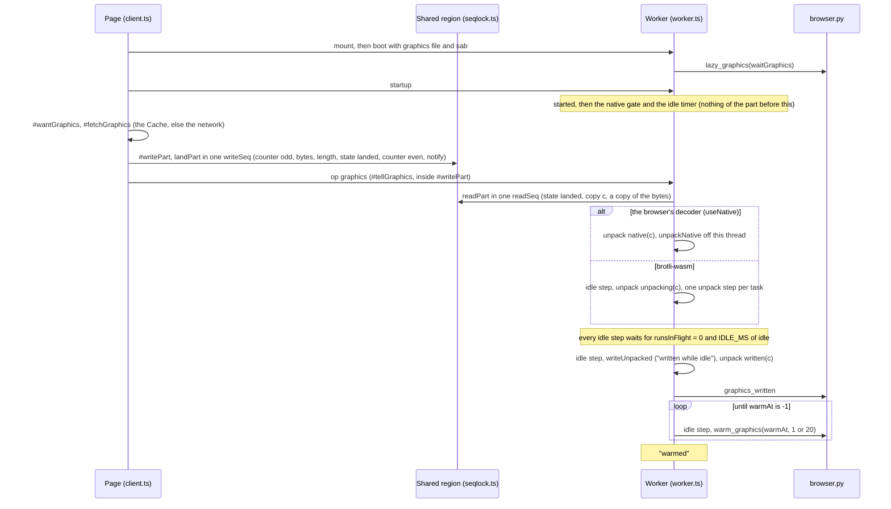
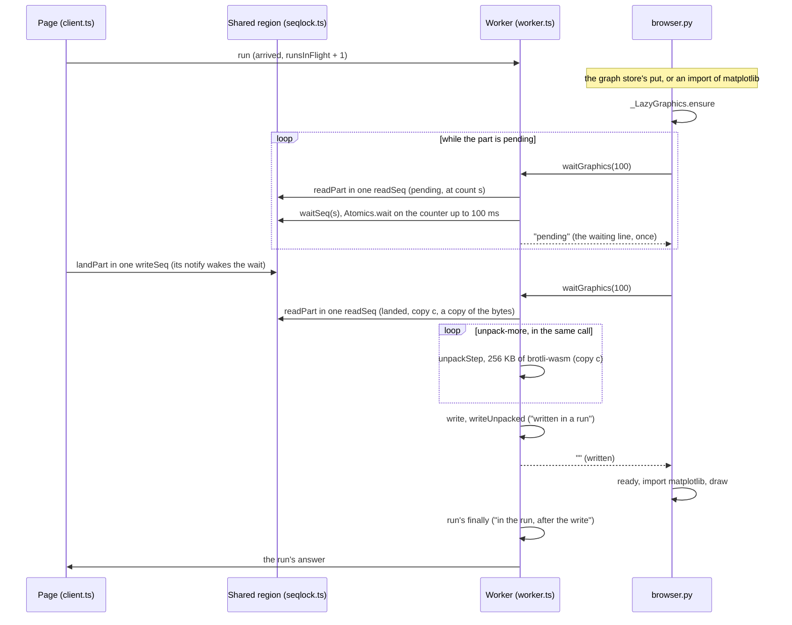
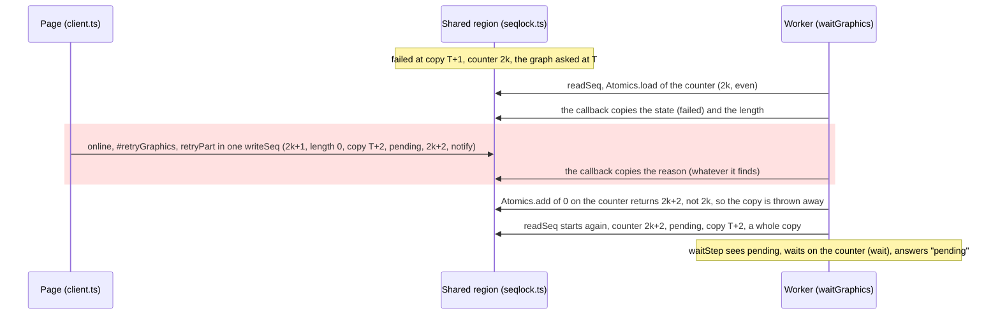
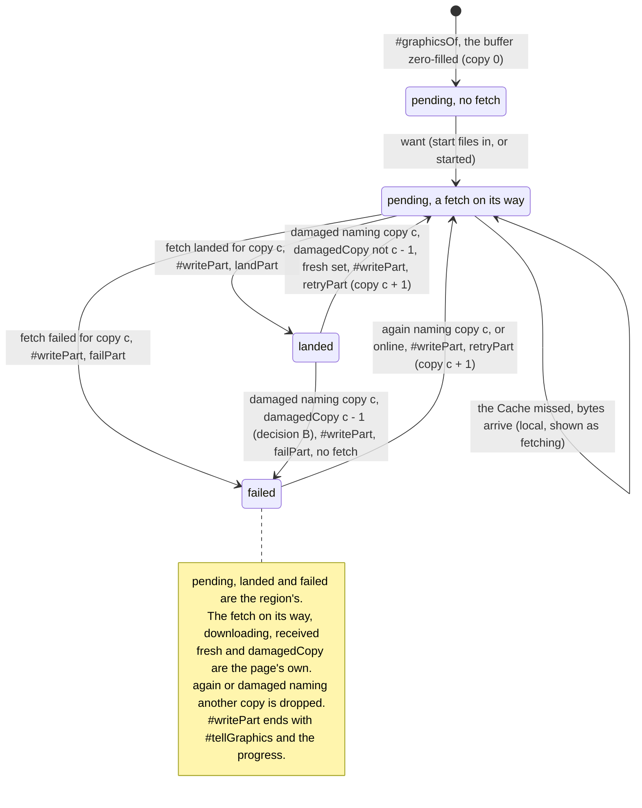
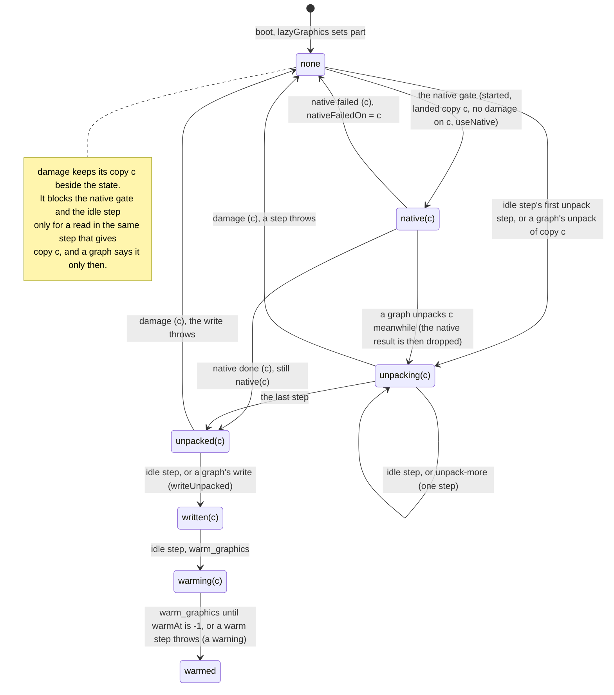
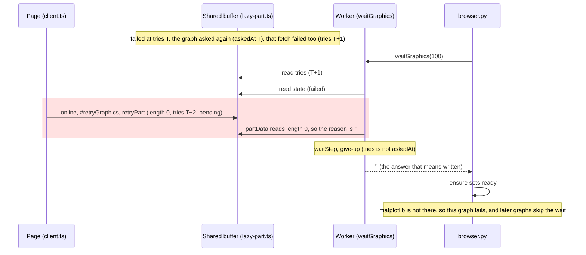

# Lazy graphics on both threads

The R1 note of the web audit (`docs/web-audit-plan.md`, section 6). A lazy snapshot's graphics part (matplotlib in a
file fetched after the start, `docs/lazy-matplotlib.md`) is fetched by the page and handed to the worker in a shared
buffer. This note is the one design R1 builds for it: a shared region written and read only through a small seqlock
utility (section 3), the page's machine (section 1) and the worker's machine (section 2) on top of it, and the races
that closes (section 6). It changes no code. **Status: built (#147, #151); where the code differs from sections 1 and 2: section 8, As built;** the
maintainer's decisions so far are quoted in "Decisions" at the end. Read from the code at e496b4c. Paths are under
`web/src/engine/` unless they start with `web/`, `src/` or `docs/`. "Guess" marks what was not checked; "(new)" marks a
name that does not exist yet (R1 may choose another).

## Primer: the pieces, in plain words

For a reader new to Web Workers, Pyodide, `SharedArrayBuffer` and `Atomics`. The sections after it assume it.

**Why Python runs in a worker.** The engine is Python, run in the browser by **Pyodide** (CPython compiled to
WebAssembly, the browser's portable machine code). A page has one main thread that also draws the page and answers
clicks; Python running there would freeze the page for the length of a run. So it runs in a **Web Worker**: a second
thread with its own memory, which talks to the page only by **messages** (`postMessage`; each message arrives as a
**task**, one unit of work a thread's event loop runs, never in the middle of another task). A run is one long task in
the worker: while Python runs, the worker reads no messages.

**Why matplotlib is a separate part.** The page starts from a **snapshot** (Python's memory saved at build time, so a
start skips the imports). matplotlib and the packages only it needs are left out of it and put in one more file, the
**graphics part**: about 7.7 MB compressed with brotli (a compression format), 32.9 MB and 1,822 files unpacked
(`docs/lazy-matplotlib.md`, 2026-11-15). The visitor downloads about 33.9 MB before the engine is ready instead of 41.6
MB, and only a program that draws a graph needs the rest.

**The flow.** Once the start files are in, the page fetches the part (from the browser's **Cache**, its offline store
for files, or else the network) and hands it to the worker. When the engine has been **idle** (no run sent or running)
for 0.25 s, the worker unpacks it, writes its files into Python's file system and imports the first modules, one short
step at a time, so that a run sent meanwhile waits for one step at most. Where the browser has its own brotli decoder,
the unpack starts as soon as the part is handed over and runs off the worker's thread; only the write and the imports
wait for idle. A graph that comes before that is done waits for the part inside its run, and unpacks and writes it
there. The pictures below show both paths.

**The shared buffer.** A message cannot reach a graph that waits inside a run: the worker is busy in Python and reads
none. So the page hands the part over in a **`SharedArrayBuffer`**, memory that both threads see at the same time. The
page posts it to the worker once, in `boot`'s arguments; posting a `SharedArrayBuffer` shares the memory, it does not
copy it. Its size is 16 + the part's size: a 16-byte header of four 32-bit numbers (the part's state: pending, landed or
failed; the length of what follows; the copy number (`copy`; `tries` today, which R1b renames), how many times the page
has fetched it again, 0 after the first fetch; and the sequence counter of section 3, unused today), then the part's
bytes (or, when the fetch failed, the reason as text). The page writes it; the worker reads it (and, under section 3's
counter, does one `Atomics.add` of 0, which writes back the value it read). A buffer is only available when the site is
**cross-origin isolated**: served over https (or from localhost) with two HTTP headers, COOP and COEP, that keep other
sites' windows out and let the page load only what other sites allow. Production and the dev server send them, so plain
http to a LAN address has no buffer.

**`Atomics`, the operations on shared memory.** Plain reads and writes of shared memory can be seen by the other thread
late or out of order, and data longer than one number can be seen half written. `Atomics` calls on one 32-bit number
cannot be:
- `Atomics.load` reads the number whole, and the thread then also sees every write the other thread made before its
  `Atomics.store` of the value read ("write the data, then publish the state" relies on this);
- `Atomics.store` writes it whole, and publishes the writes made before it;
- `Atomics.add` reads the number, adds to it and writes it back in one step (a **read-modify-write**), so two adds never
  lose one;
- `Atomics.wait` checks that the number still has a given value and, if so, sleeps until another thread calls
  `Atomics.notify` on it or a time limit passes (it does not watch the number: a change without a notify does not wake
  it);
- `Atomics.notify` wakes the threads waiting on it.

What they do not give: two loads are two moments, not one snapshot (between them the other thread may change anything);
several stores are not one step (a reader can see the first without the next); a plain read placed before an
`Atomics.load` may still take its value after it (section 3); and the page's main thread may not call `Atomics.wait` at
all (a browser refuses to block it). The page hears the worker only by messages; the worker never changes the part's
data, so there is nothing there for the page to watch.

**Without a buffer** (plain http to a LAN address, say), the part is not lazy: the worker fetches it during `boot`,
before "ready", and writes it there, so no graph ever waits for it (decision A, section 5). "Lazy" in this
note always means "with a shared buffer". Without isolation there is no **Break** either (Break stops a run at its next
safe point; it uses a second, 4-byte shared buffer), so a stuck run resets the worker.

**Where it goes wrong: a race**, when the result depends on which thread gets somewhere first. Race 3 is the worked
example, as the code is today. A graph has asked the page for one more fetch, and that fetch failed, so the buffer says
"failed" with its reason. The graph reads the state (failed), and is about to read the reason's length. Just then the
browser comes back online, and the page starts another fetch: it sets the length to 0 first, then counts a try, then
sets the state to pending. The graph reads length 0: the reason is "" (empty). But "" is also the worker's answer for
"the files are written", so Python stops waiting, the graph fails on the missing matplotlib, and later graphs no longer
wait. Each of the page's steps was atomic, and the graph's length read is a plain one; the trouble is that the graph's
three reads were not one snapshot and the page's three writes were not one step. Section 3 gives the fix: a **seqlock**,
a counter the page moves around every write so that the graph can tell a write overlapped its reads, built as a small
utility (`writeSeq` and `readSeq`, (new)) through which every write and every read must go, so that no other module can
break the rule. Section 6 lists every race found.

## In pictures

The page fetches the part and hands it over; the engine is idle, so the worker unpacks, writes and imports it (the names
of sections 1 to 3):



A graph that comes before the part is written waits for it, and unpacks and writes it in the run:



A read that meets a write (race 3's moment, under section 3's utility): the shaded steps are the page's retry inside the
worker's read; the copy is thrown away and read again, so the empty reason never leaves `readSeq`:



## 1. The page's machine (R1c)

**What the page owns.** The page owns the download, the Cache, the copy number and the progress the status bar shows;
the worker owns everything after the bytes arrive (section 2). What they share is the region's fields (state, length,
copy number, counter, and the bytes or the reason), nothing else. The two machines do not mirror each other: the page's
is small (3 shared states, four local facts, about 10 events), the worker's larger (7 unpack states, the idle clock, a
waiting graph's steps). A guess until R1c builds it; names are R1c's to choose.

**Today, in short** (what R1c replaces, and what the pins in section 7 hold): `client.ts`'s section "a lazy snapshot's
graphics part" keeps one `GraphicsPart` per build for the page's life (`#graphicsOf`), so a restarted worker gets the
same one. Its state is spread over `progress.state` (pending, fetching, landed, failed; also what the status bar shows,
through `onGraphics`), `loading` (a fetch on its way) and `damaged`, and is written twice, there and in the header, in
five places (`#fetchGraphics` twice, `#retryGraphics`, `#refetchDamaged`'s rewrite, `#graphicsOf`'s start).
`#wantGraphics` starts `#fetchGraphics` (the Cache, deleted first when fresh, else `#downloadGraphics` with `no-cache`,
or `reload` when fresh; kept in the Cache only beside the heap; size checked; `landPart` or `failPart` and one `online`
listener; then `#tellGraphics`). The worker's `again` (on failed, not loading) and the `online` event go to
`#retryGraphics` (`retryPart`, `#tellGraphics`, a fetch); the worker's `damaged` (on landed, not loading) goes to
`#refetchDamaged`, which writes `progress.state = "failed"` only so that `#retryGraphics` takes it, and sets `damaged`.
`#tellGraphics` sends the op `graphics` (no arguments, answered outside the queue) to the live worker, if any: it tells
the worker to look at the header, nothing more.

**Where each fact lives.** Checked against the code (read, not run):
- **The region is the single source of pending, landed and failed, of the copy number and of the reason.** The page
  writes them only through `landPart`, `failPart` and `retryPart`, each one `writeSeq` (section 3), and only from one
  method, `#writePart` (new), which ends every write with `#tellGraphics` and the progress function below, so no write
  can forget either. It reads them back with `readPart` (new; section 3) at `waitMs` 0: the same reader as the worker's,
  without the bytes, so it never copies the 7.7 MB part for a status update. It never meets an odd or moved count (it is
  the only writer, and `writeSeq` is synchronous) and never waits (its main thread may not).
- **"fetching" is not "a fetch in flight".** Today the status bar says fetching only once the Cache has missed and a
  download has begun (`#fetchGraphics`); during the Cache lookup, and for a Cache hit, it says pending although a fetch
  is under way. So the page keeps locally the fetch in flight (the copy it is for), whether it is downloading, and the
  bytes received. None of them is shared: the worker needs none.
- **`damaged` is not one retry's argument.** After a damaged copy, every fetch skips the HTTP cache until a copy lands,
  so an `again` or `online` retry after a failed fresh fetch is fresh too (`test/client.test.ts`, "after a damaged copy,
  a re-fetch that fails is retried with cache reload too"). It stays a page-local flag, `fresh` here, set by `damaged`
  and cleared by a landing.
- **The damaged copy's number is kept too** (decision B, Decisions). `fresh` is cleared by the landing, so it cannot
  tell that the copy now landed is the one fetched right after a damaged copy. The page keeps the copy number the last
  `damaged` it acted on named, `damagedCopy` (new), and never clears it (the region's copy only grows). It is none when
  the part is made (`null`, not -1: -1 is c - 1 for copy 0, so the first `damaged` would fail the part with no
  re-fetch), and a new build's part starts with none. A `damaged` for copy c when `damagedCopy` is c - 1 writes
  `failPart` instead of `retryPart`: the copy fetched right after a damaged copy is damaged too, so the page stops
  there, and the failed part's own rules (a graph's `again`, `online`) bound the re-fetches, one per graph that asks.
  Without it, damage tied to its copy (race 11's fix, section 2) would fetch, unpack and find damage again in a loop,
  with no run and no click (race 11). Its cost, as decided: a copy written healthy in one worker and found damaged by
  the next (a reset worker unpacks it again and throws; a phone that cannot allocate the 33 MB is a guess) counts as the
  second in a row, since the page hears no "written": the part fails, the next graph says the damage and a later graph's
  `again` fetches, where race 11's fix alone would fetch at once. That is B, not a bug: clearing `damagedCopy` to avoid
  it reopens the loop.

Page-local, then: the fetch in flight (`{copy, downloading, received}` or none), `fresh`, `damagedCopy`, and whether
the part's one `online` listener is set. `progress`, `loading` and `damaged` go.

What it removes: `progress.state` as a stored copy of the header, and so `#refetchDamaged`'s rewrite of it to "failed"
(a value the header never had) only to steer `#retryGraphics`; the state comparisons in the three guards, which become
one read of the region; the `loading` promise, whose `finally` clears it a microtask after the header already says
landed or failed (no task can run in that gap, so no bug today; the local fetch is cleared in the same step as the write
instead); and a separate page-side header reader.

What it fixes by construction: the status bar and the region cannot disagree, since one is computed from the other. A
guess, read and not run: an older build's part whose download is still on its way when `#graphicsOf` makes a new one
keeps calling `#graphicsSay` on itself, which hands the old part's progress to the listeners; progress computed only
from the current part cannot. With the copy number in `again` and `damaged` (section 4), every page event about a copy
is checked by one comparison, and the state guards follow from it: a copy is replaced only by `retryPart`, so `damaged`
naming the region's copy implies landed, and `again` naming it implies failed.

Fragility it adds: little, and named. The status bar now reads shared memory: one `readSeq` per update, and on each
download chunk too (a few loads and one read-modify-write), plus a decode of the reason when failed.

**Progress for the status bar, in one place.** One function of the current part (`#graphics`) gives the
`GraphicsProgress` that `onGraphics` hands on, its shape unchanged: `state` and the reason (`error`) from the region,
except that pending is shown as fetching while the local fetch is downloading; `received` from the local fetch (the
file's size when landed); `total`, the file's size. Every row below that changes anything ends by calling it for the
listeners. No other code writes progress, and nothing stores it.

| Region state | Page-local | Event | Guard | Effect | Next |
|---|---|---|---|---|---|
| | | part made (`#graphicsOf`, in `download()` or `start()`) | a buffer (else no lazy part: section 5) | buffer zero-filled (pending, copy 0, counter 0); `damagedCopy` none (`null`, not -1) | pending, no fetch |
| pending | no fetch | want (`download()`'s start files in; `start()`'s `started`) | | local fetch for the region's copy; fetch (the Cache, else a download; skips the HTTP cache if `fresh`) | pending, fetch on its way |
| pending | fetch on its way | the Cache missed, the download begins | | local: downloading, received 0 | same (shown as fetching) |
| pending | downloading | bytes arrive | | local: received | same |
| pending | fetch for copy c | fetch landed (c, the bytes; size checked) | c is the region's copy | `#writePart`: `landPart`; local fetch cleared; `fresh` cleared | landed |
| pending | fetch for copy c | fetch failed (c, why) | c is the region's copy | `#writePart`: `failPart` with a `PartReason`; local fetch cleared; the part's `online` listener if not yet set | failed |
| failed | | worker posts `again` (c) | c is the region's copy | retry: `#writePart`: `retryPart` (copy c + 1, pending); local fetch for c + 1, fetch | pending, fetch on its way |
| failed | | `online` | | retry, as above | pending, fetch on its way |
| landed | `damagedCopy` is not c - 1 | worker posts `damaged` (c) | c is the region's copy | `fresh` set; `damagedCopy = c`; retry, as above (the Cache entry deleted first) | pending, fetch on its way |
| landed | `damagedCopy` is c - 1 (c was fetched right after a damaged copy) | worker posts `damaged` (c) | c is the region's copy | decision B: `fresh` set; `damagedCopy = c`; the Cache entry deleted; `#writePart`: `failPart` with a `PartReason` (its words R1's); the part's `online` listener if not yet set; no fetch | failed |
| any | | `again` or `damaged` naming another copy, or from a worker that is not `live`; `damaged` when the region is not landed; `online` when not failed | | none (dropped) | same |
| any | | a new worker (`start()`, a restart) | | none: the new worker gets the same buffer at `boot` and reads the region at `startup`; want follows `started` | same |
| | | a new build | | a new part (first row); every event of the old part dropped (one check at the entry: the part is `#graphics`) | the new part's |

Every row with an effect ends with the progress function (inside `#writePart` where there is a write). The copy a
fetch's result names is the one it was started for; today only one fetch is ever in flight (want and retry require
none), so the check costs nothing and keeps that true by construction.



**What R1c builds from it.** In `client.ts`: `GraphicsPart` as the page-local fields above (no `progress`, `loading`,
`damaged`); the transitions as one pure function over (the region's state and copy, the local fields, the event)
returning the next local fields and the effects, tested as a table as `waitStep` is; `#writePart` and the progress
function; `damagedCopy` and decision B's row (built first in R1b, section 8); one `online` listener per part; messages
from a worker that is not `live` dropped. In `types.ts` (`FromWorker`) and SPEC section 6 together: `again` and
`damaged` with the copy. In `worker.ts`: `again` and `damaged` naming the copy of the read that produced them (section
4). R1b's region, copy numbers and the removal of the path without a buffer come first; R1c needs them.

**Which tests come first**, before a line of `client.ts` moves:
- Pins of today, which must stay green: the four "graphics part" tests in `test/client.test.ts`, the sticky `fresh`
  among them, plus one new pin of the progress sequence the listeners see (a Cache hit, a miss with its bytes, a
  failure, a retry, a damage), so that the derived progress is shown to match it.
- Written to fail first: a `damaged` naming copy c after copy c + 1 has landed is dropped (race 13's page half; today
  the page drops the good copy); an `again` or `damaged` from an ended worker is dropped (race 10's check, kept for the
  two messages that remain; whether a browser still delivers it is a guess, so the test sends it through the client
  directly); an old build's download does not reach the listeners (if it passes today, the guess above was wrong, and it
  stays as a pin); a second damaged copy in a row starts no fetch without a graph (decision B: `damaged` for copy 0
  starts one fetch, copy 1 lands, `damaged` for copy 1: no fetch, the region failed at copy 1; then `again` for copy 1:
  one fetch, with reload; today the page fetches at the second `damaged`), written in R1b (section 8) and kept here as a
  pin.
- Then the pure table: each row above, including the dropped events.

## 2. The worker's machine (R1b)

**Today** (`worker.ts`, the section "a lazy snapshot's graphics part"; what R1a's nets pin and R1b rebuilds). Pure
decisions are already in `lazy-part.ts`: `waitStep` (a waiting graph) and `useNative`; the rest decides inline. The rows
with a buffer (the rows of the path without one go with decision A, section 5):

| Event | Guard (spelled where) | Effect |
|---|---|---|
| `boot`: `startEngine` calls the hook `lazyGraphics` (`worker-boot.ts`) | build has a part | `share` set; the engine's `lazy_graphics(waitGraphics)` (`src/dofile/browser.py`) |
| `startup` answered | | `started`, `idleSince`; `nativeSoon`; `idleSoon` |
| op `graphics` | | `nativeSoon`; `idleSoon` |
| run arrives (dispatch hook `arrived`) | | `runs++` (stops the idle steps at once, before the queue reaches the run; runs only: another op that arrives during an idle step waits one step) |
| run starts | | `askedAt = null` |
| run ends (`finally`) | | the "in the run, after the write" line; `runs--`, `idleSince`; `nativeSoon`; `idleSoon` |
| `nativeSoon` | started; part; none of native, decode, decoded, written, error (line 352); `nativeNow()` | `startNative` in a task |
| `startNative` | the same flags again (358); landed; brotli-sized | `native`; `inflateNative`: keeps the result unless a graph unpacked meanwhile; failure: `nativeFailedOn = copy`; then `idleSoon(0)` |
| `idleSoon` | started; part; no timer; not native; no error; not (written and warmed) (387) | timer to `idleSince + IDLE_MS` |
| `idleStep` | `runs === 0`; idle `IDLE_MS` | one of: write (`decoded`; then `browser.graphics_written`), one decode step, start native (`nativeNow()` again, 408), first decode step, one `warm_graphics` step; a throw: `damaged`; else `idleSoon(0)` |
| a graph: `browser.py`'s `_LazyGraphics.ensure` calls `waitGraphics(100)` in a loop | written: ""; `graphicsError`: said once | `waitStep` decides: break, write, decode(-more), ask-again (`again`, wait), give-up, wait-failed, wait-pending (`Atomics.wait` on the header's state); a throw: `damaged` |
| `damaged(e)` | | `graphicsError`; decode dropped; posts `damaged` |

The unpack is one state written as four flags: none, `native`, `decode` (brotli-wasm under way), `decoded` (not
written), `graphicsWritten`, then warmed (`warmAt < 0`); `graphicsError` stops all idle work. Two can hold at once:
`native` with `decode` (a graph decodes while the browser's decoder runs; its result is then dropped, unless the graph
found the copy damaged: race 13).

**The 22 variables as one record.** All at `worker.ts:70-97`, one `let` each. S8 moved none of them. It moved what
surrounds them: the boot work into `worker-boot.ts` (`startEngine`, which calls back through the hook `lazyGraphics`
that `table`'s `boot` entry defines; `since` went there too), and the dispatch into `worker-dispatch.ts`, whose hook
`arrived` now counts `runs`. Eight are written by `table`'s handlers, so R1b's record is called from each of them:
`snapshotBase` and `brotliWasm` (mount), `share` (boot, in the hook `lazyGraphics`), `started` and `idleSince`
(startup), `runs` (run's `arrived`, then its `finally`), `askedAt` (run's start), `idleSince` and `writtenInRun` again
(run's `finally`).

| Group | Today | Proposed field (names R1's to choose) |
|---|---|---|
| given at start | `share`, `snapshotBase`, `brotliWasm`, `started` | `part` (`{file, region}`: the `SeqRegion` of section 3, no views and no buffer), `brotliWasm` (not `wasm`, which `client.ts` uses for WebAssembly itself), `started`, `snapshotBase` (now for `boot`'s fetch of the part: section 5) and `built` (new: mount's `built`, for that fetch's Cache) |
| idle clock | `runs`, `idleSince`, `idleTimer` | `runsInFlight` (new; the glossary: a count says what it counts), `idleSince`, `timer` |
| unpack | `decode`, `native`, `decoded`, `graphicsWritten`, `warmAt`, `tWarm`, `warmLongest` | one `unpack` state with its copy and data (below) |
| copies and damage | `copies`, `nativeFailedOn`, `fresh`, `graphicsError` | `nativeFailedOn`, `damage` (`{copy, why, said}`) (`copies` and `fresh` serve only the path without a buffer: section 5) |
| this run | `askedAt`, `fetchSaid`, `writtenInRun` | `run: {askedOn, writtenAt}` (`fetchSaid` goes with that path) |
| own fetch (no buffer) | `prefetching` | none (goes with that path) |

Read but owned elsewhere (they stay): `interrupt` (boot), `brotliMode` (mount), `py`, `browser`. Dead today:
`share.error` is never set to a reason (only cleared, `fetchPartNow`), so `partNow`'s failed branch without a buffer
cannot be reached; it goes with that path. Names the naming survey gives R1: `askedAt` (the copy when this run asked
again; R1b: `askedOn`, as `nativeFailedOn`, since `At` is a time or a position), `at` in `fetchPartNow` (a URL; goes
with that path), `damaged(e)` (a verb's job: it drops the copy; not the field `damaged` of `GraphicsPart` in
`client.ts`).

**Proposed: the unpack as one state, tied to its copy.** A guess until R1b builds it. The unpack is one field, each
phase but none and warmed naming the copy it came from: none, native(c), unpacking(c) (brotli-wasm steps), unpacked(c)
(not written), written(c), warming(c, at), warmed. Damage is a field beside it, not a phase:
`damage = {copy, why, said}`, the copy it was found on, which saying it does not clear. Every guard on damage compares
it with the copy of a read made in the same step, never with a copy remembered from an earlier read (a landing may have
moved it on since); the copy a phase or a finding carries is the copy of the read that produced its bytes, never a later
read (by then a fresh copy may have landed). The glossary's verb is unpack, so R1b renames today's `decode` and
`decoded` to `unpacking` and `unpacked`, `decodeStep` and `DECODE_STEP` to `unpackStep` and `UNPACK_STEP`,
`waitStep`'s "decode" and "decode-more" to "unpack" and "unpack-more", and the unpack's `how` ("wasm" or "native") to
`decoder`, the glossary's word for which one. Today's `writePart` (`worker.ts`: the unpacked files into Pyodide's file
system) becomes `writeUnpacked` (new), so that "part" in `readPart` and the page's `#writePart` means the region only.
`inflateNative` becomes `unpackNative` in `snapshot.ts`, which the heap's unpack and `test/snapshot.test.ts` use too;
the plan's R1 row does not name that file, so the rename belongs to the item that owns it (rule 12), or to R1b only
with the orchestrator's yes. This note uses the new name.

| Event | Guard | Effect |
|---|---|---|
| `startup` answered | | `started`, `idleSince`; the native gate; the idle timer |
| op `graphics` (a page write ended) | | the native gate; the idle timer |
| run arrives (`arrived`) | | `runsInFlight + 1` |
| run starts | | `run = {askedOn: null}` |
| run ends (`finally`) | | the "in the run, after the write" line; `runsInFlight - 1`, `idleSince`; the native gate; the idle timer |
| the native gate (one predicate for today's lines 352, 358 and 408) | started; unpack none; `readPart` at `waitMs` 0, without the bytes, gives landed copy c; no damage on c; `useNative(...)` for c; then a second `readPart` with `withBytes` gives the same copy c, brotli-sized (else nothing: the op `graphics` brings it back) | unpack native(c); `unpackNative` in a task |
| native done (c, raw) | unpack is still native(c) | unpack unpacked(c); the idle timer (0) |
| native failed (c) | | `nativeFailedOn = c`; unpack none if still native(c); the idle timer (0) |
| the idle timer (today's line 387) | started; part; no timer; not native; not warmed (no damage check: the idle step's own read decides, so a stale finding never keeps a fresh copy waiting) | timer to `idleSince + IDLE_MS` |
| idle step | `runsInFlight === 0`; idle `IDLE_MS` | by phase: unpacked(c), the write, then written(c) and `browser.graphics_written`; unpacking(c), one unpack step; none, `readPart` at `waitMs` 0: landed c without damage on c, the native gate or the first unpack step (busy, not landed, or damage on c: nothing, the op `graphics` brings it back); written or warming, one `warm_graphics` step (its throw: a console warning, and the warm-up stops, as warmed: finding 15, decided); an unpack or write step's throw: damage on the phase's copy |
| a graph's wait (`waitGraphics(waitMs)`) | | the steps below |
| damage (c, e) | an unpack or write step of copy c threw (a warm step's throw is not damage: finding 15, decided) | `damage = {copy: c, why, said: false}` (said already when the graph that found it answers with it); unpack none; posts `damaged` (c) |

**A waiting graph's steps** (`waitStep`, pure as today, its table extended): break (the interrupt buffer); written: "";
unpacked: write; unpacking: unpack-more; then one `readPart` (`waitMs`: the slice): busy: wait; damage on the read's
copy not yet said: say it (`said = true`); landed with damage on its copy already said: wait (the page's write for that
`damaged` moves the counter; no second unpack of a known-damaged copy); landed: unpack (unpacking(c)); failed, not
asked: ask-again (`run.askedOn = c`, post `again` (c), wait); failed, the copy moved past `askedOn`: give-up, answering
the read's `PartReason` (never "", section 3); failed otherwise, and pending: wait. Every wait is one `waitSeq` on the
counter from the read's count, then "pending" (today's wait-failed and wait-pending become one step, since the counter,
not the state, is what changes).



What it fixes by construction: a native result is kept only while the unpack is still native for the same copy, so the
four-flag guard (`!graphicsWritten && !decode && !decoded`) goes, and with it race 13 (after damage the unpack is none,
so a late native result of the damaged copy is dropped, and the native gate refuses a copy with damage). Damage blocks
only its own copy, which is race 11's fix (decided: "yes, fix race 11"). The behaviour change: with a buffer the page
acts on `damaged` at once (`retryPart` moves the copy within milliseconds, and the Cache entry is deleted first, so the
refetch is a download), so damage found by an idle step is stale almost at once: the next graph no longer reports it; it
waits for the refetch (its waiting line, for the download's length) and draws, or reports that fetch's failure. The same
holds for a damaged copy whose `damaged` message the page has not yet acted on: the graph then still reports it. Decided
(finding 15, section 6): a warm step's throw, after the write, is a warning that stops the warm-up, not damage.

The bound on re-fetches (decision B, section 1). Today `graphicsError` stops the idle work until a graph has said the
damage, so a part that fails on every copy costs at most two downloads per graph; tying damage to its copy removes that
throttle. A part can fail on every copy: a server that keeps sending damaged bytes at the right size, or a throw that is
not about the bytes (any throw of an unpack or write step is damage; a phone that cannot allocate the 33 MB is a guess).
Without a bound the page would fetch, the worker unpack and find damage, and the page fetch again, in a loop with no run
and no click. The page ends it: a `damaged` for the copy fetched right after a damaged copy writes `failPart`, not
`retryPart`. The copy then stays, its damage keeps blocking the idle work, the next graph says the damage (rc 199) if no
graph has, and a new copy is fetched only on a graph's `again` (one download per graph that asks) or on `online`.

**What stays a side effect.** Pure, and testable as tables: what a waiting graph does (`waitStep`), whether to unpack
natively (`useNative`), and, new in R1, what an idle step does and the native gate, and the page's transitions (section
1). Side effects, kept at the edge: `setTimeout`, `postMessage` and the console lines, `readSeq`, `writeSeq` and
`waitSeq` (section 3), `fetch`, `unpackNative`, `unpackSteps`, `writeGraphics`, `browser.graphics_written` and
`warm_graphics`, the Cache, the `online` listener, and the clock (passed in, as `machine.ts` does).

**Wire and words that stay unchanged** (they are read by e2e and by the page): the op `graphics` and `queued: false`;
`waitGraphics`'s answers ("", "break", "pending", a reason); the console lines
`[dofile] graphics part: landed (cache|network)`, `written in a run`, `written while idle`, `warmed`,
`in the run, after the write` and `native brotli failed`; and `browser.py`'s "(waiting for the graphics files to
download)". What changes: `again` and `damaged` carry the copy (R1c, with `FromWorker` and SPEC section 6), and decision
A's removals (section 5).

## 3. The shared region: a seqlock, built so its rule cannot be broken

**The fields.** The part's buffer is an Int32 header of `PART_HEADER` (16) bytes, then the bytes. Decided (see
Decisions): the header's unused fourth Int32 becomes an explicit sequence counter, so the buffer's size and its other
three fields stay.

| Field | Written by (page, through `writeSeq` only) | Read by (worker and page, through `readSeq` only) |
|---|---|---|
| state (`HDR_STATE`): pending, landed, failed | `landPart`, `failPart`, `retryPart` | `readPart` (new) |
| length (`HDR_LENGTH`) | the same three | `readPart` |
| copy number (`HDR_COPY`, `copy`; today `HDR_TRIES` and `tries`, renamed by R1b) | `retryPart` (+ 1) | `readPart` |
| counter (`HDR_SEQ` (new), the fourth Int32, always 0 today) | `writeSeq` itself, two adds around each write | `readSeq` (a load, then an `Atomics.add` of 0); `waitSeq` (new) waits on it |
| bytes, from `PART_HEADER` | `landPart` (the part), `failPart` (the reason) | `readPart`: a copy |

State and copy number keep their meanings (the part's state; how many times the page fetched it again) and carry no
parity: "pending" is the part's state while a fetch is on its way, not the odd phase, and a reader may copy a pending
part like any other (it has no bytes).

The interrupt buffer is separate (4 bytes, one Int32, made in `client.ts`'s `start()`): the page stores 2 (SIGINT) on
Break (`interrupt()`) and 0 when it sends a run; Pyodide reads it during a run; `waitGraphics` reads it between its
waits and stores 0 when it takes the Break; `browser.py`'s `keep_breaks` puts a SIGINT back. It is not the part's, and
it stays as it is (section 4).

**What is one step today** (what race 3's failing test pins). Each `Atomics` call is one step; no transition is.
`landPart` and `failPart` are four: the bytes (plain), length, state, notify. `retryPart` is four: length 0, tries + 1,
state pending, notify. The worker's read is four too: tries (`partTries`), state (`partNow`), then length and the bytes
(`partData`, a plain read). It works today by order alone: the page writes data only while the state is pending, which
the worker never copies from, and publishes the state last. Two places break that order. The worker must load `tries`
before `state` (race 1, a rule nothing enforces), and `retryPart` clears the length while the state still says failed,
which is race 3. Every other module can reach the views: `partHeader` is exported, and `worker.ts` keeps the header view
in `share.hdr`.

### What a seqlock is

A **seqlock** (sequence lock; the Linux kernel's is the textbook one) lets one writer change a block of shared data
while readers copy it, without a lock that either side waits on. It has one shared counter, `seq`, that starts at 0
(even) and only grows:

- The writer adds 1 (now odd: "being written"), writes the data, then adds 1 again (even: "done"). This is the "double
  write".

- A reader reads `seq`. If it is odd (`count & 1`, which stays right when an Int32 counter turns negative after 2^31
  adds, where `count % 2 === 1` does not), a write is under way: it waits and starts again. Otherwise it copies the
  data, then reads `seq` a second time. If the two reads differ, a write overlapped the copy: it throws the copy away
  and starts again. If they are equal, the copy is whole.

Why each half is needed. With one add per write instead of two, a write can hide between a reader's reads: an add only
at the start lets a reader read the counter just after it, copy while the data is written, and read the same counter
again; an add only at the end lets a reader read before the write starts and again before it ends. The two adds fence
the write on both sides, and the odd value in between is what "being written" looks like. On the reader's side, the
first read refuses a write under way and gives the value to compare; the second read catches a write that started during
the copy. Neither read alone does both.

What makes "equal counts" mean "whole copy" is the writer's rule, not luck: the writer touches the data only between its
two adds. So any write that overlapped the copy moved the counter, and the counter never comes back to a value it had
(it only grows; a 32-bit counter would need two billion writes to wrap). A state cannot serve as the counter for that
reason: a part's state can come back to the same value (failed, pending, failed) while its reason changed.

### The utility: `seqlock.ts` (new)

The maintainer asked for the seqlock's rule to be a design enforced by construction rather than a rule to follow (see
Decisions): a writer function that takes a function, does the counter's adds around it, and runs it synchronously; and a
reader function that handles the retry. Proposed: a module `web/src/engine/seqlock.ts` (new) that owns every view of a
shared region, so that nothing else can write or read it but through these functions. It knows nothing of the part;
`lazy-part.ts` builds the part on it. A separate module and not `lazy-part.ts` because its tests (below) are about the
counter and must not need a part, and because the interrupt buffer, which is not a seqlock, stays out of it.

```ts
// web/src/engine/seqlock.ts (new). Sketched and type-checked, not built.
declare const regionTag: unique symbol;
/** A shared region: Int32 words, the last of them the counter, then bytes. Opaque: its views live in a
 *  WeakMap private to this module, so no other module can reach them. */
export type SeqRegion = { readonly [regionTag]: true };
/** Each thread wraps the buffer it holds once. */
export function seqRegion(sab: SharedArrayBuffer, wordCount: number): SeqRegion;

/** What a write may do; it stages, writeSeq applies. Usable only during the callback. */
export type SeqWriter = {
  setWord(at: number, value: number): undefined; // at below the counter's index, else RangeError
  setBytes(source: Uint8Array): undefined; // at most the region's room, else RangeError
};
/** What a read may do. Usable only during the callback; it hands out numbers and copies, never views. */
export type SeqReader = {
  readWord(at: number): number;
  readBytes(count: number): Uint8Array<ArrayBuffer>; // a copy of the first count bytes, count clamped to the room
};
export type SeqRead<T> = { seq: number; value: T } | { seq: number; busy: true };
type NotThenable<T> = T extends PromiseLike<unknown> ? never : T extends { then: unknown } ? never : T;

/** The only write: the callback stages its writes synchronously; then the counter goes odd, the writes are applied,
 *  the counter goes even, and the waiters are woken. A throw or a thenable from the callback writes nothing. */
export function writeSeq(region: SeqRegion, write: (writer: SeqWriter) => undefined): void;
/** The only read: a whole snapshot, or busy when none could be had within waitMs (0: one attempt, no wait). */
export function readSeq<T>(region: SeqRegion, read: (reader: SeqReader) => NotThenable<T>, waitMs: number): SeqRead<T>;
/** Block up to waitMs while the counter is still seq (a worker only; returns at once if it moved). */
export function waitSeq(region: SeqRegion, seq: number, waitMs: number): void;
```

The accessors are verbs, and the verb tells the two sides apart: a writer sets (`setWord`, `setBytes`: it stages, and
`writeSeq` applies), a reader reads (`readWord` a number, `readBytes` a copy). Not `copyBytes`: in `lazy-part.ts`, which
calls both, `copy` is the copy number. `SeqReader`, not a view: it hands out numbers and copies, never views.

**`writeSeq`, step by step.**
1. Run the callback with a fresh `SeqWriter`. Its `setWord` and `setBytes` only record what to write (the source of
   `setBytes` is kept, not copied, so a 7.7 MB part is still copied once). The writer is closed when the callback
   returns: a later call throws.
2. If the callback threw: rethrow; nothing was written and the counter did not move. If it returned a thenable (an
   `async` callback cast past its type): a `TypeError`, nothing written.
3. `Atomics.add` of 1 on the counter (odd); the staged bytes, then the staged words (`Atomics.store`); in a `finally`,
   `Atomics.add` of 1 (even) and `Atomics.notify` on the counter. No caller code runs between the two adds: one copy of
   the bytes and a few stores.

This differs from the maintainer's sketch (Decisions) in one place: the callback runs inside `writeSeq`, synchronously,
as asked, but before the odd add, and its writes are applied between the adds. Staging, accepted (Decisions), is chosen
over running the callback between the adds because then two things become impossible that would otherwise rest on
convention: a throw halfway through the callback publishing half a write as a whole one (a `finally` must still make the
counter even, or it stays odd forever), and slow work inside the callback widening the odd phase.

**`readSeq`, step by step.**
1. The deadline is now + `waitMs`. Load the counter (`Atomics.load`). Odd (`count & 1`): a write is under way. With time
   left, `Atomics.wait` on the counter for that odd value until the deadline (the write's notify wakes it), then start
   again; without, answer busy. The callback is not run on an odd count, so nothing copied during a write is ever used.
   `Atomics.wait` is called only when `waitMs > 0`, so the page's main thread may call `readSeq` with `waitMs` 0.
2. Run the callback with a fresh `SeqReader`: `readWord` is a plain read, `readBytes(count)` a copy (`slice`) of the
   first count bytes, count clamped to the region, so a torn length cannot throw or read past the end. The reader is
   closed when the callback returns: a later call throws, so a callback cannot keep the reader and read outside the
   snapshot.
3. Re-check with `Atomics.add(counter, 0)`, a read-modify-write (below). Moved: the copy is thrown away (a throw from
   the callback too: it read torn data), and the read starts again at step 1 while time is left, else answers busy (with
   `waitMs` 0: busy at once).
4. Equal: a throw from the callback is rethrown (it read a whole snapshot, so it is a bug, not a tear); a thenable is a
   `TypeError`; otherwise `{seq, value}`.

**Bounded, by time, not by a count.** A moved count means a page write section ended during the read. The sections are
synchronous (one copy of at most the part, milliseconds) and rare (a landing, a failure, a retry: a handful per page
load), so a read meets a moved count once or twice at most, and a count limit would be a second bound with no case that
needs it. The time bound is what the callers need: `waitGraphics` passes its slice (100 ms), so it answers "pending" in
time and Python checks for a Break between slices; the idle step and the native gate pass 0 and never block (busy then
means "not now": the op `graphics` after the write brings them back, as today). A writer stopped inside a section (a
debugger paused on the page) blocks the reader in `Atomics.wait`, not in a spin, and only up to its deadline; a graph's
slice can then last twice `waitMs` (a `readPart` that waits out the odd count, then `waitSeq`), so a Break is taken
within about 200 ms, not 100.

**`waitSeq`** is `Atomics.wait(counter, seq, waitMs)` with the count a read returned. It returns at once if the page has
written since that read, else when a write's notify wakes it, or after `waitMs`. Waiting on the counter, not the state:
waiting on the state could sleep through a whole retry that ends in the state it started from (failed, pending, failed);
a count that only grows cannot.

**The part on it** (`lazy-part.ts`, as R1b would change it):

```ts
declare const partReasonTag: unique symbol;
/** Why a fetch failed: never "", the waitGraphics answer for "written". Only partReason makes one. */
export type PartReason = string & { readonly [partReasonTag]: true }; // (new)
export function partReason(text: string): PartReason; // (new) "" becomes a fixed text; the one check there is
export type PartRead = // (changed: today { state, tries, shared })
  | { state: "pending"; copy: number }
  | { state: "landed"; copy: number; bytes: Uint8Array<ArrayBuffer> | null } // null unless asked for
  | { state: "failed"; copy: number; reason: PartReason };
export function landPart(part: SeqRegion, bytes: Uint8Array): void; // one writeSeq each
export function failPart(part: SeqRegion, reason: PartReason): void;
export function retryPart(part: SeqRegion): void;
// (new) one readSeq
export function readPart(part: SeqRegion, waitMs: number, options?: { withBytes?: boolean }): SeqRead<PartRead>;
// (new) readPart's callback, exported so that race 3's test can wrap it (section 6)
export function partSnapshot(reader: SeqReader, options?: { withBytes?: boolean }): PartRead;
```

`withBytes` is an option, named at the call, not a bare `true` in the middle of the arguments. `HDR_TRIES` becomes
`HDR_COPY`, the word every read already uses. The two kinds of call, sketched (type-checked, not built):

```ts
// lazy-part.ts: a writer is one writeSeq, a reader one readSeq.
export function landPart(part: SeqRegion, bytes: Uint8Array): void {
  writeSeq(part, (writer) => {
    writer.setBytes(bytes);
    writer.setWord(HDR_LENGTH, bytes.length);
    writer.setWord(HDR_STATE, PART_LANDED);
  });
}

export function partSnapshot(reader: SeqReader, { withBytes = false } = {}): PartRead {
  const copy = reader.readWord(HDR_COPY);
  const length = reader.readWord(HDR_LENGTH);
  switch (reader.readWord(HDR_STATE)) {
    case PART_LANDED:
      return { state: "landed", copy, bytes: withBytes ? reader.readBytes(length) : null };
    case PART_FAILED:
      return { state: "failed", copy, reason: partReason(new TextDecoder().decode(reader.readBytes(length))) };
    default:
      return { state: "pending", copy };
  }
}

export function readPart(part: SeqRegion, waitMs: number, options: { withBytes?: boolean } = {}): SeqRead<PartRead> {
  return readSeq(part, (reader) => partSnapshot(reader, options), waitMs);
}

// worker.ts: the idle step takes the bytes at once; a waiting graph reads, then waits on the count it read.
const idle = readPart(part, 0, { withBytes: true });
const read = readPart(part, 100, { withBytes: true });
if ("value" in read && read.value.state === "pending") waitSeq(part, read.seq, 100);
```

`partHeader`, `partTries`, `partState`, `partData` and `waitPartChange` go (and `HDR_TRIES` becomes `HDR_COPY`): no
module but `seqlock.ts` makes a view of the buffer (a rule of the modules, not of the language: "What still rests on a
convention", below). On the worker, `partNow`, `waitGraphics`'s `read()` and `copyNow`
become `readPart`, and the waits become `waitSeq`.

**The non-empty reason, as a type.** `failPart` takes a `PartReason`, and `readPart`'s failed snapshot carries one. Only
`partReason` makes a `PartReason` (its brand is a symbol no other module can name; a cast, `"" as PartReason`, still
type-checks), and it never returns "": it is the
one place with a check. So `waitStep`'s give-up answers a value whose type cannot be "", and no caller compares a reason
with "". With the seqlock a whole read of a failed part always has the writer's reason; the type keeps the one wrong
answer that matters ("" means "written") away even from a reader that gets the snapshot wrong. (Changing the answer for
"written" from "" to something no reason can be would do it on the wire instead; it changes `browser.py` too, and is not
proposed.)

**What becomes impossible to break** (each a rule R1b would otherwise follow by hand):
- A write outside a write section, from code that uses the region: no module but `seqlock.ts` is given a view or a
  writer, and its only write is `writeSeq` (the buffer itself stays reachable to whoever holds it: below).
- A write section without its two adds, or without the notify: `writeSeq` does them; a callback cannot touch the counter
  (`setWord` refuses its index).
- An asynchronous write section: refused by its type (a callback must return `undefined`, which an `async` function's
  promise is not) and at run time (a thenable is a `TypeError` before the odd add, so nothing is written).
- A half write published, or the counter left odd, by a throw; slow work inside the odd phase: the callback's writes are
  staged and applied after it returns.
- A torn read accepted: `readSeq` is the only read; it never runs its callback on an odd count and always re-checks.
- A forgotten re-check: it is inside `readSeq`, an `Atomics.add` of 0. That it is an add and not a plain load (not
  sound, below) rests on that one line and the argument, not on a test ("What guards the re-check", below).
- A copy that is a view into the buffer, or a view kept past the read: the reader hands out numbers and copies, and is
  closed after the callback.
- Two loads in the wrong order (race 1), or a copy number not paired with the bytes it came from (race 2): the state,
  the copy number and the bytes come from one snapshot.
- Waiting on the state instead of the counter: `waitSeq` waits only on the counter.
- An empty reason answered as "written": the type above.

**What still rests on a convention** (none is new; each is one place to look):
- How far "by construction" reaches: the module boundary. A `SharedArrayBuffer` must cross `postMessage`, so it exists
  raw in two places: `client.ts`, which makes it in `#graphicsOf` and keeps it for the part's life to post it to each
  new worker in `boot`'s arguments (`BootArgs.graphics.sab`, `types.ts`), and the worker, where `boot`'s arguments pass
  through `startEngine` (`worker-boot.ts`) to the hook `lazyGraphics` (`worker.ts`). Whoever holds it can make a view
  (`new Int32Array(sab)[0] = 1`) and write outside any section; test 4 does so on purpose, and `test/client.test.ts`'s
  `page.header()` reads the header through its own view today. R1b keeps the buffer out of other hands: `#graphicsOf`
  wraps it with `seqRegion` at once, and the part reads and writes only through the `SeqRegion`, the raw buffer kept in
  one private field read only where `boot`'s arguments are built; `worker-boot.ts` hands it on untouched, and
  `lazyGraphics` wraps it at once and keeps only the region (the record's `part` holds no buffer). The rule left is that
  no module but `seqlock.ts` makes a typed array on a region's buffer: the one rule here a source check could hold (as
  `test/imports.test.ts` holds the imports); the principle prefers construction to checks, so it is not proposed.
- One writer per region: whoever holds the buffer can wrap it with `seqRegion` and call `writeSeq`. Only `client.ts`'s
  `#writePart` writes the part's region; the worker only reads. A source test could check it, but the principle prefers
  construction to checks, and the one write site is easy to see.
- A read callback may run more than once (each retry), so it must have no side effects: it receives only the view, but a
  closure can reach anything.
- A read callback sees torn values on a read that is then thrown away: `readBytes(count)` clamps, and a throw is
  caught, but a loop of its own over a torn number cannot be guarded.
- The `waitMs` each caller passes (the graph's slice; 0 for the idle work and on the page).
- What goes in the region and what stays page-local (section 1) is a design choice, not something the utility knows.

### Why the second read is a read-modify-write

The first read: the worker's `Atomics.load` of the counter takes its value from the page's second add (or from the
worker's own earlier add of 0, which wrote back that same count after reading it from the page's add), and in
JavaScript's memory model an atomic read that takes its value from an atomic write sees every write the writer made
before that write. So the copy sees the whole write section that ended there ("write, then publish").

The second read must show the opposite: that the copy saw none of the next write section's writes. An `Atomics.load`
does not show it. It orders what comes after it, not the plain reads before it: a plain read written before an
`Atomics.load` in the code may still take its value later, after the page has started its next write section, while the
load returns the old count. The re-check would then pass over a torn copy. On ARM64 (iPhones, Apple-silicon Macs) the
processor itself allows this (V8, in Chrome on Macs and Android, compiles `Atomics.load` to a load-acquire, which does
not hold back earlier reads; every browser on an iPhone runs WebKit's JavaScriptCore instead, whose optimising tiers
compile `Atomics.load` itself as a read-modify-write, so the reordering does not show there: an engine's choice, not the
language's promise, and the language's memory model allows the same reordering in every engine); on x86 the processor
does not reorder a read with a later read, so a test on a PC would not show it (a compiler still may: the language
allows it).

A read-modify-write on the same word closes it. `Atomics.add(hdr, HDR_SEQ, 0)` reads the counter and writes the same
value back, in one step. The page's first add is a read-modify-write on that word too, and the steps on one word happen
in one order both threads agree on. Either the worker's add comes first: the page's add then reads the value the
worker's add wrote, and the memory model makes everything the worker did before its add (the copy) happen before
everything the page does after its add (the next write section), so the copy cannot have seen those writes. Or the
page's add comes first: the worker's add then returns a different count, and the copy is thrown away. On ARM64 the
read-modify-write ends with a store-release, which waits for the earlier reads. The worker's add writes the value it
read, in the same indivisible step, so it never loses a page's add; only the page changes the count.

This is reasoned, not proven by a tool: from ECMA-262's memory model (happens-before, synchronizes-with, and the rule
that a read cannot see a write that happens after it) and ARMv8's acquire and release. No mechanised model (herd, or the
JavaScript model of Watt et al., PLDI 2020) was run; a proof would need one. A single-threaded Node test cannot show a
torn read (it interleaves whole steps); a test with the reader and the writer on two threads can, on ARM64, as the spike
below shows. The problem and this fix are the ones Hans-J. Boehm describes for C++ seqlocks ("Can Seqlocks Get Along
With Programming Language Memory Models?", MSPC 2012, doi:10.1145/2247684.2247688).

**What guards the re-check: the argument and the spike, not a test of `readSeq`.** The re-check is one line inside
`readSeq`, which no caller can leave out. That the line is right rests on the argument above and on the spike's runs
below (millions of torn copies accepted with a load in V8 and SpiderMonkey on ARM64, none with the add in five engines).
Test 6 does not guard it: a reviewer's two-thread run of a prototype of `readSeq` as this section builds it (`readWord`
calls, `readBytes` a `slice`), its re-check swapped for `Atomics.load`, accepted 9.3 million snapshots of 16 bytes,
24,000 of 4 KB and 39 of 1 MB (Node 26.10, Apple M4 Pro) and none was torn; the spike's `slice` variants with a load
did not tear either. The tearing the spike caught came from a copy loop inlined beside the re-check, a shape
`readSeq`'s callback does not have. So a change of that line to a load would pass every test proposed here: it is the
line of the utility a review must read.

**Tested, 2026-11-23: a spike, on an Apple M4 Pro (ARM64).** A writer on one thread and a reader on another (in the
browsers: the writer on the page's main thread, the reader in a Worker, with cross-origin isolation, as in the app) ran
the seqlock for seconds at a time, with headers of 4 to 1,024 Int32 words, and counted every copy the reader accepted
that was torn (the words from two write sections). Re-checking with `Atomics.load` accepted millions of torn copies in
Node 26 (V8: 8.8 million of 32.9 million accepted), Chromium 158 (4.0 million) and Firefox 159 (2.3 million): the
reordering this subsection reasons about is real on this hardware, common under contention, and visible from plain
JavaScript. It accepted none in WebKit (Playwright's build, not Safari) or the system's `jsc` shell only because
JavaScriptCore compiles `Atomics.load` as a read-modify-write (its DFG and FTL tiers, read in their disassembly; its
lower tiers were not read): an engine detail, not a guarantee. The controls (no re-check; plain reads of the counter)
tore in every engine, so the harness can see tearing. Re-checking with `Atomics.add(seq, 0)` accepted no torn copy in
about 73 million accepted copies across the five engines. That is evidence, not proof: a test can only show a failure.
Not tested: x86, an iPhone, SpiderMonkey's compiled code (Firefox's was not read, only run), and sizes beyond 1,024
words (the load re-check tore at 4 and 16 words, and once at 64 words in Firefox). The copy by `slice`, as `readPart`
makes it, was run with small samples: its two re-checked variants did not tear, the load one included, and its control
without a re-check (`C_slice`) did. The harness is not in the repository:
`.claude/orchestrate/20261123-0810-audit-s10-session4c/scratch/seqlock-spike/` in the maintainer's checkout; it is a
candidate for R1b's two-thread test (section 3, the utility's test 6).

**Tests that pin the utility** (`test/seqlock.test.ts` (new), Node; written before `lazy-part.ts` moves onto it):
1. A new region's counter is 0; each `writeSeq` leaves it 2 higher and even, with the words and bytes as written.
   (`test/part-header.test.ts` keeps the part's layout: state, length, copy, counter.)
2. A writer callback that throws, or returns a thenable (cast past its type), writes nothing and leaves the counter as
   it was; a `SeqWriter` used after `writeSeq` returns throws; `setWord` on the counter's index throws.
3. The interleaving, in whole steps, on one thread: a read callback that calls `writeSeq` on the same region halfway
   through its reads (a page write between the reader's two counter reads) is run again, and `readSeq` returns the new
   snapshot whole, never a mix; with `waitMs` 0 it answers busy. Race 3's test in `test/lazy-part.test.ts` uses the same
   trick through a seam: `readPart`'s callback is exported as `partSnapshot` (new), a function of a `SeqReader`; the
   test wraps it to call `retryPart` after its first reads and hands the wrapper to `readSeq`.
4. An odd counter (made odd by the test's own `Int32Array` on the buffer it made, as a writer stopped mid-section):
   `readSeq` does not run its callback and answers busy after about `waitMs`; a second thread (Node `worker_threads`)
   that then ends the section (an add and a notify) wakes it with the value before `waitMs`. `waitSeq` likewise returns
   at once on a moved count and when woken.
5. A `SeqReader` used after `readSeq` returns throws; `readBytes` returns a copy backed by an `ArrayBuffer` that a
   later write does not change; a length beyond the room is clamped.
6. Two threads, many rounds: a writer thread writes sections whose words and bytes all hold one number k, a reader
   thread checks that every snapshot it accepts holds one k throughout. On x86 it passes whatever the re-check is; on
   ARM64 (an Apple-silicon Mac) it tests the plumbing on two threads, not the re-check: through `readSeq` it passed with
   a plain load too ("What guards the re-check"). What could tell the two apart: the re-check as one function of
   `seqlock.ts` (`recheckSeq` (new)) that `readSeq` calls and that the spike's inline harness (end of "Why the second
   read is a read-modify-write") calls in its own copy loop, run twice: with a load in its place the harness must tear,
   which shows it sees tearing on that machine, and with the function it must not. Guess, not tried: it tests the line
   only where the engine inlines it into the loop as the spike's code was. A pass is evidence, not proof.

And `test/seqlock.types.ts` (new), checked by `npm run check` as `test/signals.types.ts` is: an `async` writer, a writer
returning a value, an `async` or thenable read result, and a plain string as a `PartReason` are each a type error
(`@ts-expect-error`). Tried on a scratch file of the signatures above with the project's TypeScript (7.0.2, `--strict`):
the four refused, the good calls accepted, including a read whose result type is inferred. The behaviour in 2 to 5 was
tried on a scratch prototype under Node 26 (one thread, plus an odd counter set by hand); a reviewer's prototype also
ran test 4's second thread (woken at 155 ms of a 2,000 ms limit) and test 6 through `readSeq` (none torn, with either
re-check).

**Cost.** In `seqlock.ts` about the sketch above; in `lazy-part.ts` the three writers and `readPart` on it,
`PartReason`; in `worker.ts`, `partNow`, `waitGraphics`'s `read()`, `copyNow` and the waits; in `client.ts`,
`#writePart` and a `partReason` where a failure's text is made. At run time: one read-modify-write per read, and a
thrown-away copy (up to the part's size, a few MB) on the rare read that meets a write.

## 4. How far to lean on the shared state

**Design principle for R1** (the maintainer, quoted in Decisions): rely on the concurrency the design already has to
remove duplication, add no fragility or complexity, and fix by construction rather than by checks. Read here as: R1 uses
the region, its counter and the copy number wherever they remove a duplicate or make a race impossible; it adds no
second shared region, no second writer per region, and no second transport for one piece of state. Its scope: the
seqlock is the tool for the one place the code is forced into shared memory, a graph blocked in Python that reads no
messages; everywhere else messages, tickets and the state machine stay the default.

**A companion rule, proposed by the reviewer, for the maintainer to accept:** when a redesign removes a guard or a flag,
list everything that guard was doing, not only the race it was there for, and keep or replace each. The example is race
11: `graphicsError` was the race, and also the only throttle on re-fetches of a part that keeps failing (decision B,
section 2). R1b's changes give each guard they remove that list (section 8).

Each candidate, with what it removes, what it fixes by construction, and what it adds:

- **The copy number in the messages that are about a copy.** The region holds it, read with the state and the bytes in
  one snapshot. The worker's two messages, `again` ("this copy failed, fetch another") and `damaged` ("this copy will
  not unpack"), name the copy they are about, and the page acts only on a message about its current copy. Removes: the
  page's guards that stand in for "is this message still about the copy I have" (`#refetchDamaged`'s "landed, not
  loading", and its rewrite of `progress.state`). Fixes by construction: race 13's second, stale `damaged` (the page
  would drop a good copy), the same stale `damaged` sent twice by two graphs of one run, and a late `again` for a copy
  already replaced (race 4 is today ordered by the guard; with the number it no longer depends on it). Adds: one number
  in two messages. The number travels with the bytes: the unpack, the unpacked result and the native result carry the
  copy of the read that produced them, and `damaged` names that copy, never a later read's. **Recommended** (R1c, with
  R1b's worker half).
-  **The copy number on the worker's own findings.** Not shared state, the same idea inside the worker (section 2): the
  unpack's phase and the damage each keep the copy they are about, and are used only for a read that still gives that
  copy; the damage's copy is not cleared by saying it. Fixes by construction: races 11 and 13. Adds: a copy in the
  unpack field and in `damage`. **Recommended**; race 11's fix is decided (R1b).
- **A worker region** (a second region the worker writes: the copy it is working on, its unpack phase, damage with its
  copy; it would replace `again` and `damaged`), re-weighed after decision A. Decision A removed one objection: a lazy
  part now always has a buffer, so a worker region would never need a message twin on a path without one; and with
  `seqlock.ts` a second region costs little code (a second buffer, `writeSeq` on the worker, `readSeq` at `waitMs` 0 on
  the page). What remains:
  - The page cannot block, so it learns of a worker write by a message (a doorbell with no content: the message stays
    and only its content moves into the region) or by `Atomics.waitAsync` on the region's counter. What was checked of
    `Atomics.waitAsync` (2026-11-23): it is a function in Node 26.10, and in the browsers this repository's e2e runs,
    Playwright's Chromium 158, Firefox 159 and WebKit 27.2, on a page and in a worker (a presence check in
    `about:blank`, not a wait). The project's TypeScript lib (`es2023`, `web/tsconfig.json`) has no type for it. Not
    verified: which browser versions the site supports (the repository names no floor), the Safari versions on visitors'
    iPhones, and that a wait on the page's main thread wakes as it should (nothing waited).
  - With `waitAsync` the page keeps a pending promise per region and re-arms it after every wake, for the life of each
    worker (a restart makes a new one): a loop that does not exist today. That is new complexity, which the principle
    rules out.
  - `again` is a request (fetch another copy), not a state: as a field it becomes a flag the page must clear, a write in
    both directions.
  - Fixes by construction: nothing the copy numbers above do not already fix (races 11 and 13, the stale messages). Race
    10 (a late message from an ended worker) is one comparison with `live`.
  **Not recommended for R1.** Reopen if the page has to show the worker's own progress (say, "unpacking" in the status
  bar), which it does not today.
- **The op `graphics` replaced by the worker waiting on the counter with `Atomics.waitAsync`.** `writeSeq`'s notify
  would then reach the worker by construction, and the op, its place beside the queue (`worker-dispatch.ts`) and
  `#tellGraphics` would go. It fixes no race: every page write is followed by the op, and `#writePart` (section 1) makes
  that by construction on the page's side. It adds the same re-armed promise, in the worker, and depends on the support
  above. **Not recommended for R1**; of the candidates here, the one worth reopening once the browsers the site supports
  are named and checked, since it removes an op. The browser floor it needs stays open (Decisions).
- **The interrupt buffer** stays a separate 4-byte buffer: Pyodide reads it directly, and merging it into the part's
  region would tie two contracts together for nothing.

**What stays out of the region.** A `SharedArrayBuffer` holds numbers and bytes, not objects, promises or functions.
Most of each machine is a resource of its own thread that the other could not use even if it knew its state: the page's
fetch and its reader, the Cache, the `online` listener and the `onGraphics` listeners; the worker's brotli-wasm unpack,
the native unpack's promise, its timers, Pyodide's files and Python's `ready`. The worker reads the region because a
graph blocked in Python receives no messages; the page hears the worker's findings by message. So the region carries the
hand-over only (one copy, its state, its number), and each thread keeps its own machine.

## 5. Without cross-origin isolation: the part at the start (decision A)

Without cross-origin isolation (in practice plain http to a LAN address, such as `npm run dev` opened on a phone;
production is isolated by its `_headers`) the lazy path is not used: the worker fetches the graphics part itself during
the start, before "ready", and writes it at `boot`, so no graph ever waits for it mid-run and nothing needs the buffer.

What goes (R1b): the worker's `prefetch` and `fetchPartNow` (the synchronous request), `fetchSaid`, `copies`, the
worker's `fresh` and its `?fresh=` address, `share.bytes` and `share.error`, `waitStep`'s steps for a part that is not
shared (`say-fetching`, `fetch`, and its `shared` flag), the `{graphics}` messages `fetching`, `progress`, `landed` and
`failed` and the meaning of `damaged` without a buffer, `#workerSaysGraphics`'s switch, and `start()`'s reset of the
progress for a new worker (`client.ts`); the console lines `fetched by the worker`, `fetched by the worker in a run`,
`the worker's own fetch was still on its way` and `the worker's fetch failed` (R1b says so where e2e reads them). What
comes: in `boot` (`startEngine`, `worker-boot.ts`), once Pyodide is up and before `boot` answers, one more fetch through
`fetchBytes` (the snapshot's Cache, else the network), then the part's unpack and write. That fetch needs what only
`mount` is given, so `worker.ts` keeps it from `mount` and passes it to `startEngine` with the hooks (no wire change):
the base, mount's `snapshot` (`snapshotBase`, kept for this fetch now that `fetchPartNow` goes); `built`, which names
the Cache (`snapshotCache(built, refused)`, with a `refused` of its own: a storage refusal means no Cache, as in
`loadFromSnapshot`) and which `worker.ts` does not keep today (new); and, for the unpack, `brotliWasm` and `brotliMode`
(kept today). As in `loadFromSnapshot`, a `file:` base (Node, the tests: `isFile`) has no Cache and the fetch reads the
file. Not in `mount`'s fetches beside the heap and the bundle (`loadFromSnapshot`): whether there is a buffer is
`boot`'s `graphics` argument (a `sab` or null, as today), and the page sends `boot` only after `mount` is answered, so
`mount` cannot know without a wire change to `MountArgs`; nor can the worker test `typeof SharedArrayBuffer` itself,
since test c removes it from the test's thread only. The cost: on this path the part's download no longer overlaps the
heap's. Decided (Decisions): it is then still warmed in idle steps, and a damaged part fails the start the way a damaged
heap does: a throw of the unpack or the write deletes the file from the snapshot's Cache (`snapshotCache`, as
`loadFromSnapshot` does for the heap) and fails `boot`; the next start fetches it again.

What it costs: without isolation, the start downloads the part too (about 7.7 MB more) and unpacks and writes it before
"ready". What the start screen shows then, from the code: over plain http to a LAN address the page is not a secure
context, so it has no Cache API, `download()` returns `cached: false` and the worker downloads every start file by
itself, uncounted: the start screen shows the stages, not bytes, and the part is uncounted the same way. On a secure
origin without isolation (https or localhost without COOP and COEP, a misconfiguration; how often it happens is a guess)
`download()` counts bytes against a `total` that is `list.download` less the part's size, and the part is no start file
(`list.files`); the worker never writes the Cache. Left so, the worker would download the part at every start,
uncounted, and a return visit offline would fail at the start although the heap is cached. So R1b makes it a start file
there: without a buffer, `download()` fetches the part with the start files into the Cache and counts it (no
subtraction), `cached()` checks it with them (else, once a boot whose unpack threw has deleted it from the Cache,
`cached()` still says true, and the start downloads it uncounted or fails offline), and the worker reads it from the
Cache as it reads the heap, with a case in `test/client.test.ts`. That keeps decision A (an eager part) and follows
`web/CLAUDE.md`'s rule that only the page writes the start files' Cache.

What it fixes by construction: races 9, 10 (for the download messages) and 14, and the dead `share.error` branch
(section 2). Without isolation there is still no Break, so a stuck run still resets the worker; it only no longer holds
a download.

## 6. Races between the page and the worker

Numbered as in the earlier versions of this note, so that reviews and the plan still find them. "Today" is the code at
e496b4c; the fix is the design above.

1. A page retry between a graph's two header loads: `waitGraphics`'s `read()` loads `tries` before `state`
   (`partTries`'s doc), so the retry shows as new tries, not as the new fetch's failure. Today ordered by load order, a
   rule nothing enforces. **Closed by construction** (section 3): the state and the copy number come from one snapshot.
2. A page retry while `startNative` reads the part: `copyNow()` is read before `partNow()`, so a native failure is
   charged to the copy it read. Today ordered by load order. **Closed by construction**: the copy and the bytes come
   from one snapshot.
3. **A page retry while a graph reads a failed part's reason gives a false success.** Not ordered today. The state is
   an `Atomics.load` (`partNow`), the length a plain read after it (`partData`), and `retryPart` stores length 0 first.
   A retry between the two (the `online` event's `#retryGraphics`; no fetch needed) makes the reason "". When the graph
   has already asked again and that fetch failed (`give-up`), `waitGraphics` returns that "", which is its answer for
   "written": `browser.py`'s `ensure` sets `ready`. That graph then fails on the missing matplotlib (an import error,
   not rc 199 "graphs are not available"; its rc was not checked), and every later graph skips the wait and fails the
   same way, sending no `again`, until a copy is written while idle (`graphics_written`), which needs a page fetch to
   land; a reload also clears it. Forced with the real `lazy-part.ts` functions (a reviewer's script, re-run):
   `{"step":"give-up","reason":""}`; `browser.py`'s reading of "" is read, not run. Rating: rare (a few instructions
   wide, and only while the browser goes online during a graph's wait after its asked-for fetch failed), but a wrong
   answer rather than a slow one; no data is lost. **Fixed in R1b's first change, test first**: section 3's utility, and
   a `PartReason` that cannot be "". The test, in `test/lazy-part.test.ts`: a read that meets a page write between
   its two reads of the counter never answers "": it answers pending, or a whole non-empty reason. Its seam is
   `partSnapshot` (new; section 3, test 3), wrapped to call `retryPart` after it has read the state and the length,
   where the reviewer's script forced it. `readPart` does not exist today, so what is written first, and fails first,
   is the same moment on today's functions: `partState`, then `retryPart`, then `partData`, then `waitStep`, by hand,
   answers `{"step":"give-up","reason":""}` (above); R1b's first change then writes it on `partSnapshot`, where it
   passes. It tests the order of whole steps, not the memory model (section 3, "Why the second read is a
   read-modify-write").
4. The graph's `again` and the `online` event: both go through `#retryGraphics`, whose guard (failed, not loading)
   starts one fetch; the graph's `askedAt` makes either fetch's failure final for it. Ordered by the guard today; by the
   copy number in `again` after R1c (section 4).
5. The part lands before `startup` is answered: the op `graphics` arrives, `nativeSoon` and `idleSoon` return on
   `!started`, and `startup` calls both. Ordered by `started`.
6. The part lands between two workers (restart): `#tellGraphics` skips an ended or absent worker; the next gets the same
   buffer at boot and reads the header at `startup`. Ordered; not tested (lazy-matplotlib.md: "argued"; test a's restart
   case pins it).
7. A graph while the browser's decoder runs: the graph decodes with brotli-wasm; the native result is dropped by
   `!graphicsWritten && !decode && !decoded`. Ordered; costs a second decode. In section 2's one state: the native
   result is kept only while the unpack is still native for its copy.
8. A run arriving during an idle step: `runs++` happens at arrival, `idleStep` returns on `runs > 0`; the step under way
   ends first (one step at most). Ordered by the single thread.
9. No buffer, a graph while `prefetch` streams. **Removed by decision A.**
10. No buffer, an ended worker's late `{graphics}` message reaching `#workerSaysGraphics` without a `live.ended` check.
    **Removed by decision A** for the download messages; the missing `live` check stays in R1c for `again` and `damaged`
    (whether a terminated worker's queued messages are still delivered was not checked).
11. Damage found by an idle step, then the fresh copy lands: `graphicsError` blocks `nativeSoon` and `idleSoon`, so the
    fresh copy waits; the next graph reports the damage (rc 199) although a fresh copy is there, the one after it draws.
    As `damaged()`'s comment says. **Decided: "yes, fix race 11".** R1b fixes it by construction (section 2): the damage
    keeps the copy it was found on, so damage found on one copy no longer blocks a newer good copy; the next graph then
    waits for the refetch and draws (or reports that fetch's failure) instead of reporting the damage. **Its bound,
    decided: "B, then fix round and handoff".** `graphicsError` was also the only throttle on re-fetches of a part that
    fails on every copy (at most two downloads per graph); without it the page would fetch again after every `damaged`,
    in a loop with no run and no click. Decision B: a `damaged` for the copy fetched right after a damaged copy writes
    `failPart` instead of `retryPart` (the damaged copy's number kept page-side, `damagedCopy`, since the landing
    clears `fresh`), so a new copy comes only on a graph's `again` or `online` (sections 1 and 2). Test first: "a second
    damaged copy in a row starts no fetch without a graph" (section 7, tests e).
12. Each failed page fetch adds one `online` listener (`once`); they pile up until the browser is online, each a no-op
    after the first. Not a race; noted; R1c keeps one per part.
13. **A native decode of a copy a graph has already found damaged is written again** (read, not run). The part lands,
    `startNative` starts; a graph comes first (race 7), decodes with brotli-wasm, and `writeGraphics` throws:
    `damaged()` posts `damaged`, clears `decode` and `decoded`, and the graph's catch clears `graphicsError`. The page
    drops the Cache entry and fetches again. After the run the native promise resolves; its guard
    (`!graphicsWritten && !decode && !decoded`) holds, so the damaged copy becomes `decoded`, the idle step writes it,
    it throws again, and a second `damaged` goes out with `graphicsError` set. If the fresh copy has landed by then,
    `#refetchDamaged` drops a good copy and fetches a third time, and the next graph reports damage (rc 199) although a
    good copy is there. Not ordered. Rare: it needs bytes brotli accepts but the write rejects, and a graph during the
    native decode. The cause: `damaged` and `again` carry no copy number, and the native result is not tied to the copy
    it read (`startNative` keeps `copy` only for a failure); two graphs of one run (a `capture` loop) can send the same
    stale `damaged` twice too. **Fixed by construction**: R1b's unpack state keeps a native result only while it is
    still native for that copy, and the native gate refuses a copy with damage (section 2); R1c makes `damaged` and
    `again` name their copy (section 4).
14. No buffer, a graph's own download cannot be broken off (a Break or a timeout resets the worker and loses the
    download). **Removed by decision A**: no graph downloads the part; a stuck run without a buffer still resets the
    worker.
15. **Damage found by a warm step is sent but never said, and starts a download no one uses** (new, read, not run).
    After the write, a `warm_graphics` step that throws goes to `damaged()`: it posts `damaged` and sets
    `graphicsError`, so the page deletes the Cache entry and downloads the part again, and the idle steps stop. But
    `graphicsWritten` stays true, and `waitGraphics` checks it first, so every later graph gets "" and the damage is
    never said; the fresh copy is never used. Not a race; rarer than an import error: `warm_graphics` catches an
    `Exception` for each module (`src/dofile/browser.py`), and a Break while no run is busy is put back, not raised
    (`_on_interrupt`), so only a `BaseException` or a failure of the call itself reaches the step.
    Decided (Decisions): a warm step's throw is not damage to the copy (the files are written; a real import error
    shows in the graph that needs the module) but a warning that stops the warm-up; R1b does that.

Race 3, drawn as it is today (section 3's picture at the top shows the same moment under the utility):



## 7. Tests

**Pinning today, before any line moves:** `e2e/graphics.spec.ts` (7 tests; skipped without a part). It reads the
worker's and page's `[dofile] graphics part` lines (order "landed ... written ... warmed"; "written while idle"; written
once) and times the idle wait: from the run sent at "ready" to the "written while idle" line, less the write and a
brotli-wasm unpack, must exceed 0.15 s. Node: `test/lazy-part.test.ts` (`waitStep`, `useNative`),
`test/part-header.test.ts` (the layout), `test/client.test.ts` (four "graphics part" tests: the page's hand-over,
damage, re-fetch, failure and `online`), `test/worker-dispatch.test.ts` (`graphics` beside the queue),
`test/worker-boot.test.ts` (`lazyGraphics` called with the engine and the part, not without a part),
`test/snapshot.test.ts` (`unpackSteps`, `packGraphics`/`writeGraphics`), `test/app-engine.test.ts` (the graphics
subscription let go), and in CPython `tests/test_browser.py` (the two `lazy_graphics` tests).

**New, before R1's items move code:**
- a. Node, real worker, with a buffer (section 9's scratch test): a graph at `started` writes "in a run"; idle: "written
  while idle", then "warmed", no step before the last run's end plus `IDLE_MS`; a restart with a landed part does not
  fetch again. Needs the harness to collect the worker thread's console lines (an option of `nodeWorker`).
- b. Node, real worker, with a buffer: a Break while a graph waits for a held part (rc 1, data kept, draws once
  released), and a damaged copy (the graph says so, the page refetches with reload, the next graph draws). Needs a way
  to hold the page's fetch of a `file:` part: either a test seam in `client.ts` (`#downloadGraphics` reads `file:` URLs
  with `fs`) or the part served over HTTP so that the client's `fetch` option applies; R1a says which (the seam is a
  change to production code in the nets item).
- c. Node, real worker, without a buffer (decision A; written to fail first, it fails today): the part is written before
  `boot` answers, a graph right after `started` draws with no waiting line, and the worker posts no `{graphics}`
  message. Needs no stand-in (section 9). The e2e tests without isolation in `e2e/graphics.spec.ts` (the worker alone
  fetches the part; a damaged part's retry has an address of its own) pin the path that goes, so R1b rewrites them: one
  test that a graph at "ready" draws without the "Graphs loading" ring, and one for a damaged part at the start (guess:
  the start fails as for a damaged heap). `test/lazy-part.test.ts`'s `waitStep` cases with `shared: false` go with the
  steps they test.
- d. The utility's tests and type test (section 3), written before `lazy-part.ts` moves onto it.
- e. Pure tables for whatever R1 makes pure (idle step, native gate, page transitions), as `lazy-part.test.ts` does,
  with cases written to fail first: race 3 (a page write inside a read never gives ""), race 13 (a native result of a
  copy found damaged is not kept), race 11 (damage on copy c does not block copy c + 1, and is not said once the copy
  has moved; run with no native decoder too, where the native gate takes no bytes), and race 11's bound, decision B
  ("a second damaged copy in a row starts no fetch without a graph", in `test/client.test.ts`: it fails today, since
  the page fetches at every `damaged`).

## 8. R1 in three items (proposed)

The design principle for all three is the maintainer's (Decisions): fix by construction, using the complexity there
already is; add none.

1. **R1a, the nets (2.3).** Tests a and b with their harness changes; no change to behaviour.
2. **R1b, the worker's machine (2.3, after R1a).** In this order, each with its failing test first and the pins green
   throughout (tests a and b, `client.test.ts`'s four "graphics part" tests, `graphics.spec.ts`'s tests with a buffer):
   - **First change: the shared region by construction** (section 3). `seqlock.ts` with tests d; then `lazy-part.ts`'s
     writers and `readPart` on it, with `PartReason`, race 3's failing test first; `client.ts` wraps the buffer with
     `seqRegion` in `#graphicsOf`, keeps the raw buffer only for `boot`'s arguments (section 3, "What still rests on a
     convention") and makes its failure text with `partReason` (`#tellGraphics` stays where it is until
     R1c's `#writePart`); `worker.ts`'s `partNow`, `waitGraphics`'s `read()`, `copyNow` and `waitPartChange` become
     `readPart` and `waitSeq`. Closes races 1, 2 and 3. It leaves the path without a buffer as it is (its branch does
     not read the region).
   - Second: the path without a buffer goes and the part is loaded in `boot` (section 5), test c written first;
     `download()` fetches and counts the part as a start file when there is no buffer, and `cached()` checks it then,
     with their cases first; `prefetch`, `fetchPartNow` and the four download messages removed on both sides at once (a
     wire change: the worker, `#workerSaysGraphics` and `start()` in `client.ts`, `FromWorker` in `types.ts` and SPEC
     section 6), the e2e tests without isolation rewritten. It removes four of the 22 variables (`prefetching`,
     `fetchSaid`, `fresh`, `copies`) and keeps one more from `mount`, `built` (new, section 5), before the record is
     built.
   - Then the record (section 2) in a module `worker.ts` imports statically, with the unpack as one state tied to its
     copy; the idle step and the native gate as pure functions next to `waitStep`; the renames; `table`'s hooks call it;
     wire and words unchanged (section 2). Its behaviour fixes, each with its failing test (tests e): race 13 (the
     native result tied to its copy) and race 11 (decided: damage tied to its copy, a behaviour change), with its bound
     in the same change (decision B, section 1): race 11's fix without it re-fetches in a loop, so today's
     `#refetchDamaged` keeps `damagedCopy` (the region's copy when it acts) and writes `failPart` for the copy right
     after a damaged one, its test in `test/client.test.ts` first. Finding 15 as decided: a warm step's throw is a
     warning that stops the warm-up. Each guard or flag R1b removes (`graphicsError`, the four-flag guard, `decode`,
     `decoded`, `graphicsWritten`, ...) gets, in its change, the list of everything it was doing and where each now
     lives (the companion rule of section 4, if the maintainer accepts it).
3. **R1c, the page's machine and the docs (2.4).** `client.ts`'s part as section 1's machine (no rewrite of
   `progress.state` to steer a guard; progress derived for the status bar; `#writePart`); the `online` listener once per
   part; race 10's `live` check; `again` and `damaged` name the copy they are about, and the page acts only on its
   current copy; decision B's row, built in R1b, moves into the table on the copy the message names. One shared region
   only, the page's (section 4). Then `docs/lazy-matplotlib.md` brought up to date (section 10),
   `src/dofile/browser.py`'s section comment, and `docs/test-map.md`. It leaves `app/state.ts` and `app/engine.ts` alone
   (`onGraphics` keeps its shape).

### As built (2026-11-23, R1c part 2)

Where the code differs from sections 1 and 2. No decision above is changed; a difference the maintainer has not decided is
marked.

- Section 1's "Today, in short", `#graphicsSay`, `#tellGraphics`, `#retryGraphics`, `#refetchDamaged`, `loading`, `damaged` and
  `progress.state` are gone. The page's part is `#partEvent` (`client.ts:468-489`: one entry check, `partStep`, then its
  effect), `#writePart` (`client.ts:452-457`: the write, the op `graphics`, the progress) and `graphicsProgress`
  (`client.ts:55-61`, computed from the region and the fetch, stored nowhere). The table is `partStep`
  (`lazy-part.ts:128-160`); the page's reader is `readOwnPart` (`lazy-part.ts:97-101`), `readPart` at `waitMs` 0 without
  the bytes, which throws when busy.
- Rows of section 1's table that are not in `partStep`: "the Cache missed" and "bytes arrive" are updates of the fetch record
  (`client.ts:517`, `client.ts:559-560`), and "from a worker that is not `live`" is one comparison in `worker.onmessage`
  (`client.ts:611`), where `live` is in scope.
- `partStep` has a row the table lacks: the result of a fetch whose copy the region has moved past ends the fetch and writes
  nothing (`lazy-part.ts:140`). It cannot happen with one fetch at a time.
- "The state guards follow from the copy" does not hold after decision B, which fails a landed copy without a new copy
  number: `partStep` checks the state as well as the copy (`lazy-part.ts:147`, `lazy-part.ts:152`).
- The row "a new build: every event of the old part dropped": `again`, `damaged` and `online` of an older build's part are
  dropped, but its fetch result still writes its own part's region and tells the live worker, and shows no progress
  (`client.ts:466-471`, `#writePart` at `client.ts:452-457`). A worker booted with that part may be waiting on its region. Not decided by
  the maintainer.
- "The Cache entry deleted first" on the retry rows: a fetch for a `fresh` part deletes the entry itself and awaits that
  before it looks (`client.ts:513`). Decision B's row deletes it with `void #uncache(part)`, not awaited
  (`client.ts:482`, `client.ts:492-497`); every later fetch of the part is fresh, so none reads the damaged copy back.
- Section 2's rows say an unpack or write step's throw is damage. A throw of the read of the part (the copy of its bytes out
  of the region) is not: `ReadFailed` (`worker-graphics.ts:25-26`, `:86-92`) ends in `readFailed` (`:94-100`), a console
  warning and the graph's answer "the graphics files could not be read (...); the next graph reads them again", with
  nothing posted and no fetch, in a graph (`:208`), the browser decoder's own task (`:234`) and an idle step (`:304`, which
  leaves the idle work to the next wake). Decided (see Decisions, "A read of the part that throws"); on `startNative`'s timer it logs a
  warning instead of ending the worker.
- Section 10's list is done: `docs/lazy-matplotlib.md`, `src/dofile/browser.py`'s section comment and `docs/test-map.md` are
  brought up to date.

## 9. Building it: the Node harness and the iOS limit

**It already runs, unasserted.** `npm run snapshot` builds a lazy snapshot by default (`SNAPSHOT_NO_MPL` unset), and
`test/engine.test.ts`, "engine from a memory snapshot", then starts the real `worker.ts` (Node worker thread,
`test/harness.ts`) through `EngineClient` with a `SharedArrayBuffer`. The page half reads the part's `file:` URL with
`fs` (`#downloadGraphics`), lands it, and the test's `scatter` waits for it. Tried at e496b4c (snapshot at
`SNAPSHOT_QUALITY=5`): the run logs "landed (network)", "written in a run (unpack (wasm) ...)", "in the run, after the
write". A scratch test (not committed) that waited 4 s before its graph got "written while idle (unpack (native) ...)"
and "warmed": Node 26 has `DecompressionStream("brotli")`, so the native path and the idle steps run too. Nothing
asserts any of it, and the lines go to the process's stdout, not to the test.

**Without a buffer.** Today's path cannot run under Node as is: with `SharedArrayBuffer` removed from the test's thread,
the worker thread died at `startup` (`prefetch` reads `self.location.href` outside its `try`, which a browser's worker
always has; a Node-only failure), and Node has no `XMLHttpRequest` and its `fetch` refuses `file:` URLs. That path goes
with decision A; the part loaded at the start goes through `fetchBytes` (`worker-boot.ts`), which already reads a
`file:` URL with `fs`, so test c needs no stand-in (guess: not tried).

**What a held or damaged part needs.** The page's fetch of a `file:` URL bypasses the client's `fetch` option, so a test
cannot hold it (the e2e spec holds it with a route; test b's choice, section 7). A damaged copy can be had by pointing
the snapshot folder's `graphics.brotli.bin` at bad bytes, then good ones (guess: the test's own folder of symlinks, as
`engine.test.ts` makes).

**The iOS limit.** `vite.config.ts` builds the worker as one file (`inlineDynamicImports`): a chunk importing the
worker's entry made iOS Safari run the entry twice, and the second copy took every later message. So R1's code goes into
modules that `worker.ts` imports statically (as `lazy-part.ts`, `worker-boot.ts`, `worker-dispatch.ts` are, and
`seqlock.ts` would be), never into a chunk or a second worker of its own. This also rules out, for R1, the "decode on
another thread" idea in lazy-matplotlib.md.

## 10. Where lazy-matplotlib.md is out of date

- "`SharedArrayBuffer(16 + size)`": the code says `PART_HEADER + file.size` (`#graphicsOf`); the value holds.
- The worker's own fetch is called `fetch` ("`fetch`, off the engine's way"; "the worker's `fetch` uses
  `cache: "reload"`"): the code has two, `prefetch` (after `startup`, streamed, with progress, `reload` after damage)
  and `fetchPartNow` (a graph's synchronous request, `?fresh=` after damage). Both go with decision A.
- "The page asks for the part at the end of `download()`": also after `started` (`start()`), which is the call that
  counts when `download()` had no Cache to fill.
- "the graph that found it says so (rc 199), the next one waits for the fresh fetch": when an idle step found the
  damage, the next graph says it even if the fresh copy is already there (race 11, fixed in R1b).
- Its path without a shared buffer (the worker's own fetch after the start, a graph's download, the `?fresh=` retry) is
  gone after R1b: without cross-origin isolation the part is fetched and written in `boot` (section 5; on a secure
  origin `download()` caches it with the start files); its sizes then say the start without isolation downloads the
  whole 41.6 MB.
- Its title and heading still say "experiment" and "E1c", as do `src/dofile/browser.py`'s section comment ("experiment
  E1c") and `docs/test-map.md`'s `graphics.spec.ts` entry.
- Checked and holding: 256 KB unpack steps, `IDLE_MS` 0.25 s, `waitGraphics(100)` slices, the warm order (three modules
  one at a time, then 20), `useNative`, the `no-cache`/`reload` fetches, 158 modules to warm and 1,822 files (this
  build). Not checked: its timings and sizes.

## Decisions

The maintainer's, all on 2026-11-23, quoted as given.

- **The seqlock.** "i prefer that we use a more idiomatic seqlock and have it be called out instead of hiding the parity
  underneath states that do not look like a counter with a parity bit". Decided: an explicit sequence counter in the
  header's unused fourth Int32 (section 3). Set aside with it: `tries` as the counter with the state as its parity, and
  one word packing the state and `tries`; both hid the parity in states.
- **The design principle for R1.** "given that we are considering investing in a "grown-up" concurrency system, relying
  on it more to reduce code duplication and fragmentation is desirable, but we don't want to increase any fragility or
  complexity, just rely on existing complexity. fixing issues by construction is far more desirable than fixing through
  exhaustive checks or linter rules". Applied in sections 1 to 4.
- **Race 11.** "yes, fix race 11". In R1b, with the behaviour change in section 2.
- **Race 11's bound (decision B).** "B, then fix round and handoff". B is the second of the two ways a review offered to
  bound the re-fetches that race 11's fix would leave unbounded: on the page, a `damaged` for the copy fetched right
  after a damaged copy writes `failPart` instead of `retryPart`, so the failed part's existing rules (a graph's
  `again`, `online`) bound the re-fetches; the damaged copy's number is kept page-side (`damagedCopy`), since the
  landing clears `fresh`. Set aside: the worker posting `damaged` from an idle step only once its last damage was
  said. Sections 1 and 2, race 11; built in R1b with race 11's fix, kept in R1c's table (section 8).
- **A read of the part that throws.** "keep option 1". Option 1: a read of the graphics part that throws (an allocation
  failure copying the bytes out of the region) is not damage: nothing is posted, no re-fetch, the graph says "the graphics
  files could not be read (<reason>); the next graph reads them again", and the next graph or idle step reads again; on
  `startNative`'s timer it logs a warning instead of ending the worker. The maintainer, 2026-11-23. Built in R1c part 1b's fix rounds (#151); listed in section 8, As built.
- **Without cross-origin isolation.** "A, eager part without isolation". Without cross-origin isolation the worker
  fetches the part at boot, before "ready"; lazy always has the buffer (section 5).
- **This pass and section 3's utility, asked for.** "do we need to do a pass over the note entirely
  after A is chosen now? since we can drop a lot of redundancy now, and our limitations have completely changed re: how
  we plan to use the shared buffer", and "add proposal to turn the "rule r1b adopts" into actual design enforced by
  construction. for example making a seqlock utility where we have to pass in a function to a sort of seq-writer
  function, which enforces the count increment and runs all of our code synchronously in the middle. same with a reader
  side function that handles the retry by construction". Proposed in section 3; its one difference from the
  sketch (the callback's writes are staged and applied between the adds) is accepted (below). Still undecided: the
  utility as a whole, until this note is approved.
- **Names, and the four recommendations.** "fix names first, as well as word/bytes within the seqwriter/reader--those
  are functions and should be verblike and also be disambiguated from each other. accept all 4 recommendations". The
  names: `copy` and `HDR_COPY` for the copy number, `SeqReader`, `setWord`/`setBytes` and `readWord`/`readBytes`,
  `PartReason`, `waitMs` and the `withBytes` option (section 3); the unpack words and `askedOn` (section 2). The four:
  - **The staged writes in `writeSeq`**: accepted (section 3).
  - **Finding 15**: a warm-up step's throw is a warning that stops the warm-up, not damage to the copy (the files are
    written; a real import error shows in the graph that needs the module). R1b does that (sections 2 and 6).
  - **The part loaded at the start without isolation**: a damaged part fails the start as a damaged heap does, and it is
    still warmed in idle steps (section 5).
  - **The `Atomics.waitAsync` browser floor**: stays open. It matters only if the op `graphics` ever moves to
    `Atomics.waitAsync`, which R1 does not do (section 4).
- **Proposed, not yet decided: the companion rule** (section 4), from a reviewer: a redesign that removes a guard or a
  flag lists everything it was doing.
