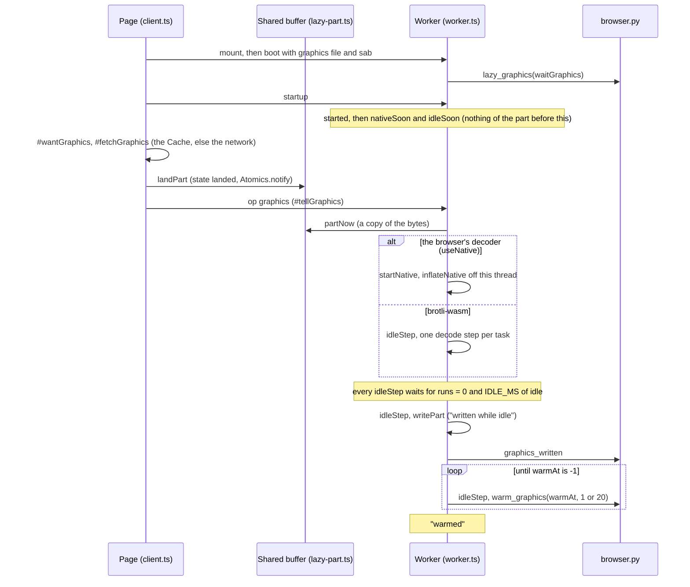
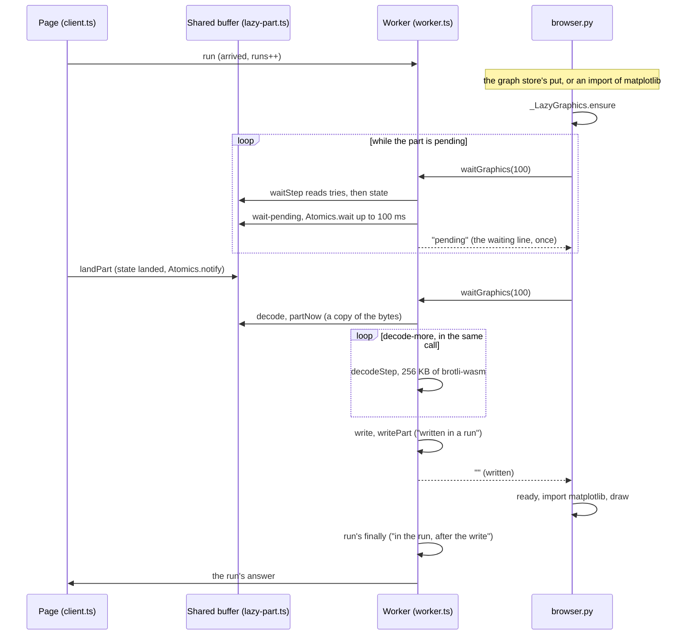
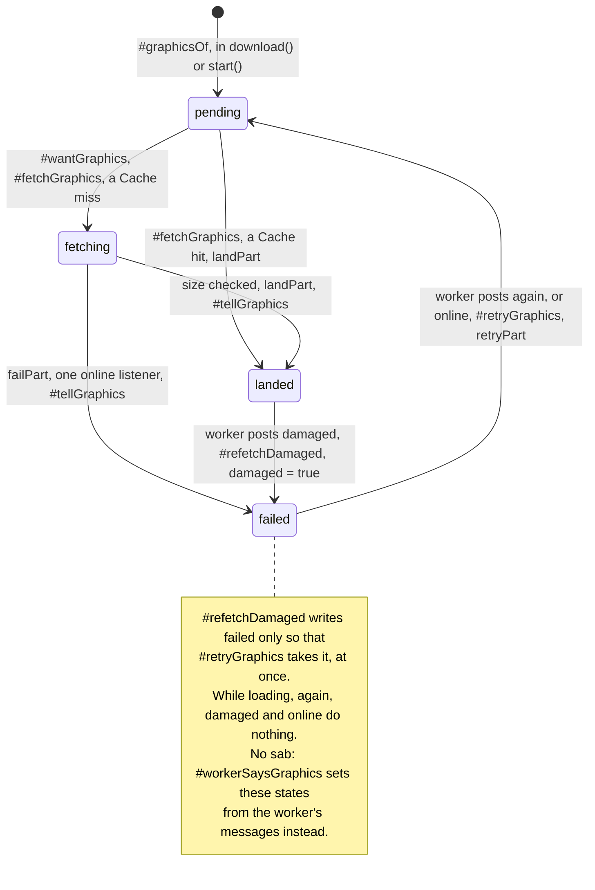
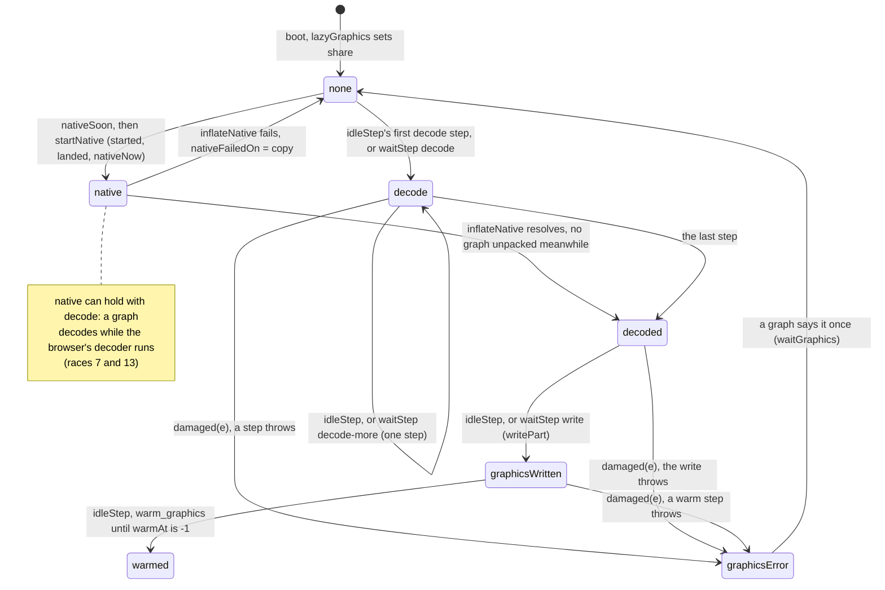
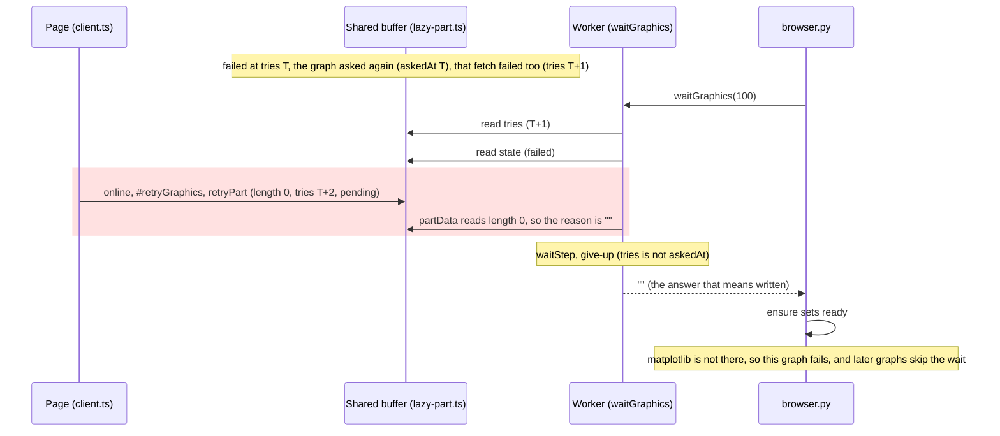

# Lazy graphics on both threads

The R1 note of the web audit (`docs/web-audit-plan.md`, section 6). It states how the lazy snapshot's graphics part
(matplotlib in a file fetched after the start, `docs/lazy-matplotlib.md`) moves between the page and the worker today,
and proposes how R1 makes it one machine. It changes no code. **Status: proposed 2026-11-23, for the maintainer's
approval.** Read from the code at e496b4c. Paths are under `web/src/engine/` unless they start with `web/`, `src/` or
`docs/`. "Guess" marks what was not checked.

## Primer: the pieces, in plain words

For a reader new to Web Workers, Pyodide, `SharedArrayBuffer` and `Atomics`. The sections after it assume it.

**Why Python runs in a worker.** The engine is Python, run in the browser by **Pyodide** (CPython compiled to
WebAssembly, the browser's portable machine code). A page has one main thread that also draws the page and answers
clicks; Python running there would freeze the page for the length of a run. So it runs in a **Web Worker**: a second
thread with its own memory, which talks to the page only by **messages** (`postMessage`; each message arrives as a
**task**, one unit of work a thread's event loop runs, never in the middle of another task). A run is one long task in
the worker: while Python runs, the worker reads no messages.

**Why matplotlib is a separate part.** The page starts from a **snapshot** (Python's memory saved at build time, so a
start skips the imports). matplotlib and the packages only it needs are left out of it and put in one more file, the
**graphics part**: about 7.7 MB compressed with brotli (a compression format), 32.9 MB and 1,822 files unpacked
(`docs/lazy-matplotlib.md`, 2026-11-15). The visitor downloads about 33.9 MB before the engine is ready instead of
41.6 MB, and only a program that draws a graph needs the rest.

**The flow.** Once the start files are in, the page fetches the part (from the browser's **Cache**, its offline store
for files, or else the network) and hands it to the worker. When the engine has been **idle** (no run sent or running)
for 0.25 s, the worker unpacks it, writes its files into Python's file system and imports the first modules, one short
step at a time, so that a run sent meanwhile waits for one step at most. A graph that comes before that is done waits
for the part inside its run, and unpacks and writes it there. Section 1 has both threads' tables, and the pictures
below show both paths.

**The shared buffer.** A message cannot reach a graph that waits inside a run: the worker is busy in Python and reads
none. So the page hands the part over in a **`SharedArrayBuffer`**, memory that both threads see at the same time.
Its size is 16 + the part's size: a 16-byte header of four 32-bit numbers (the part's state: pending, landed or
failed; the length of what follows; `tries`, how many times the page has fetched it; one unused), then the part's
bytes (or, when the fetch failed, the reason as text). The page writes it; the worker only reads it. A buffer is only
available when the site is **cross-origin isolated** (two HTTP headers that promise the page loads nothing from other
sites without their consent); production sends them.

**`Atomics`, the operations on shared memory.** Plain reads and writes of shared memory can be seen by the other
thread late or out of order, and data longer than one number can be seen half written. `Atomics` calls on one 32-bit number cannot be:
- `Atomics.load` reads the number whole, and the thread then also sees every write the other thread made before its
  `Atomics.store` of the value read ("write the data, then publish the state" relies on this);
- `Atomics.store` writes it whole, and publishes the writes made before it;
- `Atomics.add` adds to it in one step, so two adds never lose one;
- `Atomics.wait` blocks this thread while the number still has a given value, up to a time limit;
- `Atomics.notify` wakes the threads waiting on it.

What they do not give: two loads are two moments, not one snapshot (between them the other thread may change
anything); several stores are not one step (a reader can see the first without the next); and the page's main thread
may not call `Atomics.wait` at all (a browser refuses to block it), so the page cannot watch the buffer and hears the
worker only by messages.

**Without a buffer** (plain http on a LAN address, say), the worker fetches the part itself once the engine is ready,
and a graph that comes first downloads it with a request that blocks the worker until it ends. Its messages tell the
page how the download goes, for the progress ring. There is no **Break** then either (Break stops a run at its next safe point; it
uses a second, 4-byte shared buffer), so a stuck run resets the worker.

**Where it goes wrong: a race**, when the result depends on which thread gets somewhere first. Race 3 is the worked
example. A graph has asked the page for one more fetch, and that fetch failed, so the buffer says "failed" with its
reason. The graph reads the state (failed), and is about to read the reason's length. Just then the browser comes back
online, and the page starts another fetch: it sets the length to 0 first, then counts a try, then sets the state to
pending. The graph reads length 0: the reason is "" (empty). But "" is also the worker's answer for "the files are
written", so Python stops waiting, the graph fails on the missing matplotlib, and later graphs no longer wait. Each step
was atomic; the trouble is that the graph's three reads were not one snapshot and the page's three writes were not one
step. Section 6 (the shared state) gives the rule that closes this by design; section 7 lists every race found.

## In pictures: the normal path, with a shared buffer

The page fetches the part and hands it over; the engine is idle, so the worker unpacks, writes and imports it:

A graph that comes before the part is written waits for it, and unpacks and writes it in the run:

## 1. The two halves

**Page** (`client.ts`, the section "a lazy snapshot's graphics part"): one `GraphicsPart` per build for the page's life
(`#graphicsOf`), so a restarted worker gets the same one. Its state is spread over `progress.state` (also what the
status bar shows, through `onGraphics`), `loading` (a fetch on its way) and `damaged`. Writers of the shared buffer:
`landPart`, `failPart`, `retryPart` (`lazy-part.ts`).

| Event | Guard | Effect |
|---|---|---|
| `download()` (its Cache open); `start()` | | `#graphicsOf`: the part, pending; `sab` = `SharedArrayBuffer(PART_HEADER + size)` or null |
| `download()`'s start files are in; `start()`'s `started` | `sab`, not `loading`, not landed or failed | `#wantGraphics`: `#fetchGraphics` |
| `#fetchGraphics` | | the Cache (deleted first when fresh), else `#downloadGraphics` (`no-cache`; fresh: `reload`), kept in the Cache only beside the heap; size checked; `landPart` or `failPart` + one `online` listener; then `#tellGraphics` |
| worker posts `again` | sab; current part; failed; not `loading` | `#retryGraphics`: `retryPart` (tries + 1, pending), `#tellGraphics`, `#fetchGraphics(part, damaged)` |
| worker posts `damaged` | sab; current part; landed; not `loading` | `#refetchDamaged`: writes `progress.state = "failed"` so that `#retryGraphics` takes it, `damaged = true` |
| `online` | as `again` | `#retryGraphics` |
| no sab: worker posts `fetching`, `progress`, `landed`, `failed`, `damaged` | | `#workerSaysGraphics`: progress only (`damaged` becomes pending); `start()` resets it to pending for a new worker |

`#tellGraphics` sends the op `graphics` (no args, answered outside the queue) to the live worker, if any: it tells
the worker to look at the header, nothing more. It is sent only when there is a buffer.

The page's part, as `progress.state` (the flags `loading` and `damaged` beside it):

**Worker** (`worker.ts`, the section "a lazy snapshot's graphics part", lines 56 to 425). Pure decisions are already in
`lazy-part.ts`: `waitStep` (a waiting graph) and `useNative`; the rest decides inline.

| Event | Guard (spelled where) | Effect |
|---|---|---|
| `boot`: `startEngine` calls the hook `lazyGraphics` (`worker-boot.ts`) | build has a part | `share` set; the engine's `lazy_graphics(waitGraphics)` (`src/dofile/browser.py`) |
| `startup` answered | | `started`, `idleSince`; no sab: `prefetch` in a task; `nativeSoon`; `idleSoon` |
| op `graphics` | | `nativeSoon`; `idleSoon` |
| run arrives (dispatch hook `arrived`) | | `runs++` (stops the idle steps at once, before the queue reaches the run) |
| run starts | | `askedAt = null` |
| run ends (`finally`) | | the "in the run, after the write" line; `runs--`, `idleSince`; `nativeSoon`; `idleSoon` |
| `nativeSoon` | started; part; none of native, decode, decoded, written, error (line 352); `nativeNow()` | `startNative` in a task |
| `startNative` | the same flags again (358); landed; brotli-sized | `native`; `inflateNative`: keeps the result unless a graph unpacked meanwhile; failure: `nativeFailedOn = copy`; then `idleSoon(0)` |
| `idleSoon` | started; part; no timer; not native; no error; not (written and warmed) (387) | timer to `idleSince + IDLE_MS` |
| `idleStep` | `runs === 0`; idle `IDLE_MS` | one of: write (`decoded`; then `browser.graphics_written`), one decode step, start native (`nativeNow()` again, 408), first decode step, one `warm_graphics` step; a throw: `damaged`; else `idleSoon(0)` |
| a graph: `browser.py`'s `_LazyGraphics.ensure` calls `waitGraphics(100)` in a loop | written: ""; `graphicsError`: said once | `waitStep` decides: break, write, decode(-more), say-fetching, fetch (`fetchPartNow`), ask-again (`again`, wait), give-up, wait-failed, wait-pending (`Atomics.wait` on the header); a throw: `damaged` |
| no sab: `prefetch` lands or fails | not aborted, not here, not written | `share.bytes`, `copies++`; posts `landed` (or `failed`); `nativeSoon`, `idleSoon` |
| `damaged(e)` | | `graphicsError`; decode dropped; no sab: bytes dropped, `fresh`; posts `damaged` |

The unpack is one state written as four flags: none, `native`, `decode` (brotli-wasm under way), `decoded` (not
written), `graphicsWritten`, then warmed (`warmAt < 0`); `graphicsError` stops all idle work. Two can hold at once:
`native` with `decode` (a graph decodes while the browser's decoder runs; its result is then dropped, unless the
graph found the copy damaged: race 13).

The worker's unpack, as that one state (the table's events on its edges):

**Mirrors? No: the page's machine is much smaller.** Today the page's part has 4 states (pending, fetching, landed,
failed), two flags beside them (`loading`, `damaged`), 7 event rows and 7 transitions; the worker's has 7 unpack
states (none, native, decode, decoded, graphicsWritten, warmed, graphicsError), 14 event rows and 13 transitions, plus
the idle clock and a waiting graph's 10 steps (`waitStep`). Proposed (R1; the counts are a guess until it is built):
the page keeps its 4 states, with `damaged` as the argument of a retry rather than a flag, and about 6 events (want,
landed, failed, again, damaged, online); the worker keeps its 7 states as one field of its record, and about 11 events
(startup, the op `graphics`, run arrives, run ends, idle step, native done, native failed, a graph's wait, own fetch
landed, own fetch failed, damage). They own different things: the page owns the download, the Cache, the copy number
(`tries`) and the progress the status bar shows; the worker owns everything after the bytes arrive (unpack, write
into Python's files, warm-up, the idle clock, the waiting graph) and, without a buffer, the download too. What they
share is the buffer's three states (`PART_PENDING`, `PART_LANDED`, `PART_FAILED`) and `tries`, nothing else. The
page's names pending, landed and failed match the buffer's; its fetching is not in the buffer; the worker's names match
neither. Without a buffer the page's machine shrinks to a display of the worker's messages (`#workerSaysGraphics`).

## 2. The 22 variables as one record

All at `worker.ts:70-97`, one `let` each. S8 moved none of them. It moved what surrounds them: the boot work into
`worker-boot.ts` (`startEngine`, which calls back through the hook `lazyGraphics` that `table`'s `boot` entry defines;
`since` went there too), and the dispatch into `worker-dispatch.ts`, whose hook `arrived` now counts `runs`. Eight are
written by `table`'s handlers, so R1b's record is called from each of them: `snapshotBase` and `brotliWasm` (mount),
`share` (boot, in the hook `lazyGraphics`), `started` and `idleSince` (startup), `runs` (run's `arrived`, then its
`finally`), `askedAt` (run's start), `idleSince` and `writtenInRun` again (run's `finally`).

| Group | Today | Proposed field (names R1's to choose) |
|---|---|---|
| given at start | `share`, `snapshotBase`, `brotliWasm`, `started` | `part` (`{file, hdr, sab, bytes}`), `base`, `wasm`, `started` |
| idle clock | `runs`, `idleSince`, `idleTimer` | `runs`, `idleSince`, `timer` |
| unpack | `decode`, `native`, `decoded`, `graphicsWritten`, `warmAt`, `tWarm`, `warmLongest` | one `unpack` state (none, native, decoding, decoded, written, warming, warmed) with its data |
| copies and damage | `copies`, `nativeFailedOn`, `fresh`, `graphicsError` | `copies`, `nativeFailedOn`, `fresh`, `error` |
| this run | `askedAt`, `fetchSaid`, `writtenInRun` | `run: {askedAt, fetchSaid, writtenAt}` |
| own fetch (no sab) | `prefetching` | `prefetching` |

Read but owned elsewhere (they stay): `interrupt` (boot), `brotliMode` (mount), `py`, `browser`. Dead today:
`share.error` is never set to a reason (only cleared, `fetchPartNow`), so `partNow`'s failed branch without a buffer
cannot be reached. Names the naming survey gives R1: `askedAt` (the tries when this run asked again), `at` in
`fetchPartNow` (a URL), `damaged(e)` (a verb's job: it drops the copy; not the field `damaged` of `GraphicsPart` in
`client.ts`).

## 3. What stays a side effect

Pure, and testable as tables: what a waiting graph does (`waitStep`), whether to decode natively (`useNative`), and,
new in R1, what an idle step does and whether native may start (one predicate for lines 352, 358, 387 and 408), and the
page's transitions (fetch, retry, refetch-damaged, worker's message). Side effects, kept at the edge: `setTimeout`,
`postMessage` and the console lines, `Atomics.wait` and the header writes, `fetch` and the synchronous
`XMLHttpRequest`, `inflateNative`, `unpackSteps`, `writeGraphics`, `browser.graphics_written` and `warm_graphics`,
the Cache, the `online` listener, and the clock (passed in, as `machine.ts` does).

**Wire and words that stay unchanged** (they are read by e2e and by the page): the op `graphics` and `queued: false`;
the `{graphics: ...}` messages (`types.ts`, `FromWorker`); `waitGraphics`'s answers ("", "break", "pending", a
reason); the console lines `[dofile] graphics part: landed (cache|network)`, `written in a run`, `written while idle`,
`warmed`, `fetched by the worker`, `fetched by the worker in a run`, `in the run, after the write`,
`native brotli failed`, `the worker's own fetch was still on its way`, `the worker's fetch failed`; and
`browser.py`'s "(waiting for the graphics files to download)".

## 4. Driving a lazy part through the real worker under Node

**It already runs, unasserted.** `npm run snapshot` builds a lazy snapshot by default (`SNAPSHOT_NO_MPL` unset), and
`test/engine.test.ts`, "engine from a memory snapshot", then starts the real `worker.ts` (Node worker thread,
`test/harness.ts`) through `EngineClient` with a `SharedArrayBuffer`. The page half reads the part's `file:` URL with
`fs` (`#downloadGraphics`), lands it, and the test's `scatter` waits for it. Tried at e496b4c (snapshot at
`SNAPSHOT_QUALITY=5`): the run logs "landed (network)", "written in a run (unpack (wasm) ...)", "in the run, after the
write". A scratch test (not committed) that waited 4 s before its graph got "written while idle (unpack (native) ...)"
and "warmed": Node 26 has `DecompressionStream("brotli")`, so the native path and the idle steps run too. Nothing
asserts any of it, and the lines go to the process's stdout, not to the test.

**Without a buffer it cannot run as is.** Tried: with `SharedArrayBuffer` removed from the test's thread, the worker
thread died at `startup` ("Cannot read properties of undefined (reading 'href')"): `prefetch` reads `self.location.href`
outside its `try`, and its rejection is unhandled. Node also has no `XMLHttpRequest` (`fetchPartNow`) and its `fetch`
refuses `file:` URLs. `test/node-worker.ts` would need stand-ins for all three (guess: a few lines, the synchronous
request on `readFileSync`).

**What a held or damaged part needs.** The page's fetch of a `file:` URL bypasses the client's `fetch` option, so a test
cannot hold it (the e2e spec holds it with a route). A damaged copy can be had by pointing the snapshot folder's
`graphics.brotli.bin` at bad bytes, then good ones (guess: the test's own folder of symlinks, as engine.test.ts makes).

## 5. The iOS limit

`vite.config.ts` builds the worker as one file (`inlineDynamicImports`): a chunk importing the worker's entry made iOS
Safari run the entry twice, and the second copy took every later message. So R1's code goes into modules that
`worker.ts` imports statically (as `lazy-part.ts`, `worker-boot.ts`, `worker-dispatch.ts` are), never into a chunk
or a second worker of its own. This also rules out, for R1, the "decode on another thread" idea in lazy-matplotlib.md.

## 6. The shared state

**What is shared.** A `SharedArrayBuffer` is memory both threads see at once; `Atomics` are the operations on it that
each happen in one indivisible step, in one order both threads agree on. One rule makes a hand-over safe: data written
with plain writes before an `Atomics.store` is seen by a thread whose `Atomics.load` sees that store ("write, then
publish"). The part's buffer (`lazy-part.ts`) is an Int32 header of `PART_HEADER` (16) bytes, then the bytes:

| Field | Written by (page, `client.ts`) | Read by (worker, `worker.ts`) |
|---|---|---|
| state (`HDR_STATE`) | `landPart`, `failPart`, `retryPart`: `Atomics.store`, then `Atomics.notify` | `partState` (`Atomics.load`) in `partNow`; `waitPartChange` (`Atomics.wait`) |
| length (`HDR_LENGTH`) | the same three: `Atomics.store` | `partData`: a plain read |
| tries (`HDR_TRIES`) | `retryPart`: `Atomics.add` | `partTries` (`Atomics.load`): `waitGraphics`'s `read()`, `copyNow` |
| the fourth Int32 | nobody (always 0) | nobody |
| bytes, from `PART_HEADER` | `landPart` (the part), `failPart` (the reason): plain writes | `partData`: a plain copy (`slice`) |

The interrupt buffer is separate (4 bytes, one Int32, made in `client.ts`'s `start()`): the page stores 2 (SIGINT)
on Break (`interrupt()`) and 0 when it sends a run; Pyodide reads it during a run; `waitGraphics` reads it between
its waits and stores 0 when it takes the Break; `browser.py`'s `keep_breaks` puts a SIGINT back. It is not the part's.

**What is one step today.** Each `Atomics` call is one step; no transition is. `landPart` and `failPart` are four:
the bytes (plain), length, state, notify. `retryPart` is four: length 0, tries + 1, state pending, notify. The worker's
read is four too: tries, state (`partNow`), then length and the bytes (`partData`). It works today by order alone:
the page writes data only while the state is pending, which the worker never copies from, and publishes the state
last. Two places break that order. The worker must load `tries` before `state` (race 1, a rule nothing enforces),
and `retryPart` clears the length while the state still says failed, which is race 3.

**Two ways to make every read consistent.**
- (a) A seqlock-style reader, with `tries` as the generation. The worker loads tries and state, copies the length
  and bytes if landed or failed, then loads tries and state again; if either moved, it starts again (and then finds
  the part pending, and waits). The page invalidates first and publishes last: `retryPart` moves state and tries
  before it touches the length (or stops clearing it). Both halves are needed: a re-check alone can fall between
  today's length write and the tries add, and the new order alone still lets a read cross the retry. Cost: two more
  loads per read, a thrown-away copy (up to the part's size, a few MB) on the rare read that meets a retry, three
  lines reordered in `retryPart`. The layout, `waitPartChange` and `test/part-header.test.ts`'s layout test stay.
- (b) One Int32 holding state (low bits) and tries (the rest, a generation), stored by the page in one step, with the
  length and bytes written before it. State and tries can then never disagree (race 1 closed by design). But the
  bytes are still separate memory: a read that loaded "failed" can still overlap a retry and a fast Cache hit, so (b)
  needs the same re-check after the copy. `Atomics.compareExchange` would add nothing: the page's main thread is
  the only writer. Cost: a new layout (the `HDR_*` indexes, both threads, the layout test), and `waitPartChange`
  waits on the whole word.

**Recommended: (a).** It is the smaller change and keeps the layout; (b) needs its re-check anyway. The rule R1b
adopts: *the page writes the length and bytes only while the state is pending, and leaves landed or failed by moving
state and tries before anything else; the worker uses a length and bytes only when the tries and state it loaded
before and after the copy are equal.* Race 3 is then closed by design: a retry during the read moves tries, so the
empty reason is never used; the graph reads again, finds the part pending and waits. As a second guard, a failed part's
reason is never empty (`failPart` always has one), so an empty one can be taken as a torn read. Race 13 is not a
buffer race (it is between the worker's own decode and its own damage finding), so the rule does not touch it, but its
fix uses the same idea: `tries` (`copyNow`; `copies` without a buffer) is the copy number, and a native result is
kept only while it is still the copy the decode started from.

**Why the rest of each machine cannot live in the buffer.** A `SharedArrayBuffer` holds numbers and bytes, not
objects, promises or functions. Most of each machine is a resource of its own thread that the other could not use
even if it knew its state: the page's fetch and its reader, the Cache, the `online` listener and the `onGraphics`
listeners; the worker's brotli-wasm decode, the native decode's promise, its timers, Pyodide's files and Python's
`ready`. There is no `SharedArrayBuffer` at all without cross-origin isolation (plain http on a LAN), so the path
without one must work by messages anyway, and the buffer can only be the fast way to hand the part over. And the
page's main thread may not block on `Atomics.wait` (browsers forbid it), so it cannot watch the buffer: it hears the
worker's findings by message (`again`, `damaged`). The worker reads the buffer because a graph blocked in Python
receives no messages. So the buffer carries the hand-over only (one copy, its state, its number), and each thread
keeps its own machine.

## 7. Races between the page and the worker

1. A page retry between a graph's two header loads: `waitGraphics`'s `read()` loads `tries` before `state`
   (`partTries`'s doc), so the retry shows as new tries, not as the new fetch's failure. Ordered by load order.
2. A page retry while `startNative` reads the part: `copyNow()` is read before `partNow()`, so a native failure is
   charged to the copy it read. Ordered by load order.
3. **A page retry while a graph reads a failed part's reason gives a false success.** Not ordered. The state is an
   `Atomics.load` (`partNow`), the length a plain read after it (`partData`), and `retryPart` stores length 0 first. A
   retry between the two (the `online` event's `#retryGraphics`; no fetch needed) makes the reason "". When the graph
   has already asked again and that fetch failed (`give-up`), `waitGraphics` returns that "", which is its answer for
   "written": `browser.py`'s `ensure` sets `ready`. That graph then fails on the missing matplotlib (an import error,
   not rc 199 "graphs are not available"; its rc was not checked), and every later graph skips the wait and fails the
   same way, sending no `again`, until a copy is written while idle (`graphics_written`), which needs a page fetch to
   land; a reload also clears it. Forced with the real `lazy-part.ts` functions (the reviewer's script, re-run here):
   `{"step":"give-up","reason":""}`; `browser.py`'s reading of "" is read, not run. Rating: rare (a few instructions
   wide, and only while the browser goes online during a graph's wait after its asked-for fetch failed), but a wrong
   answer rather than a slow one; no data is lost. **Fixed in R1b, as its first change, test first**: a case in
   `test/lazy-part.test.ts` that forces `retryPart` between the state load and the length read (as the reviewer's
   script does) and expects no "" (the graph waits again, or gets a non-empty reason); it fails today. The fix: section
   6's rule (read the state again after the copy and read again if it moved), with `give-up` never answering "".
4. The graph's `again` and the `online` event: both go through `#retryGraphics`, whose guard (failed, not loading)
   starts one fetch; the graph's `askedAt` makes either fetch's failure final for it. Ordered by the guard.
5. The part lands before `startup` is answered: the op `graphics` arrives, `nativeSoon` and `idleSoon` return on
   `!started`, and `startup` calls both. Ordered by `started`.
6. The part lands between two workers (restart): `#tellGraphics` skips an ended or absent worker; the next gets the
   same buffer at boot and reads the header at `startup`. Ordered; not tested (lazy-matplotlib.md: "argued").
7. A graph while the browser's decoder runs: the graph decodes with brotli-wasm; the native result is dropped by
   `!graphicsWritten && !decode && !decoded`. Ordered; costs a second decode.
8. A run arriving during an idle step: `runs++` happens at arrival, `idleStep` returns on `runs > 0`; the step under
   way ends first (one step at most). Ordered by the single thread.
9. No buffer, a graph while `prefetch` streams: `fetchPartNow` aborts it; the aborted fetch posts nothing, and a copy
   that ends late is dropped (line 316). Ordered.
10. No buffer, an ended worker's late `{graphics}` message: `worker.onmessage` hands it to `#workerSaysGraphics`
    without checking `live.ended` (answers to calls go through `live.pending`), after `start()` reset the progress
    to pending. Not ordered. Guess: whether a terminated worker's queued messages are still delivered was not checked.
11. Damage found by an idle step, then the fresh copy lands: `graphicsError` blocks `nativeSoon` and `idleSoon`, so
    the fresh copy waits; the next graph reports the damage (rc 199) although a fresh copy is there, the one after it
    draws. As `damaged()`'s comment says; R1 keeps it or the maintainer changes it.
12. Each failed page fetch adds one `online` listener (`once`); they pile up until the browser is online, each a no-op
    after the first. Not a race; noted.
13. **A native decode of a copy a graph has already found damaged is written again** (read, not run). The part lands,
    `startNative` starts; a graph comes first (race 7), decodes with brotli-wasm, and `writeGraphics` throws:
    `damaged()` posts `damaged`, clears `decode` and `decoded`, and the graph's catch clears `graphicsError`. The page
    drops the Cache entry and fetches again. After the run the native promise resolves; its guard
    (`!graphicsWritten && !decode && !decoded`) holds, so the damaged copy becomes `decoded`, the idle step writes it,
    it throws again, and a second `damaged` goes out with `graphicsError` set. If the fresh copy has landed by then,
    `#refetchDamaged` drops a good copy and fetches a third time, and the next graph reports damage (rc 199) although
    a good copy is there. Not ordered. Rare: it needs bytes brotli accepts but the write rejects, and a graph during
    the native decode. The cause: `damaged` and `again` carry no copy number, and the native result is not tied to the
    copy it read (`startNative` keeps `copy` only for a failure); two graphs of one run (a `capture` loop) can send the
    same stale `damaged` twice too. R1b keeps the native result only while `copyNow()` is still the copy it read and no
    damage was found on that copy; R1c could take `damaged` with the copy (tries) it is about.
14. **Without a buffer, a graph's own download cannot be broken off** (read, not run). There is no interrupt buffer
    (`client.ts`, `start()`), and `fetchPartNow`'s synchronous request holds the worker for the whole download
    (its comment says so). A Break or the run's timeout therefore resets the worker (rc 9998, the data gone); the
    next worker has no copy (`copies` 0, the page's progress set back to pending by `start()`) and starts its
    `prefetch` from zero. Ordered, by the reset; it costs the data and the download.

Race 3, drawn: the shaded step is the page's retry between the worker's state load and its length read.

## 8. Tests

**Pinning today, before any line moves:** `e2e/graphics.spec.ts` (7 tests; skipped without a part). It reads the
worker's and page's `[dofile] graphics part` lines (order "landed ... written ... warmed"; "written while idle"; written
once) and times the idle wait: from the run sent at "ready" to the "written while idle" line, less the write and a
brotli-wasm unpack, must exceed 0.15 s. Node: `test/lazy-part.test.ts` (`waitStep`, `useNative`),
`test/part-header.test.ts` (the layout), `test/client.test.ts` (four "graphics part" tests: the page's hand-over,
damage, re-fetch, failure and `online`), `test/worker-dispatch.test.ts` (`graphics` beside the queue),
`test/worker-boot.test.ts` (`lazyGraphics` called with the engine and the part, not without a part),
`test/snapshot.test.ts` (`unpackSteps`, `packGraphics`/`writeGraphics`), `test/app-engine.test.ts` (the graphics
subscription let go), and in CPython `tests/test_browser.py` (the two `lazy_graphics` tests).

**New, before R1's items move code:**
- a. Node, real worker, with a buffer (from section 4's scratch test): a graph at `started` writes "in a run"; idle:
  "written while idle", then "warmed", no step before the last run's end plus `IDLE_MS`; a restart with a landed part
  does not fetch again. Needs the harness to collect the worker thread's console lines (an option of `nodeWorker`).
- b. Node, real worker, with a buffer: a Break while a graph waits for a held part (rc 1, data kept, draws once
  released), and a damaged copy (the graph says so, the page refetches with reload, the next graph draws). Needs a
  way to hold the page's fetch of a `file:` part.
- c. Node, real worker, without a buffer: `prefetch` lands and the idle steps take it; a graph during `prefetch`
  fetches itself; damage gives a `?fresh=` address. Needs section 4's stand-ins in `test/node-worker.ts`.
- d. Pure tables for whatever R1 makes pure (idle step, native gate, page transitions), as `lazy-part.test.ts` does,
  with two cases written to fail first: race 3 (a retry between the state and the length read) and race 13 (a native
  result of a copy found damaged is not kept).

## 9. R1 in three items (proposed)

1. **R1a, the nets (2.3).** Tests a to c with their harness changes; `share.error` either set by the no-buffer
   failures or removed (the test says which); no change to behaviour.
2. **R1b, the worker's machine (2.3, after R1a).** The 22 variables as one record (section 2) in a module `worker.ts`
   imports statically; the idle step and the native gate as pure functions next to `waitStep`; the renames; `table`'s
   hooks call it; wire and words unchanged (section 3). Tests d for the worker. Its two behaviour fixes come first,
   each with its failing test: race 3 (no "" from a failed part) and race 13 (the native result tied to its copy).
3. **R1c, the page's machine and the docs (2.4).** `client.ts`'s part as one state with its transitions (no rewrite of
   `progress.state` to steer a guard; `progress` becomes derived for the status bar); the `online` listener once per
   part; race 10 checked against `live`. Then `docs/lazy-matplotlib.md` brought up to date (list below),
   `src/dofile/browser.py`'s section comment, and `docs/test-map.md`. It leaves `app/state.ts` and
   `app/engine.ts` alone (`onGraphics` keeps its shape).

## 10. Where lazy-matplotlib.md is out of date

- "`SharedArrayBuffer(16 + size)`": the code says `PART_HEADER + file.size` (`#graphicsOf`); the value holds.
- The worker's own fetch is called `fetch` ("`fetch`, off the engine's way"; "the worker's `fetch` uses
  `cache: "reload"`"): the code has two, `prefetch` (after `startup`, streamed, with progress, `reload` after damage)
  and `fetchPartNow` (a graph's synchronous request, `?fresh=` after damage).
- "The page asks for the part at the end of `download()`": also after `started` (`start()`), which is the call that
  counts when `download()` had no Cache to fill.
- "the graph that found it says so (rc 199), the next one waits for the fresh fetch": when an idle step found the damage,
  the next graph says it even if the fresh copy is already there (race 11).
- Its title and heading still say "experiment" and "E1c", as do `src/dofile/browser.py`'s section comment ("experiment
  E1c") and `docs/test-map.md`'s `graphics.spec.ts` entry.
- Checked and holding: 256 KB decode steps, `IDLE_MS` 0.25 s, `waitGraphics(100)` slices, the warm order (three
  modules one at a time, then 20), `useNative`, the `no-cache`/`reload` fetches, 158 modules to warm and 1,822 files
  (this build). Not checked: its timings and sizes.
