# Prototype 1, step 3.5 C: the engine state machine, in diagrams

The diagrams of [prototype1-step3.5-c-design.md](prototype1-step3.5-c-design.md), the design of step C of
[prototype1-step3.5-plan.md](prototype1-step3.5-plan.md). The design is the reference: the state, event and effect names
here are its names, and the transition tables in section 5 are its tables, cell for cell.

- **Status:** approved by the maintainer on 2026-11-11, with the design.
- **Date:** 2026-11-10, revised 2026-11-11.
- **Paths** are relative to the repository root; in the diagrams, `app/` and `engine/` stand for `web/src/app/` and
  `web/src/engine/`.

Contents: 1 Data-flow map; 2 The states; 3 Events; 4 Effects; 5 The transition tables; 6 The stale guard and the
tickets; 7 Races.

## 1. Data-flow map

Legend:

- **Thick arrow**: an event goes TOWARDS the machine.
- **Thin solid arrow**: an effect is PERFORMED on the receiver, or a signal is written.
- **Dotted arrow**: the reader SUBSCRIBES to (reads) a signal.
- **Arrow ending in a circle**: a READ OP, outside the machine. It asks the engine for data and changes nothing.
- **Plain line**: any other link.

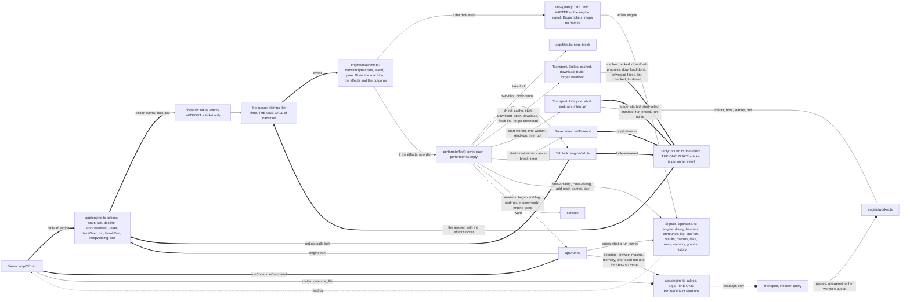

Read it left to right. Everything that happens goes into the queue (thick): the visitor's actions and `lock-lost`
through `dispatch`, which takes no event with a ticket; every answer through a `reply`, which puts its effect's ticket
on it. The queue calls `transition` once per event. The new state is written to the `engine` signal first, then the
effects go out (thin), each to the thing it acts on; the things that answer do so through `reply`, back into the
queue. `run.ts` does not read the `engine` signal: it hears of a new or lost engine only through effects. All the
boxes from the actions to `reply`, and `call`, are in `web/src/app/engine.ts`. `web/src/main.tsx` builds the transport
and the tab lock, calls `connectEngine`, `connectFiles` and `connectRun`, then `open()`; it is not drawn. It is the
only module that constructs or connects anything, which a test checks, so each box here exists once for each page.

The read ops (circle ends, along the bottom) go beside all of that: `call` to the transport's `query` to the worker.
`call` is the page's one provider of them: `run.ts` asks after each run and for "Show 50 more" and writes the shared
signals; a view asks only for what it alone shows, a matrix by name or a `.dta` file by path. They raise no event and
never reach the machine. With no worker a read op is rejected (kind `no-engine`); during a run
it waits in the worker's queue; if its worker is ended it is rejected with the ending's kind. Only `perform` holds the
transport's `Lifecycle` interface, so nothing else can send `mount`, `boot`, `startup` or `run`. The page's file
changes are journalled in the store, which then calls a function the transport gave it; that function posts the worker
the op `sync`, with nothing in it (step D). They are not drawn.

## 2. The states

The machine has sixteen states, one for each row of the tables, each with its own tag. The `engine` signal, the
`data-engine` attribute and the tests use the same sixteen names: `view(state)` drops the tickets and a queued run's
code and maps no names. The views' type, `EngineState`, is written out with one line per state; the compiler checks
that it has the machine's tags and holds no ticket or queued run (the design, item 1). Three things come in two forms: the page load (`checking-lock`, `checking-cache`), a start
(`starting-list`, `starting-worker`) and another tab owning the files (`other-tab-idle`, `other-tab-taking`).

### 2a. The happy path

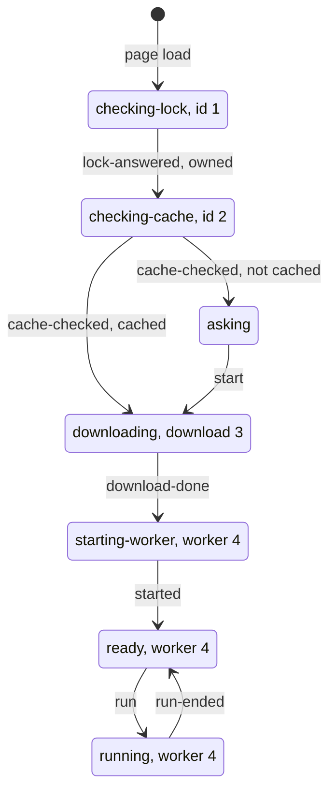

A page load with the engine's files already cached goes straight down; a first visit goes through `asking`. The
tickets are the ones a normal cached load gets from the counter.

### 2b. Page load and the tab lock

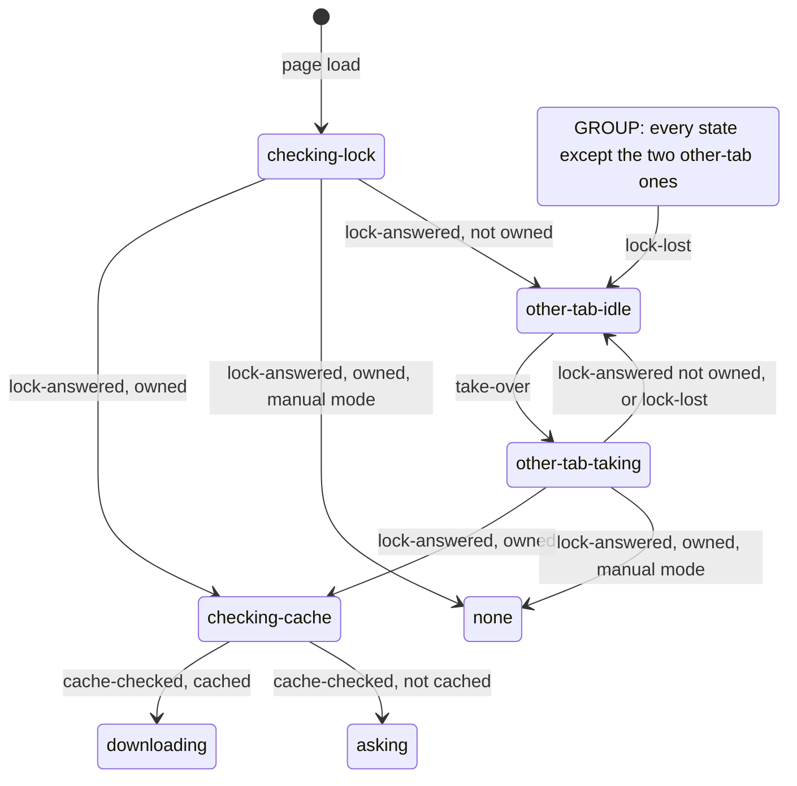

The box marked GROUP is not a state: it stands for the fourteen rows from `checking-lock` to `failed-twice`, which
all leave the same way on `lock-lost`. The other diagrams leave that arrow out.

### 2c. Asking and downloading

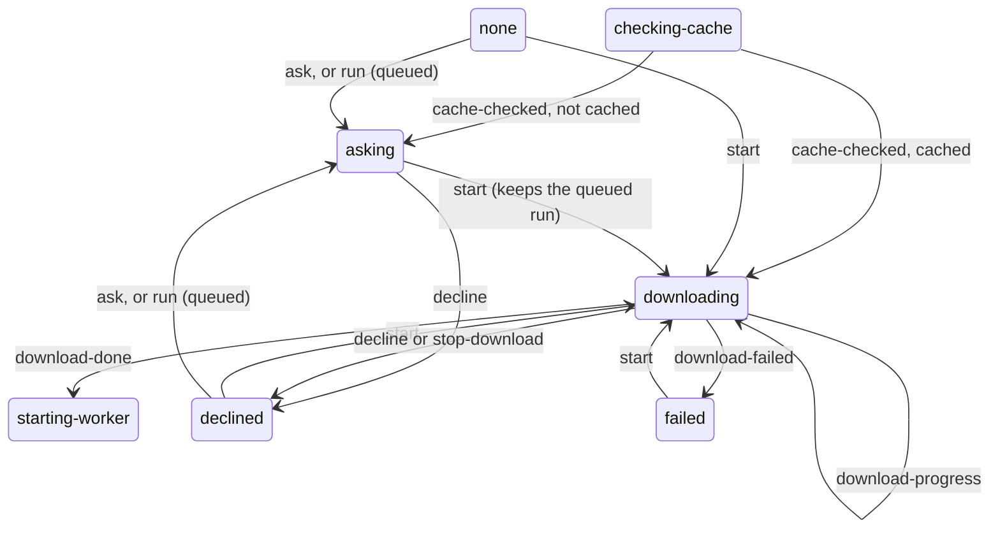

`none` is seen only in manual test mode. A run pressed with no engine is kept in `asking` (the field `queued`), then
carried through `downloading` into `starting-worker`; `decline`, `stop-download` and `download-failed` drop it.

### 2d. Starting and failures

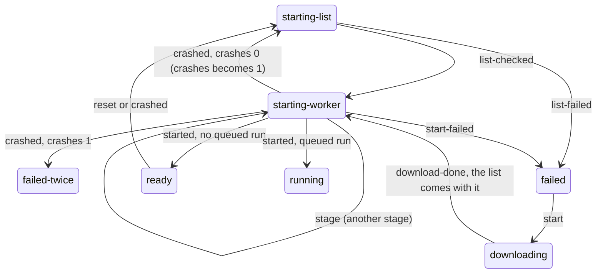

A start the visitor begins goes from `downloading` straight to `starting-worker`: `download()` has just checked the
build's list. Every restart goes through `starting-list`, where the list is fetched fresh and no worker exists yet.
A tab has at most one live worker: the states that have one are `starting-worker`, `ready`, `running`, `breaking` and
`waiting`, `start-worker` is emitted only from `downloading` and `starting-list`, which have none, and the transport's
`start` throws if a worker is still live. The first crash while starting makes a new start and keeps the queued run;
the second ends in `failed-twice`, which only `lock-lost` leaves. The crash count goes back to 0 at `started` and at `failed-twice`, and is kept through
`failed`.

### 2e. Running, Break and reset

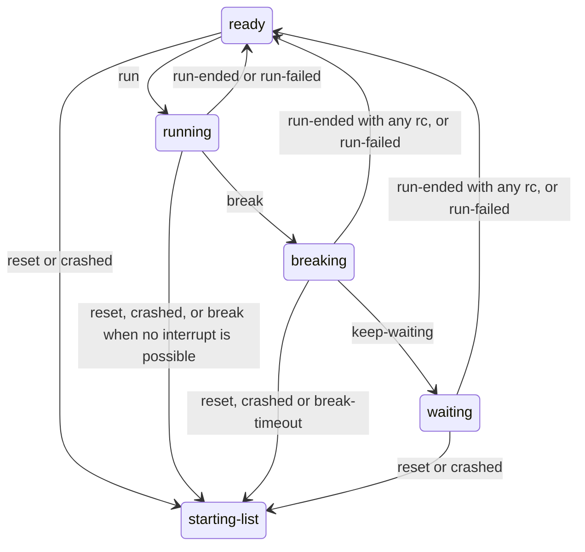

An arrow with several events stands for one transition per event, all between the same two states. Every arrow into
`starting-list` is a reset: the old worker ends, the run in progress ends with rc 9998, and a new start gets a new
ticket. A run that ends after Break keeps the rc the engine gave it: 1 when the engine took the Break between
commands, the run's own rc when it had already finished. These four states and their six events are table E, the
run's own small machine inside the one machine.

## 3. Events

| Source | Events | Presents a ticket `n`? | `n` is the ticket of |
|---|---|---|---|
| Visitor (the actions of `web/src/app/engine.ts`) | `start`, `ask`, `decline`, `stop-download`, `reset`, `take-over`, `run`, `break`, `keep-waiting` | no | |
| Tab lock | `lock-answered` | **yes** | the lock request |
| Tab lock | `lock-lost` | no | |
| Cache check | `cache-checked` | **yes** | the check |
| Download | `download-progress`, `download-done`, `download-failed` | **yes** | the download |
| The build's list, on a restart | `list-checked`, `list-failed` | **yes** | the start |
| Worker, through the transport's `reply` | `stage`, `started`, `start-failed`, `crashed` | **yes** | the worker |
| Worker, through the `send-run` performer | `run-ended`, `run-failed` | **yes** | the worker |
| Break timer | `break-timeout` | **yes** | the worker |

Twenty-four events. Fourteen present a ticket and pass through the stale guard (section 6); the nine visitor events
and `lock-lost` have none. Every event also gets `at`, the time, stamped once where it is queued. Log chunks and read ops are
not events.

## 4. Effects

| Performed on | Effect | What is done | Answered with |
|---|---|---|---|
| Tab lock (`web/src/engine/tab.ts`) | `take-lock {n, steal}` | `lock.take({steal})` | `lock-answered` |
| Files (`web/src/app/files.ts`) | `own-files` | `own()`: `store.blocked = false`, `keep(storage)`, `refresh()`. Not awaited. | none |
| Files | `block-store` | `block()`: `store.blocked = true` | none |
| Build and download (the transport's cache methods) | `check-cache {n}` | `client.cached()` | `cache-checked` |
| Build and download | `start-download {n}` | make an `AbortController` kept with `n`; `client.download()` | `download-progress`, `download-done`, `download-failed`; nothing after an abort |
| Build and download | `abort-download {n}` | abort the controller kept with `n` | none |
| Build and download | `fetch-list {n}` | `client.build()` | `list-checked`, `list-failed` |
| Build and download | `forget-download` | `client.forgetDownload()` | none |
| Worker (the transport's lifecycle interface) | `start-worker {n, build}` | `client.start(n, build, reply)` | `stage`, `started`, `start-failed`, `crashed` |
| Worker | `end-worker {n, ending}` | `client.end(n, ending)`: terminate, detach the store, reject the pending calls | none |
| Worker and `web/src/app/run.ts` | `send-run {n, code, head}` | tell `run.ts` the run began (head, theme), then `client.run(n, …, onLog)` | `run-ended`, `run-failed` |
| Worker | `interrupt {n}` | `client.interrupt(n)`: SIGINT into the shared buffer | none |
| Break timer | `start-break-timer {n, ms}` | `setTimeout` | `break-timeout` |
| Break timer | `cancel-break-timer` | `clearTimeout` | none |
| `web/src/app/run.ts` | `end-run {result}` | hand the result over. Always the last effect of its step. | none |
| `web/src/app/run.ts` | `engine-ready` | ask `memory` (today `web/src/app/run.ts:37-39`) | none |
| `web/src/app/run.ts` | `engine-gone` | clear `results`, `macros`, `data`, `rows`, `memory`, `lastRun`, `sessionRuns` (today `web/src/app/run.ts:30-36`). This is the plan's "the engine was replaced". | none |
| Signals (`web/src/app/state.ts`) | `show-dialog` | write `dialog` | none |
| Signals | `close-dialog {dialog, focusEditor}` | close it only if that kind is open; with `focusEditor`, focus the editor after (today `web/src/app/engine.ts:216-219`) | none |
| Signals | `add-reset-banner {reason, kind}` | `addBanner({b: "reset", reason, kind})` | none |
| Signals | `say {line}` | `say(SAY[line])`; the words stay in `web/src/app/engine.ts` | none |
| Console | `warn {text}` | `console.warn` (today `web/src/app/engine.ts:229`) | none |

`lock-lost` is the one outside event that no effect asks for: the lock's `onLost` raises it. The last column is the
effect's row in the `Answers` map, which the compiler checks: an effect with answers gets a `reply` function bound to
its ticket; the others get none. The controller keeps two handles for
these effects (the Break timer's id and the download's `AbortController`); neither decides a state.

## 5. The transition tables

How to read a cell:

- `·` : the event is not valid in this state. Nothing changes, no effects (outcome `not-valid`).
- **STALE** : the state holds no ticket, so the stale guard drops every event that presents one (outcome `stale`).
- Any other cell of an event with a ticket: the guard runs first (an `n` that is not the state's ticket changes
  nothing). The cell says what happens when `n` matches.
- A cell reads "new state; effects in order". A state is written as its tag and the fields that matter.
- `next` is a new ticket, `issued + 1`. `first` is the first stage: `download` on a snapshot start, else `python`. `at`
  is the event's time. `worker`, `download`, `run` and `t0` without a value are the old state's.

Shorthand:

| Name | New state | Effects, in order |
|---|---|---|
| **DOWNLOAD(queued)** | `downloading {download: next, received: 0, total: env.engineBytes or 0, t0: at, queued}` | `start-download {next}` |
| **ASK(queued)** | `asking {queued}` | `show-dialog download`, with `forRun` true when a run is queued |
| **STOP** | `declined` | `abort-download {download}`, `close-dialog download`, `say download-stopped` |
| **OWN** | Manual mode: `none`. Otherwise `checking-cache {id: next}` | Manual mode: `own-files`. Otherwise `own-files`, `check-cache {next}` |
| **BREAK** | Interrupt possible: `breaking {worker, run, t0, resetAt: at + env.graceMs}`. Not possible: RESET(break), with the reason that the page is not cross-origin isolated | `interrupt {worker}`, `start-break-timer {worker, env.graceMs}` |
| **END(result)** | `ready {worker}` | `cancel-break-timer` (only from `breaking`), `end-run {result}`. The result is passed on as it is, whatever its rc (4.3) |
| **FAIL(reason, detail)** | `failed {reason, detail}`; `crashes` unchanged | `end-worker {worker, failed}` (only from `starting-worker`), `close-dialog download`, `say failed`, `warn` |
| **TWICE(reason, detail)** | `failed-twice {reason, detail}`; `crashes` 0 | `end-worker {worker, failed-twice}`, `forget-download` (unless the reason is `memory` or `no-wasm`), `close-dialog download`, `say failed-twice`, `warn` |
| **RESET(kind)** | `starting-list {worker: next, stage: first, t0: at, done: {}, queued}`. `queued` is kept from `starting-worker`, null otherwise. `crashes` becomes 1 for kind `crash`, else 0 | `cancel-break-timer` (only from `breaking`); `end-worker {old worker, reset}`; `fetch-list {next}`; only from `ready`, `running`, `breaking`, `waiting`: `add-reset-banner {reason, kind}`, `say reset`, `engine-gone`; only from `running`, `breaking`, `waiting`: `end-run {cutResult(lost(reason), kind)}` |
| **LOST** | `other-tab-idle`; `crashes` 0 | `abort-download {download}` (only from `downloading`); `cancel-break-timer` (only from `breaking`); `end-worker {worker, stopped}` (only from `starting-worker`, `ready`, `running`, `breaking`, `waiting`); `block-store`; `engine-gone`; `show-dialog other-tab`; only from `running`, `breaking`, `waiting`: `end-run {cutResult(lost("another tab took over"), "stopped")}` |

RESET kinds: `user` (the visitor), `break` (the code did not stop in the grace time, or no interrupt is possible),
`crash` (the worker failed, or the browser closed the file storage).

**A. The visitor's engine actions**

| State | start | ask | decline | stop-download | reset | take-over |
|---|---|---|---|---|---|---|
| checking-lock | · | · | · | · | · | · |
| checking-cache | · | · | · | · | · | · |
| none | DOWNLOAD(null) | ASK(null) | · | · | · | · |
| asking | DOWNLOAD(state.queued) | · | `declined`; `close-dialog download` | · | · | · |
| declined | DOWNLOAD(null) | ASK(null) | · | · | · | · |
| downloading | · | · | STOP | STOP | · | · |
| starting-list | · | · | · | · | · | · |
| starting-worker | · | · | · | · | · | · |
| ready | · | · | · | · | RESET(user) | · |
| running | · | · | · | · | RESET(user) | · |
| breaking | · | · | · | · | RESET(user) | · |
| waiting | · | · | · | · | RESET(user) | · |
| failed | DOWNLOAD(null) | · | · | · | · | · |
| failed-twice | · | · | · | · | · | · |
| other-tab-idle | · | · | · | · | · | `other-tab-taking {take: next}`; `take-lock {next, steal: true}` |
| other-tab-taking | · | · | · | · | · | · |

**B. Tab lock and cache check**

| State | lock-answered {n, owned} | lock-lost (no ticket) | cache-checked {n, cached} |
|---|---|---|---|
| checking-lock | Owned: OWN. Not owned: `other-tab-idle`; `show-dialog other-tab` | LOST | · |
| checking-cache | · | LOST | Cached: DOWNLOAD(null). Not cached: ASK(null) |
| none | **STALE** | LOST | **STALE** |
| asking | **STALE** | LOST | **STALE** |
| declined | **STALE** | LOST | **STALE** |
| downloading | · | LOST | · |
| starting-list | · | LOST | · |
| starting-worker | · | LOST | · |
| ready | · | LOST | · |
| running | · | LOST | · |
| breaking | · | LOST | · |
| waiting | · | LOST | · |
| failed | **STALE** | LOST | **STALE** |
| failed-twice | **STALE** | LOST | **STALE** |
| other-tab-idle | **STALE** | · | **STALE** |
| other-tab-taking | Owned: `close-dialog other-tab`, then OWN. Not owned: `other-tab-idle`; no effects | `other-tab-idle`; no effects | · |

**C. Download and the build's list**

| State | download-progress {n, received, total} | download-done {n, build} | download-failed {n, reason, detail} | list-checked {n, build} | list-failed {n, reason, detail} |
|---|---|---|---|---|---|
| checking-lock | · | · | · | · | · |
| checking-cache | · | · | · | · | · |
| none | **STALE** | **STALE** | **STALE** | **STALE** | **STALE** |
| asking | **STALE** | **STALE** | **STALE** | **STALE** | **STALE** |
| declined | **STALE** | **STALE** | **STALE** | **STALE** | **STALE** |
| downloading | `downloading` with the new `received` and `total` | `starting-worker {worker: next, stage: first, t0: at, done: {download: (at − t0) / 1000}, queued}`; `start-worker {next, build}`, `say {stage: first}` | FAIL(reason, detail) | · | · |
| starting-list | · | · | · | `starting-worker`, with the fields of `starting-list` unchanged; `start-worker {worker, build}` | FAIL(reason, detail) |
| starting-worker | · | · | · | · | · |
| ready | · | · | · | · | · |
| running | · | · | · | · | · |
| breaking | · | · | · | · | · |
| waiting | · | · | · | · | · |
| failed | **STALE** | **STALE** | **STALE** | **STALE** | **STALE** |
| failed-twice | **STALE** | **STALE** | **STALE** | **STALE** | **STALE** |
| other-tab-idle | **STALE** | **STALE** | **STALE** | **STALE** | **STALE** |
| other-tab-taking | · | · | · | · | · |

**D. Worker start and crash**

| State | stage {n, stage} | started {n} | start-failed {n, reason, detail} | crashed {n, cause, reason, detail} |
|---|---|---|---|---|
| checking-lock | · | · | · | · |
| checking-cache | · | · | · | · |
| none | **STALE** | **STALE** | **STALE** | **STALE** |
| asking | **STALE** | **STALE** | **STALE** | **STALE** |
| declined | **STALE** | **STALE** | **STALE** | **STALE** |
| downloading | · | · | · | · |
| starting-list | · | · | · | · |
| starting-worker | The same stage: no change, no effects. Another: `starting-worker {stage, t0: at, done: done plus the old stage's seconds}`; `say {stage}` | `crashes` 0. No queued run: `ready {worker}`; `close-dialog download` (focus the editor), `say ready`, `engine-ready`. Queued run: `running {worker, run: head, t0: at}`; the same three effects, then `send-run {worker, code, head}` | FAIL(reason, detail) | `crashes` 0: RESET(crash). `crashes` 1: TWICE(reason, detail) |
| ready | · | · | · | RESET(crash) |
| running | · | · | · | RESET(crash) |
| breaking | · | · | · | RESET(crash) |
| waiting | · | · | · | RESET(crash) |
| failed | **STALE** | **STALE** | **STALE** | **STALE** |
| failed-twice | **STALE** | **STALE** | **STALE** | **STALE** |
| other-tab-idle | **STALE** | **STALE** | **STALE** | **STALE** |
| other-tab-taking | · | · | · | · |

**E. Runs**

| State | run {code, head} | break | keep-waiting | run-ended {n, result} | run-failed {n, message} | break-timeout {n} |
|---|---|---|---|---|---|---|
| checking-lock | · | · | · | · | · | · |
| checking-cache | · | · | · | · | · | · |
| none | ASK(run) | · | · | **STALE** | **STALE** | **STALE** |
| asking | · | · | · | **STALE** | **STALE** | **STALE** |
| declined | ASK(run) | · | · | **STALE** | **STALE** | **STALE** |
| downloading | · | · | · | · | · | · |
| starting-list | · | · | · | · | · | · |
| starting-worker | · | · | · | · | · | · |
| ready | `running {worker, run: head, t0: at}`; `send-run {worker, code, head}` | · | · | · | · | · |
| running | · | BREAK | · | END(result) | END(cutResult(message, "run-failed")) | · |
| breaking | · | · | `waiting {worker, run, t0}`; `cancel-break-timer` | END(result) | END(cutResult(message, "run-failed")) | RESET(break) |
| waiting | · | · | · | END(result) | END(cutResult(message, "run-failed")) | · |
| failed | · | · | · | **STALE** | **STALE** | **STALE** |
| failed-twice | · | · | · | **STALE** | **STALE** | **STALE** |
| other-tab-idle | · | · | · | **STALE** | **STALE** | **STALE** |
| other-tab-taking | · | · | · | · | · | · |

Sixteen rows, the tags of `State`, in the same order in all five tables; twenty-four columns in all. Table E holds
every run event.

## 6. The stale guard and the tickets

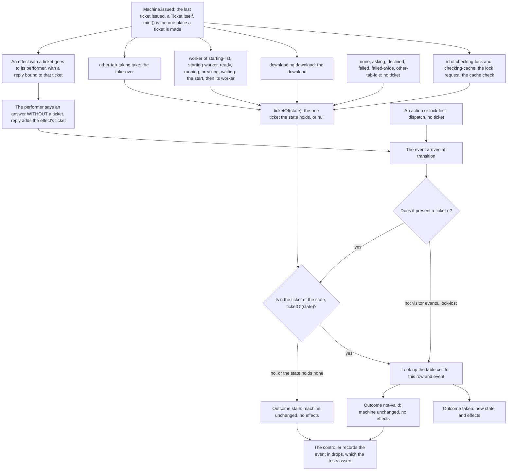

Top: one counter issues every ticket, so a download's can never equal a worker's, and a state holds at most one. The
counter is a `Ticket` too, so it cannot be set back by hand: no state ever holds a ticket greater than `issued`.
Middle: no code outside the machine writes a ticket. A `Ticket` cannot be written as a literal; a performer gets a
`reply` that takes an answer without `n`; `dispatch` takes no event with a ticket; the `Answers` map, checked by the
compiler, says which events each effect may be answered with. A `reply` also belongs to the wiring that performed
its effect: after a second `connectEngine` it does nothing, because the new machine issues the same numbers again.
Bottom: the check is the first line of `transition`, and an event that changes nothing is recorded, so a test that
did not expect it fails.

## 7. Races

In each diagram the machine's answer is "new state", and the arrows that follow it are that step's effects in order.
The controller writes the `engine` signal after each answer and before the effects.

### 7a. Break, and the engine takes it: rc 1

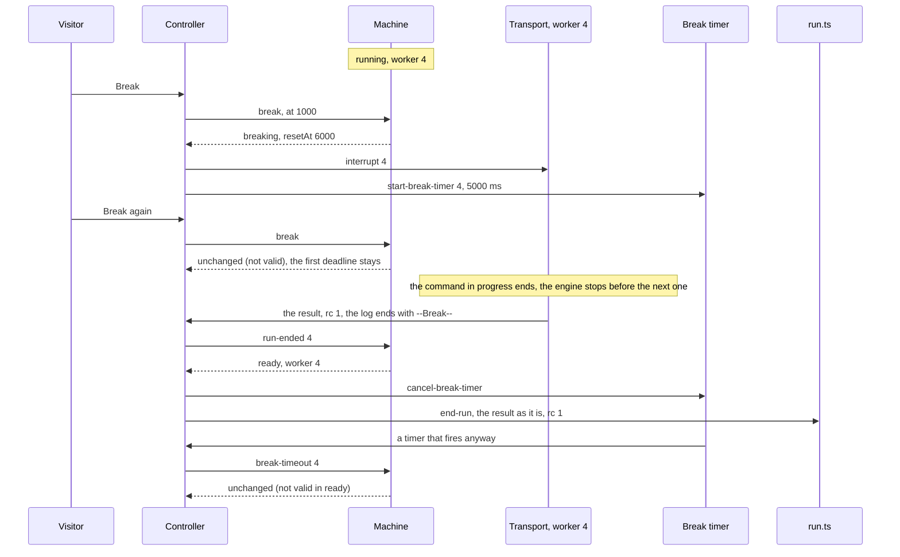

The engine takes a Break only between commands, so the data is as the last complete command left it. The timer is
cancelled, and a `break-timeout` that still arrives presents the worker's ticket but has no cell in `ready`.

### 7b. Break, but the run finishes first: rc 0

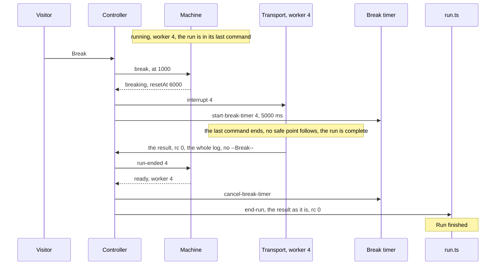

The result stands as the engine gave it: the code did complete, so the rc is 0 and nothing is rewritten. A last
command that fails gives its own Stata rc the same way. The request that was left over is dropped before the next run.

### 7c. Break, and the grace time runs out: rc 9998

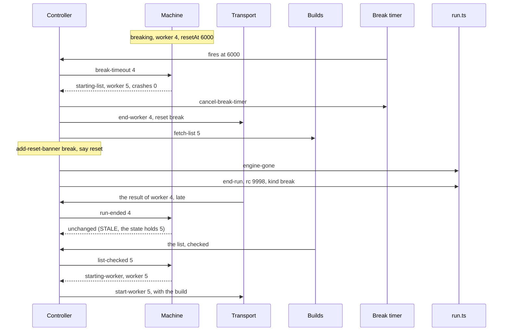

This is RESET(break) from `breaking`, with `end-run` last. The data in memory is gone, so the result is rc 9998 and
not rc 1. The late result presents 4 and the state holds 5, so the guard drops it.

### 7d. The lock lost during a download

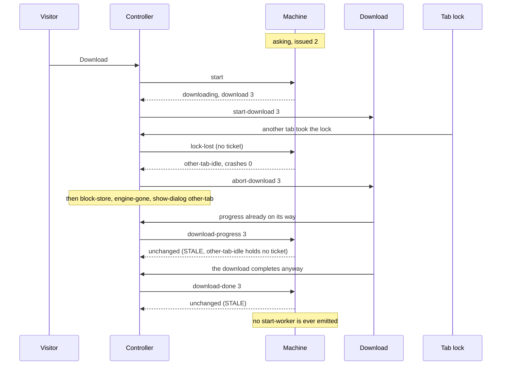

`lock-lost` has no ticket and is LOST from `downloading`. Whatever the old download still reports presents 3, and
`other-tab-idle` holds none, so no worker is started.

### 7e. A second crash

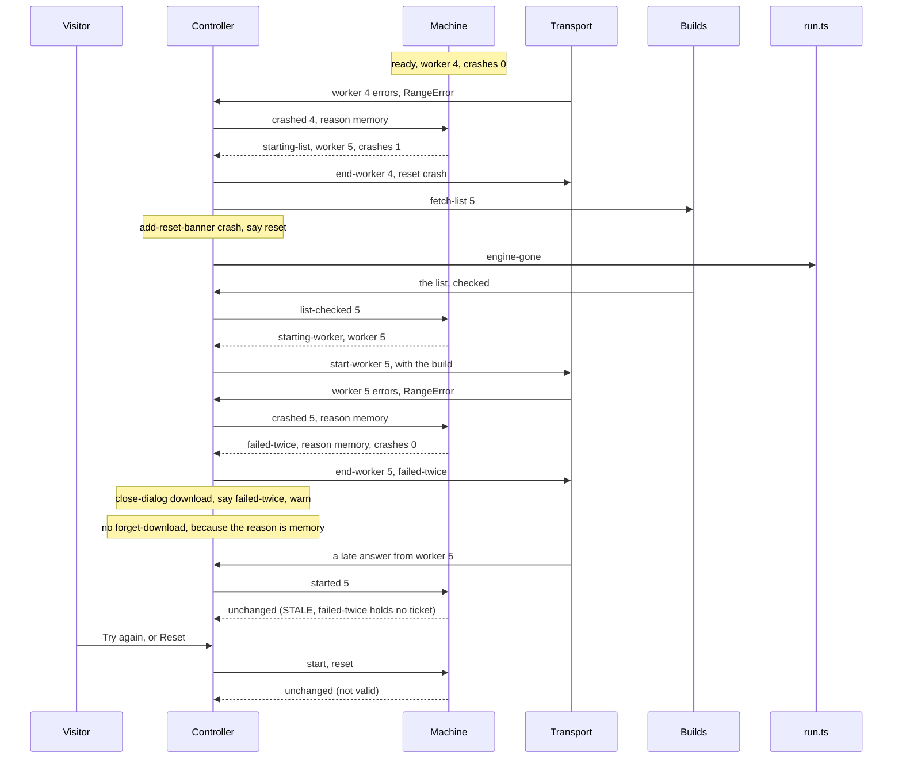

The first crash is RESET(crash) from `ready`; the second, in `starting-worker` with `crashes` 1, is TWICE and stops
for good. With a reason other than `memory` or `no-wasm`, `forget-download` would come after `end-worker 5`.

### 7f. A restart whose list fetch fails, or loses the lock

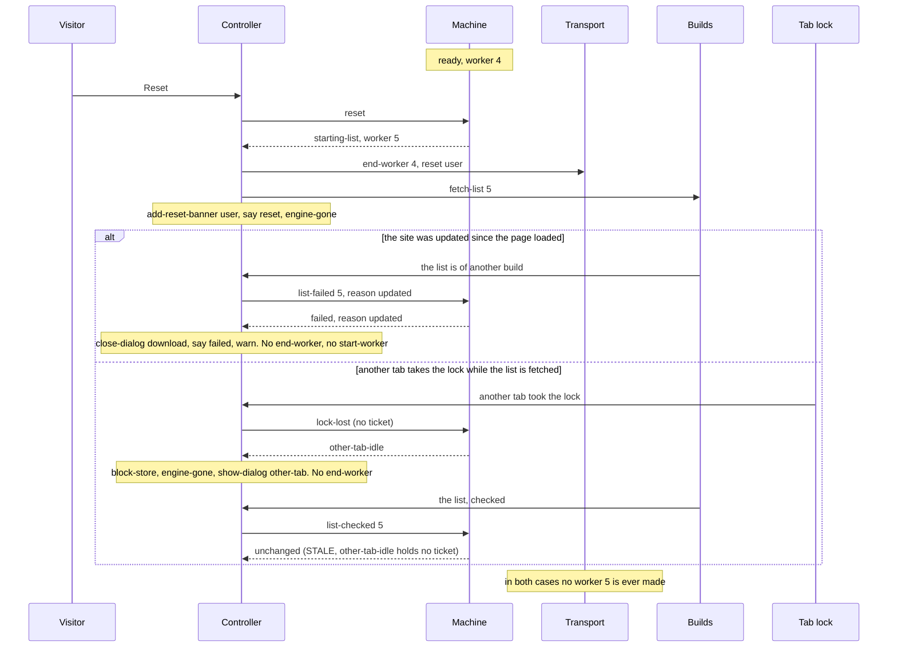

Between `end-worker 4` and `start-worker 5` no worker exists. That time is a state of its own, `starting-list`, so
what happens in it is decided by the table, and the transport never waits for anything before it makes a worker.

### 7g. A read op outside the machine

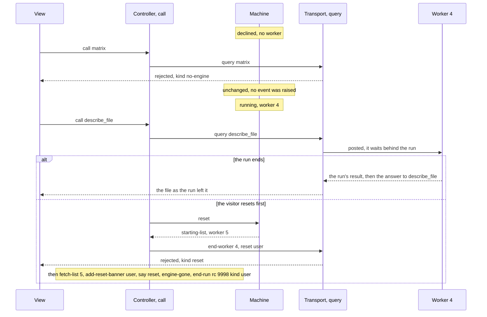

A read op never reaches the machine: it raises no event, so it can neither change a state nor be dropped by the guard.
`query("run")` and `query("write")` do not compile.

### 7h. A wrong ticket: an older download still talking

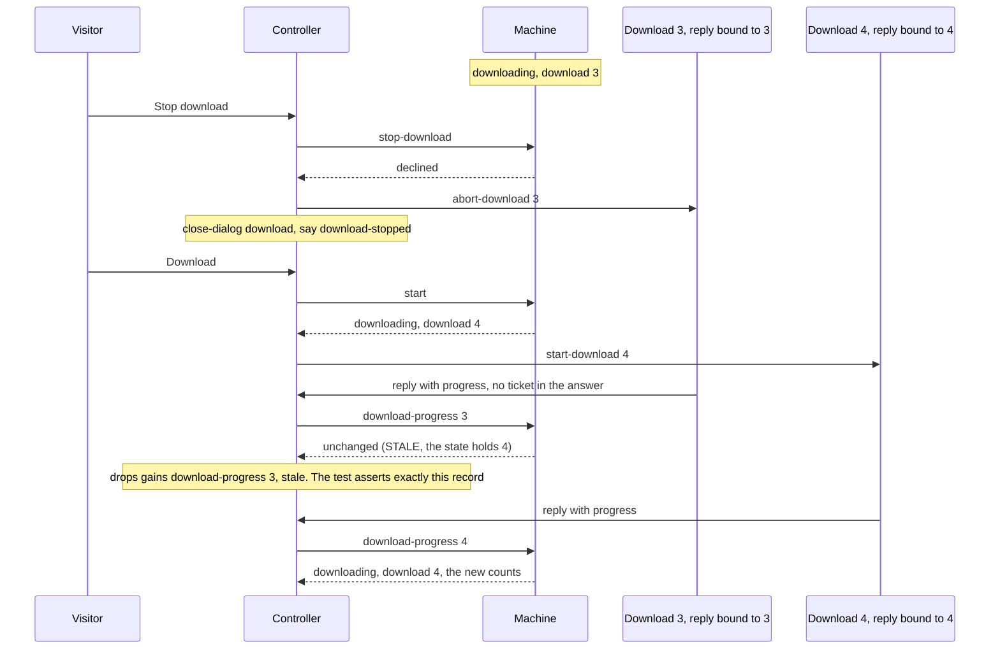

The old download cannot say 4: its `reply` was made for effect 3, and an answer has no field for a ticket. What it
says is dropped by the guard and recorded.
