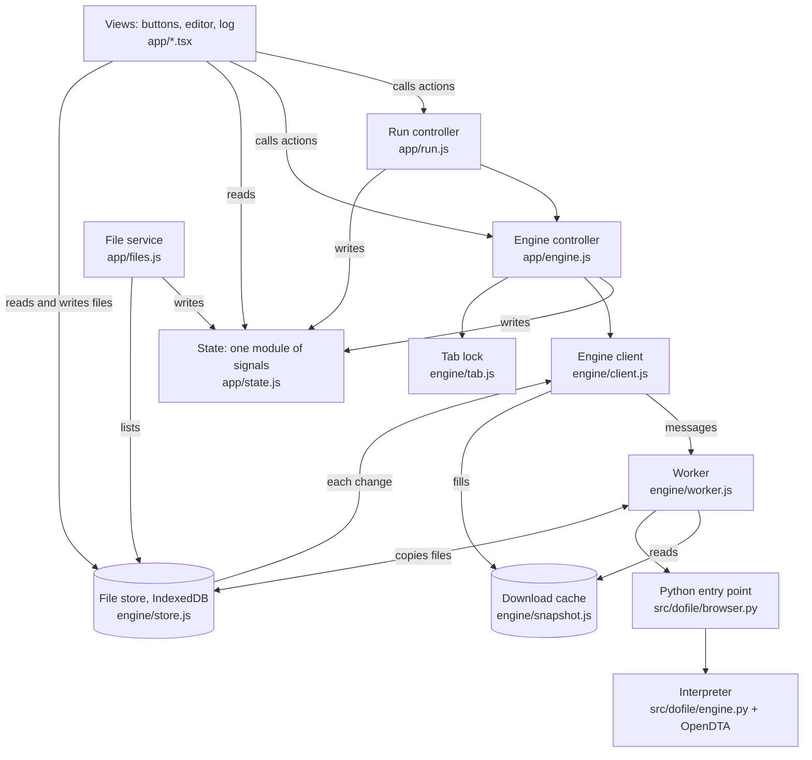
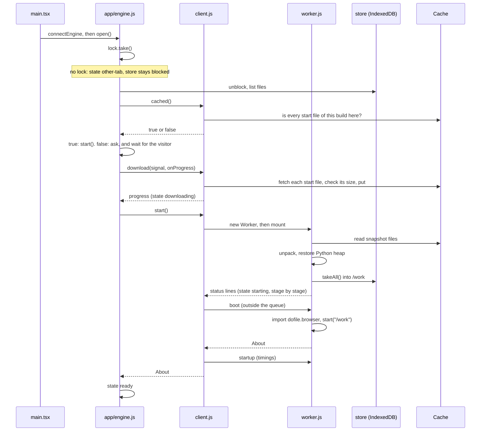
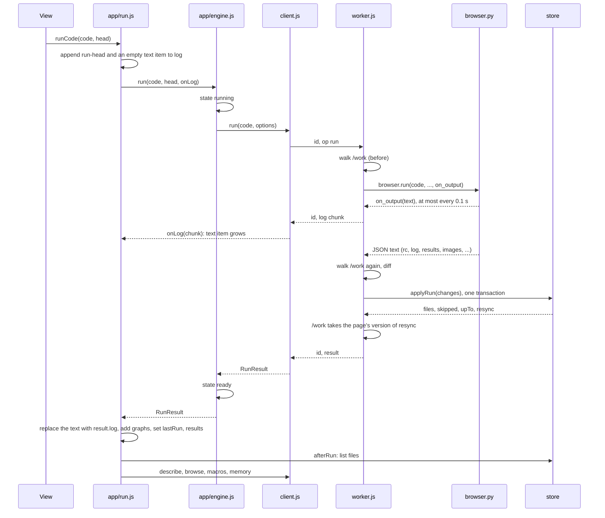

# Data flow through the dofile web engine

**This describes the code as step 3 left it (branch `prototype1-step3`, 2026-11-10), before step 3.5.**
[prototype1-step3.5-plan.md](prototype1-step3.5-plan.md) answers Part 3 and changes much of Part 2 (TypeScript, one state
machine, one build identity, the journal as the only channel); its step E revises this file to the code as built.

Written from a full read of the code; nothing was run for it. Revised once the same day, after the `dofile.downloaded`
flag was replaced by a check of the cache. Paths are relative to `web/src/` unless
they start with `src/dofile/`. Part 1 is the plain view. Part 2 is for senior developers new to the project. Part 3
lists the design choices worth questioning in the deep dive.

---

# Part 1: the plain view

## What it is

The page runs Stata-style code without a server. A copy of Python (Pyodide, Python compiled to WebAssembly) runs inside
the browser, in a background thread called a Web Worker. The dofile interpreter runs inside that Python.

Think of it as a kitchen behind a serving hatch:

- **The page** is the dining room. It has the buttons, the editor, and the log.
- **The worker** is the kitchen. It does the cooking (runs the code). While it cooks one order it cannot hear anything
  else.
- **The hatch** is message passing. The page writes an order on a slip with a number on it; the kitchen sends back a
  plate with the same number.
- **The pantry** is the file store, a database in the browser (IndexedDB). Both the page and the kitchen can open it.
  The kitchen also keeps a working copy of the files on its own counter (`/work`, in memory).

## The behaviours that exist

| Behaviour | What happens |
|---|---|
| **Open the page** | The tab asks for a lock so only one tab owns the engine and the files. With the lock, it lists the files, then checks the download cache. If every engine file for this build is there, it starts the engine. If not, it asks before downloading. |
| **Download** | The page fetches the engine's files (about 48 MB) into a browser cache, counting bytes for the progress bar. "Stop download" aborts it; what arrived is kept. |
| **Start** | A worker is created. It loads Python from a saved memory snapshot, copies the files from the pantry to its counter, then starts the interpreter. The page shows each stage. |
| **Run** | The page sends the code. The log streams back in chunks while the code runs. At the end one result comes back: the full log, numbers, graphs, and which files changed. |
| **After a run** | The worker writes the files the run changed into the pantry. The page then asks four follow-up questions: the variables, the first 50 rows, the macros, the memory use. |
| **Break** | The page raises a flag the engine checks between commands. If the engine has not stopped after 5 seconds, the page throws the worker away and starts a new one ("reset"). The visitor can choose to keep waiting instead. |
| **Reset** | A new worker. Data in memory is gone; files are kept, because they live in the pantry. |
| **Edit a file in the page** | The page writes the pantry first, then tells the worker to copy the change to its counter. This works with no engine at all. |
| **Crash** | One crash restarts the worker. A second crash before a start finishes stops for good ("failed twice") and deletes the downloaded engine files, so a page reload fetches them fresh. |
| **Second tab** | It gets no lock, starts nothing, and writes nothing. It can take over, which ends the first tab's worker. |

## Which file does what

One sentence per file:

- **`main.tsx`** builds the client, connects the controllers, and calls `open()`.
- **`app/state.js`** holds every piece of page state as a signal (a value that re-draws whatever reads it).
- **`app/engine.js`** turns what the client reports into one `engine` state: `none`, `asking`, `downloading`,
  `starting`, `ready`, `running`, `breaking`, `waiting`, `failed`, and so on.
- **`app/run.js`** runs code and stores what a run leaves: log, graphs, results, data, memory.
- **`app/files.js`** keeps the file list fresh and handles "Download all".
- **`engine/client.js`** is the page's handle on the worker: numbered messages, Break, restart. It also fills, checks
  and deletes the download cache.
- **`engine/worker.js`** is the worker: loads Python, keeps `/work`, answers one message at a time.
- **`engine/store.js`** is the file database, used by both sides.
- **`engine/tab.js`** is the one-tab lock and the "keep my files" request.
- **`engine/snapshot.js`** holds the snapshot restore and the download cache helpers.
- **`src/dofile/browser.py`** is the handful of Python functions the worker calls; each returns JSON text.

---

# Part 2: the detailed view

## 2.1 Conventions you need first

- **Two folders, two rules.** `engine/` is plain JavaScript with JSDoc types (`engine/types.d.ts`), with no framework
  and no DOM, so Node tests run it as it is. `app/*.js` controllers are also plain JavaScript and import
  `@preact/signals-core`. Only `.tsx` views import Preact.
- **Signals.** `signal(x)` is an observable cell: `.value` reads and writes. A component that reads `.value` re-renders
  on change. `S.engine.subscribe(fn)` is a plain listener. Each signal has exactly one writer, named in a comment in
  `state.js`.
- **Views never touch the client.** They call controller actions (`engine.start()`, `run.runCode()`) and read signals.
  The one exception by design is the file store, which views call directly.
- **Errors are classified by fields, never by text.** Client errors carry `kind`
  (`failed | failed-twice | updated | reset | stopped | no-engine | busy | op`), plus `reason` and the worker's error
  `name`. Messages are for the console.
- **`run()` never rejects** (except `busy`). A run that could not finish resolves with a synthetic result: return code
  9998 and a `kind` saying why.
- **Return codes.** 0 is success; Stata's own codes are errors in the code; 1 is Break; 9998 is "the session was reset".

## 2.2 The layers and what each owns

| Layer | File | Owns | Talks to |
|---|---|---|---|
| Views | `app/**/*.tsx` | nothing durable | controllers, `state.js`, `store` |
| State | `app/state.js` | all signals | nobody |
| Run controller | `app/run.js` | `log`, `lastRun`, `results`, `macros`, `data`, `rows`, `memory`, `graphs`, `history` | engine controller, `files.js` |
| Engine controller | `app/engine.js` | `engine`, `about`, the reset banner | client, tab lock, `files.js` |
| File service | `app/files.js` | `files`, `fresh`, `persisted`, two banners | store |
| Client | `engine/client.js` | the `Worker`, pending calls, the Break timer, the crash counter | worker (messages), store (`attach`), Cache |
| Worker | `engine/worker.js` | Pyodide, `/work`, the op queue, `upTo`, `unsaved` | store (its own connection), Cache (read only), Python |
| Python | `src/dofile/browser.py` | one `Engine` | `engine.py`, OpenDTA |
| Store | `engine/store.js` | IndexedDB database `dofile`: `info`, `data`, `pending` | used by page and worker |

## 2.3 The wire protocol

The page posts `{ id, op, args }`. The worker posts back one of four shapes:

| Message | Meaning |
|---|---|
| `{ id, result }` | the answer; the call resolves |
| `{ id, error, name }` | the op threw; the call rejects with kind `op` (a `run` resolves with rc 9998, kind `run-failed`) |
| `{ id, log }` | a chunk of a running run's log; the call stays pending |
| `{ status }` | a start-up stage name, with no id |

The ops are:

- **Start:** `mount`, `boot`, `startup`.
- **Engine:** `run`, `describe`, `describe_file`, `matrix`, `macros`, `browse`, `memory`.
- **File mirrors:** `write`, `mkdir`, `remove`, `rename`.
- **Test-only views of `/work`:** `files`, `read`.

The worker handles ops strictly one at a time through a promise chain (`queue = queue.then(...)`). `boot` is the one
exception: it runs outside the queue, so file ops are answered while the interpreter loads. Engine ops `await booted`
first.

The client keeps `pending: Map<id, {op, resolve, reject, onLog}>`. Each message handler closes over its own `worker`
and ignores messages when `worker !== this.worker`, so a late message from a replaced worker is dropped.

## 2.4 Flow: page load to `ready`

Points that are not obvious:

- **The cache decides whether to ask.** There is no "already downloaded" flag. `client.cached()` fetches the build's
  list (`start-files.json`) and answers true only if the cache `dofile-snapshot-<built>` exists and holds every file the
  list marks for download. It creates, writes and deletes nothing, and never rejects. It answers false for an empty or
  partly filled cache, another build's cache, no Cache API, refused storage, the diagnostic `?snapshot=0` start, and
  when the list cannot be fetched. So a site update or an evicted cache shows the download prompt again.
- **Failing twice deletes the cache.** When a start ends as `failed-twice` and the reason is not `memory` or `no-wasm`,
  the controller calls `client.forgetDownload()`, which deletes every `dofile-snapshot-*` cache. A single failure
  deletes nothing.
- **`download()` and `start()` are separate on purpose.** `download()` runs in the page before any worker exists, so
  bytes can be counted and aborted. It is the only writer of the Cache, and it keeps a file only if its byte count
  matches the build's list (`start-files.json`). The worker only reads the Cache.
- **A failed download does not stop the start.** Unless the visitor aborted it or the site was updated, `engine.js`
  logs the error and calls `client.start()` anyway. The worker then reads what is cached or fetches the rest itself,
  uncounted.
- **There is no offline start.** The worker fetches `manifest.json` from the network (never from cache) before it
  opens the cache, and `cached()` needs the build's list from the network too. Offline, the page shows the prompt and a
  download leads to a failed start, even with a complete cache. Comments in `engine.js` and SPEC section 6 still say an
  offline start reads the cache; that is not true today.
- **Pyodide's loader fetches its own files.** The worker temporarily replaces `self.fetch` (`watchFetch`) so those
  requests hit the Cache first, and so a failed fetch rejects the start instead of hanging.
- **Staleness checks.** The worker refuses a snapshot whose manifest names another wheel or wheel hash
  (`UpdatedError`). The controller maps that to reason `updated` ("reload the page").
- **Stage names** arrive as English status strings and are mapped to stage ids by a table (`STAGE_OF`).

## 2.5 Flow: one run

Details:

- **Arguments.** `run.js` builds a `RunHead` (`kind`: file, selection or command; `fresh_locals`). `engine.js` adds
  `plot_theme` from the page's theme. The worker passes them positionally to Python, because a plain Pyodide call has
  no keyword arguments.
- **The Python call is synchronous.** `browser.run` blocks the worker's thread until the code ends. Streaming works
  because Python calls the JavaScript `on_output` callback, which posts a message. Nothing else in the worker can run
  meanwhile, so any op the page posts during a run waits in the queue.
- **Results cross as JSON text.** Python returns one JSON string and the worker does one `JSON.parse`. Graphs are
  base64 PNGs inside it. Matrices are sent as sizes only (`"3x3"`); values are fetched later with the `matrix` op.
- **Stream, then replace.** The streamed chunks are a preview. When the result arrives, `run.js` replaces the text
  item's content with `result.log` and never appends, because the stream can stop short (log cap) and notes can be
  added after the run. For a synthetic rc 9998 result there is no log, so the streamed text stays and the reason is
  added as a note.
- **Error lines.** `error_line` is 1-based within the text sent. For a selection run, `run.js` adds the selection's
  first line to map it back to the file.
- **Run with no engine.** In `none` or `declined`, `runCode` stores the run in `queued`, opens the download prompt, and
  a subscriber on the `engine` signal runs it when the state becomes `ready`.

## 2.6 Flow: files

Files have one home, the IndexedDB database `dofile`, with three object stores:

| Store | Key → value | Purpose |
|---|---|---|
| `info` | path → `{path, dir, size, mtime}` | the listing |
| `data` | path → `ArrayBuffer` | the bytes |
| `pending` | auto-increment seq → `{op, path, to?}` | a journal of page changes the worker has not applied to `/work` yet |

`/work` in the worker is an in-memory copy. The rule is **store first**.

**A page change** (`store.write`, `mkdir`, `rename`, `remove`):

1. One transaction writes the records and adds a `pending` row, giving a `seq`.
2. The store posts the op with that `seq` to the worker, through a `post` function the client installed with
   `store.attach(send)`.
3. The worker's `mirror()` applies it to `/work` and deletes the row (`store.done(seq)`).
4. `store.onChange` fires; `files.js` lists the store again into the `files` signal.

With no worker, step 2 is skipped and no row is written. The next start copies the whole store.

**The worker's copies.** At `mount` (`takeAll`) and after every run (`applyRun`), the worker reads the store in one
transaction that also reads the highest `seq` and clears the journal. It keeps that number as `upTo` and skips any
queued mirror op with `seq <= upTo`. That is how a change is never applied twice.

**After a run** (`saveRun` in the worker):

1. Compare `walk(/work)` before and after by size and modification time. Only changed files are read.
2. `store.applyRun(changes)` writes them, except any path the page changed during the run (a `pending` row covers it):
   the page's version wins.
3. It returns `resync`, the page's version of those paths, which the worker copies into `/work`.
4. `RunResult` gains `files` (what was written), `skipped` (run output lost under a folder the page renamed or
   removed), and `store_error` (the store refused; the worker remembers the paths in `unsaved` and tries again after
   the next run).

Two more details:

- The worker waits (a busy loop of up to one clock step) before a run until the clock passes the newest file's time, so
  a same-size rewrite is still seen as a change.
- If the browser closes the database under the page ("Clear site data"), seqs may restart from 1. The client treats
  that as a crash and restarts the worker, so it copies the store afresh.

## 2.7 Flow: Break, reset, crash

**Break.** The page and worker share a 4-byte `SharedArrayBuffer`. `client.breakRun()` stores 2 (SIGINT) in it and
starts a 5 second timer, recording the deadline in `resetAt`. Pyodide checks the buffer and raises the signal;
`browser.py`'s handler calls `request_break()` only while a run is on; the interpreter stops at the next safe point
between commands with rc 1 and the data kept.

| Controller state | Meaning | Leaves by |
|---|---|---|
| `running` | a run is on | result → `ready`; Break → `breaking` |
| `breaking` | Break asked; a reset is due at `resetAt` | the run stops → `ready`; timer fires → restart; "wait for it" → `waiting` |
| `waiting` | Break asked; the timer is cancelled | the run stops → `ready`; "Reset now" → restart |

Without cross-origin isolation there is no `SharedArrayBuffer`, so Break restarts the worker at once.

**Restart** (`client.restart(reason, kind)`, kind `break | crash | user`):

1. `end()` terminates the worker and settles every pending call. The run resolves with rc 9998. A pending `mount`,
   `boot` or `startup` resolves with the new start's promise. Everything else rejects with kind `reset`.
2. A new `start()` begins.
3. `onRestart(reason, started, kind)` is called synchronously, before the cut run's promise resolves. The controller
   sets `starting` and, if an engine had been ready, adds the reset banner.

That ordering matters: when `engine.run()` resumes after its `await`, it sees `starting`, not `running`, and leaves the
state alone.

**Crash.** `worker.onerror` or a closed database calls `crashed()`. The first one restarts (kind `crash`). A second one
before any start has finished ends everything with kind `failed-twice`, so a phone does not loop through gigabyte
allocations.

**Tab lock.** `tab.js` requests the Web Lock `dofile-engine` and never releases it. Another tab can take it with
`steal`, which rejects the holder's request; that calls `lost()`, which calls `client.stop()` (no new worker), blocks
the store, and shows the take-over dialog.

## 2.8 How stale answers are discarded

Several asynchronous things can overlap (a start, a reset during the start, a lost lock, an aborted download). The code
uses identity checks and counters:

| Guard | Where | Protects against |
|---|---|---|
| `worker !== this.worker` | client message handlers | messages from a replaced worker |
| `gen` | `client.start()` | a start whose worker was replaced between its steps |
| `errorRestarts` | client | restart loops |
| `attempt` | `engine.js` | `ready()` or `failed()` firing for an older start |
| `downloading === ac` | `engine.js` | progress and results of a superseded download |
| `lockGen` | `engine.js` | a tab that just lost the lock unblocking the store or starting a worker (checked after listing files and after `cached()`) |
| `taking` | `engine.js` | two take-overs at once |
| `rows.value` identity | Data tab | "Show 50 more" appending to rows a newer run replaced |

## 2.9 How derived state is kept in step

`run.js` subscribes to the `engine` signal and compares the new state name with the previous one:

- On entering `starting` or `other-tab` it clears `results`, `macros`, `data`, `rows`, `memory`, `lastRun`.
- On `starting → ready` it asks for `memory`.
- On `ready` with a queued run it runs it; on `declined`, `failed`, `failed-twice` or `other-tab` it drops it.

After every run it calls `files.afterRun(result.files)` and, unless the engine was reset, `refreshData()`: four
parallel ops (`describe`, `browse` with limit 50, `macros`, `memory`).

---

# Part 3: design choices to examine in the deep dive

These are observations from reading, not defects found by testing. Two were already noted as open in the step 3
reviews and are marked so.

1. **Engine state lives in three places.** The client has `running`, `resetAt`, `breakTimer`, `gen`, `errorRestarts`.
   The controller has the `engine` signal plus `attempt`, `hadEngine`, `downloading`, `lockGen`, `taking`. `run.js` has
   `was`, `queued`, `sessionRuns`. The section 5 state machine is reconstructed from events, not defined in one
   transition table. Each counter fixed a real race found in review, which suggests the structure invites them.
2. **Ordering contracts are implicit.** `onRestart` must run before the cut run's promise resolves; `run.js` relies on
   seeing `starting` to know a reset happened; `engine.run()` re-reads the state after its `await`. These are documented
   in comments, not enforced.
3. **`run.js` reacts to state names.** Clearing derived data and running the queued run hang off a subscriber that
   compares strings with the previous state. A new state or a new path into `starting` changes behaviour silently.
4. **A restart resolves pending `mount`/`boot`/`startup` calls with another promise.** It makes the first `start()`
   adopt the second one's result, and is the reason `attempt` exists in the controller. It is clever and hard to follow.
5. **A failed download falls through to `start()`.** The comments say this allows an offline start from cache, but the
   worker cannot start offline (it needs `manifest.json` from the network). So the fall-through only moves a network
   failure to the worker, with a different error path and no byte count. Decide whether offline start is wanted; if
   not, a failed download could stop there.
6. **Three places know what "the current build" is.** `start-files.json` (`built`, `wheelHash`), the snapshot's
   `manifest.json`, and the wheel hash compiled into the page. `cached()`, `download()` and the worker each fetch and
   compare a different pair. `cached()` does not compare `wheelHash`; it relies on a new build having a new `built`.
7. **A short window at load.** While `cached()` is pending the state is `none`. A Run pressed in that moment opens the
   "to run code" prompt, which the plain prompt then replaces if the answer is false. Not guarded.
8. **The synchronous Python call.** While a run is on, the worker answers nothing: no file mirror, no `browse`. The
   `pending` journal and `resync` exist to make that safe. The alternative (passing changes mid-run through shared
   memory) is recorded as a prototype 2 idea.
9. **Two IndexedDB connections with a hand-made journal.** The seq/`upTo` protocol is the most intricate part of the
   code and has the most edge cases (`unsaved`, `forget`, renames of owed paths, a closed database restarting seqs).
10. **JSON text with base64 images.** Simple and one parse, but every graph is encoded in Python, embedded in a string,
   parsed, and held as base64 in page state (up to 20).
11. **Change detection by size and mtime**, with a busy-wait before each run to guarantee a later timestamp.
12. **Status as English strings.** Stages are identified by matching status text against a table shared by convention.
13. **The controller reaches into the UI.** `engine.js` writes the `dialog` signal and calls `editorCommands.focus()`;
    the client's callbacks are assigned after construction (`client.onStatus = ...`).
14. **Module-level singletons.** `connectEngine(deps)` and `connectFiles(store)` set module variables; tests reconnect
    them. There is one engine per page by construction.
15. **Known open, from the reviews:** `decline()` has no state guard, and `afterRun` still lists the store after the
    tab lost the lock.
