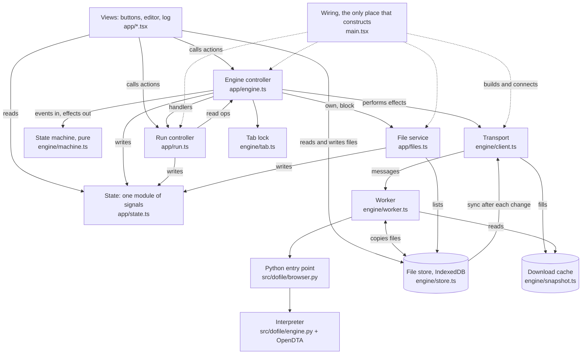
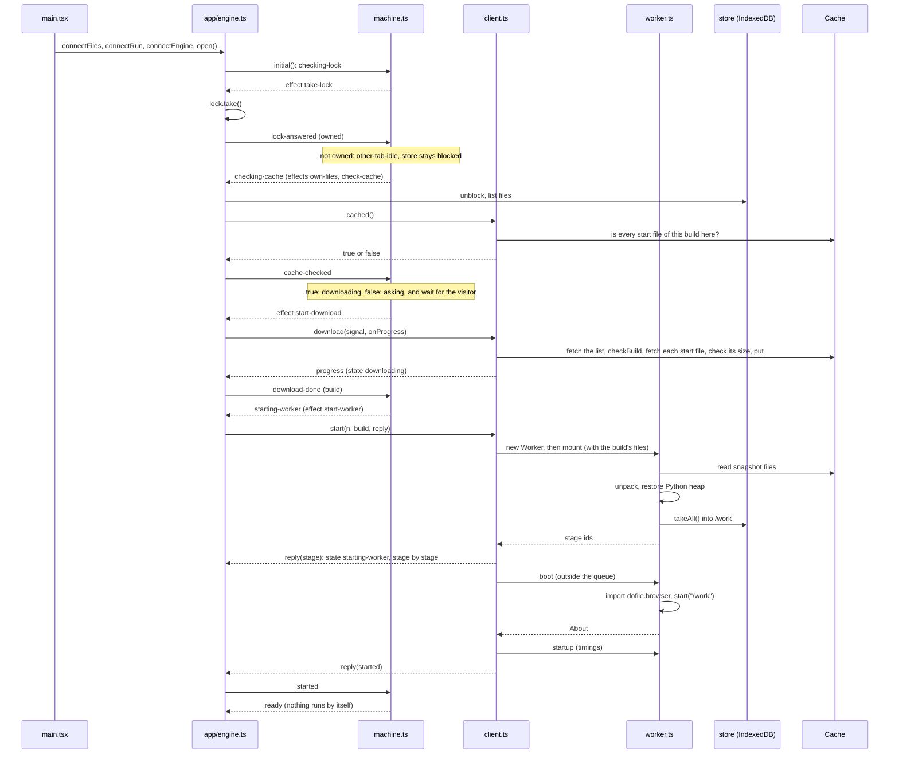
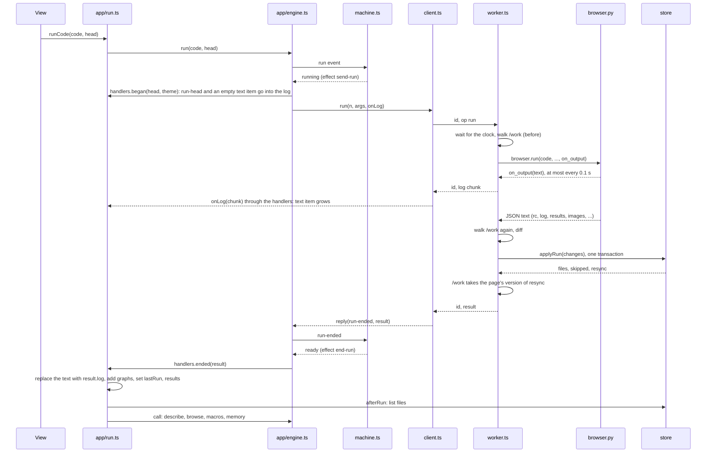

# Data flow through the dofile web engine

This describes the code as built by step 3.5 ([its plan](archive/prototype1-step3.5-plan.md): TypeScript everywhere, one
state machine, one build identity, the journal as the only channel). The state machine's design, with its tables and race
scenarios, is [prototype1-step3.5-c-design.md](archive/prototype1-step3.5-c-design.md); the contract the page's parts are
written against is `docs/design/SPEC.md`, sections 5 to 8. The document names functions and files, not line numbers.
Paths are relative to `web/src/` unless they start with `src/dofile/`. Part 1 is the plain view, Part 2 the detail for
developers new to the project, Part 3 what is still open.

---

# Part 1: the plain view

## What it is

The page runs Stata-style code without a server. Python compiled to WebAssembly (Pyodide) runs in the browser, in a Web
Worker, and the dofile interpreter runs inside that Python. As a kitchen behind a serving hatch:

- **The page** is the dining room: buttons, editor, log.
- **The worker** is the kitchen. While it cooks one order (runs code) it hears nothing else.
- **The hatch** is message passing: an order slip with a number, a plate back with the same number.
- **The pantry** is the file store, IndexedDB, which both sides can open. The kitchen keeps a working copy of the files on
  its counter (`/work`, in memory).
- **The rulebook** is `engine/machine.ts`: the engine's state, what each event does in each state, and what must be done
  next. Nothing else in the page decides a state.

## The behaviours that exist

| Behaviour | What happens |
|---|---|
| **Open the page** | The tab asks for a lock so only one tab owns the engine and the files. With it, it lists the files and checks the download cache: every engine file for this build there, it starts the engine; if not, it asks before downloading. |
| **Download** | The page fetches the engine's files (about 48 MB) into a browser cache, counting bytes for the progress bar. "Stop download" aborts it; what arrived is kept. A failed download is a failed start: no worker is made. |
| **Start** | A worker loads Python from a saved memory snapshot, copies the files from the pantry to `/work`, then starts the interpreter. The page shows each stage. |
| **Run** | The page sends the code; the log streams back in chunks; at the end one result comes back: full log, numbers, graphs, changed files. |
| **After a run** | The worker writes the changed files into the pantry. The page asks four follow-up questions: variables, first 50 rows, macros, memory. |
| **Break** | The page raises a flag the engine checks between commands. Not stopped after 5 seconds, the page throws the worker away and starts a new one ("reset"), unless the visitor chooses to keep waiting. |
| **Reset** | A new worker. Data in memory is gone; files are kept in the pantry. |
| **Edit a file in the page** | The page writes the pantry first, then tells the worker to take the change. Works with no engine at all. |
| **Crash** | One crash resets the worker. A second before a start finishes stops for good ("failed twice") and deletes the downloaded engine files (unless the cause is memory or no WebAssembly), so a reload fetches them fresh. |
| **Second tab** | Gets no lock, starts nothing, writes nothing. It can take over, which ends the first tab's worker. |

## Which file does what

What each file owns and talks to: section 2.2.

---

# Part 2: the detailed view

## 2.1 Conventions you need first

- **TypeScript everywhere.** `engine/`, `app/*.ts` and the tests are `.ts` files that Node runs by removing the types:
  imports spell the `.ts` extension and only erasable syntax is used (`npm run check` enforces it). `engine/` has no
  framework and no DOM, and never imports `app/`. `app/*.ts` controllers import `@preact/signals-core`. Only `.tsx` views
  import Preact, and no `.ts` file imports a `.tsx`.
- **One machine decides.** `engine/machine.ts` holds the sixteen states, the events, the effects and
  `transition(machine, event)`, one pure function with no clock, timer or signal that imports only types. No counter, flag
  or comparison of state names outside it decides a state. SPEC section 5's transition matrix is generated from it, and a
  test compares the two.
- **Signals.** `signal(x)` is an observable cell (`.value` reads and writes); a component that reads `.value` re-renders on
  change. A signal with one owner is a `ReadonlySignal`: views cannot assign it, and its owner writes it through a writer
  object (`engineWriter`, `runWriter`, `filesWriter`) that only the owner imports.
- **Views never touch the transport or the machine.** They call controller actions (`engine.start()`, `run.runCode()`) and
  read signals. The one exception by design is the file store, which views call directly.
- **Errors are classified by fields, never by text.** Transport errors carry `kind`
  (`failed | failed-twice | updated | reset | stopped | no-engine | op`), plus `reason` and the worker's error `name`.
  Messages are for the console.
- **Return codes.** 0 is success; Stata's own codes are errors in the code; 1 is Break (data kept); 9998 is "the session
  was reset" (data gone). The transport makes no run result: a run that could not finish gets one from the machine
  (`cutResult`: rc 9998 and a `kind`: `break`, `crash`, `user`, `stopped`, `run-failed`).

## 2.2 The layers and what each owns

| Layer | File | Owns | Talks to |
|---|---|---|---|
| Wiring | `main.tsx` | nothing durable; builds the one transport and tab lock, connects the controllers (`connectFiles`, `connectRun`, `connectEngine`) and calls `open()`. Nothing else constructs or connects | everything, once, at load |
| Views | `app/**/*.tsx` | nothing durable | controllers, `state.ts`, `store` |
| State | `app/state.ts` | all signals | nobody |
| Run controller | `app/run.ts`: runs code, stores what a run leaves; reads no engine state | `log`, `lastRun`, `results`, `macros`, `data`, `rows`, `memory`, `graphs`, `history` | engine controller (`run`, `call`), `files.ts` |
| Engine controller | `app/engine.ts`: the machine's one caller; feeds events in, performs the effects, writes `engine` from the machine's state | `engine`, the reset banner, the Break timer and the download's abort handle | machine, transport, tab lock, `files.ts`, `run.ts` (through its handlers) |
| Machine | `engine/machine.ts` | the state, the tickets, the crash count | nobody: it is a function |
| File service | `app/files.ts`: keeps the file list fresh, "Download all", the effects own and block the files | `files`, `fresh`, `persisted`, two banners | store |
| Transport | `engine/client.ts`: numbered messages, the interrupt buffer, the cache (`cached`, `download`, `build`, `forgetDownload`); decides nothing | the `Worker`, its pending calls, the interrupt buffer | worker (messages), store (`attach`), Cache |
| Worker | `engine/worker.ts`: the table of op handlers; answers one message at a time | Pyodide, the `/work` mirror | its start, its dispatch, Python, the mirror |
| Worker's dispatch | `engine/worker-dispatch.ts`: the worker's `onmessage` over the table (`OpTable`, typed from `Ops`): the queue, the answer `{id, result}` or `{id, error, name, type?}`; given `post` by the worker | the op queue | nobody |
| Worker's graphics part | `engine/worker-graphics.ts`: the record of a lazy snapshot's graphics part (where it is, the idle clock, the unpack as one state with its copy, damage, this run's ask) and its work: a waiting graph (`waitGraphics`), the browser's decoder, the idle steps; its decisions are `lazy-part.ts`'s pure functions; given Pyodide, the engine and `post` by the worker | the record | the shared region (read only), Python |
| Worker's start | `engine/worker-boot.ts`: Python from the snapshot or the normal boot (`mount`), the wheels and the engine (`boot`); given the stage callback and the startup record by the worker, posts nothing | nothing | Cache (read only), the network, Python |
| `/work` mirror | `engine/work-mirror.ts`: copies the store into `/work` at `mount`, takes the journal on `sync`, writes a run's changes back; given Pyodide's file system by the worker | `/work`, `unsaved` | store (its own connection) |
| Python | `src/dofile/browser.py`: the functions the worker calls; each returns JSON text | one `Engine` | `engine.py`, OpenDTA |
| Store | `engine/store.ts` | IndexedDB database `dofile`: `info`, `data`, `pending` | used by page and worker |
| Tab lock | `engine/tab.ts`: the one-tab lock and the "keep my files" request | the Web Lock | engine controller |
| Snapshot | `engine/snapshot.ts`: snapshot restore and download cache helpers | nothing durable | Cache |
| Types | `engine/types.ts`: shared types, among them the worker protocol's op map | nothing | nobody |

## 2.3 The wire protocol

The page posts `{ id, op, args }`. The worker posts back one of four shapes:

| Message | Meaning |
|---|---|
| `{ id, result }` | the answer; the call resolves |
| `{ id, error, name, type? }` | the op threw (`type`: a `PythonError`'s exception class); the call rejects with kind `op` (a failed `run` is ended by the machine with rc 9998, kind `run-failed`; the worker stays) |
| `{ id, log }` | a chunk of a running run's log; the call stays pending |
| `{ stage }` | a start-up stage id (`download`, `unpack`, `python`, `files`, `packages`, `engine`), with no id |

The ops are one typed map (`Ops` in `engine/types.ts`) in three sets; the set decides who may send an op:

- **`LifecycleOps`:** `mount`, `boot`, `startup`, `run`. They change the engine. Only the transport's `start()` and `run()`
  send them, and only the machine's effect performer calls those.
- **`ReadOps`:** `describe`, `describe_file`, `matrix`, `macros`, `browse`, `memory`, and the test-only views of `/work`,
  `files` and `read`. Declared to change nothing; anyone may send one through `query()`.
- **`JournalOps`** (the page's file changes): `sync`, with no arguments. Only the function the transport gives to
  `store.attach` sends it.

The worker handles ops one at a time through a promise chain (`queue = queue.then(...)`) in `engine/worker-dispatch.ts`.
Its table (`OpTable`, one entry per op of `Ops`, in `worker.ts`) says for each op its handler, whether it is queued, and
the hooks around it: `run` is counted as it arrives (`arrived`), `boot`'s answer settles `booted` (`answered`).
`boot` and `graphics` run outside the queue, so `sync` and the views of `/work` are answered while the interpreter loads,
and a graphics note does not wait for a run; engine ops `await booted` first. A read op sent during a start or a run
waits in the queue. An op with no entry is answered with an error in the queue.

The transport keeps a record for the live worker: its number, a `pending` map of calls, its interrupt buffer, and, once
ended, what it was ended with. Every call goes through that record, so a call on an ended worker rejects at once with what
`end()` said, and a message for a call `end()` already dropped finds nothing. `postMessage` is called in one place (`#send`).

## 2.4 Flow: page load to `ready`

Points that are not obvious:

- **The cache decides whether to ask.** There is no "already downloaded" flag. `client.cached()` fetches the build's list
  (`start-files.json`) and answers true only if the cache `dofile-snapshot-<built>` exists and holds every file the list
  marks for download. It writes nothing and never rejects. It answers false for an empty or partial cache, another build's
  cache, no Cache API, refused storage, the diagnostic `?snapshot=0` start, and a list that cannot be fetched. So a site
  update or an evicted cache shows the prompt again.
- **Failing twice deletes the cache.** When a start ends as `failed-twice` and the reason is not `memory` or `no-wasm`, the
  effect `forget-download` calls `client.forgetDownload()`, which deletes every `dofile-snapshot-*` cache. A single failure
  deletes nothing.
- **`download()` and `start()` are separate on purpose.** `download()` runs in the page before any worker exists, so bytes
  can be counted and aborted. It is the only writer of the Cache, and keeps a file only if its byte count matches
  `start-files.json`. The worker only reads the Cache.
- **A failed download is a failed start.** Unless the visitor aborted it, it ends in `failed` (reason `download`, or
  `updated`); `start()` is not called. "Try again" is a new `start` event.
- **There is no offline start.** `cached()`, `download()` and every restart's `build()` fetch `start-files.json` fresh from
  the network. Offline, the page shows the prompt and a download ends as `failed`, even with a complete cache.
- **One statement of the build.** `start-files.json` names the build (`buildId`, `built`, the two snapshot files). The page
  compares its build id with the list's in one place (`checkBuild`, called by `download()` and `build()`): another id is
  kind `updated`, "reload the page". The worker fetches no `manifest.json` and compares no build; `mount` gets the build's
  files as arguments. The snapshot's `manifest.json` is the build record scripts read (`vite build` fails on a stale
  snapshot); it is not deployed.
- **A restart fetches the list again** (state `starting-list`): after a reset the Cache may have been evicted, and the worker
  would then fetch whatever build the site has now. A start the visitor begins reuses the list `download()` just checked.
- **Pyodide's loader fetches its own files.** The worker's start (`engine/worker-boot.ts`) temporarily replaces `fetch` (`watchFetch`) so those requests
  hit the Cache first, and a failed fetch rejects the start instead of hanging.
- **Stage names** arrive as typed ids; the words are the controller's (`stageWords`, `stageStatus`).

## 2.5 Flow: one run

Details:

- **Who answers what.** `engine.run()` answers at once: true (the engine was ready and the run began) or false (any other
  state: refused; nothing runs, then or later, and no prompt opens). `run.ts` does not look at the state. It must not call
  `run()` while a step of the machine is in progress (inside a handler): `run()` throws then, before it queues anything.
- **Arguments.** `run.ts` builds a `RunHead` (`kind`: file, selection or command; `fresh_locals`); the controller adds
  `plot_theme` from the page's theme. The worker passes them positionally, since a plain Pyodide call has no keyword arguments.
- **The Python call is synchronous.** `browser.run` blocks the worker's thread until the code ends. Streaming works because
  Python calls the JavaScript `on_output` callback, which posts a message. Any op posted during a run (a `sync`, a read op)
  waits in the queue.
- **Results cross as JSON text**, one `JSON.parse`. Graphs are base64 PNGs inside it. Matrices are sent as sizes only
  (`"3x3"`); values are fetched with the `matrix` op.
- **Stream, then replace.** The chunks are a preview. When the result arrives, `run.ts` replaces the text item with
  `result.log` and never appends, because the stream can stop short (log cap) and notes can be added after the run. A result
  the machine made (rc 9998) has no log, so the streamed text stays and the reason is added as a note.
- **Error lines.** `error_line` is 1-based within the text sent; for a selection run, `run.ts` adds the selection's first
  line to map it back to the file.
- **With no engine nothing offers to run.** A `run` is valid in `ready` alone. With no engine (`app/start.ts`: `none`,
  `asking`, `declined`, `failed`, `failed-twice`, `other-tab-idle`, `other-tab-taking`) the page offers one action, "Start
  engine": the event `ask` (the download prompt; in `other-tab-idle` the take-over dialog again) or, after a failed start
  that can be tried again, `start`. Run is that button; Run selection and the command line are disabled (the command line
  keeps its text); Load, Import and the log's help links are off. Once started the state is `ready` and nothing runs: no
  state keeps a run or a mark that one was wanted. A run pressed during the page load (`checking-lock`, `checking-cache`) is
  refused. The table of states: `docs/web-page-flows.md`, section 2. The maintainer removed the held run (sent once the
  engine had started), and then the prompt a run opened, on 2026-11-12.

## 2.6 Flow: files

Files have one home, the IndexedDB database `dofile`, with three object stores:

| Store | Key → value | Purpose |
|---|---|---|
| `info` | path → `{path, dir, size, mtime}` | the listing |
| `data` | path → `ArrayBuffer` | the bytes |
| `pending` | auto-increment key → `{op, path, to?}` | the journal: page changes `/work` has not taken yet |

`/work` in the worker is an in-memory copy. The rule is **store first**, and **the journal is the only way a page change
reaches `/work`**.

**A page change** (`store.write`, `mkdir`, `rename`, `remove`):

1. One transaction writes the records and, when a worker is live, adds a `pending` row.
2. The store calls `sync`, which the transport installed with `store.attach`; it posts the op `sync`, with no arguments
   and no bytes.
3. The worker's `sync` calls `store.applyRun([])`: in one transaction it reads the `pending` rows, takes the store's version
   of those paths (the path and everything under it, both names of a rename; a `mkdir` row gives the folder) and clears the
   journal; then it puts that version into `/work`.
4. `store.onChange` fires; `files.ts` lists the store again into the `files` signal.

With no worker, no row is written and nothing is posted; the next start copies the whole store. A `sync` that finds the
journal empty does nothing, so the order of syncs does not matter and nothing is applied twice. The accepted cost: the
worker reads an upload back from the store, and a renamed folder is copied again, not renamed in place.

**The worker's other copies.** At `mount` (`takeAll`) it reads every record and clears the journal in one transaction.
After every run (`applyRun(changes)`) it writes the run's changes and takes the journal in the same transaction.

**After a run** (`saveRun` in the worker's `/work` mirror, `engine/work-mirror.ts`):

1. Compare `walk(/work)` before and after by modification time and size; only changed files are read. The wait before the
   run (until the clock is past the newest file) makes the time enough for any write of one byte or more; the size catches
   a truncation, which Pyodide's file system does not stamp with a time.
2. `store.applyRun(changes)` writes them, except any path the page changed during the run (a `pending` row covers it): the
   page's version wins.
3. It returns `resync`, the page's version of those paths, which the worker copies into `/work`; the `sync` ops queued
   behind the run then find the journal empty.
4. `RunResult` gains `files` (what was written), `skipped` (run output lost under a folder the page renamed or removed), and
   `store_error` (the store refused; the worker remembers the paths in `unsaved` and tries again after the next run). If
  `/work` then cannot take `resync`, the run's files are kept and its result says nothing of it; the worker posts
  `{folderError}` right after the run's answer, and the transport says `crashed` with cause `folder`.

**Storage failures.**

- If the browser closes the database under the page ("Clear site data", or another page deleted it), `/work` may hold files
  the store no longer has, which no journal row says. The store tells the transport (`onClosed`), the transport says
  `crashed` with cause `storage`, and the machine resets: the new worker copies the store as it is.
- A `sync` the worker fails, or a `/work` that cannot take a run's `resync`, leaves `/work` out of step with the store:
  `crashed` with cause `folder`, and the same reset.
- If the worker cannot open the store, it still mounts, with an empty `/work` and `startup.storeError` (the error's name and
  message, and `cause`: `open` or `copy`, where it failed); the transport detaches the store from that worker, so the page's changes stay in the store and do not reach
  `/work`, and says `started` with `storeFailed`: the machine adds the `store-failed` banner. A `VersionError` (another
  page of a newer build upgraded the database) is `start-failed` with reason `updated` instead: only a reload helps.

## 2.7 Flow: Break, reset, crash

**Break.** The page and worker share a 4-byte `SharedArrayBuffer`. The machine's Break cell asks for two effects:
`interrupt` (the transport stores 2, SIGINT, in the buffer) and `start-break-timer` (the controller's `setTimeout`, 5
seconds; the deadline is `resetAt` in the state). Pyodide checks the buffer and raises the signal; `browser.py`'s handler
calls `request_break()` only while a run is on; the interpreter stops at the next safe point between commands with rc 1,
data kept. The Break belongs to the run sent last: the transport clears the buffer as it posts a run, the worker lets
Pyodide read it only during `browser.run`, and a Break read before the run is busy is put back for the run to read again.
The transport writes SIGINT again every 100 ms until the run answers, since Pyodide's read and clear of the buffer are two
steps and a store between them is lost.

| State | Meaning | Leaves by |
|---|---|---|
| `running` | a run is on | result → `ready`; Break → `breaking` |
| `breaking` | Break asked; a reset is due at `resetAt` | the run stops → `ready`; the timer fires → reset; "wait for it" → `waiting` |
| `waiting` | Break asked; the timer is cancelled | the run stops → `ready`; "Reset now" → reset |

Every exit from `breaking` cancels the timer. After Break the result stands as the engine gave it: rc 1, or the run's own rc
if it ended before a safe point. Without cross-origin isolation there is no `SharedArrayBuffer`, so Break resets at once.

**Reset** (the machine's RESET, kind `break`, `crash` or `user`):

1. The effects, in order: cancel the Break timer (if breaking); `end-worker` (the transport terminates the worker, detaches
   the store and rejects every pending call with kind `reset`); `fetch-list`; for an engine that had been ready, the reset
   banner, "Engine reset" and `engine-gone` (run.ts clears what the engine left); last, `end-run` with the cut run's rc 9998
   result.
2. The state is `starting-list` with a new ticket. When the list arrives, `start-worker` makes the new worker under the same
   ticket; then `starting-worker`, `ready`.

One event gives the cut result and the new state together, so no ordering between a callback and a promise must be kept.

**Crash.** `worker.onerror` (cause `error`), a closed database (cause `storage`) or a `/work` out of step with the store
(cause `folder`) says `crashed`. From `ready`, `running`,
`breaking` or `waiting` it is a reset of kind `crash`. During a start the first crash is a reset too (no banner, since the
engine had not been ready); a second before any start has finished is `failed-twice`, so a phone does not loop through
gigabyte allocations. The crash count is part of the machine; it survives a failed start and "Try again", and goes back to
0 when a start finishes, on `failed-twice` and when the tab lock is lost.

**Tab lock.** `tab.ts` requests the Web Lock `dofile-engine` and never releases it. Another tab can take it with `steal`,
which rejects the holder's request; that calls `lost()`, and the machine ends the worker (no new one), blocks the store,
cuts a run in progress (rc 9998, kind `stopped`) and shows the take-over dialog. Without Web Locks (plain HTTP on a LAN)
every tab owns the engine.

## 2.8 How stale answers are discarded

Several asynchronous things can overlap (a start, a reset during the start, a lost lock, an aborted download). One rule
handles them: **a ticket.** The machine issues a number for each request (the tab lock, the cache check, the download, the
list fetch and each worker, each take-over); a state holds at most one; every answer carries the ticket of the effect it
answers, and `transition()` first drops an answer whose ticket is not the state's. A dropped answer, and an event not valid
in its state, change nothing and are recorded (`drops()`, the last 200).

| Guard | Where | Protects against |
|---|---|---|
| ticket check | first line of `transition()` | every late answer: a replaced worker's stage or error, a superseded download's progress, a lock answer after the lock was lost, a second take-over |
| `reply` bound to its effect | `app/engine.ts` | performers choosing a ticket: they cannot, and a `reply` of a replaced wiring does nothing |
| the worker's record | `engine/client.ts` | calls of an ended worker (they reject with the ending's kind) and a late message for a dropped call |
| `rows.value` identity | `moreRows()` in `app/run.ts` | "Show 50 more" appending to rows a newer run replaced |

## 2.9 How derived state is kept in step

`run.ts` subscribes to nothing and compares no state names. The engine controller calls the handlers it was given
(`connectRun`):

- `began` when a run starts (the effect `send-run`, only from `ready`): the run-head and a text item go into the log.
- `log` for each chunk; `ended` with the result, always after the `engine` signal has the new state.
- `engineReady`: it asks for `memory`.
- `engineGone` (a reset, or another tab took the engine): it clears `results`, `macros`, `data`, `rows`, `memory`,
  `lastRun`, and the session's run count.

After every run it calls `files.afterRun(result.files)` and, unless the engine was reset, `refreshData()`: four parallel read
ops (`describe`, `browse` with limit 50, `macros`, `memory`). `refreshData()` looks at no state: with no engine its calls
reject and nothing is written; while an engine starts or a run is on, they wait in the worker's queue. `moreRows()` is the
only other writer of `rows`.

---

# Part 3: what is still open

What Part 3 listed before step 3.5 was answered by its steps A to D. What remains:

1. (Closed: a Break pressed between sending a run and the worker starting it stops that run. The transport clears the
   interrupt buffer when it posts a run, the worker lets Python read the buffer only during a run, and `browser.py` puts
   back a Break it reads before the run is busy; "Break" in SPEC section 6.)
2. (Closed: another page's upgrade of the database is a failed start with reason `updated`, and a worker that cannot open
   the store adds the `store-failed` banner; "Storage failures" above.)
3. (Closed with 2.)
4. **A closed database keeps today's restart.** The machine resets the worker on `crashed` with cause `storage`, though the
   journal alone would not need it; it stays because a deleted database leaves `/work` with files the store no longer has,
   which no journal row says (the maintainer's ruling, 2026-11-11).
5. **The failed states' banners** (closed by step 4d). `failed` and `failed-twice` are in the `engine` signal, with a
   visitor's `message`; step 4d's banners above the editor show them (`web/src/app/states/banners.tsx`).
6. **The synchronous Python call.** While a run is on, the worker answers nothing: no `sync`, no `browse`. The journal and
   `resync` make that safe. The alternative (passing changes mid-run through shared memory) is recorded as a prototype 2 idea.
7. **JSON text with base64 images.** Simple and one parse, but every graph is encoded in Python, embedded in a string,
   parsed, and held as base64 in page state (up to 20).
8. **The controller reaches into the UI.** The effects `show-dialog` and `close-dialog` write the `dialog` signal, and
   `close-dialog` asks the editor for focus through the focus registry's `ask("editor")` (`app/ui/focus-targets.ts`).
9. **Module-level state in the controllers.** `connectEngine`, `connectRun` and `connectFiles` set module variables; the tests
   reconnect them (a second `connectEngine` replaces the wiring, one record that holds the performer and its handles, and
   clears the machine, the queue and the drop record). One engine per page is held by a
   test that only `main.tsx` constructs or connects.
