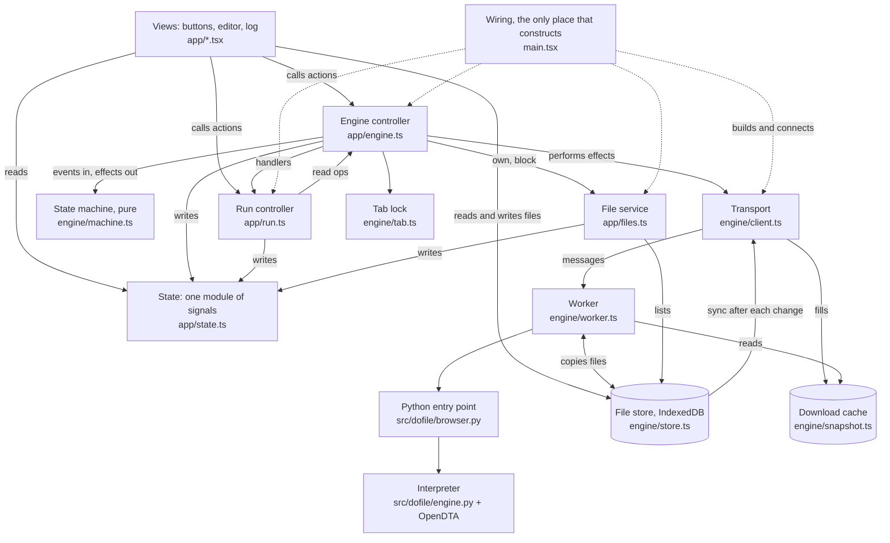

# Data flow through the dofile web engine

**This describes the code as built by step 3.5 (branch `prototype1-step3`, commit `7d26ed6` and the step E documents,
2026-11-11).** [prototype1-step3.5-plan.md](prototype1-step3.5-plan.md) is the plan that produced it: TypeScript
everywhere, one state machine, one build identity, the journal as the only channel. The state machine's design, with its
tables and race scenarios, is [prototype1-step3.5-c-design.md](prototype1-step3.5-c-design.md); the contract the page's
parts are written against is `docs/design/SPEC.md`, sections 5 to 8.

After step 3.5 the code was reformatted (Biome for `web/`, ruff for the Python) and its lint findings fixed, with no change
in behavior: [formatting-proposal.md](formatting-proposal.md). Every name in this document was checked against the code
after that (2026-11-11); none changed. The document names functions and files, not line numbers, so it does not depend
on the layout.

Written from a full read of the code. Paths are relative to `web/src/` unless they start with `src/dofile/`. Part 1 is
the plain view. Part 2 is for senior developers new to the project. Part 3 lists what is still open.

---

# Part 1: the plain view

## What it is

The page runs Stata-style code without a server. A copy of Python (Pyodide, Python compiled to WebAssembly) runs inside
the browser, in a background thread called a Web Worker. The dofile interpreter runs inside that Python.

Think of it as a kitchen behind a serving hatch:

- **The page** is the dining room. It has the buttons, the editor, and the log.
- **The worker** is the kitchen. It does the cooking (runs the code). While it cooks one order it cannot hear anything
  else.
- **The hatch** is message passing. The page writes an order on a slip with a number on it; the kitchen sends back a
  plate with the same number.
- **The pantry** is the file store, a database in the browser (IndexedDB). Both the page and the kitchen can open it.
  The kitchen also keeps a working copy of the files on its own counter (`/work`, in memory).
- **The rulebook** is one file, `engine/machine.ts`. It says which state the engine is in, what each event does in each
  state, and what must be done next. Nothing else in the page decides a state.

## The behaviours that exist

| Behaviour | What happens |
|---|---|
| **Open the page** | The tab asks for a lock so only one tab owns the engine and the files. With the lock, it lists the files, then checks the download cache. If every engine file for this build is there, it starts the engine. If not, it asks before downloading. |
| **Download** | The page fetches the engine's files (about 48 MB) into a browser cache, counting bytes for the progress bar. "Stop download" aborts it; what arrived is kept. A download that fails is a failed start: no worker is made. |
| **Start** | A worker is created. It loads Python from a saved memory snapshot, copies the files from the pantry to its counter, then starts the interpreter. The page shows each stage. |
| **Run** | The page sends the code. The log streams back in chunks while the code runs. At the end one result comes back: the full log, numbers, graphs, and which files changed. |
| **After a run** | The worker writes the files the run changed into the pantry. The page then asks four follow-up questions: the variables, the first 50 rows, the macros, the memory use. |
| **Break** | The page raises a flag the engine checks between commands. If the engine has not stopped after 5 seconds, the page throws the worker away and starts a new one ("reset"). The visitor can choose to keep waiting instead. |
| **Reset** | A new worker. Data in memory is gone; files are kept, because they live in the pantry. |
| **Edit a file in the page** | The page writes the pantry first, then tells the worker to take the change. This works with no engine at all. |
| **Crash** | One crash resets the worker. A second crash before a start finishes stops for good ("failed twice") and deletes the downloaded engine files (unless the cause is memory or no WebAssembly), so a page reload fetches them fresh. |
| **Second tab** | It gets no lock, starts nothing, and writes nothing. It can take over, which ends the first tab's worker. |

## Which file does what



One sentence per file:

- **`main.tsx`** builds the transport and the tab lock, connects the controllers (`connectFiles`, `connectRun`,
  `connectEngine`) and calls `open()`. Nothing else constructs or connects.
- **`engine/machine.ts`** holds the sixteen states, the events, the effects and `transition(machine, event)`, one pure
  function. It imports only types and has no clock, timer or signal.
- **`app/engine.ts`** is the machine's one caller: it feeds events in, performs the effects the machine returns, and
  writes the `engine` signal from the machine's state.
- **`app/state.ts`** holds every piece of page state as a signal (a value that re-draws whatever reads it). A signal with
  one owner is exported read-only.
- **`app/run.ts`** runs code and stores what a run leaves: log, graphs, results, data, memory. The engine controller
  tells it what happened to the engine; it reads no engine state.
- **`app/files.ts`** keeps the file list fresh, handles "Download all", and performs two of the machine's effects (own the
  files, block them).
- **`engine/client.ts`** is the page's handle on the worker: numbered messages, the interrupt buffer, the cache
  (`cached`, `download`, `build`, `forgetDownload`). It decides nothing.
- **`engine/worker.ts`** is the worker: loads Python, keeps `/work`, answers one message at a time.
- **`engine/store.ts`** is the file database, used by both sides.
- **`engine/tab.ts`** is the one-tab lock and the "keep my files" request.
- **`engine/snapshot.ts`** holds the snapshot restore and the download cache helpers.
- **`engine/types.ts`** holds the shared types, among them the worker protocol's op map.
- **`src/dofile/browser.py`** is the handful of Python functions the worker calls; each returns JSON text.

---

# Part 2: the detailed view

## 2.1 Conventions you need first

- **TypeScript everywhere.** `engine/`, `app/*.ts` and the tests are `.ts` files that Node runs as they are, by removing the
  types: imports spell the `.ts` extension and only erasable syntax is used (`npm run check` enforces it). `engine/` has no
  framework and no DOM, and never imports `app/`. `app/*.ts` controllers import `@preact/signals-core`. Only `.tsx` views
  import Preact, and no `.ts` file imports a `.tsx`.
- **One machine decides.** Which state follows which event, and what must be done then, is `engine/machine.ts`'s table.
  No counter, flag or comparison of state names outside it decides a state. SPEC section 5's transition matrix is
  generated from it, and a test compares the two.
- **Signals.** `signal(x)` is an observable cell: `.value` reads and writes. A component that reads `.value` re-renders on
  change. A signal with one owner is a `ReadonlySignal`: views cannot assign it, and its owner writes it through a writer
  object (`engineWriter`, `runWriter`, `filesWriter`) that only the owner imports.
- **Views never touch the transport or the machine.** They call controller actions (`engine.start()`, `run.runCode()`) and
  read signals. The one exception by design is the file store, which views call directly.
- **Errors are classified by fields, never by text.** Transport errors carry `kind`
  (`failed | failed-twice | updated | reset | stopped | no-engine | op`), plus `reason` and the worker's error `name`.
  Messages are for the console.
- **Return codes.** 0 is success; Stata's own codes are errors in the code; 1 is Break (data kept); 9998 is "the session
  was reset" (data gone). The transport makes no run result: a run that could not finish gets a result from the machine
  (`cutResult`: rc 9998 and a `kind` saying why: `break`, `crash`, `user`, `stopped`, `run-failed`).

## 2.2 The layers and what each owns

| Layer | File | Owns | Talks to |
|---|---|---|---|
| Wiring | `main.tsx` | nothing durable; makes the one transport and tab lock | everything, once, at load |
| Views | `app/**/*.tsx` | nothing durable | controllers, `state.ts`, `store` |
| State | `app/state.ts` | all signals | nobody |
| Run controller | `app/run.ts` | `log`, `lastRun`, `results`, `macros`, `data`, `rows`, `memory`, `graphs`, `history` | engine controller (`run`, `call`), `files.ts` |
| Engine controller | `app/engine.ts` | `engine`, the reset banner, the Break timer and the download's abort handle | machine, transport, tab lock, `files.ts`, `run.ts` (through its handlers) |
| Machine | `engine/machine.ts` | the state, the tickets, the crash count | nobody: it is a function |
| File service | `app/files.ts` | `files`, `fresh`, `persisted`, two banners | store |
| Transport | `engine/client.ts` | the `Worker`, its pending calls, the interrupt buffer | worker (messages), store (`attach`), Cache |
| Worker | `engine/worker.ts` | Pyodide, `/work`, the op queue, `unsaved` | store (its own connection), Cache (read only), Python |
| Python | `src/dofile/browser.py` | one `Engine` | `engine.py`, OpenDTA |
| Store | `engine/store.ts` | IndexedDB database `dofile`: `info`, `data`, `pending` | used by page and worker |

## 2.3 The wire protocol

The page posts `{ id, op, args }`. The worker posts back one of four shapes:

| Message | Meaning |
|---|---|
| `{ id, result }` | the answer; the call resolves |
| `{ id, error, name }` | the op threw; the call rejects with kind `op` (a failed `run` is ended by the machine with rc 9998, kind `run-failed`; the worker stays) |
| `{ id, log }` | a chunk of a running run's log; the call stays pending |
| `{ stage }` | a start-up stage id (`download`, `unpack`, `python`, `files`, `packages`, `engine`), with no id |

The ops are one typed map (`Ops` in `engine/types.ts`) in three sets, and the set decides who may send an op:

- **`LifecycleOps`:** `mount`, `boot`, `startup`, `run`. They change the engine. Only the transport's `start()` and `run()`
  send them, and only the machine's effect performer calls those.
- **`ReadOps`:** `describe`, `describe_file`, `matrix`, `macros`, `browse`, `memory`, and the test-only views of `/work`,
  `files` and `read`. Declared to change nothing; anyone may send one through `query()`.
- **`JournalOps`** (the page's file changes; formerly `MirrorOps`): `sync`, with no arguments. Only the function the
  transport gives to `store.attach` sends it.

The worker handles ops strictly one at a time through a promise chain (`queue = queue.then(...)`). `boot` is the one
exception: it runs outside the queue, so `sync` and the views of `/work` are answered while the interpreter loads. Engine
ops `await booted` first. A read op sent during a start or a run waits in that queue.

The transport keeps, for the live worker, a record: its number, a `pending` map of calls, its interrupt buffer, and, once
it was ended, what it was ended with. Every call goes through that record, so a call made on an ended worker rejects at
once with what `end()` said, and a message for a call `end()` already dropped finds nothing. `postMessage` is called in
one place (`#send`).

## 2.4 Flow: page load to `ready`

```mermaid
sequenceDiagram
  participant M as main.tsx
  participant E as app/engine.ts
  participant T as machine.ts
  participant C as client.ts
  participant W as worker.ts
  participant DB as store (IndexedDB)
  participant CA as Cache

  M->>E: connectFiles, connectRun, connectEngine, open()
  E->>T: initial(): checking-lock
  T-->>E: effect take-lock
  E->>E: lock.take()
  E->>T: lock-answered (owned)
  Note over T: not owned: other-tab-idle, store stays blocked
  T-->>E: checking-cache; effects own-files, check-cache
  E->>DB: unblock, list files
  E->>C: cached()
  C->>CA: is every start file of this build here?
  C-->>E: true or false
  E->>T: cache-checked
  Note over T: true: downloading. false: asking, and wait for the visitor
  T-->>E: effect start-download
  E->>C: download(signal, onProgress)
  C->>CA: fetch the list, checkBuild, fetch each start file, check its size, put
  C-->>E: progress (state downloading)
  E->>T: download-done (build)
  T-->>E: starting-worker; effect start-worker
  E->>C: start(n, build, reply)
  C->>W: new Worker, then mount (with the build's files)
  W->>CA: read snapshot files
  W->>W: unpack, restore Python heap
  W->>DB: takeAll() into /work
  W-->>C: stage ids
  C-->>E: reply(stage): state starting-worker, stage by stage
  C->>W: boot (outside the queue)
  W->>W: import dofile.browser, start("/work")
  W-->>C: About
  C->>W: startup (timings)
  C-->>E: reply(started)
  E->>T: started
  T-->>E: ready (or running, with a queued run)
```

Points that are not obvious:

- **The cache decides whether to ask.** There is no "already downloaded" flag. `client.cached()` fetches the build's list
  (`start-files.json`) and answers true only if the cache `dofile-snapshot-<built>` exists and holds every file the list
  marks for download. It creates, writes and deletes nothing, and never rejects. It answers false for an empty or partly
  filled cache, another build's cache, no Cache API, refused storage, the diagnostic `?snapshot=0` start, and when the list
  cannot be fetched. So a site update or an evicted cache shows the download prompt again.
- **Failing twice deletes the cache.** When a start ends as `failed-twice` and the reason is not `memory` or `no-wasm`, the
  machine's effect `forget-download` calls `client.forgetDownload()`, which deletes every `dofile-snapshot-*` cache. A single
  failure deletes nothing.
- **`download()` and `start()` are separate on purpose.** `download()` runs in the page before any worker exists, so bytes
  can be counted and aborted. It is the only writer of the Cache, and it keeps a file only if its byte count matches the
  build's list (`start-files.json`). The worker only reads the Cache.
- **A failed download is a failed start.** Unless the visitor aborted it, a download that fails ends in state `failed`
  (reason `download`, or `updated`); no worker is made and `start()` is not called. The visitor's "Try again" is a new
  `start` event.
- **There is no offline start.** `cached()`, `download()` and every restart's `build()` fetch `start-files.json` from the
  network, fresh. Offline, the page shows the prompt and a download ends as `failed`, even with a complete cache.
- **One statement of the build.** `start-files.json` names the build (`buildId`, `built`, the two snapshot files). The page
  compares its own build id with the list's in one place (`checkBuild`, called by `download()` and `build()`): another id is
  kind `updated`, "reload the page". The worker fetches no `manifest.json` and compares no build; `mount` gets the build's
  files as arguments. The snapshot's `manifest.json` is the build record that scripts read (`vite build` fails on a stale
  snapshot); it is not deployed.
- **A restart fetches the list again.** The machine has a state for it, `starting-list`: after a reset the Cache may have
  been evicted, and the worker would then fetch the files of whatever build the site has now. A start the visitor begins
  reuses the list `download()` has just checked.
- **Pyodide's loader fetches its own files.** The worker temporarily replaces `self.fetch` (`watchFetch`) so those requests
  hit the Cache first, and so a failed fetch rejects the start instead of hanging.
- **Stage names** arrive as typed ids. The words for the live region and the status bar are the controller's
  (`stageWords`, `stageStatus`).

## 2.5 Flow: one run

```mermaid
sequenceDiagram
  participant V as View
  participant R as app/run.ts
  participant E as app/engine.ts
  participant T as machine.ts
  participant C as client.ts
  participant W as worker.ts
  participant P as browser.py
  participant DB as store

  V->>R: runCode(code, head)
  R->>E: run(code, head)
  E->>T: run event
  T-->>E: running; effect send-run
  E->>R: handlers.began(head, theme): run-head and an empty text item go into the log
  E->>C: run(n, args, onLog)
  C->>W: id, op run
  W->>W: wait for the clock, walk /work (before)
  W->>P: browser.run(code, ..., on_output)
  P-->>W: on_output(text), at most every 0.1 s
  W-->>C: id, log chunk
  C-->>R: onLog(chunk) through the handlers: text item grows
  P-->>W: JSON text (rc, log, results, images, ...)
  W->>W: walk /work again, diff
  W->>DB: applyRun(changes), one transaction
  DB-->>W: files, skipped, resync
  W->>W: /work takes the page's version of resync
  W-->>C: id, result
  C-->>E: reply(run-ended, result)
  E->>T: run-ended
  T-->>E: ready; effect end-run
  E->>R: handlers.ended(result)
  R->>R: replace the text with result.log, add graphs, set lastRun, results
  R->>DB: afterRun: list files
  R->>E: call: describe, browse, macros, memory
```

Details:

- **Who answers what.** `engine.run()` answers at once: `started` (the engine was ready and the run began), `queued` (no
  engine yet; the prompt opens and the machine runs the code once the engine has started) or `refused` (any other state).
  `run.ts` does not look at the state. It must not call `run()` while a step of the machine is in progress (inside a handler
  it was given): `run()` throws then, before it queues anything.
- **Arguments.** `run.ts` builds a `RunHead` (`kind`: file, selection or command; `fresh_locals`). The controller adds
  `plot_theme` from the page's theme. The worker passes them positionally to Python, because a plain Pyodide call has no
  keyword arguments.
- **The Python call is synchronous.** `browser.run` blocks the worker's thread until the code ends. Streaming works because
  Python calls the JavaScript `on_output` callback, which posts a message. Nothing else in the worker can run meanwhile, so
  any op the page posts during a run (a `sync`, a read op) waits in the queue.
- **Results cross as JSON text.** Python returns one JSON string and the worker does one `JSON.parse`. Graphs are base64
  PNGs inside it. Matrices are sent as sizes only (`"3x3"`); values are fetched later with the `matrix` op.
- **Stream, then replace.** The streamed chunks are a preview. When the result arrives, `run.ts` replaces the text item's
  content with `result.log` and never appends, because the stream can stop short (log cap) and notes can be added after the
  run. For a result the machine made (rc 9998) there is no log, so the streamed text stays and the reason is added as a note.
- **Error lines.** `error_line` is 1-based within the text sent. For a selection run, `run.ts` adds the selection's first
  line to map it back to the file.
- **Run with no engine.** In `none` or `declined`, the machine goes to `asking` and keeps the run (`queued`); the prompt
  opens titled for a run. When the engine has started, the machine goes from `starting-worker` straight to `running` and
  sends the code. "Not now", "Stop download", a failed start and another tab take over drop it. A run pressed during the page
  load (`checking-lock`, `checking-cache`) is refused.

## 2.6 Flow: files

Files have one home, the IndexedDB database `dofile`, with three object stores:

| Store | Key → value | Purpose |
|---|---|---|
| `info` | path → `{path, dir, size, mtime}` | the listing |
| `data` | path → `ArrayBuffer` | the bytes |
| `pending` | auto-increment key → `{op, path, to?}` | the journal: page changes `/work` has not taken yet |

`/work` in the worker is an in-memory copy. The rule is **store first**, and **the journal is the only way a page change
reaches `/work`**.

**A page change** (`store.write`, `mkdir`, `rename`, `remove`):

1. One transaction writes the records and, when a worker is live, adds a `pending` row.
2. The store calls `sync`, which the transport installed with `store.attach`. It posts the one op `sync` to the worker,
   with no arguments and no bytes.
3. The worker's `sync` calls `store.applyRun([])`: in one transaction it reads the `pending` rows, takes the store's
   version of those paths (the path and everything under it, both names of a rename; a `mkdir` row gives the folder) and
   clears the journal; then it puts that version into `/work`, replacing what `/work` had there.
4. `store.onChange` fires; `files.ts` lists the store again into the `files` signal.

With no worker, steps 1 to 3 are cut down: no row is written and nothing is posted. The next start copies the whole store.
A `sync` that finds the journal empty does nothing, so the order in which syncs arrive does not matter and nothing is
applied twice: whichever sync or copy finds a row takes the store's version as it is then. The cost, accepted: the worker
reads an upload back from the store, and a renamed folder is copied again, not renamed in place.

**The worker's other copies.** At `mount` (`takeAll`) it reads every record and clears the journal in one transaction. After
every run (`applyRun(changes)`) it writes the run's changes and takes the journal in the same transaction.

**After a run** (`saveRun` in the worker):

1. Compare `walk(/work)` before and after by modification time and size. Only changed files are read. The wait before the
   run (until the clock is past the newest file) makes the time enough for any write of one byte or more; the size catches
   a truncation, which Pyodide's file system does not stamp with a time.
2. `store.applyRun(changes)` writes them, except any path the page changed during the run (a `pending` row covers it): the
   page's version wins.
3. It returns `resync`, the page's version of those paths, which the worker copies into `/work`; the `sync` ops that waited
   behind the run then find the journal empty.
4. `RunResult` gains `files` (what was written), `skipped` (run output lost under a folder the page renamed or removed), and
   `store_error` (the store refused; the worker remembers the paths in `unsaved` and tries again after the next run).

**Storage failures.**

- If the browser closes the database under the page ("Clear site data", or another page deleted it), `/work` may hold files
  the store no longer has, which no journal row says. The store tells the transport (`onClosed`), the transport says
  `crashed` with cause `storage`, and the machine resets: the new worker copies the store as it is. This is the one store
  failure the machine knows.
- If the worker alone cannot open the store, it still mounts, with an empty `/work` and `startup.storeError`; the transport
  detaches the store from that worker, so the page's changes stay in the store and do not reach `/work`.

## 2.7 Flow: Break, reset, crash

**Break.** The page and worker share a 4-byte `SharedArrayBuffer`. The machine's Break cell asks for two effects:
`interrupt` (the transport stores 2, SIGINT, in the buffer) and `start-break-timer` (the controller's `setTimeout`, 5
seconds; the deadline is `resetAt` in the state). Pyodide checks the buffer and raises the signal; `browser.py`'s handler
calls `request_break()` only while a run is on; the interpreter stops at the next safe point between commands with rc 1 and
the data kept.

| State | Meaning | Leaves by |
|---|---|---|
| `running` | a run is on | result → `ready`; Break → `breaking` |
| `breaking` | Break asked; a reset is due at `resetAt` | the run stops → `ready`; the timer fires → reset; "wait for it" → `waiting` |
| `waiting` | Break asked; the timer is cancelled | the run stops → `ready`; "Reset now" → reset |

Every exit from `breaking` cancels the timer. After Break the run's result stands as the engine gave it: rc 1, or the
run's own rc if it had ended before a safe point. Without cross-origin isolation there is no `SharedArrayBuffer`, so Break
resets at once.

**Reset** (the machine's RESET, kind `break`, `crash` or `user`):

1. The effects, in order: cancel the Break timer (if breaking); `end-worker` (the transport terminates the worker, detaches
   the store and rejects every pending call with kind `reset`); `fetch-list`; for an engine that had been ready, the reset
   banner, "Engine reset" and `engine-gone` (run.ts clears what the engine left); and, last, `end-run` with the cut run's
   rc 9998 result.
2. The state is `starting-list` with a new ticket. When the list arrives, `start-worker` makes the new worker under the same
   ticket; then `starting-worker`, `ready`.

One event gives the run's cut result and the new state together: there is no ordering between a callback and a promise to
keep.

**Crash.** `worker.onerror` (cause `error`) or a closed database (cause `storage`) says `crashed`. From `ready`, `running`,
`breaking` or `waiting` it is a reset of kind `crash`. During a start, the first crash is a reset too (a run queued for the
start is kept, and no banner is added, since the engine had not been ready); a second one before any start has finished is
`failed-twice`, so a phone does not loop through gigabyte allocations. The crash count is part of the machine; it survives a
failed start and "Try again", and goes back to 0 when a start finishes, on `failed-twice` and when the tab lock is lost.

**Tab lock.** `tab.ts` requests the Web Lock `dofile-engine` and never releases it. Another tab can take it with `steal`,
which rejects the holder's request; that calls `lost()`, and the machine ends the worker (no new one), blocks the store,
cuts a run in progress (rc 9998, kind `stopped`) and shows the take-over dialog. Without Web Locks (plain HTTP on a LAN)
every tab owns the engine.

## 2.8 How stale answers are discarded

Several asynchronous things can overlap (a start, a reset during the start, a lost lock, an aborted download). One rule
handles them: **a ticket.** The machine issues a number for each request (the tab lock, the cache check, the download, the
list fetch and each worker, each take-over); a state holds at most one; every answer carries the ticket of the effect it
answers, and `transition()` drops, as its first step, an answer whose ticket is not the state's. A dropped answer, and an
event that is not valid in its state, change nothing and are recorded (`drops()`, the last 200).

| Guard | Where | Protects against |
|---|---|---|
| ticket check | first line of `transition()` | every late answer: a replaced worker's stage or error, a superseded download's progress, a lock answer after the lock was lost, a second take-over |
| `reply` bound to its effect | `app/engine.ts` | performers choosing a ticket: they cannot, and a `reply` of a replaced wiring does nothing |
| the worker's record | `engine/client.ts` | calls of an ended worker (they reject with the ending's kind) and a late message for a dropped call |
| `rows.value` identity | `moreRows()` in `app/run.ts` | "Show 50 more" appending to rows a newer run replaced |

## 2.9 How derived state is kept in step

`run.ts` subscribes to nothing and compares no state names. The engine controller calls the handlers it was given
(`connectRun`):

- `began` when a run starts (this one, or a queued one when its engine is up): the run-head and a text item go into the log.
- `log` for each chunk; `ended` with the result, always after the `engine` signal has the new state.
- `engineReady`: it asks for `memory`.
- `engineGone` (a reset, or another tab took the engine): it clears `results`, `macros`, `data`, `rows`, `memory`,
  `lastRun`, and the session's run count.

After every run it calls `files.afterRun(result.files)` and, unless the engine was reset, `refreshData()`: four parallel
read ops (`describe`, `browse` with limit 50, `macros`, `memory`). `refreshData()` looks at no state: with no engine its
calls reject and nothing is written; while an engine starts or a run is on, the calls wait in the worker's queue.
`moreRows()` is the only other writer of `rows`.

---

# Part 3: what is still open

The questions Part 3 asked before step 3.5 (engine state in three places, implicit ordering contracts, `run.js` reacting to
state names, the restart that resolved calls with another promise, the failed download that fell through to `start()`, three
places that knew the build, the window at load, the seq and `upTo` journal, status as English strings, the unguarded
`decline()`, `afterRun` listing the store after the lock was lost) are answered by steps A to D. What remains:

1. **A Break pressed between sending a run and the worker starting it is lost,** and the run ends as a 9998 reset. The worker
   clears the interrupt buffer when a run starts (so a Break pressed while idle cannot stop the next run), and Break asked
   in that gap is cleared with it; the Break timer then runs out.
2. **When another page upgrades the database,** this page still opens version 1, which fails in both threads: the new worker
   mounts with a store error and an empty `/work`, and the store is detached from it. A later idea: treat it as "reload the
   page".
3. **If only the worker fails to open the store,** an upload shows in the file list (the page's store works) but `use` on it
   gives rc 601, with no banner that says why.
4. **A closed database keeps today's restart.** The machine resets the worker on `crashed` with cause `storage`, though the
   journal makes that unnecessary for the seqs; it stays because a deleted database leaves `/work` with files the store no
   longer has, which no journal row says (the maintainer's ruling, 2026-11-11).
5. **The failed states show nothing.** `failed` and `failed-twice` are in the `engine` signal, with a visitor's `message`, but
   the banners are step 4d's: until then a failed start is seen only as "Stopped" on Run.
6. **The synchronous Python call.** While a run is on, the worker answers nothing: no `sync`, no `browse`. The journal and
   `resync` make that safe. The alternative (passing changes mid-run through shared memory) is recorded as a prototype 2 idea.
7. **JSON text with base64 images.** Simple and one parse, but every graph is encoded in Python, embedded in a string,
   parsed, and held as base64 in page state (up to 20).
8. **The controller reaches into the UI.** The effects `show-dialog` and `close-dialog` write the `dialog` signal, and
   `close-dialog` calls `editorCommands.focus()`.
9. **Module-level state in the controllers.** `connectEngine`, `connectRun` and `connectFiles` set module variables; the tests
   reconnect them (a second `connectEngine` replaces the wiring and clears the machine). One engine per page is held by a
   test that only `main.tsx` constructs or connects.
