# Flows of the editor page

**This describes the code as built on branch `prototype1-step4` (pull request #17, 2026-11-11), with what step 5
(`prototype1-step5`, pull request #18) adds to these flows: the editor is served under `/app/`, and the sample's first-visit
seed and "Restore the sample" (`sample.ts`) are events of section 3 and a dialog of section 1.** It
is a sibling of [web-engine-data-flow.md](web-engine-data-flow.md), which covers the engine under the page. This
document covers four parts of the editor page that no single file shows: where the focus goes, a run as the views see
it, an open file's state in the editor, and where the log puts graph links and notes. Each spans several modules and
depends on an order of events.

Written from the code. Paths are relative to `web/src/app/` unless they start with `web/` or `engine/` (that is
`web/src/engine/`). The document names files and functions, not line numbers.

**Timing words used below.**

- **Synchronous:** in the same call stack.
- **Signal effect:** an `effect()` from `@preact/signals-core`. It runs synchronously when a signal it read is written.
- **Render:** a component that reads a signal re-renders in a microtask (`@preact/signals` calls `setState`, and Preact
  11 queues renders with `queueMicrotask`). One microtask renders every queued component. A step of the engine's
  machine therefore reaches the views as one render, with all of its writes.
- **Layout effect:** `useLayoutEffect`. It runs in that render, before the next microtask. Its cleanup runs while the
  component's nodes are still in the page.
- **Timer:** `setTimeout(f)` or `setTimeout(f, 0)`. It runs after all microtasks, and after every timer set before it.

---

## 1. Where the focus goes

### The rules

1. **A hand-off moves only a focus left on nothing** (`document.activeElement` is `<body>` or null). The dialog's
   hand-back, `useFocusOnLeave` and Delete's `refocus` all check this first. So whoever places the focus first wins, and
   the focus moves once.
2. **The fallback is `states/focus.ts` `focusStable()`:** first `editorCommands.focus()`, then, if that moved the focus
   nowhere, the first visible `button[aria-label="More actions"]`. It is never `<body>`.
3. **`editorCommands.focus()`** (`editor/Editor.tsx` `focus`) focuses at once, without changing the active tab or the
   phone's view:
   - a text tab shown: CodeMirror's content (`[data-editor]`);
   - no tab, or a text tab with no editor state yet: the empty view ("No file is open", `[data-editor]` then);
   - a `.dta` tab: its tab in "Open files" when that is visible, else the first enabled button of its view (Load), else
     nothing;
   - the Editor pane hidden (a phone on another view): the code calls `view.focus()` (or the empty view's `focus()`) all
     the same. The browser does not
     focus an element under `display: none`, so the focus does not move, and `focusStable` goes on to "More actions".
4. **A dialog gives the focus back to its opener** (what had the focus when it opened). When the opener has left the
   page, or it had none, the dialog calls `focusStable()`. `<body>` is never an opener. A dialog that opens while
   another one is still handing the focus back takes that one's opener as its own (`ui/Dialog.tsx`, the module variable
   `leaving`).
5. **A view that takes the focus when it appears takes it in a layout effect:** a dialog (`ui/Dialog.tsx`), the
   stopping banner's "Don't reset: wait for it", and the waiting banner itself (`states/banners.tsx`). So a hand-off
   that waits for a microtask finds the focus already taken.
6. **After a tab closes** (`files/EditorTabs.tsx` `focusAfterClose`, a timer) the focus goes to the selected tab, else
   the file tree's row in the tab order, else `editorCommands.focus()`. When that moves nothing, the close-tab dialog's
   own hand-back follows (its opener, else `focusStable`).

### Who moves the focus

| Who | When | Timing | Where to |
|---|---|---|---|
| `ui/Dialog.tsx`, opening | it mounts | layout effect | It blurs the opener, then calls `showModal()`. Then `[data-autofocus]`, else the first enabled button, link or input. |
| `ui/Dialog.tsx`, closing | it unmounts | cleanup (blur inside, `close()`), then a timer; only a focus on nothing | the opener if it is still in the page, else `focusStable()` |
| `states/focus.ts` `useFocusOnLeave` | a banner unmounts with the focus inside | layout cleanup, then a microtask; only a focus on nothing | `focusStable()` |
| `StoppingBanner`, `WaitingBanner` (`states/banners.tsx`) | they mount | layout effect | "Don't reset: wait for it"; the waiting banner's box (`tabindex=-1`) |
| `DeclinedBanner` (`states/banners.tsx`) | "Download the engine" | synchronous, before `eng.ask()` | `focusStable()`, so the prompt takes the editor as its opener |
| `engine.ts`, effect `close-dialog` with `focusEditor` | `started` closes the download dialog, if it is still open (no other cell sets `focusEditor`) | a timer set in the step | `editorCommands.focus()` |
| `files/EditorTabs.tsx` `focusAfterClose` | Delete on a tab (no dialog); close-tab's Save or "Don't save" | a timer | selected tab, tree row, `editorCommands.focus()` |
| `files/dialogs.tsx` `refocus` | Delete's store change is done | a 100 ms timer; only a focus on nothing | the tree's row in the tab order |
| `ui/Menu.tsx` `closeMenu(true)` | Esc, Tab, a picked item (before its `onSelect`) | synchronous | the trigger (`restore`, else `anchor`). A click outside, a resize or the window's blur close it with no focus move. |
| `log/LogView.tsx` `FindBar` close | Esc or Close | synchronous | what opened Find (`openFind`'s `from`, else the focus at that time), if it is visible; else the log `<pre>` |
| `editor/Editor.tsx` `goToLine` | "Go to line N" | a timer after `openFile` | CodeMirror, at the line |

A mouse click on a tab's × that closes a clean tab calls no `focusAfterClose` (`EditorTabs` passes `keyboard: false`).

### A dialog opens and closes

The Reset dialog, opened from the ⋯ menu:

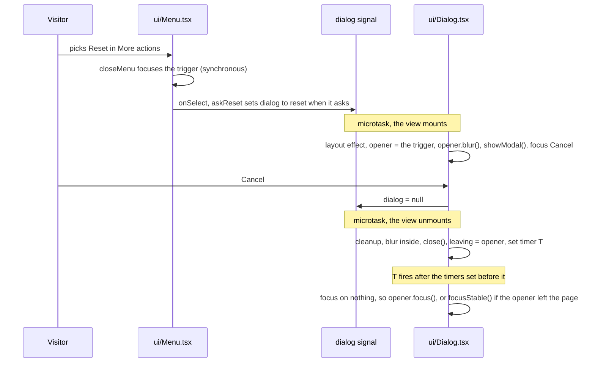

The opener lets go of the focus before `showModal()`, so the browser keeps no element to give it back to on `close()`.
Only the timer gives it back, once.

Step 5's `restore-sample` dialog (`files/dialogs.tsx`, from the file menu's "Restore the sample") follows the same rules:
Cancel focused, the focus back to the menu's trigger; Replace opens `analysis.do`, which moves no focus.

### A dialog that follows another (the clash chain)

An upload with two clashes; the visitor presses "Keep mine" on the first. The same chain runs when the download prompt
becomes the progress dialog (`states/DownloadDialog.tsx`: two `<Dialog>`s with different keys), and when the other-tab
dialog replaces any dialog (the host keys each view on the whole `dialog` value).

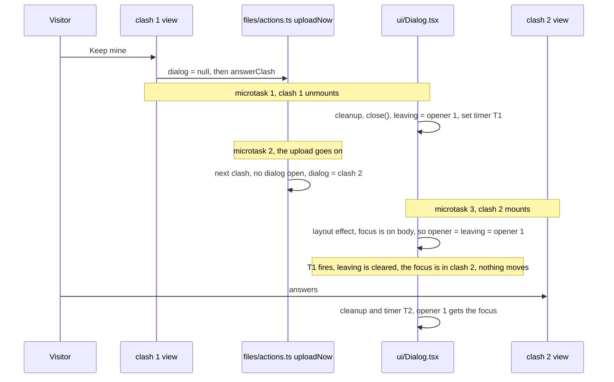

After "Replace with uploaded" the upload first awaits `store.write`. If T1 fires before clash 2 opens, it gives the
focus to opener 1, and clash 2 takes opener 1 as the active element. The result is the same.

### A dialog whose opener leaves the page (other-tab over the stopping banner)

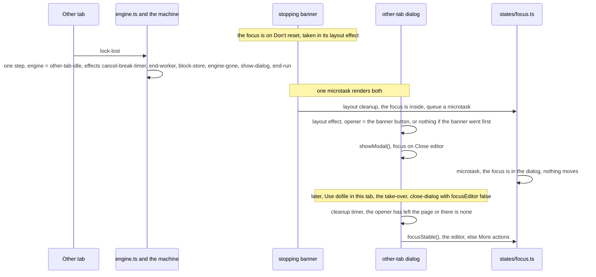

Both orders of the two renders end in `focusStable()`: the opener is either the button that has left the page, or
nothing.

### A banner leaves with the focus in it

Stopping, then waiting, then the run ends:

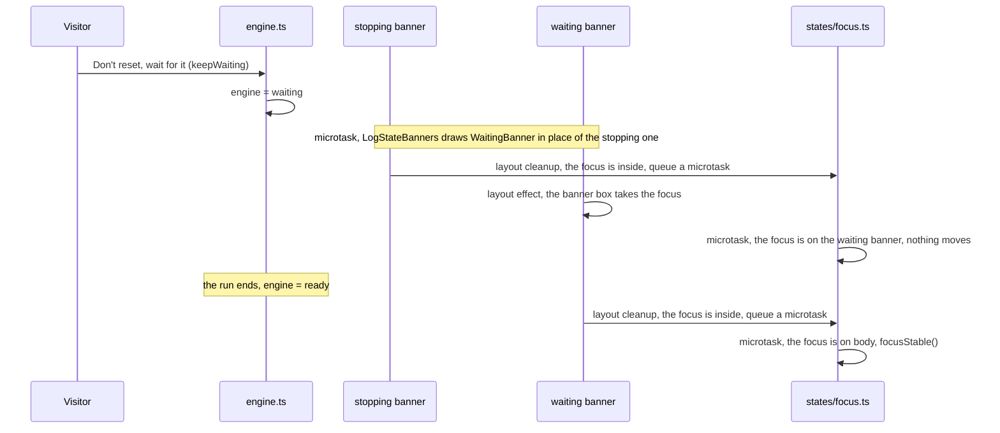

Dismiss on a banner that uses `useFocusOnLeave` (reset, storage, download-failed, the failed-start banners, the
editor's save-failed and run-changed, the Files pane's not-text) follows the last two lines, and so does run-changed's
"Reload from the run". With a `.dta` tab active, `editorCommands.focus()` puts the focus on that tab, so `focusStable`
stops there and the focus moves once.

The banners that hold no control (running, memory) do not use it, nor does the declined banner, which calls
`focusStable()` itself before it goes.

### A tab closes from the close-tab dialog

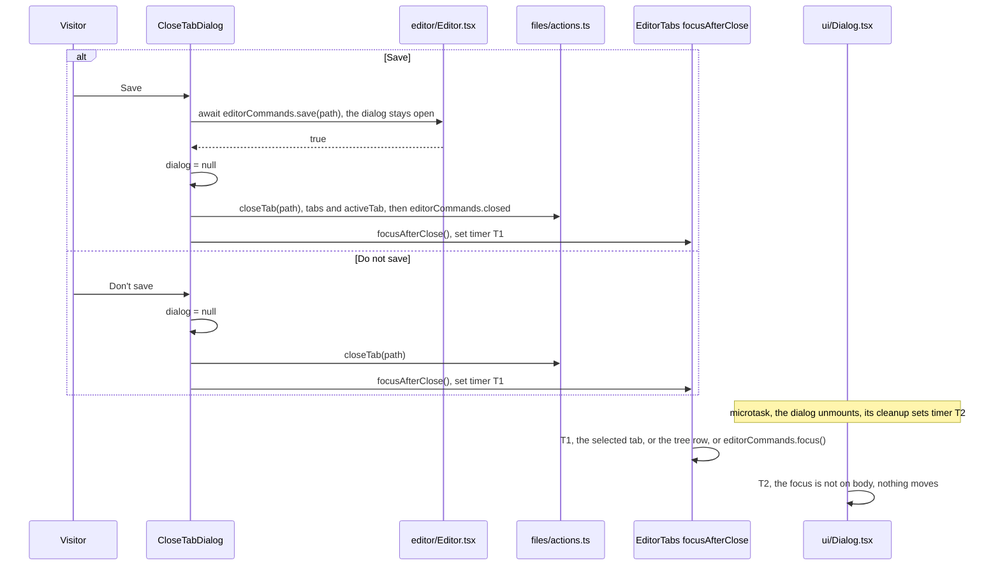

T1 is set synchronously in the click handler and T2 in the render after it, so T1 runs first. When Save resolves false
(the store refused), the dialog closes, the tab stays and nothing calls `focusAfterClose`. T2 then gives the focus back
to the opener (the tab).

### Phone variants

On a phone, one view shows at a time, so the Editor pane is often hidden.

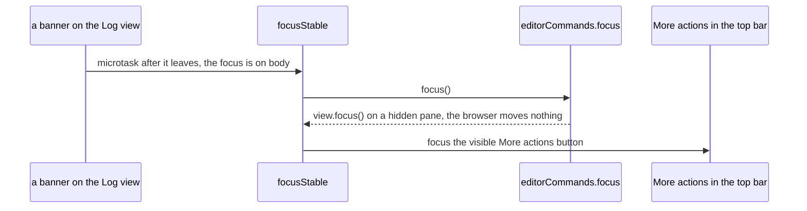

| Case | Desktop | Phone |
|---|---|---|
| A banner leaves, or a dialog's opener has left | the editor (or the `.dta` tab, or Load) | the editor (or a `.dta` tab's Load) on the Editor view; "More actions" on any other view |
| Close-tab's Save or "Don't save" | the selected tab in "Open files" | the editor: "Open files" is not shown, and neither is the tree on the Editor view |
| The engine's dialog closes itself (`started`) | the editor | the editor on the Editor view. On any other view nothing moves, and the dialog's timer gives the focus to its opener. A queued Run has just shown the Log view (`run.ts` `began`). |
| A dialog opened from a menu (Reset, Delete all) | the menu's trigger: ⋯ for Reset, "File actions" for Delete all | the ⋯ trigger, for both |
| Find opened from the phone's ⋯ | (desktop: the Log head's Find button) | `openFind(null)` takes the focused element, the ⋯ button that `closeMenu` just focused |

### Tests that hold this

- `web/e2e/states.spec.ts`:
  - "a banner that goes with the focus in it hands the focus on: the editor, or More actions when it is hidden"
  - "the editor's and the Files pane's banners hand the focus on too: save-failed, run-changed (Dismiss, Reload from the
    run), not-text"
  - "a dialog whose opener has left the page gives the focus to the editor, or More actions, not to the page"
  - "with a .dta tab active, a banner that goes with the focus hands it to that tab, in one move"
  - "from the stopping banner to the waiting banner the focus goes straight across, never through the editor"
  - "the banners above the log: running, stopping (focus on Don't reset), waiting (takes the focus)"
- `web/e2e/files.spec.ts`:
  - "tabs: … the focus goes to a tab or the tree, never the page, in one move after Save and Don't save"
  - "a clash dialog that follows another (Keep mine, then the next clash at once): the focus goes back to what had it
    before the first, not the page"
- `web/e2e/editor.spec.ts`:
  - "a .dta tab: Save is off, and when the engine's dialog closes by itself the focus goes to that tab"
  - "Find in the log: … Esc gives the focus back"
- `web/e2e/shell.spec.ts`:
  - "the layout: … the ⋯ menu works by keyboard"
  - "the folded file list: … Esc folds it and gives the focus back"

No Node test covers the focus. The rules hold only in a browser.

### If you change this

- **A view that takes the focus when it appears must do it in a layout effect.** In a `useEffect` (after paint), the
  hand-off's microtask finds `<body>` first and sends the focus through the editor.
- **`useFocusOnLeave`'s cleanup must stay a layout cleanup.** A `useEffect` cleanup runs after the nodes are removed, so
  `el.contains(activeElement)` is never true and nothing is handed on.
- **`editorCommands.focus()` must focus synchronously.** `focusStable` reads `activeElement` right after it. A `.dta`
  tab's own target must win in that call, or the focus moves twice (the e2e test records every `focusin`).
- **Place the focus before the dialog's timer is set.** An answer that places the focus itself must set its timer
  synchronously, in the same turn as `dialog = null`. That is why the close-tab dialog stays open while Save writes:
  after an `await` beyond T2, the dialog would give the focus to the opener first, and then the close would move it
  again.
- **Keep the opener's `blur()` before `showModal()`, and the `leaving` hand-over.** Without the first, WebKit gives the
  focus back on `close()` before an answer can place it. Without the second, a dialog that follows another takes
  `<body>` as its opener.

---

## 2. A run, seen from the views

### Who decides what

- `engine/machine.ts` decides whether a run is taken:
  - `ready`: sent at once (effect `send-run`);
  - `none`, `declined`: queued (state `asking` with `queued`, and the prompt, titled for a run);
  - every other state has no `run` cell, so the event is not valid and changes nothing.
  - A queued run stays through `asking` → `downloading` → `starting-worker`, and through a crash reset from
    `starting-worker` (`RESET` keeps `queued`). It is sent by `started`.
  - `transition()` ends with `dropRun`: a step that lets go of a queued run without `send-run` gets the effect
    `drop-run` as its last effect. That covers "Not now", "Stop download", a failed download, list or start,
    failed-twice, and the lock lost.
  - Every exit from `running`, `breaking` or `waiting` has one `end-run`, as its last effect: `END` (`run-ended`,
    `run-failed`), `RESET` (`reset`, `crashed`, `break-timeout`, or Break with no `SharedArrayBuffer`) and `LOST`.
- `engine.ts` `run(code, head)` dispatches the event and answers `started`, `queued` or `refused` from the step. It
  throws while a step is in progress (`stepping`). A step writes the `engine` signal before it performs its effects
  (`apply`).
- `run.ts` turns that into promises:
  - `request()` returns `current.promise` for a started run. For a queued one, a new promise whose resolver is
    `pending`. For a refused one, `Promise.resolve(null)`.
  - `began()` adopts `pending`: the queued caller's promise settles with this run's result.
  - `dropped()` settles `pending` with null.
- `runCommand(text)` adds `kind: "command"`, `fresh_locals: false` and `history`, and returns `{accepted, done}`.

### Where a run starts

| Control | Calls | When it can be pressed |
|---|---|---|
| Run (`editor/RunControls.tsx`) | `editorCommands.runFile()`: the active text tab's whole text, `kind: "file"`, fresh locals; with no text tab, the toast "No file is open to run" | enabled in `ready` and `declined`; `aria-disabled` (not `disabled`) in `running`, so a focused Run keeps the focus and a second Enter cannot reach Break; disabled in `breaking`, `waiting` and every other state ("Starting…" while downloading or starting, "Stopped" after a failed start). It is disabled in `none` too, which only `?test=manual` gives, though the machine would queue a run there. |
| Run selection | `runSelection()`: the selected whole lines, `kind: "selection"`, locals kept | enabled in `ready` and `declined` with a selection; `disabled` in every other state, `running` too (not `aria-disabled`) |
| Ctrl/Cmd+Enter in the editor | `runEither()`: Run selection with a selection, else Run; held, it runs once | in any state: outside `ready`, `none` and `declined` the run is refused (`run.ts` `requestRun`), and a toast says why by the state (`editor/words.ts` `refusedRunWords`) |
| Break | `running`: `breakRun()` ("Break", or "Break (reset)" with no cross-origin isolation); `waiting`: "Reset now", `eng.reset()` with no question | disabled in `breaking` ("Stopping…") and when no run is on |
| The phone's pill | replaces the phone's Run in `running`, `breaking` and `waiting`; does what Break does, then sets `phoneTab` to `"log"` | a tap within 600 ms of the run's `t0` is ignored, so a double tap on Run does not break the run |
| "Run the file again" (the reset banner) | `editorCommands.runFile()`, then the banner is dismissed | enabled in `ready` with a text tab active |
| The command line, a hint's `help x` link | `runCommand(text)` | any time; the machine accepts or refuses |
| Load (`output/DtaView.tsx`), Import (`files/FileBar.tsx`) | `runCommand(text)` | enabled in `ready`, `none` and `declined` |

The error mark's hooks are signal effects in `editor/Editor.tsx`: `followRuns` on `engine`, `followErrors` on
`lastRun`. Both run inside a step.

### One command's fate

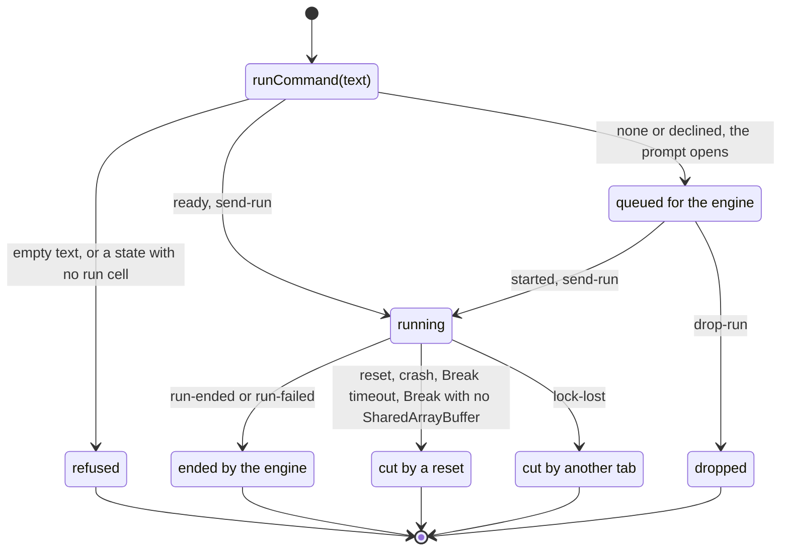

| Fate | `accepted` | `done` settles with | `lastRun` | `history` | The command line's text |
|---|---|---|---|---|---|
| Refused | false | null, at once | unchanged | unchanged | kept |
| Ran (from `ready`) | true | the result, after the after-run work | the run, written in the step that ended it | + the command (not twice in a row) | cleared |
| Queued, then ran | true | the same, once the engine has started | the same | + the command, at the time it was queued | cleared |
| Queued, then dropped | true | null (`drop-run`) | unchanged | + the command, kept | cleared |
| Its op failed in the worker | true | the machine's rc 9998, kind `run-failed` | the run, rc 9998 (the worker stays) | + | cleared |
| Cut by a reset | true | the machine's rc 9998, kind `break`, `crash` or `user` | null (`engine-gone`), then the cut run, rc 9998, in the same step | + | cleared |
| Cut by another tab | true | the machine's rc 9998, kind `stopped` | null (`engine-gone`), and not written again | + | cleared |

`runCode` (Run, Run selection) is the same without `history` and the field. Its head is `kind: "file"` or
`"selection"`, and `began` adds a run-head to the log and, on a phone, sets `phoneTab` to `"log"`.

### An ordinary run, from Enter to the after-run reads

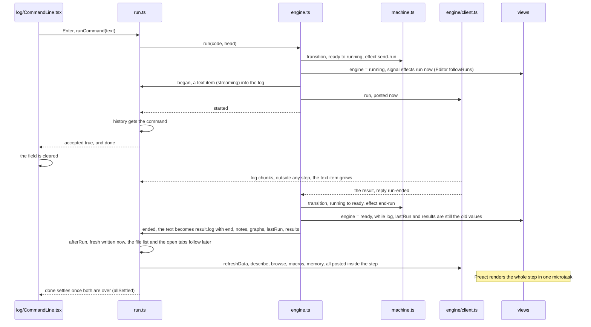

What a view may rely on, and when:

| When | What is true |
|---|---|
| `runCommand` has returned | `accepted` is known. When started: `history` has the command, `engine` is `running`, and the log has the run's text item. |
| A signal effect on `engine` sees `ready` | The run has ended, but `ended` has not run yet: `log`, `lastRun`, `results` and `graphs` are the old ones. |
| A signal effect on `lastRun` sees the new run | The log text is final, with `end`, and the graphs are added. `results` is still the old one (written next). |
| A component renders after the step | The whole step: `engine`, the log, `graphs`, `lastRun`, `results`, and `fresh` (and the storage banner, when it is due), which `afterRun` writes before its first `await`. |
| Later, as each answers | `data`, `rows`, `macros`, `memory` (`refreshData`); `files` and the open tabs (`afterRun`). |
| `done` has settled | All of the above. An after-run read that failed leaves its signal as it was. A failed file list, and an open tab's follow-up that throws, go to the console; `refreshData` drops its error. |

`refreshData` sends its four reads synchronously inside the end step (`client.ts` `#send` posts at once). So they are
ahead, in the worker's queue, of any run started after the step.

### Three pasted lines, the second fails

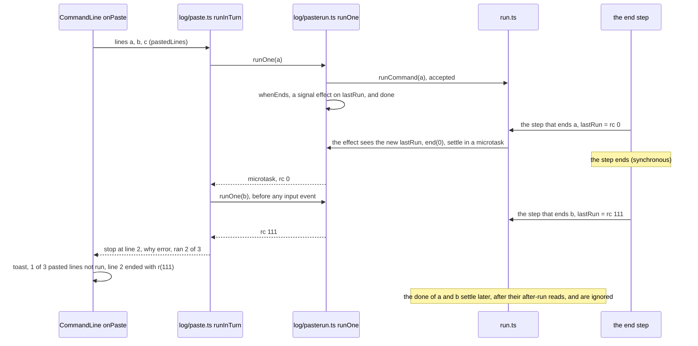

- **Why `whenEnds` waits on `lastRun`.** `lastRun` is written in the step that ends the run. `done` settles only
  after the after-run reads. Between the two the engine is `ready`, so an Enter or a Run pressed then would take the
  engine, and the next pasted line would be refused. Starting it in a microtask after the step leaves no gap. It cannot
  start inside the step: `run()` would throw.
- **Why `done` is still awaited.** Two ends write no new `lastRun`. A queued line that is dropped settles `done` with
  null. A line cut by another tab settles with kind `stopped`. `done` settling also stops the effect, so no wait
  outlives its run. The first of the two to come wins (`over`).

| `stop.why` | When | Lines counted as run | Toast (`inTurnWords`) |
|---|---|---|---|
| `block` | the line opens a block, a `/*` comment it does not close, or holds `///` (`opensBlock`); it is not sent | those before it | "N of T pasted lines not run: line L starts a block, a comment or a /// command; run those from the editor" |
| `refused` | `accepted` is false | those before it | "N of T pasted lines not run: the engine can't take a command now". The line goes back into the field if the field is empty. |
| `not-run` | `done` gave null (queued, then dropped) | those before it | "N of T pasted lines not run: line L didn't run" |
| `error` | rc is not 0: an error, Break's rc 1, or rc 9998 (a reset, `run-failed`) | up to and with it | "N of T pasted lines not run: line L ended with r(rc)" |
| `taken` | `done` gave kind `stopped` | up to and with it | "N of T pasted lines not run: another tab took over the engine during line L" |
| none | every line ran | all | no toast |

When the last line ends with an error or is cut by another tab, nothing is left (`total - ran` is 0), and there is no
toast: its error is in the log. A last line that is refused, not run or a block's leaves one line, and the toast shows.

### Invariants a change must keep

- **At most one queued run.** The machine has no `run` cell in `asking`, `downloading` or `starting-*`, and run.ts has
  one `pending` slot.
- **`done` always settles.** A started run settles through `end-run` (every exit from a running state has one). A
  queued run settles through `began` or `drop-run`. A refused run settles at once. The after-run work uses
  `Promise.allSettled`, so a failed read does not keep `done` open.
- **No run starts during a step.** A view never calls `runCode` or `runCommand` inside a handler given to `connectRun`,
  or inside a signal effect on `engine` or `lastRun`. Both are written only during a step, so the call throws. A `log`
  write from a step (`began`, `ended`) throws too. A streamed chunk and "Clear log" write `log` outside a step, where
  the call does not throw: during a run it is refused, and after "Clear log" in `ready` the run starts. Start the next
  run after the step: in a microtask, or when `done` settles.
- **`ended` comes after the `engine` signal has its new state.** When the machine cut the run, it also comes after
  `engine-gone`.
- **A cut of kind `stopped` writes no `lastRun`.** The tab no longer owns the engine, and a quick take-over may already
  have started a new one.

### Tests that hold this

- `web/test/app.test.ts`:
  - "a run: the streamed log grows one item and the result's log replaces it; graphs, lastRun, results and the
    after-run calls"
  - "a crash cuts a run: the new state first, then engine-gone, then the cut run's result; …"
  - "runCode while a run is on does nothing; a queued run is dropped by Not now and by a failed start, and its promise
    then settles with null"
  - "run() called while a step is in progress throws before it queues anything"
  - "runCommand: added to history (not twice in a row), …"
  - "runCommand: a command that does not run is refused …"
  - "a run whose op failed in the worker (run-failed) is not a reset: …"
  - "Stop download declines; Run then asks for a run, and the run starts with the engine: `ready` is not shown in
    between"
  - "C1: a run cut by losing the tab lock does not set lastRun, and the store is not listed afterwards"
  - "J1: pasted lines: a line cut because another tab took the engine stops the rest; …"
  - "J5: a run's promise settles even when the after-run work throws (an open tab's follow-up fails)"
- `web/test/machine.test.ts`:
  - "property: a transition from running, breaking or waiting to a state that is none of those has exactly one end-run,
    as its last effect; no other has one"
  - "property: a queued run is kept, sent (send-run) or dropped (drop-run, once, as the last effect); drop-run comes
    from nothing else"
  - "property: a transition from ready, running, breaking or waiting to a state that does not hold the same worker has
    engine-gone, once"
- `web/test/editor.test.ts`:
  - "pasted lines run in turn and stop at the first refused, not run, or failed one"
  - "pasted lines stop before a block's, a comment's or a /// line, …"
  - "pasted lines: the next starts only once the one before has ended"
  - "a paste with no line break is an ordinary paste; …"
  - "a refused Ctrl/Cmd+Enter's toast: the words by the engine's state; none where a run is taken or queued"
- `web/test/imports.test.ts`:
  - "events get in through two doors: …; transition() is called once"
  - "each signal has one writer: …"
- `web/e2e/editor.spec.ts`:
  - "the command line: Enter runs and clears, ↑ recalls; a paste of lines runs each in turn and stops at an error; …"
  - "the command line with no engine: pasted lines wait for the engine; Not now drops them, and a toast says so"
  - "Ctrl/Cmd+Enter that the engine does not take says why in a toast and starts nothing; …"
- `web/e2e/shell.spec.ts`: "first visit: … a run asks again, titled for a run, and Not now drops it"

### If you change this

- **Taking the rc from `done` in `whenEnds`** leaves a gap between two pasted lines in which another run takes the
  engine. The next line is then refused.
- **Changing `Promise.allSettled` to `Promise.all` in `ended`** leaves `done` unsettled when an open tab's follow-up
  fails, and a paste then waits for ever (J5).
- **A new state that holds a queued run** must call its field `queued`. `dropRun` reads that name, and a run held under
  another name would never settle.
- **The order of writes in `ended`:** log and graphs, then `lastRun`, then `results`. The editor's error mark and
  `whenEnds` react to `lastRun`. Moving `lastRun` earlier gives them a log that is not final.
- **The `RunHead` object is passed through unchanged**, from `runCode` through the machine to `began` and the run-head
  item. `codeOf` (section 4) and the editor's running-lines mark (`marked?.head === run`) look it up by identity.

---

## 3. An open file's state in the editor

The editor (`editor/Editor.tsx`) keeps, per open text tab, keyed by path:

- `states`: the `EditorState`. The shown one lives in the view and is copied back when the tab is hidden.
- `savedText`: the store's text in the editor's form, or null when the store's version is not text.
- `forms`: the noted line break and BOM.
- `saving`: each Save in progress with the path its tab has now (`renamed` moves it, `closed` sets it to null), so a
  Save that answers after a rename leaves its outcome on the renamed tab.

`tabs[].dirty` (the unsaved dot) is written only through `state.ts` `setDirty`. The file code (`files/open.ts`,
`files/actions.ts`) changes `tabs` and `activeTab` first, then calls the editor through `editorCommands`.

### The three text forms

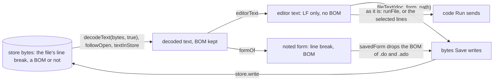

- `editorText` (`editor/ranover.ts`) drops a leading BOM and turns `\r\n` and `\r` into `\n`.
- `formOf` notes `lineBreakOf` (`\r\n` when it outnumbers lone `\n`; else `\n`, also on a tie, for an empty file and
  for lone `\r`) and whether the text starts with a BOM.
- `fileText` writes the editor's text with the noted break, and with the BOM unless `dropsBom(path)` (a `.do` or
  `.ado` name, case ignored, at the time of the Save).
- `textOf` (the save-failed banner's Download) gives the same text as Save would write.

### What each event does

| Event | Editor's text | Saved text | Noted form | Unsaved dot | Error mark | run-changed, save-failed | The store |
|---|---|---|---|---|---|---|---|
| **Open** (`openFile` → `open`) | `editorText` of the file | the same | `formOf` the file | off (the tab is added clean) | back on its line if the file was closed with one, clean, and opens with the same text | none (`openFile` dismisses any not-text banner) | read only |
| **Edit** | changed | unchanged | unchanged | on when the text differs from the saved text (`follow`, on each change) | moves with the text; gone when its line is deleted (`cm.ts` `lineMarksField`, `errormark.ts` `lineDeleted`) | unchanged | unchanged |
| **Undo back to the saved text** | equals the saved text | unchanged | unchanged | off | mapped as any edit | unchanged | unchanged |
| **Save succeeds** (`save`) | unchanged | the text Save wrote | `savedForm`: a `.do` or `.ado` loses its BOM, by the name it was written under | off, unless the text changed while it was written | unchanged | both dismissed for the tab's path; toast "Saved name". A tab renamed while it was written gets all of this under its new path. | `fileText` bytes |
| **Save fails** | unchanged | unchanged | unchanged | stays on | unchanged | save-failed added (one per path, under the tab's path at the time it fails; none for a tab closed meanwhile); the live region says it | unchanged |
| **Rename** (`renameEntry` → `renamed`) | the same state, its language set by the new name | moved to the new path | moved, BOM and all; the new name decides at the next Save | kept | kept | both moved to the new path; a Save in progress answers there (`saving`) | the same bytes under the new name |
| **Rename across a `.do` name** | as Rename | as Rename | `a.txt` with a BOM renamed `a.do`: the next Save writes no BOM. `a.do` with a BOM, never saved here, renamed `a.txt`: the next Save keeps it. | kept | kept | moved | the same bytes |
| **Rename to a name that opens another way** | a clean tab is closed and opened again in its place (as Close, then Open); a tab with edits stays as it is; a `.png` name closes a clean tab | | | | | | |
| **Close** (`closeTab` → `closed`) | dropped | dropped | dropped | the tab is gone | noted (line and text) when it had one and no unsaved edits | both dismissed | unchanged ("Don't save" loses the edits) |
| **First visit's sample** (`sample.ts` `seedSample`: an empty store and no mark) | as Open, of `analysis.do`, once the three files are written | the same | `\n`, no BOM | off | none | none; the seed's own writes bring no storage banner (`files.ts`, by the store's change row) | the sample's three files |
| **"Restore the sample" over an open tab** (`put` → `reload`) | the sample's text (`decodeText(bytes, true)`), a new state | the same | `formOf` it: `\n`, no BOM, so a `\r\n` or BOM tab saves the sample's form from then on | off | gone (new state) | both dismissed | the sample's bytes. Asked first (dialog `restore-sample`) when the file differs from the sample or the tab has unsaved edits; a missing file is written with no question. |
| **Upload and "Replace with uploaded"** (`reopen` → `reload`) | the uploaded text, a new state (undo history gone) | the same | `formOf` the upload | off | gone (new state) | both dismissed | the uploaded bytes. Not text: the tab closes. |
| **A run writes the same text** (in the editor's form) | unchanged | unchanged | unchanged, even if the run wrote other line breaks | unchanged (a tab with edits stays unsaved) | unchanged | unchanged | the run's bytes |
| **A run writes other text, tab clean** | the run's text, as one change where the two differ: caret, selection and undo kept | the run's text | `formOf` the run's text | off | mapped through the change | run-changed dismissed | the run's bytes |
| **A run writes other text, tab unsaved** | kept | the run's text | `formOf` the run's text; unchanged when the run wrote exactly the editor's text | on. When the run wrote exactly the editor's text: off, and the answer is "same". | unchanged | run-changed added (files.ts, on "kept"); when "same", dismissed | the run's bytes |
| **A run writes something that is not text** | kept | null (`savedIsText` is false) | unchanged | on | unchanged | run-changed in its not-text words, with no "Reload from the run" | the run's bytes. A later run that writes the editor's text makes the tab clean and removes the banner. |
| **A run deletes the file** | unchanged (`followOpen` skips `removed`) | unchanged | unchanged | unchanged | unchanged | unchanged | removed; the file leaves the list, and Save writes it again |
| **"Reload from the run"** (`textInStore` → `reload`) | the store's text, a new state | the same | `formOf` it | off | gone | both dismissed. When the store gives no text: only run-changed, dismissed. | unchanged |
| **The file's own run starts** | sent as it is, edits included, never saved first | unchanged | unchanged | unchanged | this file's mark cleared (`onRunStart`); a selection run marks its lines while the state is `running`, `breaking` or `waiting` | unchanged | unchanged |
| **It ends with an error** | unchanged | unchanged | unchanged | unchanged | set on `lastRun.line` (the file's line: a selection's offset added in `run.ts`) when rc is not 0 or 1 and the line exists. The number is applied to the text as it is then. | unchanged | what the run wrote follows (rows above), after this step |
| **A command-line command runs** | unchanged | unchanged | unchanged | unchanged | unchanged (`onRunStart`, `onLastRun`: a command changes no mark) | unchanged | as the run rows, if it writes the file |
| **A reset** | unchanged | unchanged | unchanged | unchanged | every mark cleared, the closed files' too (`lastRun` is null in the `engine-gone` effect); the running lines cleared | unchanged | unchanged |

What "the run changed" means: the worker compares `/work` before and after the run by modification time and size, and
writes the changes in `store.applyRun` (`engine/store.ts`). It leaves out any path the page changed during the run,
because the page's version wins. `RunResult.files` lists only what it wrote. `files.ts` `afterRun` calls `followOpen`
for each listed path that is open in a text tab. `followOpen` reads it, decodes it strictly (BOM kept, null when not
UTF-8), and calls `editorCommands.ranOver`, which applies `ranover.ts` `followRun`.

### Rules a change must keep

- **Compare in the editor's form.** The dot (document against `savedText`) and a run's version (`followRun` passes the
  run's text through `editorText`) are compared with `\n` breaks and no BOM. Otherwise a clean `\r\n` tab is never
  clean.
- **Save is the editor's only write to the store.** Run sends the text and writes nothing. The Download in save-failed
  gives the browser a file and writes nothing. The editor follows the other writers: an upload (`reload`), a run
  (`ranOver`).
- **A `.do` or `.ado` file is written without its BOM,** by the name it is saved under (`savedForm`). After a Save,
  the noted form is the one written.
- **`tabs` first, then the editor.** `open`, `renamed` and `closed` assume the tab already has its new state in `tabs`
  and `activeTab`.
- **A null `savedText` means "the store's version is not text".** Keep it null when it moves (`renamed`), and keep
  `?? null` where it is read.

### Tests that hold this

- `web/test/editor.test.ts`:
  - "a run's version of an open file (editor/ranover.ts): compared with line breaks as the editor holds them; …"
  - "a file's form (editor/ranover.ts): its line break, the more common one, \n on a tie or with none, and its BOM; …"
  - "the error mark's rule (editor/errormark.ts): …"
- `web/test/app.test.ts`:
  - "a run that rewrites an open file: the editor follows it (ranOver); the banner when it keeps the tab's text: …"
  - "setDirty sets one tab's dot; decodeText takes strict UTF-8 only"
- `web/test/files-ui.test.ts`:
  - "openFile: a text file gets a tab, made active, before the editor is told; …"
  - "closing a tab: …"
  - "rename: an open file, and a folder with open files under it: the tabs follow, then the editor is told for each"
  - "upload over an open file: … Replace reloads it in the editor; one no longer text closes its tab"
  - "rename: a .dta tab renamed to .csv opens again as text in its place; …"
- `web/e2e/editor.spec.ts`:
  - "the editor: typing marks the tab unsaved, Ctrl/Cmd+S saves it with a toast, a failed save shows a banner; …"
  - "a failed save's banner goes when the editor's text is replaced: Reload from the run, Replace with uploaded"
  - "a rename while Save writes: the save follows the tab to its new name (clean, its toast), and so does a failed
    save's banner"
  - "Save keeps a file's form: …"
  - "the error line keeps to its text when the tab is left and shown again"
  - "the error line comes back when its file is closed and opened again with the same text"
  - "a run that rewrites open files: …"
  - "a clean tab of a .csv with \r\n line breaks follows a run that rewrites it: …"
  - "a file's form follows the store's text the editor takes: …"

### If you change this

- **`ranOver` calls `setDirty` itself.** The `follow` listener sees only the shown view's transactions. A hidden tab
  changed through `update()` gives the listener nothing.
- **The error mark's effects (`followRuns`, `followErrors`) must read only their one signal.** If they also read
  `shown`, a tab switch would place the error again at the run's line number, not where its text has moved.
- **`renamed` shows the new path itself.** `activeTab` changed before the call, when the editor had no state for the
  new name and showed the empty view.
- **A rename must keep `savedText`'s null.** Code such as `savedText.get(from) ?? ""` would make a not-text tab look
  like an empty saved text.
- **A Save answers for the path its tab has when the store answers** (`saving`). Code that awaits between taking a
  tab's path and writing the editor's maps under it must follow a rename the same way, or it writes under the old name.

---

## 4. Placing graph links and notes in the log

### The problem

The log is plain text that the engine prints, with no marks. The engine reports, for each graph, only the line number
in the code it was sent (`RunResult.graph_lines`), and not where in the log that line ran. `log/align.ts` `echoLines`
walks the log's echoes beside the code to find, for each code line, the index of its echo.

### The pieces

- **Line kinds** (`log/classify.ts` `classify`). The walk uses:
  - `echo`: `. cmd`; a loop's or program's body line `  2. cmd` and a continued `> ` line, but only right after another
    echo;
  - the text `end of do-file`, which is classed `out`.
- **`runError(lines)`:** the last `err` line that is not `r(N);`.
- **The code** (`editor/commands.ts` `codeOf`): a `WeakMap` from the run's `RunHead` to the code sent, which
  `Editor.tsx` `start` fills before `runCode`. A command has no run-head. `LogView` takes its first echo's text as
  the code. A run started from elsewhere (the test hook) has no code, so its links go to the run's end.
- **Per code line** (`blocks`, `comments`):
  - `inside` a block: `{ }`, `program define` … `end`, `mata` … `end`. `inBlocks` exports it.
  - `silent`: the body of a `quietly { }` or `capture { }` outside a loop or program.
  - `skip`: blank, or in or opening a `/* */` comment.
  - Braces in strings, comments and a `local`'s or `global`'s text are not counted.
- **The index:**
  - `real[j]`: the next line from `j` that is surely echoed.
  - `all`: the code lines by text.
  - `far`: the lines by text that the look-ahead may jump to (outside blocks, not skipped, not silent).
  - The lookups use a binary search (`atLeast`), so the walk is linear in the log.
- **`endFirst[i]`** (a backward pass): whether an `end of do-file` comes after log line `i` and before the next echo of
  a `do` that shows its echoes.
- **The walk's state:**
  - `p`: the next code line to find.
  - `depth`: the nested do-files open.
  - `jump`: whether a top-level echo may be taken and looked for further down.

`opens(x)` is true for `do` or `include`, after any `capture`, `quietly` and `noisily` prefixes (abbreviated too),
when its echoes show: no prefix, or `noisily` last.

### The walk, per log line

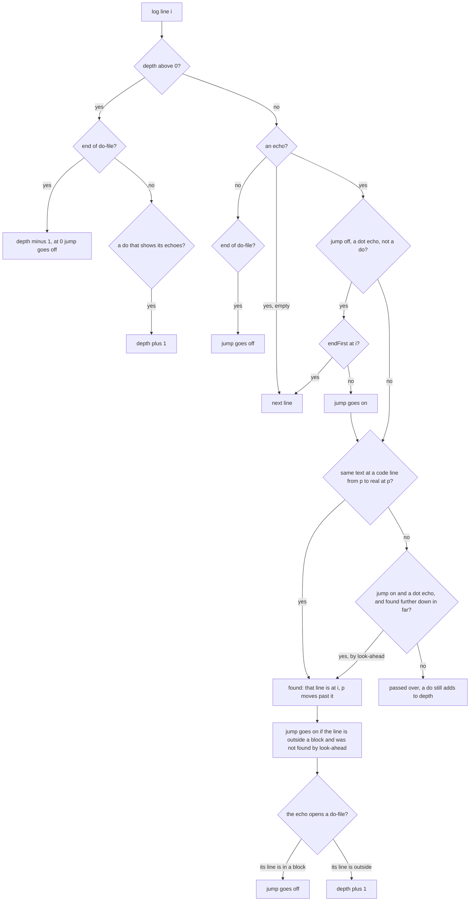

A candidate between `p` and `real[p]` is taken when it is `real[p]` itself, or when it is not silent and either not
inside a comment or matched by a continued `> ` echo.

### A worked example: a loop that runs a nested do-file

`step.do` holds one line, `count`. The editor runs this file, and its line 8 draws a graph (`graph_lines` is `[8]`):

```
1  clear
2  set obs 3
3  generate x = _n
4  forvalues i = 1/2 {
5      do step.do
6  }
7  count
8  scatter x x
```

The engine's log (run through dofile's engine; the page receives it without the CLI's outer `do`), with the walk's
state before each line. `depth` stays 0 throughout: the `do` is in a block, so it opens nothing. `endFirst` is computed
before the walk. A line with no entry in the last column is passed over.

| i | Log line | Kind | `p` | `jump` | `endFirst` | What happens |
|---|---|---|---|---|---|---|
| 0 | `. clear` | echo | 0 | on | no | code line 1 found |
| 1 | (blank) | out | 1 | on | no | |
| 2 | `. set obs 3` | echo | 1 | on | no | code line 2 found |
| 3 | `number of observations (_N) was 0, now 3` | out | 2 | on | no | |
| 5 | `. generate x = _n` | echo | 2 | on | no | code line 3 found |
| 7 | `. forvalues i = 1/2 {` | echo | 3 | on | no | code line 4 found |
| 8 | `  2.     do step.do` | echo | 4 | on | yes | code line 5 found. It opens a do-file, and line 5 is in a block, so `jump` goes off. |
| 9 | `  3. }` | echo | 5 | off | yes | code line 6 found (not a dot echo, so `jump` does not stop it) |
| 11 | `. count` | echo | 6 | off | yes | an `end of do-file` comes before any `do`, so this echo may be `step.do`'s: passed over |
| 14 | `. ` | echo | 6 | off | yes | empty |
| 15 | `end of do-file` | out | 6 | off | yes | `jump` stays off |
| 17 | `. count` | echo | 6 | off | yes | passed over, as at 11 |
| 21 | `end of do-file` | out | 6 | off | no | |
| 23 | `. count` | echo | 6 | off | no | no `end of do-file` follows, so `jump` goes on. Code line 7 found. |
| 26 | `. scatter x x` | echo | 7 | on | no | code line 8 found |

The result is `{1→0, 2→2, 3→5, 4→7, 5→8, 6→9, 7→23, 8→26}`, and the link "graph 1" goes after log line 26. Without
`endFirst`, line 11, the first `. count` (`step.do`'s), would be taken as code line 7.

A `do` at the top level (outside any block) works the other way. Its echo raises `depth`, and every log line until the
matching `end of do-file` is passed over. A `do` echoed inside that file raises `depth` again. When `depth` is back to
0, `jump` goes off: a `do` in a loop of that file may still print ends that were not seen opening.

### Where `LogView` uses the result

`log/LogView.tsx` `runText`, for each text item:

- **Graph links.** Each graph of this run (`graphs` with `from: "run"` and this `run`) goes after
  `commandEnd(lines, echoes.get(g.line))`, the last `> ` line of that command. When the line has no echo, or the graph
  has no line, it goes after the item's last line (the one before the text's final line break, which may be blank). A
  graph drawn inside its run's text is not drawn again by its `{t: "graph"}` log item (`placed`).
- **S 15's note.** The item keeps `unsaved`, the open files with unsaved edits when the run started (`run.ts`
  `began`). For each found echo, `nestedTarget` reads the command `align.ts` `echoed` gives (the echo without its
  `. `, `  2. ` or `> ` prefix, the one rule the walk uses too). The note "Note: name has unsaved edits in the editor;
  do runs the saved file. …" goes after that command when `unsavedTarget` finds the file: the same path, else the one
  unsaved file with that name. A loop's or program's body is echoed once, where it is defined, so a `do` there gets
  one note after that echo, however many passes run the file (for a program, at its definition, not its call). A `do`
  whose file name is on a continued `> ` line gets none.
- **OQ-10's note.** When the run ended with rc above 1, `states/words.ts` `noteFor(end.rc, runError(lines))` picks
  the note, which goes at the run's end, after "Go to line" when that is there (Break's note is rc 1's, so never with
  it).
- **Caches.** `kinds` (each item's `classify`) and `aligned` (each item's echoes, kept with the code they were
  computed for) are `WeakMap`s keyed by the text item. `run.ts` replaces an item on every change (`setText` maps to a
  new object), so a streamed chunk is classified again, and an ended run is aligned once.

### Late rather than wrong

Where the walk cannot know which echo is a line's, the line gets none, and its link goes to the run's end. A link in
the wrong place is worse than a late one. These cases give no echo on purpose:

- **An echo that may belong to a do-file run from a block** (a loop, a program, an `if`): after such a `do`, or after
  any nested file's end, a top-level echo is taken only when no `end of do-file` comes before the next `do`
  (`endFirst`).
- **A program's call followed by its do-file's echoes:** the call (`zp`) may get no echo. The test allows "unknown,
  never wrong".
- **Silent lines:** the body of a `quietly { }` or `capture { }` outside a loop or program.
- **A line inside a `/* */` comment:** it is taken only as a continued `> ` echo of a comment that began in a command.
- **Blank lines.**
- **Lines echoed in another form** (a mata block's `: ` lines). The walk gets back in step at the next top-level echo,
  through the look-ahead.
- **`quietly do`:** it prints no echoes and opens nothing.
- **A top-level echo with no candidate while the look-ahead is off:** passed over (a `do` there still adds to `depth`).

The look-ahead is off (`jump` off) after a `do` in a block, and after any `end of do-file` seen at depth 0. It comes on
again at a dot echo with no nested end before the next `do`, or when a line outside a block is found in step.

### The known limit

In `#delimit ;` mode, two commands on one line are echoed as the whole line twice. The second echo can be matched to a
later identical line, and a graph's link then goes in the wrong place (`docs/prototype1-plan.md`, list C, item 11).

### Tests that hold this

- `web/test/editor.test.ts`:
  - "echoLines: each code line finds its echo; blank lines and block comments are passed over"
  - "echoLines: a nested do-file's echoes are passed over, even one with the text of a later line"
  - "echoLines: a do-file run from a block opens nothing, and the walk stays in step after it"
  - "echoLines: after lines echoed in another form (a mata block) the walk finds the next line further down"
  - "echoLines: capture noisily do shows its file's echoes, which are passed over; quietly do shows none"
  - "echoLines: a do-file run from a loop, then a line its file holds too: the main file's echo, after the loop's runs"
  - "echoLines: a do-file run from a program: a later line its file holds is not taken for the program's echo"
  - "echoLines: a do-file that runs a do-file from a loop is passed over whole"
  - "echoLines: `n` is noisily too (cap n do shows its file's echoes); include and noi do"
  - "echoLines: a quietly or capture block echoes nothing inside; a line there is not taken for a later line's echo"
  - "echoLines: a line in a /* */ comment is not taken for the echo of the same line after it; a comment's continued
    line is"
  - "inBlocks: a local or global's braces open no block"
  - "nestedTarget and unsavedTarget: the file a do or include runs, and the open file with unsaved edits it is" (also
    `echoed` on a top-level and a body echo)
  - "runError: the error a run ended with is its last error line, not one capture noisily caught before it"
  - the three ".log tokenizer" tests
- `web/e2e/editor.spec.ts`:
  - "Run: the run-head, the graph after its echo, the error line marked, Go to line, the last run; Run selection keeps
    locals"
  - "the log: under an error, the OQ-10 note where the engine's own words do not say it"
  - "S 15's note under a nested do in a loop: one note, after the loop's echo of that line, however many passes run it"
- `web/e2e/shell.spec.ts`: "key hints: … the Editor and Log views with a nested do's note …"

### If you change this

- **Mutating a log text item** in place, instead of replacing it, leaves the `WeakMap` caches with old answers.
- **`graph_lines` are lines of the code sent.** For a selection, that is the selected slice, which is also what
  `codeOf` holds. `error_line` is offset to the file's line in `run.ts`; `graph_lines` must not be.
- **`codeOf` is keyed by the `RunHead` object.** A head that is copied anywhere between `Editor.tsx` `start` and the
  run-head item loses the code, and every link goes to the run's end.
- **The echo rules of `classify`** (a body line or `> ` counts only after another echo) decide what the walk sees. A
  change there changes where links go.
- **A new case should give no echo rather than a guess.** The tests assert "unknown, never wrong" where the walk
  cannot know.
