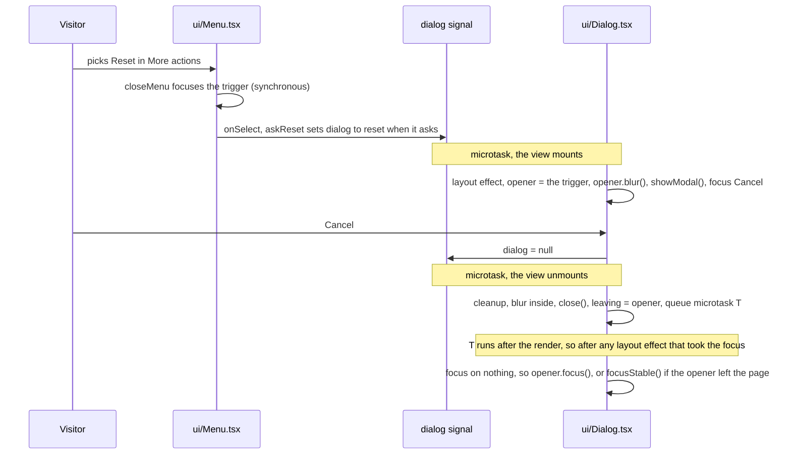
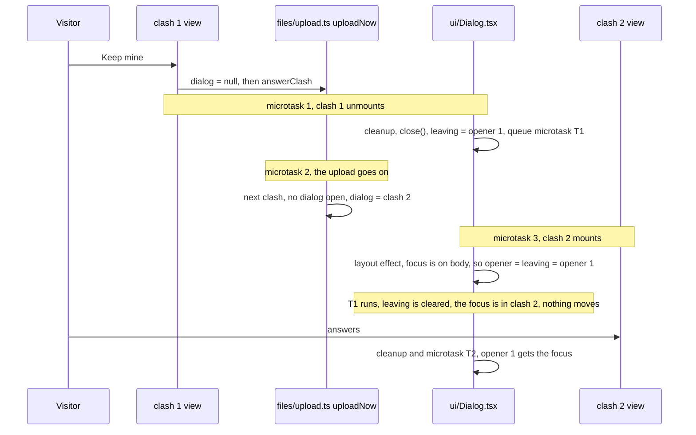
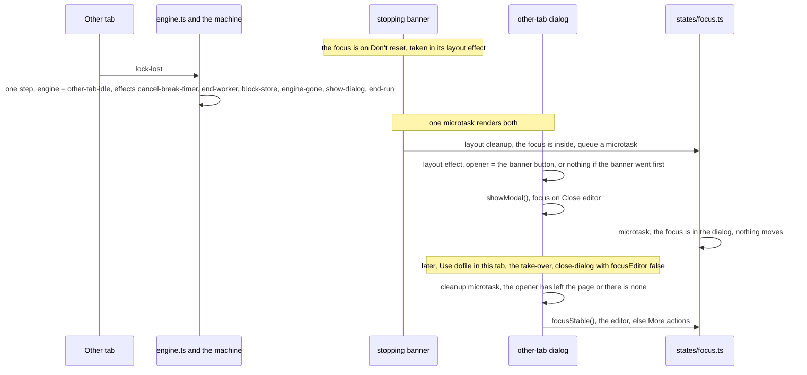
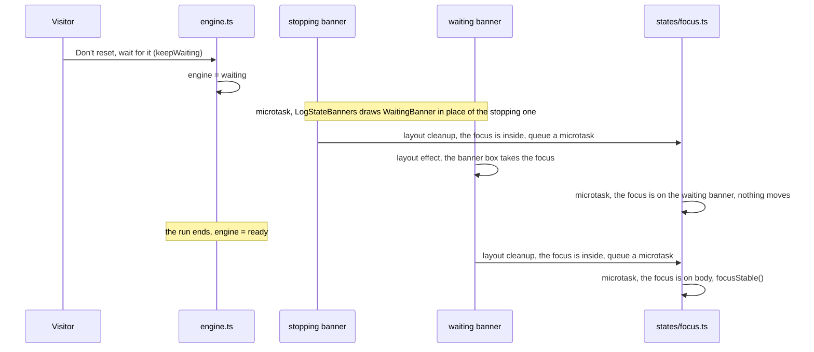
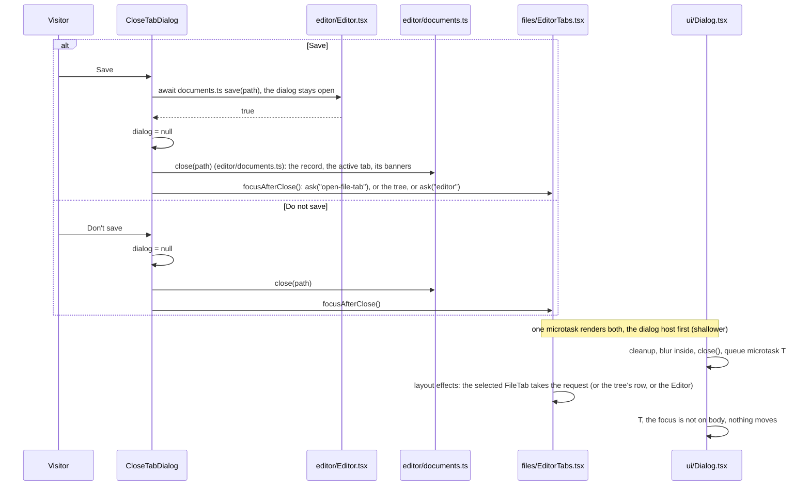
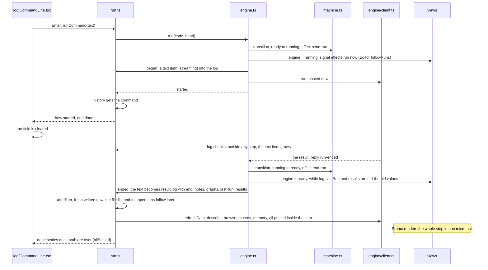
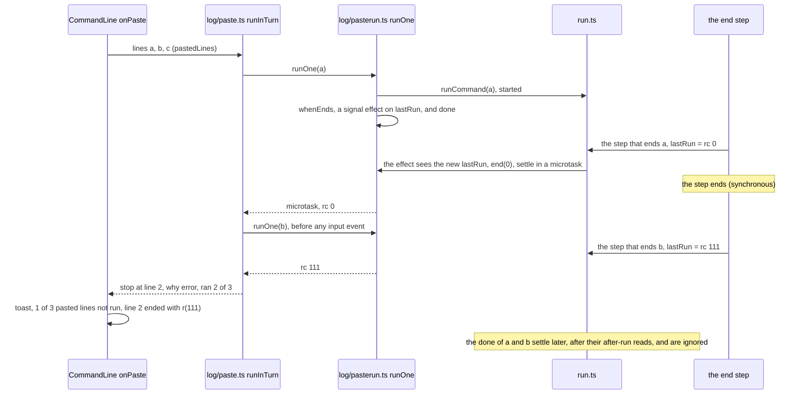
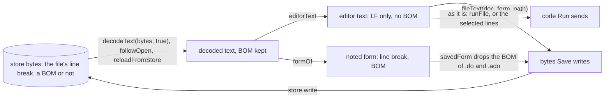
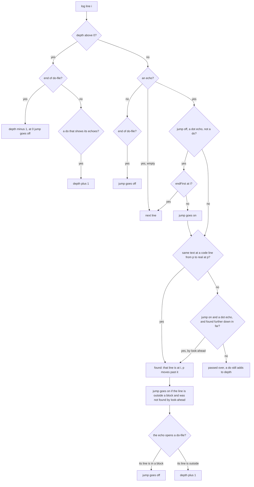

# Flows of the editor page

**This describes the code as built on branch `prototype1-step4` (pull request #17, 2026-11-11), with what step 5
(`prototype1-step5`, pull request #18) adds to these flows: the editor was served under `/app/` (since the split it is at the root of its own origin, `app.dofile.dev`: SPEC section 8, "URLs"), and the sample's first-visit
seed and "Restore the sample" (`sample.ts`) are events of section 3 (the restore asks through the clash dialog of section 1).** It
is a sibling of [web-engine-data-flow.md](web-engine-data-flow.md), which covers the engine under the page. This
document covers four parts of the editor page that no single file shows: where the focus goes, a run as the views see
it, an open file's state in the editor, and where the log puts graph links and notes. Each spans several modules and
depends on an order of events.

Written from the code. Paths are relative to `web/src/app/` unless they start with `web/` or `engine/` (that is
`web/src/engine/`). The document names files and functions, not line numbers. What the page shows is in
`docs/design/SPEC.md`; this file says how the code gets there.

**Timing words used below.**

- **Synchronous:** in the same call stack.
- **Signal effect:** an `effect()` from `@preact/signals-core`. It runs synchronously when a signal it read is written.
- **Render:** a component that reads a signal re-renders in a microtask (`@preact/signals` calls `setState`, and Preact
  11 queues renders with `queueMicrotask`). One microtask renders every queued component, so a step of the engine's
  machine reaches the views as one render, with all of its writes.
- **Layout effect:** `useLayoutEffect`. It runs in that render, before the next microtask. Its cleanup runs while the
  component's nodes are still in the page.
- **Timer:** `setTimeout(f)` or `setTimeout(f, 0)`. It runs after all microtasks, and after every timer set before it.

---

## 1. Where the focus goes

### The rules

1. **A hand-off moves only a focus left on nothing** (`document.activeElement` is `<body>` or null). The dialog's
   hand-back and `useFocusOnLeave` check this first, so whoever places the focus first wins and the focus moves once.
2. **The fallback is `states/focus.ts` `focusStable()`:** first the registry's `editor` target (`focusNow`,
   `ui/focus-targets.ts`), then, if that moved the focus nowhere, the first shown `more-actions` target (the "More actions"
   button). It is never `<body>`.
3. **The `editor` target** (`editor/Editor.tsx` `focusTarget`; `focusNow("editor")` focuses at once) focuses without
   changing the active tab or the phone's view:
   - a text tab shown: CodeMirror's content (`[data-editor]`);
   - no tab, or a text tab with no editor state yet: the empty view ("No file is open", `[data-editor]` then);
   - a `.dta` tab: its tab in "Open files" when that is visible, else the first enabled button of its view (Load), else
     nothing;
   - the Editor pane hidden (a phone on another view): the element is not shown, so `focusNow` moves nothing and returns
     false, and `focusStable` goes on to "More actions".
4. **A modal gives the focus back to its opener** (what had the focus when it opened: a dialog, and the full-size graph
   view, through `ui/modal-trap.ts` `useModalTrap`). When the opener has left the page, or it had none, the trap calls
   `focusStable()`. `<body>` is never an opener. A modal that opens while another one is still handing the focus back
   takes that one's opener as its own (the module variable `leaving`). The Graph tab's "Open full size" focuses itself
   when pressed, because Safari focuses no pressed button.
5. **A view that takes the focus when it appears takes it in a layout effect:** a modal (`useModalTrap`), the
   stopping banner's "Don't reset: wait for it", the waiting banner itself (`states/banners.tsx`), and the inline
   rename field (`files/TreeRow.tsx`), the last three through `ui/focus-hooks.ts` `useFocusOnMount`. So a hand-off
   that waits for a microtask finds the focus already taken.
6. **After a tab closes** (`files/close-focus.ts` `focusAfterClose`) the focus goes to the selected tab (`ask("open-file-tab")`),
   else the file tree's row in the tab order when the tree is shown (`focusTree`), else the editor (`ask("editor")`). The
   choice is made in the handler, from the tabs as they stand and whether the strip is drawn; the target takes the request
   in its next render, after the closed tab has left the page. When that moves nothing, the close-tab dialog's own
   hand-back follows (its opener, else `focusStable`).
7. **A focus request is taken by the render of the component that draws the target.** The action sets a request: the
   registry's one `focusRequest` (`ask(name)`: the tree, Find's field, the editor, the selected tab after a close; a
   newer request replaces an older one, whatever its target) or a tablist's own signal (`tabAsked`, `Tablist`'s). The
   target takes it in a layout effect of its own render (`ui/focus-hooks.ts` `useFocusTarget`, `useFocusRequest` for
   the tablists, or a plain layout effect where taking it is more than a focus: Go to line), and the request ends there,
   taken or not. No timer stands in for that render: Preact renders the queued components
   shallowest first, so `App` shows a pane, and the dialog host closes its dialog, before a deeper target takes its
   request.
   - **Whose focus each may take** (`from`): the tablists, from inside their own list (or the page body, after a
     close); the tree's rows, from the page body or the tree; the Files button's request, Find and the editor, from
     anywhere.
   - **The tree's request** names a row (`focusRow`: the request's key is its path) or none (`focusTree`: the row in the
     tab order, or with no rows the head's File actions). A request reaches the entries with its own key and no others, so
     each `TreeRow` registers twice: once with its path, and once with no key while it is the row in the tab order (and
     File actions with no key while the list is empty). A row with its rename field open is not a target. The test hook
     reads the request as `focusWanted` (`{ path }`, `{ path: null, anywhere }` or `null`). It is set once its action has succeeded (a rename, a delete once the list has been read
     again). It also ends when a new one replaces it, a rename starts, or the visitor focuses or clicks another row.
   - **A tablist's request is set by a key, never by a click:** Safari does not focus a tapped button (`ui/Menu.tsx`
     focuses a `keepOpen` item itself for that reason), so a request from a click would move the focus where a click
     alone moves none. The other requests follow an action that may be a click (the Files button, a dialog's answer,
     "Go to line", Find), and so does a rename that a click elsewhere ends: the field's blur ends it and `focusRow` asks
     for the renamed row, which takes the focus where the click left it on the page body (WebKit), not where the click
     focused something outside the tree.
8. **On an iPhone the keyboard comes up only for a focus made while the tap is handled** (the tap's own microtasks
   count: a signal set in the tap renders, and its layout effect runs, before the tap's dispatch ends; an `await` of
   IndexedDB does not). A field that is to raise the keyboard is drawn in the tap, before anything is written or awaited.
   - So "New .do file" and "New folder" (also a folder row's "New file here" and "New folder", and the Files head's
     "+") show their name field at once: a draft row, in the folder that `startDraft(kind, dir)` unfolds. The file or
     folder is written when the field is left (Enter or blur; Esc writes nothing), and `startRename` and `startDraft`
     are synchronous.
   - **The current folder** (what it does: SPEC 3.1, "Folders and the current folder", and OQ-21): `currentDir` in
     `files/tree-state.ts`, kept apart from the roving focus (`rovingPath`); arrow keys select nothing; the caret is a span,
     `aria-hidden`, not a tab stop, and it folds and unfolds and selects nothing; a tap on the rest of the row selects and
     unfolds, never folds; folding it or a folder above it makes the parent current; it is drawn as an accent outline, no
     fill. The "+" (and the head
     menu's New .do file and New folder, and the dropzone's New .do file) make theirs in `newFileDir`: the current
     folder, or the nearest folder above it that exists when it has gone; the "+" label names it.
   - **A draft left with a name that cannot be used** makes the free default, and a toast says why (the field's reason
     line is gone with it). Esc in a draft gives the focus back to the row that was in the tab order before it
     (`Renaming.from`), not the open file's row.
   - **The commit** (`endDraft`) awaits the store and reads the list again (`files.ts` `refresh`). The store's change
     already refreshes the list, so for one render the tree may hold both the field and the new row; then the draft
     goes. After Enter the file opens and its row takes the focus (`focusRow`), unless another field was started
     meanwhile (each field has an `id`; a commit that ends after another began touches neither the state nor the
     focus). After a blur (a tap elsewhere, the keyboard's hide key) it only writes: nothing opens, and the focus and
     the phone's view stay where the visitor tapped (a row's file, the Log view, the "Files ⋯" menu), because the commit
     ends after the tap's own click and would otherwise open the new file on top of it.
   - Playwright cannot test the keyboard: the e2e test checks that the field has the focus within the tap's microtasks.

### Who moves the focus

| Who | When | Timing | Where to |
|---|---|---|---|
| `ui/modal-trap.ts` `useModalTrap`, opening (`ui/Dialog.tsx`, `output/FullSize.tsx`) | it mounts | layout effect | A dialog: it blurs the opener, then calls `showModal()`; then `[data-autofocus]`, else the first enabled button, link or input. The full-size view: the view itself (so a Space that opened it cannot press Close). The view also keeps Tab and Shift+Tab inside its buttons, takes Esc and the arrow keys, and leaves every key to a `dialog[open]` over it. |
| `useModalTrap`, closing | it unmounts | cleanup (blur inside, a dialog's `close()`), then a microtask, after the render's other layout effects; only a focus on nothing | the opener if it is still in the page, else `focusStable()` |
| `states/focus.ts` `useFocusOnLeave` | a banner unmounts with the focus inside | layout cleanup, then a microtask; only a focus on nothing | `focusStable()` |
| `KeepWaitingButton` (in `StoppingBanner`), `WaitingBanner` (`states/banners.tsx`) | the button appears (1 s after the Break press), the waiting banner mounts | layout effect (`useFocusOnMount`) | "Don't reset: wait for it"; the waiting banner's box (`tabindex=-1`) |
| `DeclinedBanner` (`states/banners.tsx`) | "Start engine" | synchronous, before `eng.ask()` | `focusStable()`, so the prompt takes the editor as its opener |
| `engine.ts`, effect `close-dialog` with `focusEditor` | `started` closes the download dialog, if it is still open (no other cell sets `focusEditor`) | `ask("editor")` in the step; the Editor takes it in a layout effect of the render that removes the dialog (`useFocusTarget`) | the `editor` target |
| `files/close-focus.ts` `focusAfterClose` | Delete on a tab (no dialog); close-tab's Save or "Don't save" | `ask` for the selected tab, the tree or the editor (rule 6) | rule 6 |
| `files/dialogs.tsx` `DeleteDialog` | Delete's store change is done and the list read again (`files.ts` `refresh`) | `focusTree()`, taken by the tree's render; only a focus on nothing or in the tree | the tree's row in the tab order; with no rows, the head's File actions (`FilesHead`) |
| `files/fold.ts` `foldFiles` (the Files button in `App.tsx`) | the Files button (700 to 1199 px) opens the list | `focusTree(true)`, taken by the render that shows the pane; from anywhere | as `DeleteDialog` |
| `ui/Menu.tsx` `closeMenu(true)` | Esc, Tab, a picked item (before its `onSelect`) | synchronous | the trigger (`restore`, else `anchor`). A click outside, a resize or the window's blur close it with no focus move. |
| `ui/Menu.tsx` `MenuEntry` | the menu opens and is placed; an arrow, Home or End changes the active item (a position among all its items, disabled ones included, so an item that turns enabled or disabled while it is open does not move the focus) | layout effect, from the item's own render | the active item; the open file's item (`current`) is scrolled into view the same way |
| `files/TreeRow.tsx` `RenameField` | F2, New .do file, New folder: the field mounts (a New's field is a draft, `renaming.draft`, rule 8) | layout effect (`useFocusOnMount`), then the name without its extension selected | the field |
| `files/rename.ts` `endDraft` | Esc in a draft's field | `focusTree()`, as `DeleteDialog` | as `DeleteDialog` (File actions is hidden on a phone) |
| `ui/Tablist.tsx` `Tab`, `files/EditorTabs.tsx` `FileTab` | an arrow, Home or End in the tablist | `useFocusRequest` (rule 7) | the tab moved to, only while the focus is inside that tablist |
| `files/TreeRow.tsx` `TreeRow` (`useFocusTarget("tree")`, twice) | `focusRow` (after a rename, a new file or folder is written, the arrow keys) sets the roving path and asks `tree` with the path as key; `focusTree` asks with no key | rule 7 | the row, only while the focus is on the page body or inside the tree (the tree's `role`) |
| `log/LogView.tsx` `FindBar` open | `openFind` (`log/find.ts`) asks `find-field` | `useFocusTarget`; once per `openFind`, so the Log drawn again with Find open takes no focus | the field |
| `log/LogView.tsx` `FindBar` close | Esc or Close | synchronous | what opened Find (`openFind`'s `from`, kept as `findReturn` in `log/find.ts`, else the focus at that time), if it is visible; else the log `<pre>` |
| `editor/Editor.tsx` `goToLine` | "Go to line N" | sets `editorAsked` (`{ path, line }`) after `openFile`; the Editor takes it in a layout effect of its next render, after the render that shows its pane | CodeMirror, at the line, if that file is shown |
| `output/clip.ts` `fallbackCopy` | a copy without the clipboard API (plain HTTP): Results, Copy on a .dta tab or a file's bar | synchronous: the hidden field takes the focus to copy, then gives it back only to an element that had keyboard focus (`:focus-visible`) | that element; after a click the focus stays off (the page body), so no ring shows. The Results tab moves no other focus: every value is a Tab stop, no arrow keys (SPEC 3.9) |

A mouse click on a tab's × that closes a clean tab calls no `focusAfterClose` (`EditorTabs` passes `keyboard: false`).

### A dialog opens and closes

The Reset dialog, opened from the ⋯ menu:



The opener lets go of the focus before `showModal()`, so the browser keeps no element to give it back to on `close()`.
Only T gives it back, once.

"Restore the sample" (`sample.ts`) is an upload (`upload(items, "sample")`): its questions are the clash dialog with the
sample's words and follow the clash rules below ("Keep mine" focused, the focus back to the menu's trigger). Opening
`analysis.do` once the upload has ended moves no focus.

### A dialog that follows another (the clash chain)

An upload with two clashes; the visitor presses "Keep mine" on the first. The same chain runs when the download prompt
becomes the progress dialog (`states/DownloadDialog.tsx`: two `<Dialog>`s with different keys), and when the other-tab
dialog replaces any dialog (the host keys each view on the whole `dialog` value).



T1 can also run before the upload goes on (the upload first awaits its turns: a Replace's write, and the next clash's read of its file). Then
T1 gives the focus to opener 1, and clash 2 takes it as the active element: the same result.

### A dialog whose opener leaves the page (other-tab over the stopping banner)



Both orders of the two renders end in `focusStable()`.

### A banner leaves with the focus in it

Stopping, then waiting, then the run ends:



Dismiss on a banner that uses `useFocusOnLeave` (reset, storage, download-failed, the failed-start banners, the
editor's save-failed and run-changed, the Files pane's not-text), and run-changed's "Reload from the run", follow the
last two lines. With a `.dta` tab active, the `editor` target is that tab, so the focus moves once.
The banners that hold no control (running, memory) do not use it, nor does the declined banner, which calls
`focusStable()` itself before it goes.

### A tab closes from the close-tab dialog



The three writes are made synchronously in the click handler, so one render takes them all and the request is taken
before T runs. When Save resolves false (the store refused), the dialog closes, the tab stays and nothing calls
`focusAfterClose`; T gives the focus back to the opener (the tab).

### Phone variants

On a phone one view shows at a time, so the Editor pane is often hidden and `focusStable` ends on "More actions"
(rule 3).

| Case | Desktop | Phone |
|---|---|---|
| A banner leaves, or a dialog's opener has left | the editor (or the `.dta` tab, or Load) | the editor (or a `.dta` tab's Load) on the Editor view; "More actions" on any other view |
| Close-tab's Save or "Don't save" | the selected tab in "Open files" | the editor: "Open files" is not shown, and neither is the tree on the Editor view |
| The engine's dialog closes itself (`started`) | the editor | the editor on the Editor view. On any other view nothing moves, and the dialog's hand-back gives the focus to its opener. With no engine the page offers only "Start engine", which opened the prompt, so no run takes the focus from the Log view. |
| A dialog opened from a menu (Reset, Delete all, Clear log) | the menu's trigger: ⋯ for Reset, "File actions" for Delete all, "Log actions" for Clear log | the ⋯ trigger for Reset; the strip's "Files ⋯" ("File actions") for Delete all; the strip's "Log ⋯" ("Log actions") for Clear log |
| The Clear log dialog opened from the Log head's "Clear…" | the button, back on Cancel and Esc | after "Clear log" the button is disabled (nothing is left to clear), so the trap (`ui/modal-trap.ts`) hands the focus to `focusStable()` |
| Find opened from the phone strip's "Log ⋯" | (desktop: the Log head's Find button) | `openFind(null)` takes the focused element, the "Log ⋯" button that `closeMenu` just focused |
| A tap on the command line while it does not have the focus | the browser's own focus | `log/CommandLine.tsx` takes the tap (`touchend`) and focuses the field itself with `preventScroll`, the caret at the end: the browser's focus would scroll the page up to the field, which iOS does before the page can stop it (`app/viewport.ts`, `docs/phone-keyboard-experiment.md`) |

### Tests that hold this

`web/test/focus-targets.test.ts` covers the registry and `focusStable`'s order, and `web/test/tree-focus.test.ts` the tree's, Find's and the close's requests (the stand-in elements); the rest of the rules hold only in a browser.

- `web/e2e/keyboard.spec.ts`: "a tap on the phone's command line focuses it without scrolling the page, …"
- `web/e2e/states.spec.ts`:
  - "a banner that goes with the focus in it hands the focus on: …"
  - "the editor's and the Files pane's banners hand the focus on too: …"
  - "a dialog whose opener has left the page gives the focus to the editor, …"
  - "with a .dta tab active, a banner that goes with the focus hands it to that tab, in one move"
  - "from the stopping banner to the waiting banner the focus goes straight across, …"
  - "the banners above the log: running, stopping (focus on Don't reset), waiting (takes the focus)"
- `web/e2e/files.spec.ts`:
  - "tabs: … the focus goes to a tab or the tree, never the page, in one move after Save and Don't save"
  - "the row menu (Shift+F10, right click, the ⋯): Delete asks, …" (the focus after Delete)
  - a draft in a folder: "a folder's menu: New file here and New folder unfold …", 'the "+": the current folder …',
    'the "+" and a name with "/": …', "a draft's name is checked part by part …", 'the "+" twice from a folder's file
    row …', 'the "+" after a typed name was written by leaving the field …' and "a draft's Esc, from a folder's menu or
    the "+": …"
  - "New .do file and New folder: the name field has the focus within the tap's microtasks, …" (rule 8), and the tests
    after it: Esc, Enter, leaving the field, a name in use, a second New while the first is written
  - "a clash dialog that follows another (Keep mine, then the next clash at once): …"
  - "a clash asked again because the file changed while it was asked: …" (the re-ask dialog's focus)
- `web/e2e/output.spec.ts`:
  - "the full-size view: its first focus is the view, not Close; Tab and Shift+Tab wrap inside it; Esc hands the focus back
    to Open full size"
  - "the full-size view whose opener has left the page gives the focus to the editor, not to the page"
  - "a dialog over the full-size view has the keys: …"
- `web/e2e/editor.spec.ts`: "a .dta tab: Save is off, and when the engine's dialog closes by itself the focus goes to
  that tab"; "Find in the log: … Esc gives the focus back"; "the Output tabs by keyboard: …"
- `web/e2e/shell.spec.ts`: "the layout: … the ⋯ menu works by keyboard"; "the folded file list: … Esc folds it and
  gives the focus back"; "the folded file list with no files: …"

### If you change this

- **A view that takes the focus when it appears must do it in a layout effect.** In a `useEffect` (after paint), the
  hand-off's microtask finds `<body>` first and sends the focus through the editor.
- **`useFocusOnLeave`'s cleanup must stay a layout cleanup.** A `useEffect` cleanup runs after the nodes are removed, so
  `el.contains(activeElement)` is never true and nothing is handed on.
- **`focusNow` must focus synchronously.** `focusStable` needs its answer at once. A `.dta`
  tab's own target must win in that call, or the focus moves twice (the e2e test records every `focusin`).
- **An answer that places the focus sets its request in the same turn as `dialog = null`,** so the render that closes
  the dialog takes the request before the dialog's hand-back. That is why the close-tab dialog stays open while Save
  writes: after an `await`, the dialog would give the focus to the opener first, and the close would move it again.
- **No timer stands in for a render.** A target drawn later than the action (Delete's rows, once the list is read
  again) gets its request when that is done (Delete awaits a fresh list), not after a guessed delay.
- **Keep the opener's `blur()` before `showModal()`, and the `leaving` hand-over.** Without the first, WebKit gives the
  focus back on `close()` before an answer can place it. Without the second, a dialog that follows another takes
  `<body>` as its opener.

---

## 2. A run, seen from the views

### Who decides what

- `engine/machine.ts` decides whether a run is taken:
  - `ready`: sent at once (effect `send-run`);
  - every other state has no `run` cell, so the event is not valid and changes nothing, the states with no engine
    included: a run opens no prompt, no state holds a run's code or a "for a run" mark, and nothing runs when the
    engine becomes ready (`started` always leads to `ready`). The maintainer removed the held run, and then the prompt a
    run opened, on 2026-11-12 (`docs/phase2-history.md`, "Post-merge review").
  - Every exit from `running`, `breaking` or `waiting` has one `end-run`, as its last effect: `END` (`run-ended`,
    `run-failed`), `RESET` (`reset`, `crashed`, `break-timeout`, or Break with no `SharedArrayBuffer`) and `LOST`.
- `engine.ts` `run(code, head)` dispatches the event and answers, from the step, whether the run started (true) or was
  refused. It throws while a step is in progress (`stepping`). A step writes the `engine` signal before it performs its
  effects (`apply`).
- `run.ts` turns that into a `Requested`, `{how, done}`: `done` is `current.promise` for a started run (made by
  `began()`, which the effect `send-run` called inside the step), and `Promise.resolve(null)` for a refused one.
  `runCode` returns `done`; `requestRun` (the editor) and `runCommand` return the whole `Requested`.
- `runCommand(text)` adds `kind: "command"`, `fresh_locals: false`, and `history` when it started.

### With no engine: "Start engine"

What the page shows with no engine is in SPEC 3.4 (Run), 3.5 (the command line) and section 5 (the states). In the
code, `app/start.ts` is the one statement of it: `startOffer(state)` says what "Start engine" does in a state, or null
when the state is not "no engine"; `startEngine()` does it (the toolbar's button, the command line's button and
Ctrl/Cmd+Enter all call it); `noEngine()` is `startOffer() !== null`. It runs nothing, and nothing runs when the engine
becomes ready.

| State | `startOffer` | The toolbar's Run | A press, or Ctrl/Cmd+Enter | The command line |
|---|---|---|---|---|
| `checking-lock`, `checking-cache` (the page load) | null | "Run", off | the button and Ctrl/Cmd+Enter: toast "The engine is starting. Try again when it is ready." | on; "Run command", off; Enter and the off button: the same toast, and the text stays |
| `none` (only `?test=manual`), `declined` | `prompt` | "Start engine" | `ask`: the download prompt (`asking`) | off, hint "Start the engine to run code"; "Start engine" |
| `asking` | `prompt` | "Start engine" (under the blocking prompt) | `ask`: the prompt again, should another dialog have taken its place | the same |
| `downloading`, `starting-list`, `starting-worker` | null | "Starting…", off | the "starting" toast | on; "Run command", off; Enter and the off button: the "starting" toast, and the text stays |
| `ready` | null | "Run" | a run | on; "Run command" |
| `running`, `breaking`, `waiting` | null | "Run", off | the button: nothing (a second Enter on a focused Run must stay silent). Ctrl/Cmd+Enter: toast "Run is not available until the current run ends" | on; "Run command", off; Enter and the off button: that toast, and the text stays |
| `failed`, reason `download`, `memory` or `unknown` (the banner has "Try again") | `retry` | "Start engine" | `start`: a new try, as the banner's "Try again" | off, hint "Start the engine to run code"; "Start engine" |
| `failed`, reason `updated` or `no-wasm` (the banner says to reload, or which browsers work) | `off` | "Not started", off | toast "Run is not available: the engine isn't running in this tab"; no event reaches the machine | off, hint "The engine isn't running"; "Start engine", off: a press says the hint in a toast |
| `failed-twice` | `off` | "Not started", off | the same | the same |
| `other-tab-idle` | `take-over` | "Start engine" (hidden with the other run controls, and under the blocking dialog) | `ask`: the take-over dialog again (the state stays; no lock is taken, nothing starts). Only its "Use dofile in this tab" takes over | off, hint "Start the engine to run code"; "Start engine" |
| `other-tab-taking` | `off` | "Start engine", off (hidden) | nothing started; the "isn't running in this tab" toast | off, hint "The engine isn't running"; "Start engine", off |

"Off" in this table is never the `disabled` attribute: the toolbar's Run and the command line's button are
`aria-disabled` with `.off`, the command line's field is `aria-disabled` and read-only, and all stay focusable.

- **Why not `disabled`: the focus.** These states change under the visitor's hands: a start fails while a command is
  typed, and "Start engine" pressed after a failed start turns that very button into "Starting…" (the toolbar) or the
  off "Run command" (the command line, the same element). A `disabled` element that has the focus loses it to
  `<body>`; `aria-disabled` keeps it where it was (the pattern `RunControls.tsx` already used for `running`). Handing
  the focus on, as a banner that leaves does, would take it out of the field the visitor is typing in, and it would
  not come back with the engine. The field's text is never changed.
- **A held Enter acts once.** A button that keeps the focus through "Start engine", "Starting…" and "Run" (the
  toolbar's Run, the phone's Run and Break pill, the command line's three buttons: one element each) ignores a held
  Enter's repeats (`ui/keys.ts` `ignoreHeldEnter`): it starts nothing twice, toasts once, and runs nothing when the
  engine is ready. A hint's `help x` link held during a run or a start toasts once, and held in `ready` runs `help x`
  once. Ctrl/Cmd+Enter (one window listener in `Editor.tsx`;
  not with a dialog open, nor in another text field, which keeps it) ignores the key's repeats, and a dialog ignores a
  repeated Enter (`ui/Dialog.tsx`), so the repeats do not press the prompt's "Download", which has the focus.
- **An off control that is pressed is not silent**, except Run while a run is on: Enter in the field with text, and a
  press of the off "Run command" or the off Run, show the toast Ctrl/Cmd+Enter shows in that state (`editor/words.ts`
  `refusedRunWords`); Enter in the off field and a press of the off "Start engine" show the field's hint. So a second
  click where "Start engine" was is answered: "The engine is starting. Try again when it is ready."
- **The toolbar does not move**: "Start engine" is one of the labels in the Run button's one cell (`ui/Icon.tsx`
  `Labels`; `e2e/shell.spec.ts`, "the toolbar does not move"). The command line's button reserves no width (SPEC 3.5).
- **A paste** into the command line is decided before anything changes (`log/pasterun.ts` `pastePlan`). With no engine
  it is an ordinary paste (the field is read-only then; this guards the instant before it is drawn so). With an engine
  that is there or on its way but not `ready`, a paste of lines is refused whole (the table under "Three pasted lines").
- **Load, Import and the log's `help x` links** are off with no engine (`aria-disabled` and `.off`, still focusable). A
  press reaches no machine and opens no prompt; a toast says why, by the offer (`start.ts` `startFirst`): "Start the
  engine to load wages.dta" (to import survey.csv, to see help regress), or where nothing can start it from the page
  (`off`), "The engine isn't running: can't load wages.dta" (can't import survey.csv, can't see help regress).
- **Run selection** is disabled with no engine (the phone's one button stays "Start engine" with a selection).
- **The command line's look with no engine** is in SPEC 3.5. Not there: on a phone the hint is set in the UI font,
  smaller, so it shows whole beside the wider button; the hint and draft are the muted color at full opacity on
  `--surface-2` (contrast 4.5 in both themes, measured by an e2e test).
- **A returning visitor whose browser has the engine** never sees "Start engine" (SPEC section 5). A first visit shows
  "Run", off, for the moment of the page load, then the prompt, with "Start engine" under it.

### Where a run starts

| Control | Calls | When it can be pressed |
|---|---|---|
| Run (`editor/RunControls.tsx`) | `editorCommands.runFile()`: the active text tab's whole text, `kind: "file"`, fresh locals; with no text tab, the toast "No file is open to run" | enabled in `ready`; off (`aria-disabled`, never `disabled`) in every other state with an engine or one on its way, so a focused Run keeps the focus and a second Enter cannot reach Break. With no engine, the table above. |
| Run selection | `runSelection()`: the selected whole lines, `kind: "selection"`, locals kept | enabled in `ready` with a selection; `disabled` (not `aria-disabled`) in every other state, `running` too |
| Ctrl/Cmd+Enter (anywhere on the page) | `runEither()`: with no engine `startEngine()`; else Run selection with a selection, else Run; held, it acts once | any state: with no engine as "Start engine"; in `ready` it runs; in the other states the run is refused (`run.ts` `requestRun`) with a toast by the state (`refusedRunWords`) |
| Break | `running`: `breakRun()` ("Break", or "Break (reset)" with no cross-origin isolation); `waiting`: "Reset now", `eng.reset()` with no question | disabled in `breaking` ("Stopping…") and when no run is on |
| The phone's pill | replaces the phone's Run in `running`, `breaking` and `waiting`; does what Break does, then sets `phoneTab` to `"log"` | a tap within 600 ms of the run's `t0` is ignored, so a double tap on Run does not break the run |
| "Run the file again" (the reset banner) | `editorCommands.runFile(path)` for the file whose run the reset cut (`rerunPath`), then the banner is dismissed | drawn only for a Break or a crash that cut a file run (not after a Reset the visitor asked for); enabled in `ready` with that file open as a text tab |
| The command line | `runCommand(text)` | in `ready` it runs. With an engine not ready, or on its way, the field is on and the command is refused with a toast (the button is off). Off with no engine |
| A hint's `help x` link (`log/LogParts.tsx`) | `runCommand(text)` | in `ready` it runs; during a run or a start the machine refuses it with the command line's toast (`refusedRunWords`). Off with no engine |
| Load (`output/DtaView.tsx`), Import (`files/FileBar.tsx`) | `runCommand(text)` | enabled in `ready`; off with no engine (`aria-disabled`, a toast); `disabled` in the other states |

The error mark's hooks are signal effects in `editor/Editor.tsx`: `followRuns` on `engine`, `followErrors` on
`lastRun`. Both run inside a step.

### One command's fate

| Fate | `how` | `done` settles with | `lastRun` | `history` | The command line's text |
|---|---|---|---|---|---|
| Refused (empty text, or a state with no `run` cell) | `refused` | null, at once | unchanged | unchanged | kept |
| Ran (from `ready`, `send-run`; ended by `run-ended`) | `started` | the result, after the after-run work | the run, written in the step that ended it | + the command (not twice in a row) | cleared |
| Its op failed in the worker (`run-failed`) | `started` | the machine's rc 9998, kind `run-failed` | the run, rc 9998 (the worker stays) | + | cleared |
| Cut by a reset (reset, crash, Break timeout, Break with no `SharedArrayBuffer`) | `started` | the machine's rc 9998, kind `break`, `crash` or `user` | null (`engine-gone`), then the cut run, rc 9998, in the same step | + | cleared |
| Cut by another tab (`lock-lost`) | `started` | the machine's rc 9998, kind `stopped` | null (`engine-gone`), and not written again | + | cleared |

`runCode` (Run, Run selection) is the same without `history` and the field. Its head is `kind: "file"` or
`"selection"`, and `began` adds a run-head to the log and, on a phone, sets `phoneTab` to `"log"`.

### An ordinary run, from Enter to the after-run reads



What a view may rely on, and when:

| When | What is true |
|---|---|
| `runCommand` has returned | `how` is known. When started: `history` has the command, `engine` is `running`, and the log has the run's text item. |
| A signal effect on `engine` sees `ready` | The run has ended, but `ended` has not run yet: `log`, `lastRun`, `results` and `graphs` are the old ones. |
| A signal effect on `lastRun` sees the new run | The log text is final, with `end`, and the graphs are added. `results` is still the old one (written next). |
| A component renders after the step | The whole step: `engine`, the log, `graphs`, `lastRun`, `results`, and `fresh` (and the storage banner, when it is due), which `afterRun` writes before its first `await`. |
| Later, as each answers | `data`, `rows`, `macros`, `memory` (`refreshData`); `files` and the open tabs (`afterRun`). |
| `done` has settled | All of the above. An after-run read that failed leaves its signal as it was. A failed file list, and an open tab's follow-up that throws, go to the console; `refreshData` drops its error. |

`refreshData` sends its four reads synchronously inside the end step (`client.ts` `#send` posts at once), so they are
ahead, in the worker's queue, of any run started after the step.

### Three pasted lines, the second fails



- **Why `whenEnds` waits on `lastRun`.** `lastRun` is written in the step that ends the run; `done` settles only
  after the after-run reads. Between the two the engine is `ready`, so an Enter or a Run pressed then would take the
  engine and the next pasted line would be refused. Starting it in a microtask after the step leaves no gap; inside the
  step, `run()` would throw.
- **Why `done` is still awaited.** A line cut by another tab writes no new `lastRun`: `done` settles with kind
  `stopped`. `done` settling also stops the effect, so no wait outlives its run. The first of the two wins (`over`).

| `stop.why` | When | Lines counted as run | Toast (`inTurnWords`) |
|---|---|---|---|
| `block` | the line opens a block, a `/*` comment it does not close, or holds `///` (`opensBlock`); it is not sent | those before it | "N of T pasted lines not run: line L starts a block, a comment or a /// command; run those from the editor" |
| refused whole (`pastePlan`: `refused`) | the engine is there or on its way but not `ready` when the paste comes (the page load, a download, a start, a run) | none: no line is sent | "T of T pasted lines not run: the engine can't take a command now". The paste is prevented and the field is exactly as it was: nothing pasted, nothing cleared, the text around the cursor kept (until 2026-11-12 the field was cleared and the lines after the first and the text after the cursor were lost). |
| `refused` | `how` is `refused` for a line after the first (the engine was `ready` when the paste began, and was not when this line's turn came) | those before it | "N of T pasted lines not run: the engine can't take a command now". The line goes back into the field if the field is empty and not off (`pasterun.ts` `putBack`: with no engine by then, nothing is put into the off field). |
| `error` | rc is not 0: an error, Break's rc 1, or rc 9998 (a reset, `run-failed`) | up to and with it | "N of T pasted lines not run: line L ended with r(rc)" |
| `taken` | `done` gave kind `stopped` | up to and with it | "N of T pasted lines not run: another tab took over the engine during line L" |
| none | every line ran | all | no toast |

When the last line ends with an error or is cut by another tab, nothing is left (`total - ran` is 0) and there is no
toast: its error is in the log. A last line that is refused or a block's leaves one line, and the toast shows. With no
engine no line is run: the paste is an ordinary paste (`pastePlan` answers before `pastedLines` is asked). An engine
lost while pasted lines run keeps the rules above: `taken` when another tab took it, `error` (rc 9998) when a reset cut
the line.

### Invariants a change must keep

- **No run is held.** A run is sent in the step of its `run` event, from `ready`, or never: no state keeps a run's code
  (a property in `machine.test.ts`), and run.ts keeps no promise for a run that has not begun. No state carries a
  "for a run" mark through the download either: the prompt has one title.
- **With no engine nothing offers to run.** A new control that runs code reads `start.ts` `noEngine()` and is off
  then; a new way to start the engine calls `startEngine()`, so another tab's engine is never taken without the
  take-over dialog.
- **`done` always settles.** A started run settles through `end-run` (every exit from a running state has one), a
  refused run at once, and the after-run work uses `Promise.allSettled`, so a failed read does not keep `done` open.
- **No run starts during a step.** A view never calls `runCode` or `runCommand` inside a handler given to `connectRun`,
  or inside a signal effect on `engine` or `lastRun`: both are written only during a step, so the call throws. A `log`
  write from a step (`began`, `ended`) throws too. A streamed chunk and "Clear log" write `log` outside a step, where
  the call does not throw: during a run it is refused, and after "Clear log" in `ready` the run starts. Start the next
  run after the step: in a microtask, or when `done` settles.
- **`ended` comes after the `engine` signal has its new state,** and, when the machine cut the run, after
  `engine-gone`.
- **A cut of kind `stopped` writes no `lastRun`.** The tab no longer owns the engine, and a quick take-over may already
  have started a new one.

### Tests that hold this

- `web/test/app-*.test.ts`:
  - "a run: the streamed log grows one item and the result's log replaces it; …"
  - "a crash cuts a run: the new state first, then engine-gone, then the cut run's result; …"
  - "runCode while a run is on does nothing; with no engine a run is refused, …"
  - "run() called while a step is in progress throws before it queues anything"
  - "runCommand: added to history (not twice in a row), …"
  - "runCommand: a command that does not run is not in history (so the field keeps it): …"
  - "a run whose op failed in the worker (run-failed) is not a reset: …"
  - "Stop download declines; a run then is refused and opens no prompt; …"
  - "Start engine: what each engine state offers (start.ts startOffer), …"
  - "Start engine pressed (startEngine, the buttons' and Ctrl/Cmd+Enter's one action) in each state: …"
  - "C1: a run cut by losing the tab lock does not set lastRun, …"
  - "J1: pasted lines: a line cut because another tab took the engine stops the rest; …"
  - "a paste is decided before anything changes (pastePlan): …"
  - "J5: a run's promise settles even when the after-run work throws (…)"
- `web/test/machine.test.ts`:
  - "property: a transition from running, breaking or waiting to a state that is none of those has exactly one end-run, …"
  - "property: no run is held: …"
  - "scenario 12. with no engine a run is not valid; …"
  - "property: a transition from ready, running, breaking or waiting to a state that does not hold the same worker has
    engine-gone, once"
- `web/test/editor.test.ts`:
  - "pasted lines run in turn and stop at the first refused or failed one"
  - "pasted lines stop before a block's, a comment's or a /// line, …"
  - "pasted lines: the next starts only once the one before has ended"
  - "a paste with no line break is an ordinary paste; …"
  - "a dialog's held-Enter rule (ui/keys.ts isHeldEnter): …"
  - "a refused Ctrl/Cmd+Enter's toast: …"
- `web/biome/architecture.grit` (a Biome plugin, run by `npm run check`): the controller's queue has one way in (`enqueue()`, called from `dispatch()` and `reply()`); each signal's writer object is named only by its `state/` module and its owner
- `web/e2e/editor.spec.ts`:
  - "the command line: Enter runs and clears, ↑ recalls; a paste of lines runs each in turn and stops at an error; …"
  - "the command line with no engine: …"
  - "with no engine nothing offers to run: …"
  - "with no engine Import and the log's help links are off: …"
  - "while the engine starts, a command is refused with words and the draft stays; …"
  - "a .dta tab: Save is off, and when the engine's dialog closes by itself the focus goes to that tab" (Start engine
    opens the prompt, and nothing runs once the engine is ready)
  - "Ctrl/Cmd+Enter that the engine does not take says why in a toast and starts nothing; …"
- `web/e2e/shell.spec.ts`: "first visit: … Run is Start engine, …"; "the toolbar does not move: …"
- `web/e2e/states.spec.ts`: "a second tab: Start engine goes into the take-over dialog, …"; "where nothing can start
  the engine from the page …"; "the phone's command line at 320 px with no engine: …"
- `web/e2e/output.spec.ts`: "a .dta tab with no engine …; Load is off and a press only says why"

### If you change this

- **Taking the rc from `done` in `whenEnds`** leaves a gap between two pasted lines in which another run takes the
  engine, and the next line is refused.
- **Changing `Promise.allSettled` to `Promise.all` in `ended`** leaves `done` unsettled when an open tab's follow-up
  fails, and a paste then waits for ever (J5).
- **Holding a run again** ("No run is held", above) would bring back a state field, a promise and an effect per way out,
  removed on 2026-11-12; the no-held-run property in `machine.test.ts` fails first.
- **The order of writes in `ended`:** log and graphs, then `lastRun`, then `results`. The editor's error mark and
  `whenEnds` react to `lastRun`; moving it earlier gives them a log that is not final.
- **The `RunHead` object is passed through unchanged**, from `runCode` through the machine to `began` and the run-head
  item. `codeOf` (section 4) and the editor's running-lines mark (`marked?.head === run`) look it up by identity.

---

## 3. An open file's state in the editor

`editor/documents.ts` keeps one record per open tab (its path and its content: a text tab's document, or nothing for a
.dta tab), with no DOM. A text tab's document has:

- `state`: the `EditorState`, always current. While it is shown the view's changes reach it through `edited()`.
- `saved`: the store's text in the editor's form, or null when the store's version is not text.
- `form`: the noted line break and BOM.
- `dirty`: computed, the text against `saved`; the unsaved dot in `tabs` is derived from it and stored nowhere.

A reload, a rename's retype and a run's text shown put a new document in the record; a close drops the record. Save
(`documents.ts` `save`) holds the record and the document it took when pressed: it writes under the record's path when
its turn comes, so a Save that answers after a rename leaves its outcome on the renamed tab, and it writes nothing (and
applies no answer) when the record was closed or holds another document by then (the Save rule: the later action wins,
SPEC 4b). A Save writes in its turn (`files/turns.ts` `fileTurn`): a rename or a delete keeps the turn until the tabs have followed
it, so a Save pressed meanwhile writes under the new name, or nothing when its tab was closed; a Save's turn ends once
its write is issued, and the store applies changes in the order they are called, so a rename after it moves the bytes it
wrote. The file code (`files/open.ts`, `files/ops.ts`, `files/upload.ts`, `files.ts`) calls the owner's functions; the view attaches to
it when the Editor mounts (`attachView`).

### The three text forms



- `editorText` (`editor/ranover.ts`) drops a leading BOM and turns `\r\n` and `\r` into `\n`.
- `formOf` notes `lineBreakOf` (`\r\n` when it outnumbers lone `\n`; else `\n`, also on a tie, for an empty file and
  for lone `\r`) and whether the text starts with a BOM.
- `fileText` writes the editor's text with the noted break, and with the BOM unless `dropsBom(path)` (a `.do` or
  `.ado` name, case ignored, at the time of the Save).
- `textOf` (the save-failed banner's Download) gives the same text as Save would write.

### What each event does

| Event | Editor's text | Saved text | Noted form | Unsaved dot | Error mark | run-changed, save-failed | The store |
|---|---|---|---|---|---|---|---|
| **Open** (`openFile` → `addText`) | `editorText` of the file | the same | `formOf` the file | off (the tab is added clean) | none (the mark lives in the tab's state, which a close drops) | none (`openFile` dismisses any not-text banner) | read only |
| **Edit** | changed | unchanged | unchanged | on when the text differs from the saved text (the document's computed `dirty`) | moves with the text; gone when its line is deleted (`cm.ts` `lineMarksField`, `errormark.ts` `lineDeleted`) | unchanged | unchanged |
| **Undo back to the saved text** | equals the saved text | unchanged | unchanged | off | mapped as any edit | unchanged | unchanged |
| **Save succeeds** (`save`) | unchanged | the text Save wrote | `savedForm`: a `.do` or `.ado` loses its BOM, by the name it was written under | off, unless the text changed while it was written | unchanged | both dismissed for the tab's path; toast "Saved name". A tab renamed while it was written gets all of this under its new path. | `fileText` bytes |
| **Save cancelled** (a reload, "Reload from the run" or a run's text shown before its turn; its tab closed or retyped) | as the later action left it | as the later action left it | as the later action left it | as the later action left it | unchanged | unchanged; no toast | not written (also when pressed while "Reload from the run"'s or a run's store read waits: that read's turn comes first; an upload's Replace takes a turn too: one whose turn comes first cancels the Save, and one that comes after finds the file changed and asks again) |
| **Save fails** | unchanged | unchanged | unchanged | stays on | unchanged | save-failed added (one per path, under the tab's path at the time it fails; none for a tab closed meanwhile); the live region says it | unchanged |
| **Rename** (`renameEntry` → `moved`) | the same state, its language set by the new name | moved to the new path | moved, BOM and all; the new name decides at the next Save | kept | kept | both moved to the new path; a Save in progress answers there (it holds the record) | the same bytes under the new name |
| **Rename across a `.do` name** | as Rename | as Rename | `a.txt` with a BOM renamed `a.do`: the next Save writes no BOM. `a.do` with a BOM, never saved here, renamed `a.txt`: the next Save keeps it. | kept | kept | moved | the same bytes |
| **Rename to a name that opens another way** | a clean tab takes the new kind in its place (`retype`: a text name is read from the store first, in the rename's turn; a name that is not text, or a file the store cannot give, closes it); a tab with edits stays as it is; a `.png` name closes a clean tab | | | | | | |
| **Close** (`close`) | dropped | dropped | dropped | the tab is gone | dropped with the tab's state | both dismissed | unchanged ("Don't save" loses the edits) |
| **First visit's sample** (`sample.ts` `seedSample`: an empty store and no mark) | as Open, of `analysis.do`, once the three files are written | the same | `\n`, no BOM | off | none | none; the seed's own writes bring no storage banner (`files.ts`, by the store's change row) | the sample's three files |
| **"Restore the sample" over an open tab** (an upload: `reopen` → `reload`) | the sample's text (`decodeText(bytes, true)`), a new state | the same | `formOf` it: `\n`, no BOM, so a `\r\n` or BOM tab saves the sample's form from then on | off | gone (new state) | both dismissed | the sample's bytes. Asked first (the clash dialog, the sample's words) when the file differs from the sample or the tab has unsaved edits; a file that holds the sample's bytes, with no unsaved edits, is not written and its tab is left as it is; a missing file is written with no question, and its open tab, if any, is not reloaded. |
| **Upload and "Replace with uploaded"** (`reopen` → `reload`) | the uploaded text, a new state (undo history gone) | the same | `formOf` the upload | off | gone (new state) | both dismissed | the uploaded bytes. Not text: the tab closes. A clash with the same bytes, no unsaved edits, is not written and its tab is left as it is. |
| **A run writes the same text** (in the editor's form) | unchanged | unchanged | unchanged, even if the run wrote other line breaks | unchanged (a tab with edits stays unsaved) | unchanged | unchanged | the run's bytes |
| **A run writes other text, tab clean** | the run's text, as one change where the two differ: caret, selection and undo kept | the run's text | `formOf` the run's text | off | mapped through the change | run-changed dismissed | the run's bytes |
| **A run writes other text, tab unsaved** | kept | the run's text | `formOf` the run's text; unchanged when the run wrote exactly the editor's text | on. When the run wrote exactly the editor's text: off, and the answer is "same". | unchanged | run-changed added (files.ts, on "kept"); when "same", dismissed | the run's bytes |
| **A run writes something that is not text** | kept | null (`savedIsText` is false) | unchanged | on | unchanged | run-changed in its not-text words, with no "Reload from the run" | the run's bytes. A later run that writes the editor's text makes the tab clean and removes the banner. |
| **A run deletes the file** | unchanged (`followOpen` skips `removed`) | unchanged | unchanged | unchanged | unchanged | unchanged | removed; the file leaves the list, and Save writes it again |
| **"Reload from the run"** (`reloadFromStore` → `reload`) | the store's text, a new state | the same | `formOf` it | off | gone | both dismissed. When the store gives no text: only run-changed, dismissed. | unchanged |
| **The file's own run starts** | sent as it is, edits included, never saved first | unchanged | unchanged | unchanged | this file's mark cleared (`onRunStart`); a selection run marks its lines while the state is `running`, `breaking` or `waiting` | unchanged | unchanged |
| **It ends with an error** | unchanged | unchanged | unchanged | unchanged | set on `lastRun.line` (the file's line: a selection's offset added in `run.ts`) when rc is not 0 or 1 and the line exists. The number is applied to the text as it is then. | unchanged | what the run wrote follows (rows above), after this step |
| **A command-line command runs** | unchanged | unchanged | unchanged | unchanged | unchanged (`onRunStart`, `onLastRun`: a command changes no mark) | unchanged | as the run rows, if it writes the file |
| **A reset** | unchanged | unchanged | unchanged | unchanged | every mark cleared, the closed files' too (`lastRun` is null in the `engine-gone` effect); the running lines cleared | unchanged | unchanged |

What "the run changed" means: the worker compares `/work` before and after the run by modification time and size, and
writes the changes in `store.applyRun` (`engine/store.ts`), leaving out any path the page changed during the run (the
page's version wins). `RunResult.files` lists only what it wrote. `files.ts` `afterRun` calls `followOpen` for each
listed path open in a text tab; `followOpen` reads it, decodes it strictly (BOM kept, null when not UTF-8), and calls
`ranOver` (`editor/documents.ts`), which applies `ranover.ts` `followRun`.

### Rules a change must keep

- **Compare in the editor's form.** The dot (document against `saved`) and a run's version (`followRun` passes the
  run's text through `editorText`) are compared with `\n` breaks and no BOM. Otherwise a clean `\r\n` tab is never
  clean.
- **Save is the editor's only write to the store.** Run sends the text and writes nothing. The Download in save-failed
  gives the browser a file and writes nothing. The editor follows the other writers: an upload (`reload`), a run
  (`ranOver`).
- **A `.do` or `.ado` file is written without its BOM,** by the name it is saved under (`savedForm`). After a Save,
  the noted form is the one written.
- **One record per tab, changed only by `editor/documents.ts`.** `tabs`, `activeTab`, `selection` and the dot are
  computed from the records; a new field written as a plain value would leave them stale.
- **A null `saved` means "the store's version is not text".** Keep it null when the tab moves (`moved`), and keep
  `?? null` where it is read.

### Tests that hold this

- `web/test/editor.test.ts`: "a run's version of an open file (editor/ranover.ts): …"; "a file's form
  (editor/ranover.ts): …"; "the error mark's rule (editor/errormark.ts): …"
- `web/test/app-*.test.ts`: "a run that rewrites an open file: the editor follows it (ranOver); …"; "decodeText takes
  strict UTF-8 only"
- `web/test/files-ui.test.ts`: "openFile: a text file gets a tab with its document, made active; …"; "closing
  a tab: …"; "rename: an open file, and a folder with open files under it: …"; "upload over an open file: …"; "rename:
  a .dta tab renamed to .csv opens again as text in its place; …"; "rename: a .dta tab renamed to a text name is read
  before its tab moves, …"; "rename to a text name: a file that is not text closes its tab …"
- `web/test/documents.test.ts`: every test (open, close, move, retype, reload, a run over a tab, the dot derived, the
  view attached)
- `web/test/save.test.ts`: every test (Save against a rename and a delete, the Save rule's cases, a run that keeps
  the edits, a Save pressed while a reload's or a run's read waits, a Save whose turn comes before a reload's)
- `web/e2e/editor.spec.ts`:
  - "the editor: typing marks the tab unsaved, Ctrl/Cmd+S saves it with a toast, a failed save shows a banner; …"
  - "a failed save's banner goes when the editor's text is replaced: …"
  - "a rename while Save writes: …"
  - "a Save pressed while a rename is being written saves under the new name, not the old one"
  - "a Save pressed while a delete is being written does not bring the file back"
  - "Save keeps a file's form: …"
  - "the error line keeps to its text when the tab is left and shown again"
  - "the error line goes with its tab: …"
  - "a run that rewrites open files: …"
  - "a clean tab of a .csv with \r\n line breaks follows a run that rewrites it: …"
  - "a file's form follows the store's text the editor takes: …"

### If you change this

- **A hidden tab changes through `update()`, the shown one through the view.** `update` dispatches on the view when it
  shows that document, else changes the state in place; either way the document's `state` is current, and its dot
  follows.
- **The error mark's effects (`followRuns`, `followErrors`) must read only their one signal.** If they also read
  the shown tab, a tab switch would place the error again at the run's line number, not where its text has moved.
- **A rename's retype reads the store before the tab moves,** and moves and retypes the tabs in one batch, so no tab
  shows its new name as the wrong kind (a .dta view on a .csv).
- **A Save holds its record and the document it took** (`documents.ts` `save`), never a path. Code that awaits between
  taking a tab and writing to its document holds the record and compares the document with `content` after the await,
  or it writes under the old name or over a reload.
- **A change that tabs follow takes a turn** (`fileTurn`, a generator body over `Io`: `files/turns.ts`; the page writes
  the store nowhere else, a Biome rule). A store read whose answer a tab takes shares that turn. A new action that renames, moves or removes files and then
  updates the tabs must hold a turn until the tabs have followed it, or a Save pressed in between writes under the old
  name (and brings a deleted file back).

---

## 4. Placing graph links and notes in the log

### The problem

The log is plain text that the engine prints, with no marks. The engine reports, for each graph, only the line number
in the code it was sent (`RunResult.graph_lines`), not where in the log that line ran. `log/align.ts` `echoLines`
walks the log's echoes beside the code to find, for each code line, the index of its echo.

### The pieces

- **Line kinds** (`log/classify.ts` `classify`). The walk uses:
  - `echo`: `. cmd`; a loop's or program's body line `  2. cmd` and a continued `> ` line, but only right after another
    echo;
  - the text `end of do-file`, which is classed `out`.
- **`runError(lines)`:** the last `err` line that is not `r(N);`.
- **The code** (`editor/commands.ts` `codeOf`): a `WeakMap` from the run's `RunHead` to the code sent, which
  `Editor.tsx` `start` fills before `runCode`. A command has no run-head: `runParts` takes its first echo's text as
  the code. A run started from elsewhere (the test hook) has no code, so its links go to the run's end.
- **Per code line** (`blocks`, `comments`):
  - `inside` a block: `{ }`, `program define` … `end`, `mata` … `end`. `inBlocks` exports it.
  - `silent`: the body of a `quietly { }` or `capture { }` outside a loop or program.
  - `skip`: blank, or in or opening a `/* */` comment.
  - Braces in strings, comments and a `local`'s or `global`'s text are not counted.
- **The index:**
  - `real[j]`: the next line from `j` that is surely echoed.
  - `all`: the code lines by text.
  - `far`: the lines by text that the look-ahead may jump to (outside blocks, not skipped, not silent).
  - The lookups use a binary search (`atLeast`), so the walk is linear in the log.
- **`endFirst[i]`** (a backward pass): whether an `end of do-file` comes after log line `i` and before the next echo of
  a `do` that shows its echoes.
- **The walk's state:** `p`, the next code line to find; `depth`, the nested do-files open; `jump`, whether a
  top-level echo may be taken and looked for further down.

`opens(x)` is true for `do` or `include`, after any `capture`, `quietly` and `noisily` prefixes (abbreviated too),
when its echoes show: no prefix, or `noisily` last.

### The walk, per log line



A candidate between `p` and `real[p]` is taken when it is `real[p]` itself, or when it is not silent and either not
inside a comment or matched by a continued `> ` echo.

### A worked example: a loop that runs a nested do-file

`step.do` holds one line, `count`. The editor runs this file, and its line 8 draws a graph (`graph_lines` is `[8]`):

```
1  clear
2  set obs 3
3  generate x = _n
4  forvalues i = 1/2 {
5      do step.do
6  }
7  count
8  scatter x x
```

The engine's log (run through dofile's engine; the page receives it without the CLI's outer `do`), with the walk's
state before each line. `depth` stays 0 throughout: the `do` is in a block, so it opens nothing. `endFirst` is computed
before the walk. A line with no entry in the last column is passed over.

| i | Log line | Kind | `p` | `jump` | `endFirst` | What happens |
|---|---|---|---|---|---|---|
| 0 | `. clear` | echo | 0 | on | no | code line 1 found |
| 1 | (blank) | out | 1 | on | no | |
| 2 | `. set obs 3` | echo | 1 | on | no | code line 2 found |
| 3 | `number of observations (_N) was 0, now 3` | out | 2 | on | no | |
| 5 | `. generate x = _n` | echo | 2 | on | no | code line 3 found |
| 7 | `. forvalues i = 1/2 {` | echo | 3 | on | no | code line 4 found |
| 8 | `  2.     do step.do` | echo | 4 | on | yes | code line 5 found. It opens a do-file, and line 5 is in a block, so `jump` goes off. |
| 9 | `  3. }` | echo | 5 | off | yes | code line 6 found (not a dot echo, so `jump` does not stop it) |
| 11 | `. count` | echo | 6 | off | yes | an `end of do-file` comes before any `do`, so this echo may be `step.do`'s: passed over |
| 14 | `. ` | echo | 6 | off | yes | empty |
| 15 | `end of do-file` | out | 6 | off | yes | `jump` stays off |
| 17 | `. count` | echo | 6 | off | yes | passed over, as at 11 |
| 21 | `end of do-file` | out | 6 | off | no | |
| 23 | `. count` | echo | 6 | off | no | no `end of do-file` follows, so `jump` goes on. Code line 7 found. |
| 26 | `. scatter x x` | echo | 7 | on | no | code line 8 found |

The result is `{1→0, 2→2, 3→5, 4→7, 5→8, 6→9, 7→23, 8→26}`, and the link "graph 1" goes after log line 26. Without
`endFirst`, line 11, the first `. count` (`step.do`'s), would be taken as code line 7.

A `do` at the top level (outside any block) works the other way. Its echo raises `depth`, and every log line until the
matching `end of do-file` is passed over. A `do` echoed inside that file raises `depth` again. When `depth` is back to
0, `jump` goes off: a `do` in a loop of that file may still print ends that were not seen opening.

### Where `LogView` uses the result

`log/run-parts.ts` `runParts` (LogView draws its parts: `log/LogParts.tsx`), for each text item:

- **Graph links.** Each graph of this run (`graphs` with `from: "run"` and this `run`) goes after
  `commandEnd(lines, echoes.get(g.line))`, the last `> ` line of that command. When the line has no echo, or the graph
  has no line, it goes after the item's last line (the one before the text's final line break, which may be blank). A
  graph drawn inside its run's text is not drawn again by its `{t: "graph"}` log item (`placed`).
- **S 15's note.** The item keeps `unsaved`, the open files with unsaved edits when the run started (`run.ts`
  `began`). For each found echo, `nestedTarget` reads the command `align.ts` `echoed` gives (the echo without its
  `. `, `  2. ` or `> ` prefix, the one rule the walk uses too). The note "Note: name has unsaved edits in the editor;
  do runs the saved file. …" goes after that command when `unsavedTarget` finds the file: the same path, else the one
  unsaved file with that name. A loop's or program's body is echoed once, where it is defined, so a `do` there gets
  one note after that echo, however many passes run the file (for a program, at its definition, not its call). A `do`
  whose file name is on a continued `> ` line gets none.
- **OQ-10's note.** When the run ended with rc above 1, `log/notes.ts` `noteFor(end.rc, runError(lines))` picks
  the note, which goes at the run's end, after "Go to line" when that is there (Break's note is rc 1's, so never with
  it).
- **Caches.** `linesByItem` (each item's `classify`) and `echoesByItem` (each item's echoes, kept with the code they were
  computed for) are `WeakMap`s keyed by the text item. `run.ts` replaces an item on every change (`setText` maps to a
  new object), so a streamed chunk is classified again, and an ended run is aligned once.

### Late rather than wrong

Where the walk cannot know which echo is a line's, the line gets none, and its link goes to the run's end: a link in
the wrong place is worse than a late one. These cases give no echo on purpose:

- **An echo that may belong to a do-file run from a block** (a loop, a program, an `if`): after such a `do`, or after
  any nested file's end, a top-level echo is taken only when no `end of do-file` comes before the next `do`
  (`endFirst`).
- **A program's call followed by its do-file's echoes:** the call (`zp`) may get no echo. The test allows "unknown,
  never wrong".
- **Silent lines:** the body of a `quietly { }` or `capture { }` outside a loop or program.
- **A line inside a `/* */` comment:** it is taken only as a continued `> ` echo of a comment that began in a command.
- **Blank lines.**
- **Lines echoed in another form** (a mata block's `: ` lines). The walk gets back in step at the next top-level echo,
  through the look-ahead.
- **`quietly do`:** it prints no echoes and opens nothing.
- **A top-level echo with no candidate while the look-ahead is off:** passed over (a `do` there still adds to `depth`).

The look-ahead is off (`jump` off) after a `do` in a block, and after any `end of do-file` seen at depth 0. It comes on
again at a dot echo with no nested end before the next `do`, or when a line outside a block is found in step.

### The known limit

In `#delimit ;` mode, two commands on one line are echoed as the whole line twice. The second echo can be matched to a
later identical line, and a graph's link then goes in the wrong place (`docs/phase2-history.md`, "Step 4: decisions and open questions", list C, item 11).

### Tests that hold this

- `web/test/editor.test.ts`:
  - "echoLines: each code line finds its echo; blank lines and block comments are passed over"
  - "echoLines: a nested do-file's echoes are passed over, even one with the text of a later line"
  - "echoLines: a do-file run from a block opens nothing, and the walk stays in step after it"
  - "echoLines: after lines echoed in another form (a mata block) the walk finds the next line further down"
  - "echoLines: capture noisily do shows its file's echoes, which are passed over; quietly do shows none"
  - "echoLines: a do-file run from a loop, then a line its file holds too: …"
  - "echoLines: a do-file run from a program: …"
  - "echoLines: a do-file that runs a do-file from a loop is passed over whole"
  - "echoLines: `n` is noisily too (cap n do shows its file's echoes); include and noi do"
  - "echoLines: a quietly or capture block echoes nothing inside; …"
  - "echoLines: a line in a /* */ comment is not taken for the echo of the same line after it; …"
  - "inBlocks: a local or global's braces open no block"
  - "nestedTarget and unsavedTarget: …" (also `echoed` on a top-level and a body echo)
  - "runError: the error a run ended with is its last error line, …"
  - the three ".log tokenizer" tests
- `web/e2e/editor.spec.ts`: "Run: the run-head, the graph after its echo, the error line marked, Go to line, …"; "the
  log: under an error, the OQ-10 note where the engine's own words do not say it"; "S 15's note under a nested do in a
  loop: …"
- `web/e2e/shell.spec.ts`: "key hints: … the Editor and Log views with a nested do's note …"

### If you change this

- **Mutating a log text item** in place, instead of replacing it, leaves the `WeakMap` caches with old answers.
- **`graph_lines` are lines of the code sent.** For a selection, that is the selected slice, which is also what
  `codeOf` holds. `error_line` is offset to the file's line in `run.ts`; `graph_lines` must not be.
- **`codeOf` is keyed by the `RunHead` object.** A head that is copied anywhere between `Editor.tsx` `start` and the
  run-head item loses the code, and every link goes to the run's end.
- **The echo rules of `classify`** (a body line or `> ` counts only after another echo) decide what the walk sees. A
  change there changes where links go.
- **A new case should give no echo rather than a guess.** The tests assert "unknown, never wrong" where the walk
  cannot know.
